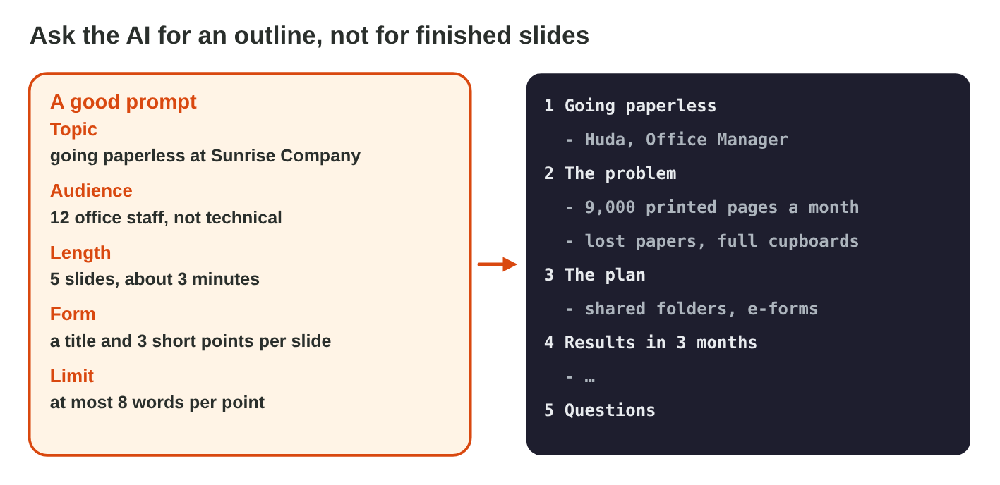
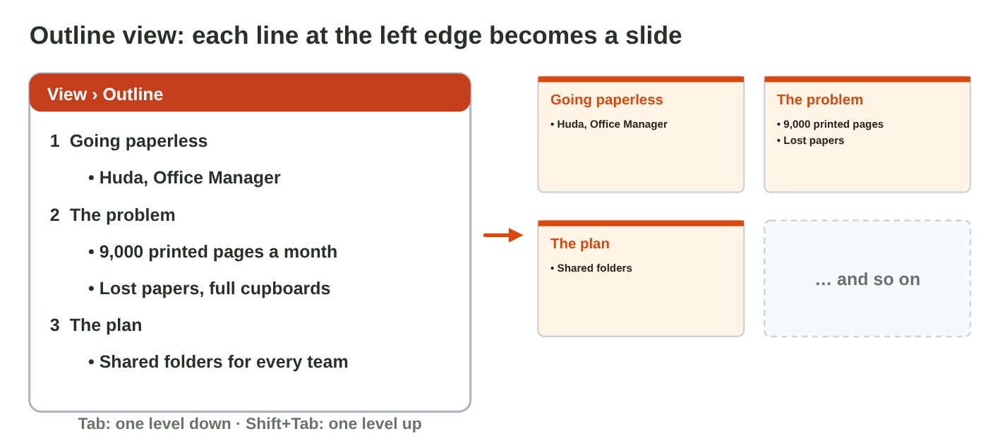
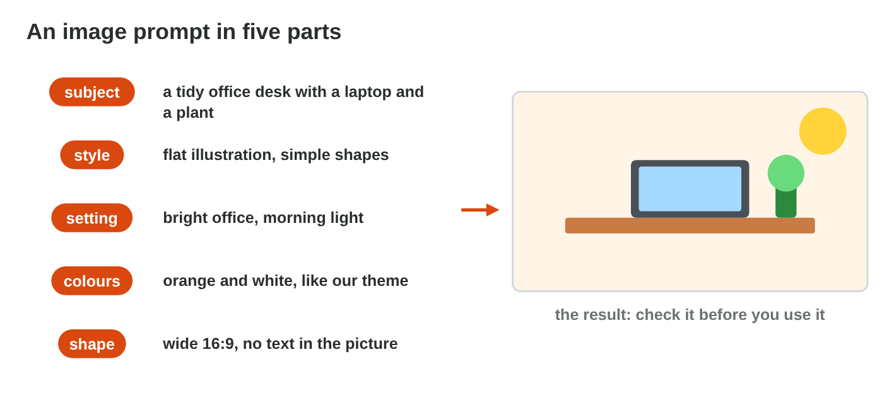
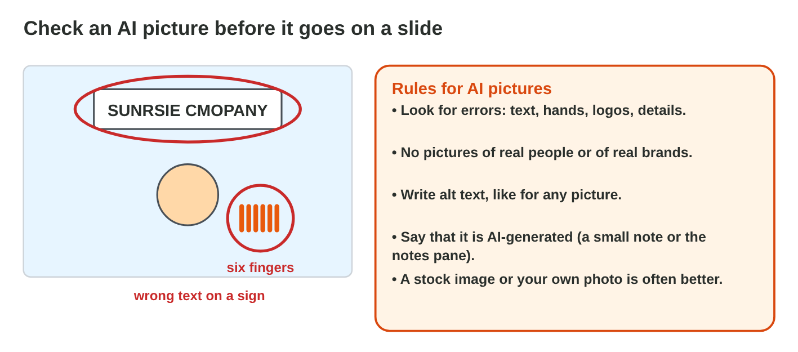
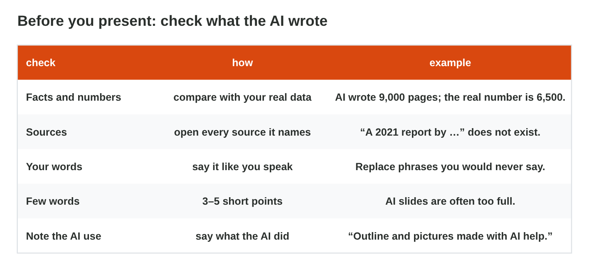

## Before you start {.study}

- **What you need:** PowerPoint (the desktop app, PowerPoint on the web at
  `office.com`, or the free phone app) and a free AI chat tool (for example
  Microsoft Copilot with your university account, ChatGPT or Gemini).
  An AI image tool is optional: stock images also work.
- **Time:** about 45 minutes. Work alone, at your own speed.
- **How it works:** do Steps 1–3 on this page. Each step has a short text, a
  figure and a quick check; Steps 1 and 2 have a simulator. Then do the
  **Tasks to submit**.
- **What you submit:** one PowerPoint file and two short answers, before
  lecture 9. Each Step shows how to do its task, with a model. You never
  write a prompt: you copy it and change only the topic.
- **You need Lectures 2 and 8:** what AI does well and where it fails;
  layouts, themes, few words and speaker notes.
- **Never type personal data into an AI tool**: no names or phone numbers
  of real people.

## Key terms {.study}



## Step 1 · From an AI outline to slides {.study}

- Ask an AI tool for an **outline**, not for finished slides.
- A good outline prompt has five parts: **topic**, **audience** (12 office
  staff, your classmates), **length** (5 slides, 3 minutes), **form** (a
  title and 3 points per slide) and a **limit** (at most 8 words per
  point). Add: "Do not invent numbers or sources."
- In PowerPoint, **View › Outline**: paste the outline. A line at the left
  edge is a **new slide**; **Tab** makes a line a point; **Shift + Tab**
  makes it a title again.
- Then choose a theme and the layouts (Lecture 8). Copilot in PowerPoint
  can also make slides, if your account has it.

{width=100%}

{width=100%}



::: {.callout-note title="Model · Rana's outline prompt and three slides"}
1. Rana copies this prompt into an AI chat:

   ::: {.prompt}
   Make an outline for a short talk about saving paper at the office, for
   12 office staff. 3 slides, about 2 minutes. Each slide: a title and 3
   points. At most 8 words per point. Do not invent numbers or sources.
   :::

2. In PowerPoint, she opens **View › Outline** and pastes the outline:
   three titles at the left edge, and their points with **Tab**.
3. She chooses one theme; slide 1 gets the layout **Title Slide**.
:::

::: {.callout-tip title="Try it 1 · The outline"}
Choose the right answer.

::: {.match extra="the font|Ctrl+P"}
"12 office staff, not technical": which part of the prompt is it?
:   the audience

    Why: It says who will listen to the talk.

"5 slides, about 3 minutes": which part of the prompt is it?
:   the length

    Why: It says how many slides and how much time.

"At most 8 words per point": which part of the prompt is it?
:   the limit

    Why: It keeps every point short.

Where do you paste an outline in PowerPoint?
:   View › Outline

    Why: In Outline view, every line at the left edge becomes a slide.

Which key makes a line a point under a title?
:   Tab

    Why: Tab moves the line one level in; Shift + Tab moves it back.
:::
:::

## Step 2 · A picture for a slide {.study}

- The best picture is free and true: a **stock image** (**Insert ›
  Pictures › Stock Images**) or your own photo.
- Put it next to the points, wide (16:9), and write its **alt text**: a
  few words that say what it shows (*a library with books*).
- An AI tool can also make a picture from an **image prompt**. Check it
  closely: letters, hands and logos are often wrong. Write
  "AI-generated" under it.

{width=100%}

{width=100%}



::: {.callout-tip title="Try it 2 · The picture"}
Use Image Prompt Lab. Choose the right answer.

::: {.match extra="a famous singer|tall 9:16"}
Which shape fits a picture next to the points?
:   wide 16:9

    Why: A wide picture fits next to the points on the slide.

What do you ask about text in the picture?
:   no text in the picture

    Why: AI pictures often get letters wrong; you type text on the slide.

Which note goes under an AI picture?
:   AI-generated

    Why: The audience knows that a tool made the picture.

The AI picture has wrong letters and odd hands. What do you do?
:   use a stock image

    Why: A stock image or your own photo has no such errors.
:::
:::

## Step 3 · Check before you present {.study}

- **Facts and numbers:** compare every number with your own data.
- **Sources:** open each one; delete a source that does not exist.
- **Your notes:** a short line in the Notes pane of each slide, with what
  you will say.
- **Few words** on the slides: 3–5 points of at most 8 words.
- **Honest:** a short note on the last slide says what the AI did.

{width=100%}

::: {.callout-tip title="Try it 3 · Five checks"}
Choose the check.

::: {.match extra="the theme|the transition"}
The AI wrote 9,000 pages; your notes say 6,500. Which check finds it?
:   facts and numbers

    Why: Every number must match your own data.

"Green Office Report 2021" cannot be found. Which check finds it?
:   sources

    Why: You open every source; a made-up one goes.

A slide has five long sentences. Which check finds it?
:   few words

    Why: A slide has 3–5 short points; you say the rest.

"Outline and pictures made with AI help." Which check is it?
:   the note on the AI use

    Why: It says honestly what the AI did.
:::
:::

## Tasks to submit {.tasks}

Do the tasks alone. Choose a topic you
know, for example *a study tip that works for me*, *a free app that helps
students* or *how our college can save paper*. Use no personal data of
other people.

### Task 1 · An outline from AI

Copy this prompt into an AI tool. Change only **[topic]**: write one of
*a study tip*, *a free app for students* or *saving paper at our college*.

::: {.prompt}
Make an outline of 3 slides for my classmates about [topic]. Each slide
has a title and 3 points of at most 8 words. Do not invent numbers or
sources.
:::

a) Which topic did you choose?



### Task 2 · Three slides

Make `my-ai-talk.pptx` from the outline with **View › Outline**: three
slides, one theme, the layout **Title Slide** for slide 1, and at most five
short points on a slide. Add a stock image to slide 2, with its alt text.
(Steps 1 and 2 show how.)

*Submit:* the file `my-ai-talk.pptx`.

### Task 3 · One check

b) Does the AI outline have a number or a source? Write **yes** or **no**.
If yes, write the website where you checked it. (Step 3 shows how.)



## How to submit

Upload `my-ai-talk.pptx` and your answers (a and b) to the university
e-learning platform, **before lecture 9**.
