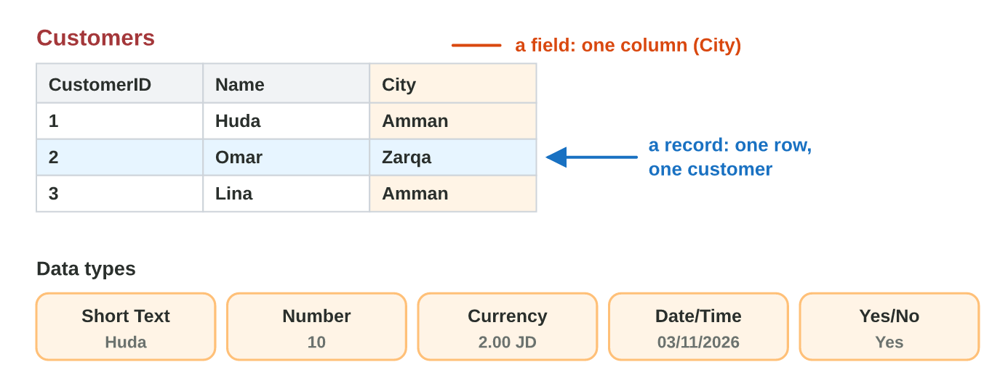
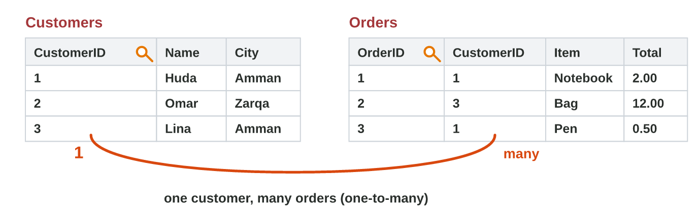
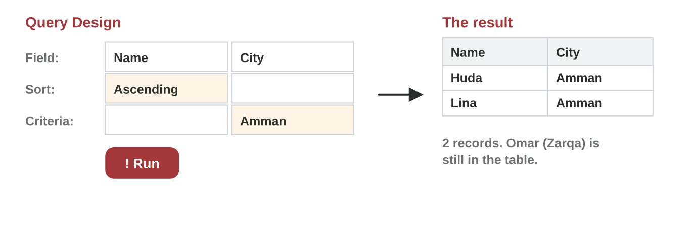

## Keywords



## A table: fields and data types

:::: {.columns}
::: {.column width="50%"}
- A database keeps data in tables, for example in Microsoft Access.
- A field is a column, and a record is a row.
- Each field has a data type, such as Short Text, Currency or Yes/No.
- A phone number is Short Text, because the 0 at the start must stay.
:::
::: {.column width="50%"}

:::
::::

## Live demo · A table



## Try it 1 · Tables

a) What is one row of the Customers table called?
b) Which data type is right for OrderDate (03/11/2026)?
c) Which data type is right for InStock (Yes or No)?

::: {.answer}
a) a record
b) Date/Time
c) Yes/No
:::

## The primary key and a relationship

:::: {.columns}
::: {.column width="50%"}
- The primary key has a different value in every record.
- CustomerID is the primary key of Customers.
- The Orders table has CustomerID too, so it joins the two tables.
- One customer can have many orders, so the relationship is one-to-many.
:::
::: {.column width="50%"}

:::
::::

## Live demo · The key



## Try it 2 · Keys

a) Students table: StudentID, Name, City. Which field is the primary key?
b) Which field joins Orders to Customers?
c) Huda has two orders. Which relationship is it?

::: {.answer}
a) StudentID
b) CustomerID
c) one-to-many
:::

## A query: a criterion and a sort

:::: {.columns}
::: {.column width="50%"}
- A query asks a table a question: Create › Query Design, then Run.
- A criterion chooses the records, for example City = Amman.
- A sort puts the records in order, ascending or descending.
- The table keeps all its records, because the query only hides some.
:::
::: {.column width="50%"}

:::
::::

## Live demo · A query



## Try it 3 · Queries

a) Which criterion shows the products that cost more than 5 JD?
b) Which sort puts the cheapest products first?
c) Huda, Omar and Lina: which customers does City = Amman show?

::: {.answer}
a) Price > 5
b) Price, Ascending
c) Huda and Lina
:::

## Summary

- A database keeps data in tables of fields (columns) and records (rows).
- Each field has a data type, such as Short Text, Number, Currency, Date/Time or Yes/No.
- The primary key is different in every record.
- A relationship joins two tables with the same field, one-to-many.
- A query shows only the records that you ask for, with a criterion and a sort.

## Your worksheet

:::: {.columns}
::: {.column width="50%"}
- In the computer lab, follow the worksheet alone, step by step, in Access.
- Five short tasks: a blank database, the fields of Customers, three records, a query, export to Excel.
- Nothing to download: you type the text yourself.
- Each step has a picture of the screen; tick each step when it is done.
- Then the Extra: on tutudocs.com an AI assistant adds customers to your exported table.
:::
::: {.column width="50%"}

:::
::::

## Results of the worksheet

What does your file show at the end?

::: {.reveal}
- Tasks 1–3: the table Customers has ID (the key), Name and City, and three records.
- Task 4: the query Amman customers shows Huda and Rana, sorted by name.
- Task 5: Customers.xlsx is in Documents.
:::

## Game challenge · The Data Desk



## Try it 4 · The shop database (harder)

The facts: Customers has CustomerID, Name and City. Orders has OrderID, CustomerID, Item and Total.

a) Which data type is right for Total (12.00 JD)?
b) Which field is in both tables?
c) Which query shows the customers of Amman from A to Z?

::: {.answer}
a) Currency
b) CustomerID
c) City = Amman, sort Name Ascending
:::
