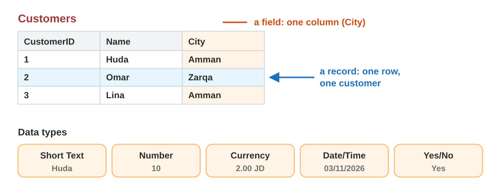
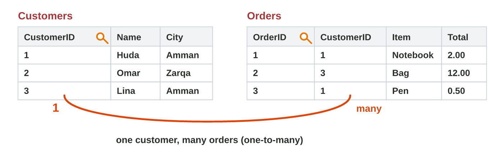
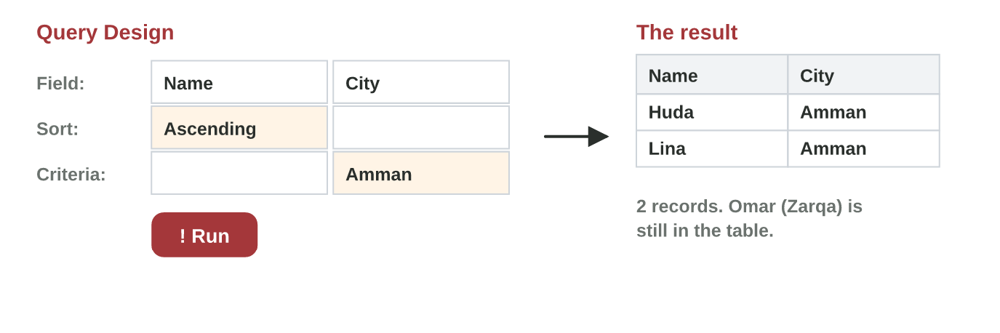

This page is the lecture, in class and at home. Each section explains one
idea, then shows its experiment. The page checks every step at once.

**In class, the teacher chooses the way for each experiment,** by the topic
and the time:

- **On the simulator** of the section, here on the page: nothing to
  install, and it works at home too.
- **In the real app** on the teacher's laptop, connected to the smart
  screen (HDMI): Microsoft Access, with the steps of **Part A**.
- **In the computer lab:** each student follows the **worksheet (PDF)**,
  Part A in Access and Part B on the simulator, and checks each result
  here.
- **You need:** Microsoft Access (Windows), or only the simulators of this
  page.

## Key terms



## 8.1 A table: fields and data types

- A **database** keeps data in **tables** (Microsoft Access).
- A **field** is a column (Name). A **record** is a row (one customer).
- Each field has a **data type**: Short Text, Number, Currency, Date/Time,
  Yes/No.

{width=100%}





::: {.callout-tip title="Try it 1 · Tables"}
Choose the right answer.

::: {.match extra="a query|Number"}
One row of the Customers table: Huda, Amman. What is it?
:   a record

    Why: A record is one row: all about one customer.

The field OrderDate (03/11/2026). Which data type?
:   Date/Time

    Why: A date is Date/Time, so Access sorts it in time order.
:::
:::

## 8.2 The primary key and a relationship

- The **primary key** is different in every record: **CustomerID**.
- The **Orders** table has CustomerID too. It joins Orders to Customers.
- **One** customer has **many** orders: one-to-many (1 — ∞).

{width=100%}





::: {.callout-tip title="Try it 2 · Keys"}
Choose the right answer.

::: {.match extra="Name|one-to-one"}
Students table: StudentID, Name, City. Which field is the primary key?
:   StudentID

    Why: Two students can have the same name or city; the ID never repeats.

Huda has two orders. What is the relationship of Customers and Orders?
:   one-to-many

    Why: One customer, many orders.
:::
:::

## 8.3 A query: a criterion and a sort

- A **query** asks a table a question: **Create › Query Design**, then
  **Run**.
- A **criterion** chooses the records: City = Amman, Price > 5.
- A **sort** puts them in order: Ascending (A to Z, small to big).

{width=100%}





::: {.callout-tip title="Try it 3 · Queries"}
The Products table: Notebook 2, Pen 0.50, Bag 12, Water 0.50, Juice 1,
Folder 1.50, Lunch box 6, Coffee 1 (JD). Choose the right answer.

::: {.match extra="Price < 5|Descending"}
You want only the products that cost more than 5 JD. Which criterion?
:   Price > 5

    Why: > means "more than".

You want the cheapest products first. Which sort on Price?
:   Ascending

    Why: Ascending puts the small prices first.
:::
:::

## Table of results



## Game challenge: the Data Desk at Sunrise Company {.challenge}

Huda's colleagues ask about the shop database: a key, a data type, a
query.



::: {.callout-tip title="Try it 4 · The shop database"}
The shop database has the tables Customers (CustomerID, Name, City) and
Orders (OrderID, CustomerID, Item, Total). Choose the right answer.

::: {.match extra="Short Text|Name"}
Which data type is right for Total (12.00 JD)?
:   Currency

    Why: Money is Currency.

Which field is in both tables?
:   CustomerID

    Why: It joins Orders to Customers.

(Harder) Which query shows the customers of Amman, A to Z?
:   City = Amman, sort Name Ascending

    Why: The criterion chooses Amman; Ascending sorts the names from A to Z.
:::
:::

## Summary {.summary}

- A database keeps data in tables: fields are columns, records are rows.
- Each field has a data type: Short Text, Number, Currency, Date/Time, Yes/No.
- The primary key is different in every record.
- A relationship joins two tables with the same field: one-to-many.
- A query shows only the records you ask for: a criterion and a sort.
