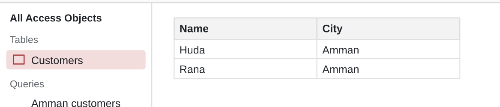

## Today in the lab

::: {.lab-plan}
1. **15 minutes, here:** the teacher shows each idea on a simulator, then
   in Access.
2. **35 minutes, in Access:** you follow the **worksheet**, step by
   step, on the lab computer. Nothing to download: you type the text
   yourself.
3. **At the end:** show your table to your teacher. Then the **Extra**: an
   AI assistant adds customers to your table (exported to Excel).
:::

{width=50%}

## Key terms



## 8.1 A table: fields and data types

### On the simulator

- A **table** holds one kind of thing: Customers. Each column is a **field**, each row a **record**.
- In **Design View** each field has a **data type**: **Short Text** for a name, **Number**, **Date/Time**…
- In **Datasheet View** you type the records.

::: {.sim-part}

:::

### In Access: worksheet Tasks 1 to 3

:::: {.word-part}
Open Access, then **Blank database**: the name **shop-** and your name, **Create**. Then the same steps as on the simulator:

::: {.screens}
![[1]{.step-n} **Blank database**. [2]{.step-n} The name. [3]{.step-n} **Create**.](images/lab-new-1.png)

![[1]{.step-n} **View ▾**. [2]{.step-n} **Design View**. [3]{.step-n} **Customers**. [4]{.step-n} **OK**.](images/lab-design-1.png)

![[1]{.step-n} **Name** and **City**. [2]{.step-n} **Short Text**. [3]{.step-n} The key of ID.](images/lab-fields-1.png)

![[1]{.step-n} **View** (Datasheet View). [2]{.step-n} Three customers.](images/lab-records-1.png)
:::
::::

::: {.callout-tip title="Try it 1 · Data types"}
Choose the right answer.

::: {.match extra="Number|Yes/No"}
Which data type for the field City?
:   Short Text

    Why: A city is a short text: a few letters.
:::
:::

## 8.2 The primary key and a relationship

### On the simulator

- The **primary key** has one value for each record, never the same twice: **ID** (AutoNumber). A small key shows it.
- A **relationship** joins two tables: the key **Customers.ID** goes with **Orders.CustomerID**.
- One customer has many orders: **one to many** (1 to ∞).

::: {.sim-part}

:::

### In Access: the key (Task 2)

:::: {.word-part}
Access gives **ID** the key by itself. The relationship is on the simulator only today.

::: {.screens}
![The small key [3]{.step-n}: **ID** is the primary key.](images/lab-fields-1.png)
:::
::::

::: {.callout-tip title="Try it 2 · The key"}
Choose the right answer.

::: {.match extra="Name|City"}
Which field is the best primary key of Customers?
:   ID

    Why: Two customers can have the same name or city, but never the same ID.
:::
:::

## 8.3 A query: a criterion and a sort

### On the simulator

- A **query** asks the table a question: **Create › Query Design**.
- Double-click the fields; a **criterion** (**Amman**) keeps only some records; **Sort** puts them in order.
- **Run** (!) shows the answer.

::: {.sim-part}

:::

### In Access: worksheet Task 4

:::: {.word-part}
::: {.screens}
![[1]{.step-n} **Create**. [2]{.step-n} **Query Design**. [3]{.step-n} Name and City.](images/lab-query-1.png)

![[1]{.step-n} Sort: **Ascending**. [2]{.step-n} Criteria: **Amman**. [3]{.step-n} **Run**.](images/lab-query-2.png)
:::
::::

## Extra: AI changes your table

### On the simulator

- On **tutudocs.com** you open your table, exported to Excel, with **no sign-in**.
- **AI Assistant**: ask for one change, for example: three more customers.
- **File › Download**, the Excel file (**.xlsx**).

::: {.sim-part}

:::

### On tutudocs.com: the Extra of the worksheet

:::: {.word-part}
::: {.screens}
![**tutudocs.com**: [1]{.step-n} click the box, then choose your table.](images/lab-tutu-1.png)

![[1]{.step-n} **AI Assistant**. [2]{.step-n} Your request. [3]{.step-n} The AI adds the customers.](images/lab-tutu-2.png)

![[1]{.step-n} **File**, [2]{.step-n} **Download**, [3]{.step-n} the **.xlsx** file.](images/lab-tutu-3.png)
:::
::::

## Now: your worksheet

::: {.lab-go}
Take your **worksheet** and do Tasks 1–5 in Access on the lab
computer, in order. Tick each step. Raise your hand when you are stuck,
and at the end. Finished? Do the **Extra**: on tutudocs.com an AI
assistant adds customers to your table (exported to Excel).
:::

## Summary {.summary}

- A table holds records (rows) and fields (columns); each field has a data type.
- The primary key (ID) has one value for each record.
- A relationship joins the key of one table to a field of another: one to many.
- Create › Query Design: the fields, a criterion, a sort, then Run.
- Export the table to Excel; on tutudocs.com (no sign-in) the AI Assistant changes it.
