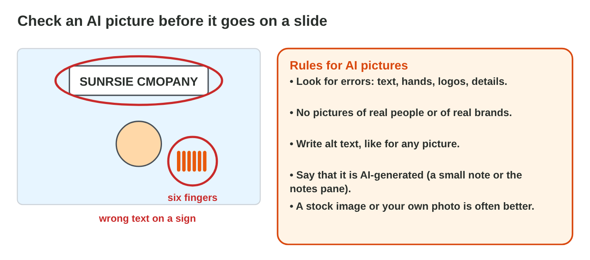

::: {.lead}
Huda, the office manager of *Sunrise Company*, has a plan: less paper in
the office. On Monday the plan goes to the staff in a short talk, and there
is only one hour to prepare it. An AI tool can help: it can suggest the
slides of the talk, and it can make a picture for a slide. But the first AI
answer says "we print 9,000 pages a month" (the real number is 6,500),
names a report that does not exist, and makes a picture with a sign that
says "SUNRSIE CMOPANY". In lectures 17 and 18 you made clear slides. In
this lesson you use AI to go faster: an **outline** first, then the
**slides**, then the **pictures**, and at every step you **check** what the
AI made. Every section ends with a lab task.
:::

## Key terms



## 19.1 An outline first

Do not ask the AI for "a presentation". Ask for an **outline**: the plan of
the talk, which you can check and change before you make slides
(@fig-prompt).

::: {.callout-important title="Definition 19.1 — An outline prompt"}
A **presentation outline** is the list of slide titles with their main
points. A good prompt for it gives the **topic**, the **audience**, the
**length** (number of slides, minutes), the **form** (a title and 3 short
points per slide) and a **limit** (at most 8 words per point). Use a free AI
chat tool (for example Microsoft Copilot with your university account,
ChatGPT or Gemini).
:::

{#fig-prompt width=100%}

::: {.callout-note title="Example 19.1 — Huda's prompt"}
"Write an outline for a 3-minute talk to 12 office staff, not technical:
*Going paperless at our office*. 5 slides. For each slide a title and at
most 3 points of at most 8 words. Do not invent numbers or sources."

The AI answers with five slides: Going paperless, The problem, The plan,
Results, Questions. Huda adds the real numbers from the office notes.
:::

::: {.callout-warning title="Common mistake"}
Putting names, phone numbers or other personal data of colleagues into the
prompt "to help the AI". The AI does not need them, and they leave your
computer. Describe roles ("12 office staff"), not people.
:::

::: {.callout-note title="Lab task · Your outline"}
1. Choose a topic from your own studies or work for a 3-minute talk.
2. Write an outline prompt with the five parts, and get an outline from an
   AI tool.
3. Copy the outline into a Word document and mark every number and every
   source that you must check.

*Your result:* a prompt and a checked outline.
:::

## 19.2 From the outline to slides

PowerPoint can turn an outline into slides: in **Outline view**, every line
at the left edge is a slide title (@fig-outline).

::: {.callout-important title="Definition 19.2 — Outline view"}
**View › Outline** shows the text of all slides. Paste the outline there:
a line at the left edge becomes a **new slide**; press **Tab** to make a
line a **point** of the slide above, and **Shift+Tab** to make it a title
again. Then choose a theme and the layouts (lecture 17). In Microsoft 365,
**Copilot in PowerPoint** can also make a first presentation from a prompt
or a Word file, if your account has it.
:::

{#fig-outline width=100%}

::: {.callout-note title="Example 19.2 — Five slides in two minutes"}
1. Huda opens a new presentation, clicks **View › Outline**, and pastes
   the outline.
2. "Huda, Office Manager" became its own slide: Tab makes it a point
   under the title. "E-forms instead of paper forms" also needs Tab.
3. Now there are 5 slides. A theme from the Design tab gives them one look.
:::



::: {.callout-warning title="Common mistake"}
Pasting the whole AI answer onto one slide, or making each slide with
copy and paste. Outline view does it in one step and uses the placeholders
of the layout.
:::

::: {.callout-note title="Lab task · Paste and fix"}
1. Paste your outline into **View › Outline** of a new presentation.
2. Use Tab and Shift+Tab until each slide has a title and its points.
3. Choose a theme. Save as `my-ai-talk.pptx`.

*Your result:* `my-ai-talk.pptx` with about five slides.
:::

## 19.3 Pictures with AI, and checking them

A picture helps the audience remember. An AI tool can make one from an
**image prompt** (@fig-imgprompt), but you must check it (@fig-aipic).

::: {.callout-important title="Definition 19.3 — Image prompt and AI pictures"}
An **image prompt** describes the picture in five parts: **subject**,
**style**, **setting**, **colours** and **shape** (16:9 for a slide). Ask
for **no text** in the picture. An **AI-generated image** can have errors:
wrong letters, extra fingers, strange details. Never make pictures of real
people or real brands. Write **alt text**, and add a small note that the
picture is AI-generated. A **stock image** (Insert › Pictures › Stock
Images) or your own photo is often a better choice.
:::

{#fig-imgprompt width=100%}

{#fig-aipic width=100%}

::: {.callout-note title="Example 19.3 — A picture for “The plan”"}
1. First prompt: "a picture of our company". The result has a sign with
   "SUNRSIE CMOPANY" and a person with six fingers.
2. Second prompt: "an office desk with a laptop and folders, flat
   illustration, orange and white, wide 16:9, no text in the picture".
3. The picture fits the theme. Alt text: "An office desk with a laptop and
   coloured folders." A small note: "Picture: AI-generated".
:::



::: {.callout-warning title="Common mistake"}
Using the first AI picture without looking closely. Zoom in: letters,
hands and logos are where the errors hide.
:::

::: {.callout-note title="Lab task · One picture"}
1. Write an image prompt with the five parts for one slide of your talk.
2. Make the picture with an AI image tool (or **Image Prompt Lab**), check
   it, and insert it. If it has errors, use a stock image instead.
3. Write its alt text and the note "AI-generated".

*Your result:* one checked picture with alt text.
:::

## 19.4 Check before you present

The talk is yours, not the AI's. Before you present, check it with five
questions (@fig-check).

::: {.callout-important title="Definition 19.4 — Five checks of an AI-made talk"}
1. **Facts and numbers:** compare them with your real data.
2. **Sources:** open every source; delete the ones you cannot find
   (**hallucinations**).
3. **Your words:** change phrases that you would never say.
4. **Few words:** 3–5 short points per slide (lecture 17).
5. **Honesty:** say in a short note what the AI did, for example "Outline
   and pictures made with AI help."
:::

{#fig-check width=100%}

::: {.callout-note title="Example 19.4 — Huda checks the talk"}
1. 9,000 pages → **6,500**, from the office notes.
2. "Source: Green Office Report 2021": no such report → **deleted**.
3. "Our goal" has five long sentences → three short points; the rest goes
   into the speaker notes.
4. The last slide: "Thank you! Outline and pictures made with AI help."
:::

::: {.callout-warning title="Common mistake"}
"The AI wrote it, so it is correct." AI tools write wrong numbers and
invent sources in a sure voice. You are responsible for every word you
present.
:::

::: {.callout-note title="Lab task · Check your talk"}
1. Check `my-ai-talk.pptx` with the five checks. Change at least one thing.
2. Add the note about the AI use on the last slide.

*Your result:* a checked `my-ai-talk.pptx`.
:::

## Case study: AI Deck Check

Before the Monday meeting, Huda checks the talk "Going paperless": a wrong
number from the AI, a source that does not exist, a picture with wrong
letters on a sign, a first prompt with the names and phone numbers of the
staff, a slide with five long sentences, and the question of how to say
that AI helped. The Game challenge of the interactive lesson uses this
talk. In the mini-game below you choose the best action for each problem.



::: {.callout-note title="Lab task · Upload"}
Upload `my-ai-talk.pptx` and your prompts (in a Word file) to the
e-learning platform.

*Your result:* two files.
:::

## Further reading

Microsoft Support, "Create a presentation with Copilot in PowerPoint",
"Create a presentation from an outline" and "Add alternative text to a
shape, picture, chart, SmartArt graphic, or other object"
(support.microsoft.com).

## Exercises

1. Why ask the AI for an outline and not for finished slides?
2. Name the five parts of a good outline prompt.
3. What does a line at the left edge become in Outline view?
4. Which key makes a line a point of the slide above?
5. Name the five parts of an image prompt.
6. Why ask for "no text in the picture"?
7. Name two errors to look for in an AI picture.
8. Why should you not make pictures of real people with AI?
9. The AI names a report that you cannot find. What do you do?
10. How do you tell the audience that AI helped?

## Answers to the exercises

::: {.answers}
1. An outline is short and easy to check and change before the slides.
2. Topic, audience, length, form, limit.
3. A new slide (its title).
4. Tab.
5. Subject, style, setting, colours, shape.
6. AI tools often write wrong letters.
7. For example wrong text, extra fingers, strange logos or details.
8. It can hurt them and break the law; use your own photo or a stock image.
9. Delete it: it is probably made up.
10. A short note, for example "Outline and pictures made with AI help."
:::
