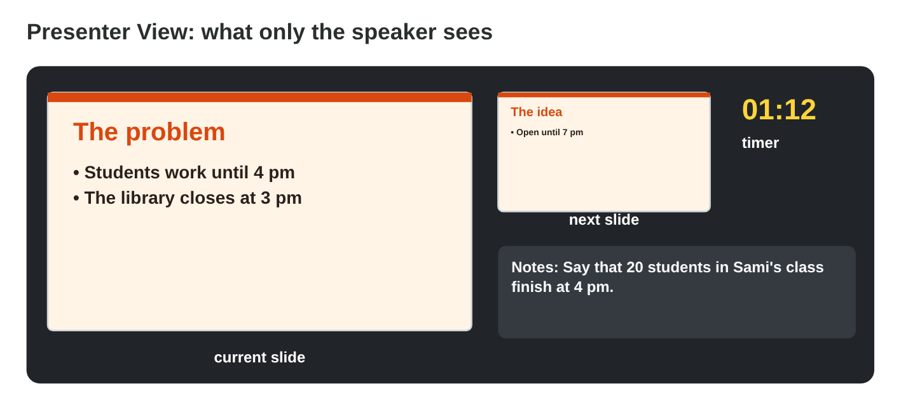

## Before you start {.study}

- **What you need:** PowerPoint (the desktop app, PowerPoint on the web at
  `office.com`, or the free phone app). Google Slides also works; the menu
  names are a little different.
- **Time:** about 60 minutes. Work alone, at your own speed.
- **How it works:** do Steps 1–2 on this page. Each step has a short text, a
  simulator and a self-check. Then do the **Tasks to submit**.
- **What you submit:** one PowerPoint file and two short answers, on the
  university e-learning platform, before lecture 9.
- **You need Lecture 8:** layouts, themes, few words on each slide, speaker
  notes, transitions and animations.

## Key terms {.study}



## Step 1 · Plan a five-slide talk {.study}

- A short talk of about **three minutes** needs about **five slides**, one
  idea on each.
- A good order: **1 Title** (topic, your name) › **2 The problem** › **3
  The idea** › **4 An example** (a number or a case) › **5 Thank you and
  questions**.
- Give each slide its time: the problem, the idea and the example take the
  most. The first and the last slide are short.
- Write the speaker notes of each slide before you rehearse.

{width=100%}



::: {.callout-tip title="Try it 1 · The plan"}
Use Talk Planner. Choose the right answer.

::: {.match extra="Thank you and questions first|10 minutes"}
Which slide comes right after the title?
:   the problem

    Why: First the audience hears the problem, then your idea.

Which slide gives a number or a case?
:   the example

    Why: An example makes the idea real, for example "20 students would come".

How long is Sami's whole talk?
:   about three minutes

    Why: Five slides of about 30–45 seconds make about three minutes.

How long is the last slide?
:   at most 30 seconds

    Why: "Thank you" is short; then the questions come.
:::
:::

## Step 2 · Rehearse with Presenter View {.study}

- In the slide show, **Presenter View** shows you the current slide, the
  next slide, your speaker notes and a **timer**. The audience sees only
  the slide.
- With a projector it opens by itself. On one screen: start the show,
  right-click › **Show Presenter View** (or **Alt + F5** in Windows).
- **Rehearse** twice. Watch the timer: is each slide close to its time?
  Where a slide is too long, say less; where it is too short, say your notes
  fully.
- Look at the audience, not at the notes: notes are short reminders.

{width=100%}



::: {.callout-note title="Lab task · Rehearse Sami's talk"}
In **Rehearsal Lab**, rehearse Sami's talk two times. The first time, press
Next slide quickly. The second time, keep each slide close to its plan.

::: {.check}
The first time, the list shows "too short" for most slides, and the total is
far below 3:00. The second time, every slide says "about right", and the
total is about 3:00 (the plan: 0:20, 0:45, 0:45, 0:45 and 0:25).
:::
:::

::: {.callout-tip title="Try it 2 · Rehearse"}
Choose the right answer.

::: {.match extra="on the slide in small letters|everybody"}
What does Presenter View show you?
:   the slide, the next slide, the notes and a timer

    Why: It helps you talk and keep the time.

Who sees the speaker notes in the slide show?
:   only the speaker

    Why: The audience sees only the slide.

Which keys open Presenter View on one screen in Windows?
:   Alt + F5

    Why: Alt + F5 starts the slide show with Presenter View.

Your rehearsal took 4 minutes for a 3-minute talk. What do you do?
:   say less, then rehearse again

    Why: The timer shows where you are too long.
:::
:::

## Tasks to submit {.tasks}

Do the tasks alone. Your teacher marks them (6 marks). Choose **one topic**
from your own life at the university, for example *a longer opening time
for the library*, *a quiet study room*, or *a study group for a hard
course*.

### Task 1 · Five clear slides (2 marks)

1. Make a new presentation `my-talk.pptx` with **five slides** in the order
   of Step 1. Use the right layouts (Title Slide for slides 1 and 5).
2. Use **one theme**, at most five short points per slide, and at least
   **one picture with alt text**.

### Task 2 · Transitions, an animation and notes (2 marks)

1. Add one quiet transition of 0.5–1 second with **Apply To All**, and an
   animation **By Paragraph** to the points of slide 3.
2. Write **speaker notes** on every slide (at least two sentences each):
   what you will say.

### Task 3 · Rehearse and answer (2 marks)

1. Rehearse the talk twice with Presenter View and its timer.

a) How long was your talk the second time? What did you change after the
first time?



b) Which slide was the hardest to keep short, and what did you move into the
notes?



## How to submit

Upload `my-talk.pptx` (five slides with notes) and your answers to Task 3
to the university e-learning platform, **before lecture 9**.
