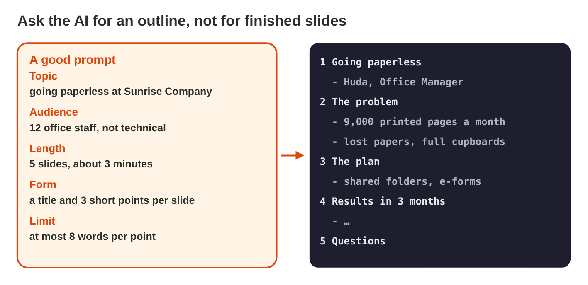
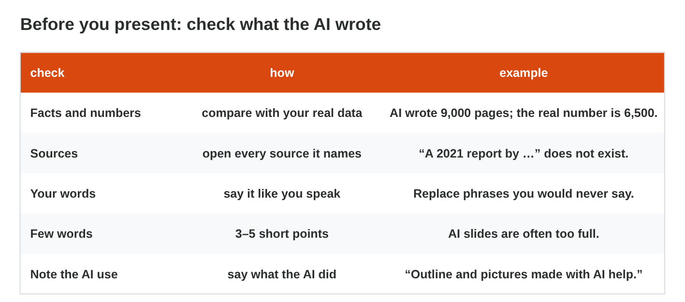

::: {.lead}
Today you use AI with PowerPoint, as in Lectures 2 and 8: you get an
outline for a short talk from an AI tool and check it, then you check an
AI-made deck slide by slide. There are no new ideas. The results are at the
end of this worksheet.
:::

## Recall

- **Lecture 2:** AI writes likely words, so it can invent a number or a
  source. You check every fact and number, and you never type personal
  data into an AI tool.
- **A clear prompt** has a task, a context and a format (Online activity 2).
- **Lecture 8:** one idea per slide, 3–5 points of about 8 words; Title
  Slide first, then Title and Content; a picture has alt text.

{width=100%}

::: {.callout-tip title="Try it 1 · Recall"}
Choose the right answer.

::: {.match extra="a theme|about 20 words"}
An AI answer names a report that nobody can find. What is it?
:   a hallucination

How many words should a point on a slide have?
:   about 8 or fewer

Which three parts make a clear prompt?
:   task, context and format
:::
:::

## Activity 1 · An outline from an AI tool

Huda, the office manager of Sunrise Company, must give a 3-minute talk,
"Going paperless", to 12 office staff. Her notes say: *we print 6,500 pages
a month; the plan is shared folders and e-forms; our goal is half the paper
in three months.*

::: {.callout-note title="Activity 1 · Huda's outline · 15 min"}
1. Ask an AI tool: *Make an outline of 5 slides for a 3-minute talk to 12
   office staff about going paperless. Each slide: a title and 3 points of
   at most 8 words. Do not invent numbers or sources.*
2. Mark every number and every source in the answer. Compare them with
   Huda's notes: correct a wrong number, and delete a source that you
   cannot open.
3. Cut every point to 8 words or fewer. Write the outline as five slides:
   Title Slide first, then Title and Content.

*Your product:* a checked outline of five slides.

::: {.check}
A good outline: 1 *Going paperless* (Huda, Office Manager); 2 *The
problem* (we print 6,500 pages a month); 3 *The plan* (shared folders,
e-forms); 4 *Our goal* (half the paper in three months); 5 *Questions?*

- ☐ Every number is from Huda's notes, for example 6,500, not 9,000.
- ☐ No source is left that you could not open.
- ☐ Every point has 8 words or fewer.
:::
:::

::: {.callout-tip title="Try it 2 · The outline"}
Choose the right answer.

::: {.match extra="keep it: the AI knows best|Two Content"}
The AI writes "We print 9,000 pages a month". Huda's notes say 6,500. What do you do?
:   correct it from the notes

The prompt says "12 office staff". Why not the names of the staff?
:   names are personal data

Which layout fits the first slide, "Going paperless"?
:   Title Slide
:::
:::

## Activity 2 · Check Huda's deck

An AI tool made Huda's six slides. Before the meeting on Monday, she checks
each slide: the numbers, the sources, the picture, the prompt, the amount
of text and a note about the AI help.

{width=100%}



::: {.callout-note title="Activity 2 · Ready for Monday? · 12 min"}
1. Play **AI Deck Check**. For each slide, choose the best fix.
2. Write the six fixes, one short line each.

*Your product:* six fixes, one for each slide.

::: {.check}
The six fixes: correct 9,000 to 6,500 (Huda's notes); delete the made-up
"Green Office Report 2021"; use a picture without text and type the name
on the slide; take the names and phone numbers out of the prompt; keep 3–5
short points on "Our goal" and say the rest; add a short note: "Outline
and pictures made with AI help".
:::
:::

::: {.callout-tip title="Try it 3 · Huda's deck"}
Use AI Deck Check. Choose the right answer.

::: {.match extra="make the font smaller|say nothing"}
The AI picture shows "SUNRSIE CMOPANY" on a sign. What is the fix?
:   a picture without text; type the name on the slide

The slide "Our goal" has five long sentences. What is the fix?
:   keep 3–5 short points, say the rest

How does Huda tell the staff that AI helped?
:   a short note: outline and pictures made with AI help
:::
:::

## Exercises

1. Which words in a prompt stop the AI from adding numbers or sources of its own?
2. An AI outline gives "Source: City Office Study 2020". You cannot find it anywhere. What do you do?
3. Why do you ask for "no text in the picture" from an AI image tool?
4. A prompt has the names and phone numbers of the staff. What is wrong?
5. What does a short note on the last slide say about AI?

## Answers to the exercises

::: {.answers}
1. "Do not invent numbers or sources."
2. Delete it: it is a made-up source.
3. AI pictures often get letters wrong; you type the text on the slide.
4. Personal data does not go into a prompt.
5. What the AI did, for example "Outline and pictures made with AI help".
:::
