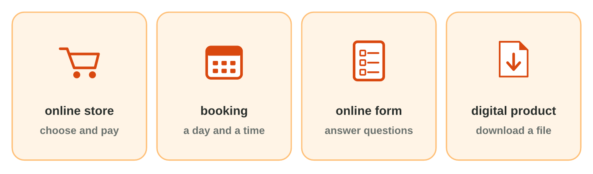
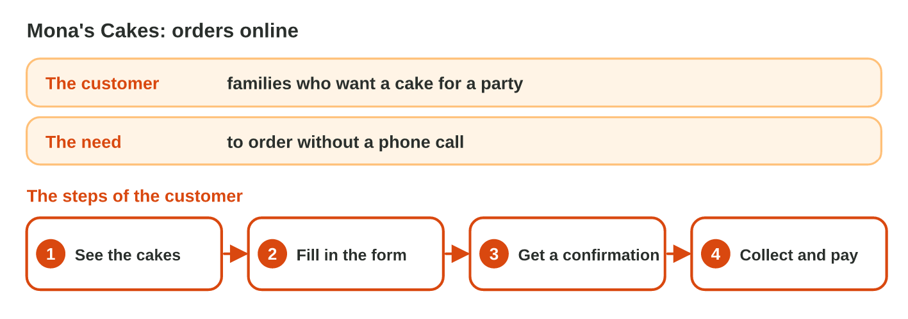
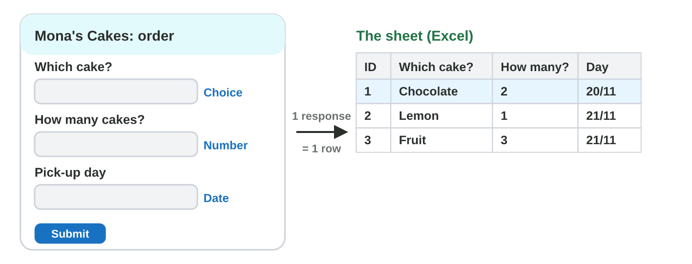

This page is the lecture, in class and at home. Each section explains one
idea, then shows its experiment. The page checks every step at once.

**In class, the teacher chooses the way for each experiment,** by the topic
and the time:

- **On the simulator** of the section, here on the page: nothing to
  install, and it works at home too.
- **In the real app** on the teacher's laptop, connected to the smart
  screen (HDMI): Microsoft Forms and Word, with the steps of **Part A**.
- **In the computer lab:** each student follows the **worksheet (PDF)**,
  Part A in the apps and Part B on the simulator, and checks each result
  here.
- **You need:** your university account (Microsoft Forms at
  `forms.office.com`, Word) and the start file, or only the simulators of
  this page.

## Key terms



## Before you start



## 8.1 Kinds of digital services

- A **digital service** is used on the Internet.
- **Online store:** choose products and pay. **Booking:** choose a day and
  a time.
- **Online form:** answer questions (an order, a survey). **Digital
  product:** a file to download.

{width=100%}





::: {.callout-tip title="Try it 1 · Kinds"}
Choose the right kind.

::: {.match extra="a digital product|a report"}
Green Bites: choose lunch boxes and pay by card.
:   an online store

    Why: Products and an online payment.

The training room, reserved for one hour.
:   a booking

    Why: A room for a day and a time.
:::
:::

## 8.2 A plan: the customer, the need, the steps

- Before you build, write a short **plan**.
- **The customer:** who uses the service. **The need:** the problem it
  solves.
- **The steps:** what the customer does, in order.

{width=100%}





::: {.callout-tip title="Try it 2 · Plans"}
Fix It repairs phones. Choose the right answer.

::: {.match extra="the repair shop|a new phone"}
Who is the customer of Fix It?
:   people with a broken phone

    Why: The customer is the person who uses the service.

What is the need?
:   to book a repair without waiting in the shop

    Why: The need is the problem that the service solves.
:::
:::

## 8.3 An order form linked to a spreadsheet

- An **online form**: Microsoft Forms or Google Forms.
- Each question has a **type**: Choice, Text, Number or Date.
- Each **response** becomes **one row** of a spreadsheet.

{width=100%}





::: {.callout-tip title="Try it 3 · Forms"}
Choose the right answer.

::: {.match extra="Date|one row for all"}
The customer chooses Small, Medium or Large. Which question type?
:   Choice

    Why: The customer taps one of the options.

Twenty customers send the form. How many rows of answers are in the sheet?
:   20

    Why: Each response is one row.
:::
:::

## Table of results



## Game challenge: the Service Desk at Sunrise Company {.challenge}

Huda's colleagues plan their digital services: the kind, the plan, the form.



::: {.callout-tip title="Try it 4 · Services"}
Omar wants online orders of notebooks; Lina reserves the training room for
one hour; Sami's form asks "How many boxes?". Choose the right answer.

::: {.match extra="Text|a digital product"}
Which kind of service does Omar need?
:   an online store

    Why: Customers choose products and pay.

Which question type is right for Sami's question?
:   Number

    Why: A number that he can add up.

(Harder) Ten people book the room. Where does Lina see all the bookings?
:   in the sheet of the responses

    Why: Each booking is one row of the sheet.
:::
:::

## Summary {.summary}

- A digital service is used on the Internet: a store, a booking, a form, a digital product.
- Plan first: the customer, the need, the steps.
- An online form has questions of a type: Choice, Text, Number, Date.
- Each response is one row of the sheet of the form.
