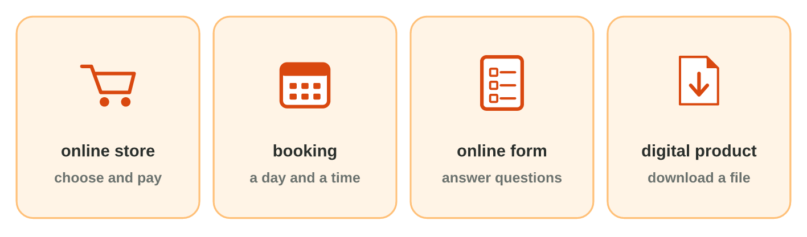
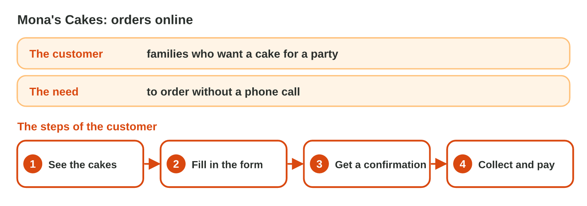
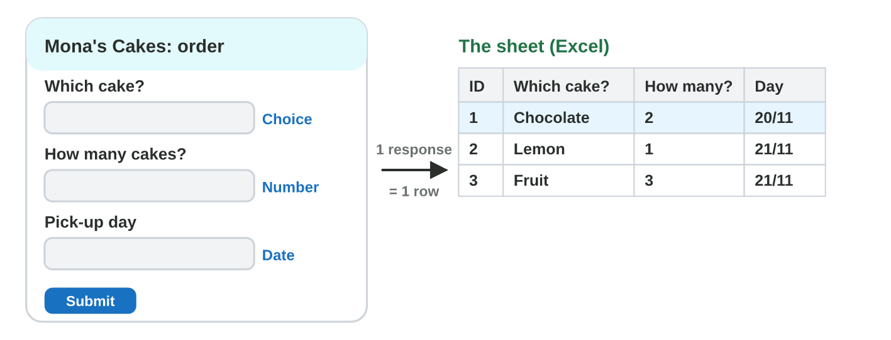

::: {.lead}
Mona makes cakes at home. Her customers phone her, and she writes the
orders on paper. Some orders get lost, and the phone rings during her
work. A small **digital service** solves it: the customers order with an
online form, and every order goes into a spreadsheet by itself. In this
lesson you learn the kinds of digital services, how to plan one, and how
to build its form. These notes are a short reference: in class you do each
idea in the apps, as an experiment of the **worksheet**.
:::

## Key terms



## 9.1 Kinds of digital services

A **digital service** is a service that customers use on the Internet,
from a phone or a computer: day and night, without a visit or a phone call
(@fig-kinds).

| Kind | The customer … | Example |
|---|---|---|
| online store | chooses products and pays online | Green Bites lunch boxes |
| booking | chooses a day and a time | Fix It phone repair |
| online form | answers questions | an order form, a survey |
| digital product | downloads a file | an e-book, slide designs |

: Four kinds of digital services. {#tbl-kinds}

{#fig-kinds width=100%}

::: {.callout-important title="Definition 9.1 — Digital service"}
A **digital service** is a service that customers use on the Internet,
such as an online store, a booking, an online form or a digital product.
:::

::: {.callout-note title="Example 9.1 — Three services of Sunrise Company"}
1. The online shop of notebooks and bags: an online store.
2. The training room, reserved for one hour: a booking.
3. The survey of the canteen: an online form.
:::



*In class: Experiment 1 of the worksheet, the templates of Microsoft Forms
and the kinds of services.*

## 9.2 A plan: the customer, the need, the steps

Before you build a service, write a short **plan** of three parts
(@fig-plan):

- **The customer:** who uses the service (families who want a cake).
- **The need:** the problem that the service solves (to order without a
  phone call).
- **The steps:** what the customer does, in order (see the cakes, fill in
  the form, get a confirmation, collect and pay).

{#fig-plan width=100%}

::: {.callout-note title="Example 9.2 — Fix It"}
1. The customer: people with a broken phone.
2. The need: to book a repair without waiting in the shop.
3. The steps: choose the day, fill in the booking form, get a confirmation,
   bring the phone.
:::

::: {.callout-warning title="Common mistake"}
Starting with the colours of the page. The plan comes first: who, what
need, which steps. The design comes later (Lecture 10).
:::



*In class: Experiment 2 of the worksheet, the plan of Mona's service in
Word.*

## 9.3 An order form linked to a spreadsheet

The heart of Mona's service is the order form (@fig-form).

- **Microsoft Forms** (`forms.office.com`, your university account) or
  **Google Forms** makes an online form.
- Each question has a **type**: **Choice** (the customer taps an option),
  **Text**, **Number** (Text with the restriction Number) or **Date**.
- Every **response** (one filled-in form) becomes **one row** of a
  spreadsheet: **Responses › Open results in Excel** (in Google Forms: Link
  to Sheets).
- **Collect responses** gives the **link** and a **QR code** of the form,
  to share.

{#fig-form width=100%}

::: {.callout-note title="Example 9.3 — Mona's order form"}
1. Questions: *Your name* (Text), *Which cake?* (Choice: Chocolate, Lemon,
   Fruit), *How many cakes?* (Number), *Pick-up day* (Date).
2. Sara orders 2 chocolate cakes for 20/11. Her order is row 2 of the
   sheet.
3. In the evening Mona opens the sheet and sees every order of the day.
:::

::: {.callout-warning title="Common mistake"}
A Text question for a choice. Customers write "choco", "Chocolate cake",
"chocolat": the sheet cannot count them. Use Choice.
:::



*In class: Experiment 3 of the worksheet, Mona's order form in Microsoft
Forms and its sheet in Excel.*

## Case study: the Service Desk at Sunrise Company

Huda's colleagues plan their services. Omar wants online orders of
notebooks. Lina reserves the training room for one hour at a time. Sami's
form asks "How many boxes?". Ten customers sent Omar's form. In the
mini-game below, you answer eight such messages.



## Further reading

Evans, Martin and Poatsy, *Technology in Action*, the chapter on the
Internet and e-commerce. Microsoft 365 Training
(support.microsoft.com/training): Microsoft Forms, create a form.

## Exercises

1. Customers choose a day and a time for a haircut. Which kind of service?
2. An e-book that you download is … (an online store or a digital product)?
3. Which part of a plan says who uses the service?
4. Put in order: fill in the form · see the cakes · collect the cake · get a confirmation.
5. Which question type for "Pick-up day"?
6. Which question type for "Which size? Small, Medium, Large"?
7. Twelve customers send the form. How many rows of answers are in the sheet?
8. How do customers open the form on their phones: a link or a USB stick?

## Answers to the exercises

::: {.answers}
1. A booking.
2. A digital product.
3. The customer.
4. See the cakes · fill in the form · get a confirmation · collect the cake.
5. Date.
6. Choice.
7. 12.
8. A link (or its QR code).
:::
