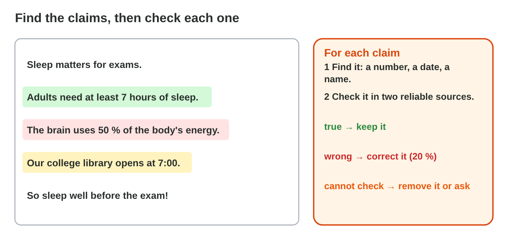
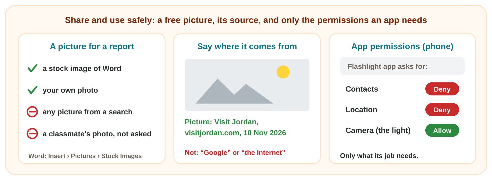
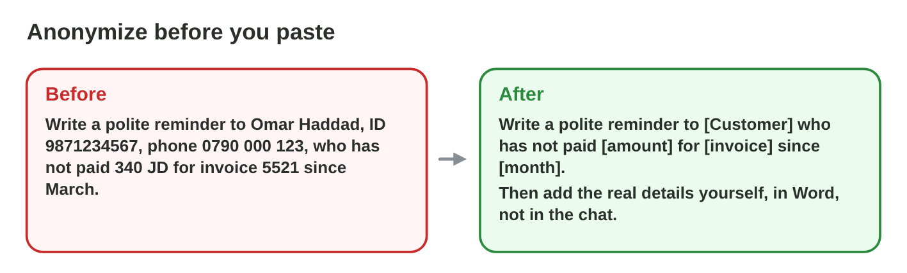
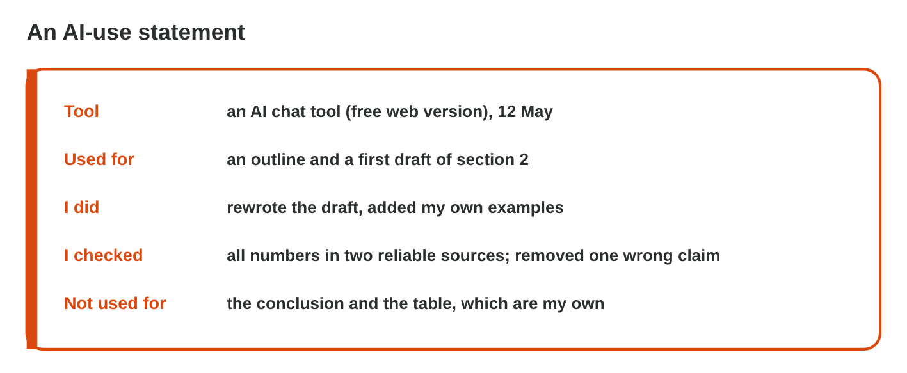

::: {.lead}
A message in the class group says that the highest mountain in Jordan is
Jabal Ram. Rana needs a picture for her report. A new flashlight app asks
Omar for his contacts. Huda almost pastes a customer's name and bank
details into an AI chat. Every day we check what we read and decide what
we share. In this lesson you **check** a claim in reliable sources, you
**share and use** pictures and apps safely, and you use AI **safely and
honestly**. These notes are a short reference: in class you test each
idea, as an experiment of the **worksheet**.
:::

## Key terms



## 9.1 Check a claim in two sources

A **claim** is a sentence that can be checked: a number, a date, a name, a
quote, "studies show". A claim can come from a message, a website or an AI
answer. Checking means finding the claims and comparing each one with
**reliable sources** (@fig-claims).

::: {.callout-important title="Definition 9.1 — Fact-checking"}
1. **Find** the claims: numbers, dates, names, quotes, "studies show".
2. **Check** each one in **two reliable sources**: an official
   organisation, a university, an encyclopedia, a known newspaper. Open
   other pages about the claim instead of trusting one page (**lateral
   reading**).
3. **Decide:** true → keep; wrong → correct it with the source; cannot
   check → remove it.

A source in a text needs three checks: search its **title**, search its
**authors** and the journal or website, and **open the link**. If they
fail, it is a **made-up source**: delete it, or find a real one.
:::

{#fig-claims width=100%}

::: {.callout-note title="Example 9.1 — Sami's draft"}
1. "Adults need at least 7 hours of sleep": a national health site and an
   encyclopedia agree → **keep**.
2. "The brain uses 50 % of the body's energy": a university page and a
   science magazine say about 20 % → **correct**.
3. "Students who sleep 8 hours get 25 % better marks (Miller & Hart,
   2019)": the title search finds nothing, and the journal does not exist →
   a made-up source: **remove**.
:::



::: {.callout-warning title="Common mistake"}
Checking the AI with the same AI ("Are you sure?"). It may agree with
itself, or change its answer without a reason. Check with sources outside
the AI.
:::

An AI text can also be unfair: **bias** is an unfair idea that the AI
repeats from its data, for example "every nurse is a woman". Check who the
text shows, and how, and correct it.

*In class: Experiment 1 of the worksheet, a claim from a message checked in two sources, and six claims decided in Fact-Check Lab.*

## 9.2 Share and use safely

What we share and use online has rules (@fig-share).

- **Personal data of others.** A phone number, an ID number, an address,
  the grades or the photo of another person are not shared without their
  permission. Crop or cover them in a screenshot.
- **Pictures and copyright.** A picture on a website belongs to its owner.
  Use a free picture: Word's **Insert › Pictures › Stock Images**, or your
  own photo. For another picture, ask, and add a **source line** under it:
  *who, where, when*.
- **App permissions.** An app asks to use your camera, contacts or
  location. Give it only what its job needs: a map needs your location, a
  flashlight does not. Phone: **Settings › Apps › (the app) ›
  Permissions** (iPhone: **Settings › Privacy**).

::: {.callout-important title="Definition 9.2 — Copyright and a source line"}
**Copyright** protects the work of its owner: a text, a picture, a song. A
**source line** names who made it, where you found it and when: *Picture:
Visit Jordan, visitjordan.com, 10 Nov 2026*.
:::

{#fig-share width=100%}

::: {.callout-note title="Example 9.2 — Rana's report and Omar's app"}
1. Rana needs a picture of a library. She uses **Insert › Pictures › Stock
   Images**: free to use.
2. She also uses a photo of Petra from *Visit Jordan*. Under it she types
   *Picture: Visit Jordan, visitjordan.com, 10 Nov 2026*.
3. Omar's new flashlight app asks for his contacts and his location. He
   chooses **Deny** for both: a flashlight needs neither.
:::

::: {.callout-warning title="Common mistake"}
"Picture: Google." Google only finds pictures; it does not own them. Name
the website of the picture, or use a free one.
:::

*In class: Experiment 2 of the worksheet, a free picture and a source line in Word, and the permissions of an app on the phone.*

## 9.3 AI: a safe prompt and an honest statement

Whatever you paste into a prompt leaves your computer: it goes to the
company that runs the tool.

::: {.callout-important title="Definition 9.3 — Personal data and anonymizing"}
- **Personal data:** anything about a person who can be identified: a name
  with a phone number, an e-mail, an ID number, an address, a birthday.
- **Sensitive data:** data that can harm a person: health, salary,
  passwords, bank details.
- **Confidential information:** company or university secrets: customer
  lists, contracts, exam questions.

**Anonymize** before you paste: replace names and details with
**placeholders** such as [Customer] or [amount], and add the real details
yourself later, outside the AI tool (@fig-anon).
:::

{#fig-anon width=100%}

- Check the **settings** of the tool: does it save the chat history, and
  does it use your chats for training? Switch it off if you can.
- Use the university or work account if there is one, and follow the AI
  rules of your course or company.

::: {.callout-note title="Example 9.3 — Huda's reminder"}
1. Huda's first prompt contains the customer's name, e-mail address and the
   company's bank account.
2. Huda replaces them with [Customer], [e-mail] and [bank account]. The
   amount and the month can stay: without the name, they say nothing about
   a person, and the AI needs them.
3. The AI writes the reminder; Huda pastes it into Outlook and adds the
   real name and account there.
:::



::: {.callout-warning title="Common mistake"}
"I will delete the chat afterwards." The text may already be stored or
used by the provider. Anonymize **before** you paste.
:::

### Honest AI use: the AI-use statement

At work and at university, people must be able to trust that your work is
yours, and that you may use what you share (@fig-statement).

::: {.callout-important title="Definition 9.4 — Copyright and honest AI use"}
- **Copyright** also holds for AI: upload only files you may share; a paid
  e-book is not yours to upload.
- **Plagiarism** is presenting someone else's work, also AI-written text,
  as your own.
- An **AI-use statement** says which **tool** you used, for **what**, what
  **you changed** and how **you checked** it. Keep your drafts and prompts:
  they show your own work.
:::

{#fig-statement width=100%}

::: {.callout-note title="Example 9.4 — Sami's report"}
1. The course allows AI for ideas and drafts if it is stated.
2. Sami used an AI chat tool for an outline and a first draft, then
   rewrote the text and checked every number in two reliable sources.
3. At the end Sami writes: "I used an AI chat tool for an outline and a
   first draft. I rewrote it in my own words. I checked every fact in two
   reliable sources."
:::

::: {.callout-warning title="Common mistake"}
A statement that only says "AI was used." It must say **for what** and
**how you checked it**; otherwise nobody knows which parts are yours.
:::

*In class: Experiment 3 of the worksheet, a clean prompt with placeholders, an AI-use statement under the AI's message, and Prompt Cleaner.*

## Case study: Responsible or Not?

Six people at Sunrise Company and the college share, use and make things
online this week. Huda shares a screenshot of the class chat that shows
Sami's phone number. Sami asks an AI to write a whole essay and hands it in
as Sami's own work. Rana needs a picture of a library for a report. Huda
pastes the staff salary list with names into a free AI chat to make a
chart. A new flashlight app asks Omar for his contacts and his location.
Sami asks an AI to explain a hard topic, then writes notes in Sami's own
words. In the mini-game below you judge each case.



## Further reading

UNESCO, *Guidance for Generative AI in Education and Research*, 2023, the
parts on checking AI output and on privacy. Evans, Martin and Poatsy,
*Technology in Action*, 18th ed., the chapters on digital privacy and on
artificial intelligence.

## Exercises

1. In how many reliable sources do you check a claim?
2. What do you do with a claim that you cannot check?
3. A text says "Every nurse is a woman." What is it: a fact or bias?
4. Can you share a classmate's photo without asking? (yes / no)
5. Where are the free pictures in Word?
6. Which source line is right: "Picture: Google" or "Picture: Visit
   Jordan, visitjordan.com, 10 Nov 2026"?
7. A calculator app asks for your location. Allow or deny?
8. What do you write in a prompt instead of a real name?
9. What is plagiarism: your own work, or someone else's work shown as yours?
10. Name the four parts of an AI-use statement.

## Answers to the exercises

::: {.answers}
1. Two.
2. Remove it.
3. Bias.
4. No.
5. Insert › Pictures › Stock Images.
6. Picture: Visit Jordan, visitjordan.com, 10 Nov 2026.
7. Deny.
8. A placeholder, for example [name].
9. Someone else's work, also AI-written text, shown as yours.
10. The tool, what it was used for, what you changed, and how you checked it.
:::
