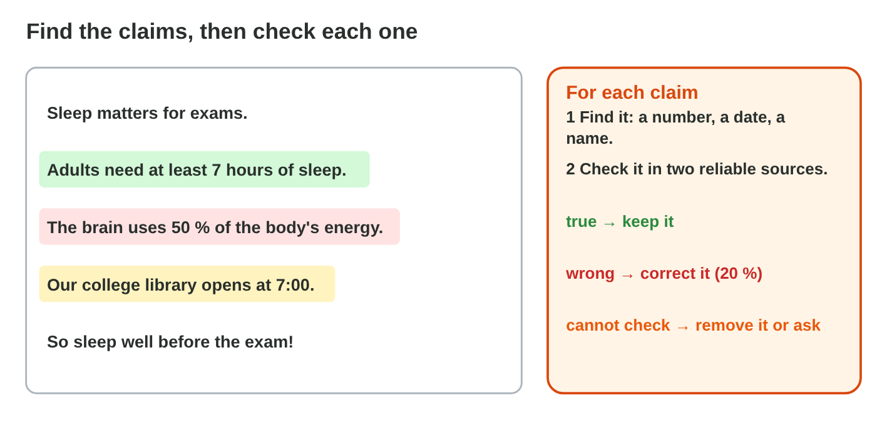
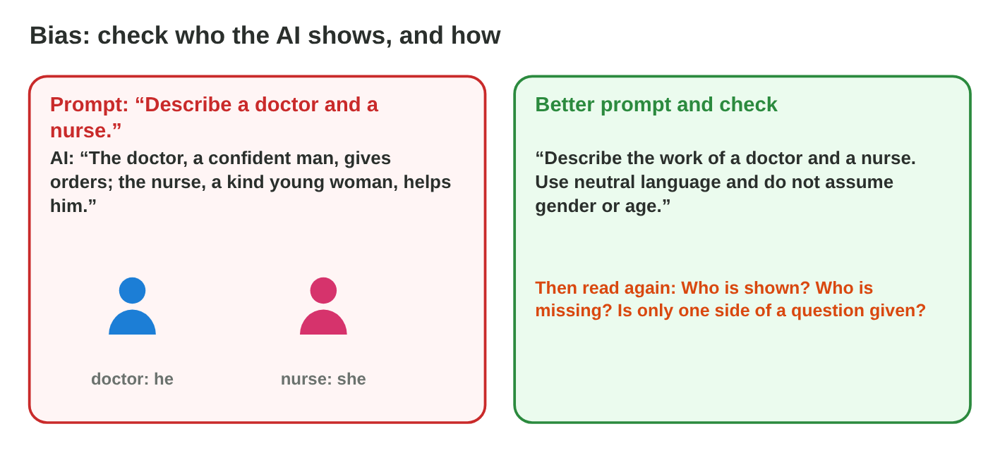
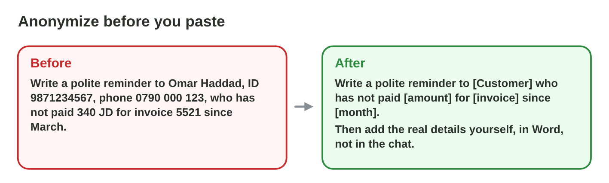
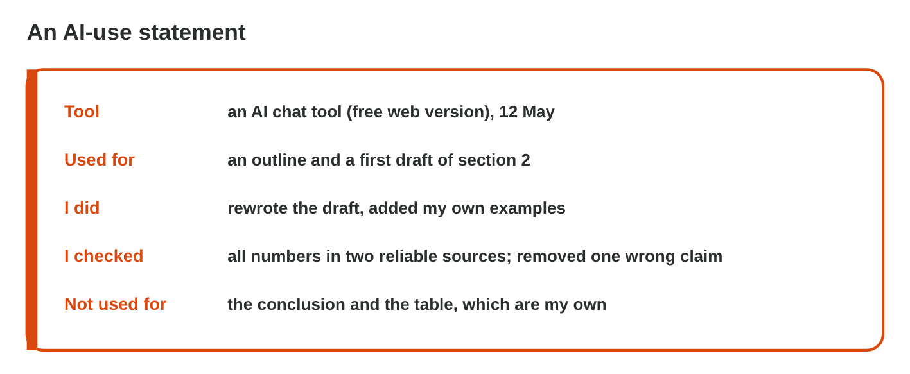

## Keywords



## Check the claims and the sources

:::: {.columns}
::: {.column width="50%"}
- A claim is a sentence that can be checked: a number, a date, a name or a fact.
- You check each claim in two reliable sources that agree.
- An AI can give a made-up source, so you search its title, its authors and its link.
- If one check fails, you delete the source.
:::
::: {.column width="50%"}

:::
::::

## Live demo · Fact-Check Lab



## Try it 1 · Claims and sources

a) In how many reliable sources do you check a claim?
b) "Einstein said: Sleep is the best study." Nothing reliable shows it. What do you do?
c) The title, the authors and the link all fail. What is the source?

::: {.answer}
a) two
b) Remove it.
c) a made-up source
:::

## Bias in AI texts

:::: {.columns}
::: {.column width="50%"}
- Bias is an unfair idea from the AI's data, like "the nurse, she".
- You check who the text shows, and how.
- You ask for neutral language and for different people.
- For an opinion, you ask for both sides with reasons.
:::
::: {.column width="50%"}

:::
::::

## Live demo · Bias Lab



## Try it 2 · Fair texts

a) What do you ask for when the AI writes "the doctor is a confident man, the nurse a kind young woman"?
b) What do you ask for after "Working from home is always better"?
c) What do you ask for after "We need a strong young man for the warehouse"?

::: {.answer}
a) neutral language
b) both sides with reasons
c) Describe the job, not the person.
:::

## Keep personal data out of prompts

:::: {.columns}
::: {.column width="50%"}
- Names, phone numbers, addresses, ID numbers and grades are personal data.
- You replace them with placeholders like [Customer] before you paste.
- You keep what the AI needs: the amount, the day or the problem.
- Company lists and sick notes stay out of free AI tools too.
:::
::: {.column width="50%"}

:::
::::

## Live demo · Prompt Cleaner



## Try it 3 · Personal data

a) A customer's name and address. What are they?
b) "340 JD", once the name is replaced. Can it stay in the prompt?
c) What do you put in place of a phone number?

::: {.answer}
a) personal data
b) yes
c) a placeholder, like [phone]
:::

## Copyright and honesty

:::: {.columns}
::: {.column width="50%"}
- Texts, pictures and books are protected by copyright.
- AI text handed in as your own work is plagiarism.
- An AI-use statement names the tool, what the AI did, what you changed and how you checked.
- Your drafts and prompts show your own work if somebody asks.
:::
::: {.column width="50%"}

:::
::::

## Try it 4 · Honest work

a) What are the four parts of an AI-use statement?
b) A colleague wants to rework a paid e-book with AI. Is it allowed?
c) AI text is handed in as your own work. What is it?

::: {.answer}
a) the tool, the use, the changes and the checks
b) not without permission
c) plagiarism
:::

## Summary

- You check each AI claim in two reliable sources, and you delete made-up sources.
- Bias is an unfair idea, so you ask for neutral language and both sides.
- Personal data stays out of prompts, with placeholders in its place.
- Copyright protects other people's work.
- An AI-use statement says the tool, the use, the changes and the checks.

## Your worksheet

:::: {.columns}
::: {.column width="50%"}
- In the computer lab, do the three experiments of the worksheet alone.
- Part A is in an AI assistant, a search engine and Word.
- Part B is on a simulator or the game Responsible or Not?: scan its QR code or click its link.
- Never type personal data into the AI, and write your result after each step.
:::
::: {.column width="50%"}

:::
::::

## Results of the worksheet

Which results do you have in your table?

::: {.reveal}
- Experiment 1: Jabal Umm al-Dami, about 1 850 m, from two sources, and the six claims of Fact-Check Lab are decided.
- Experiment 2: The fair advert in Word describes the job, and each request of Bias Lab gets its instruction.
- Experiment 3: The prompt has [neighbour], [phone] and [address], and the statement names the tool, the use, the changes and the check.
:::

## Game challenge · Responsible or Not?


