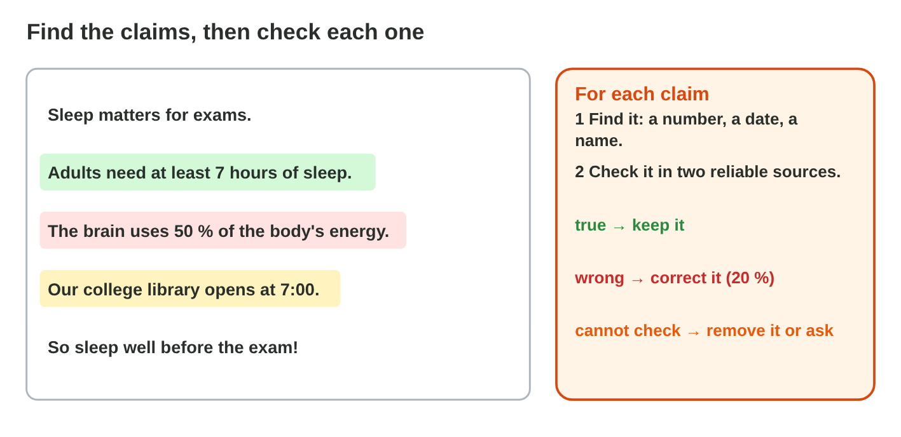
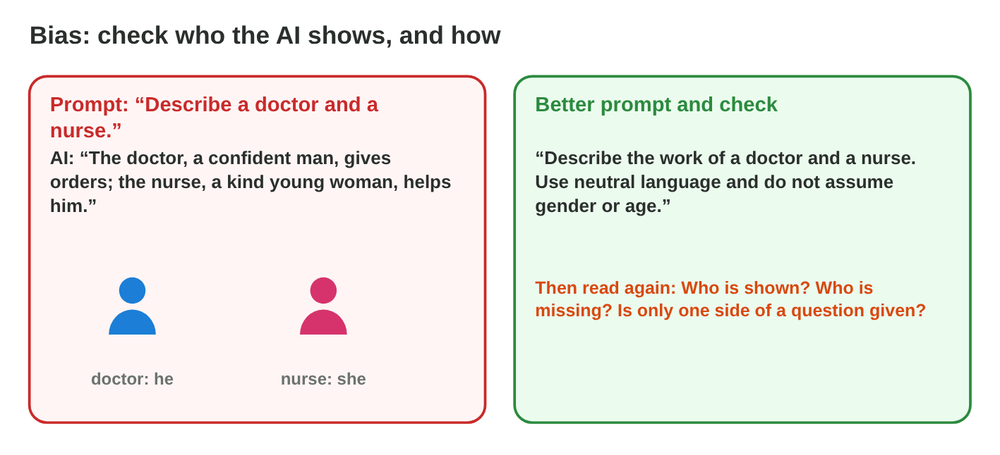
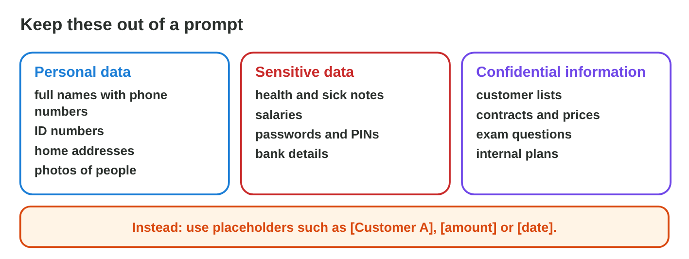
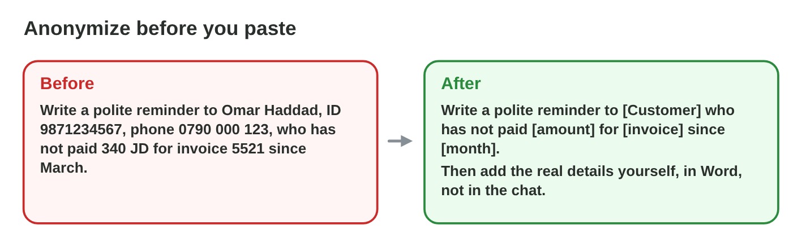
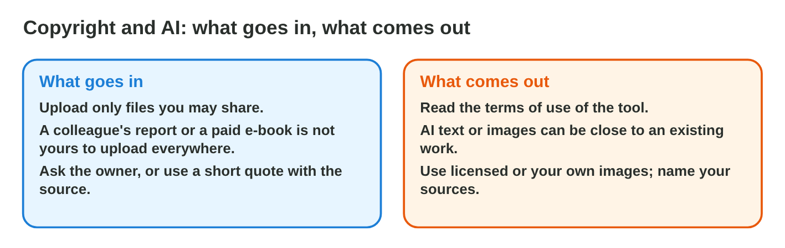
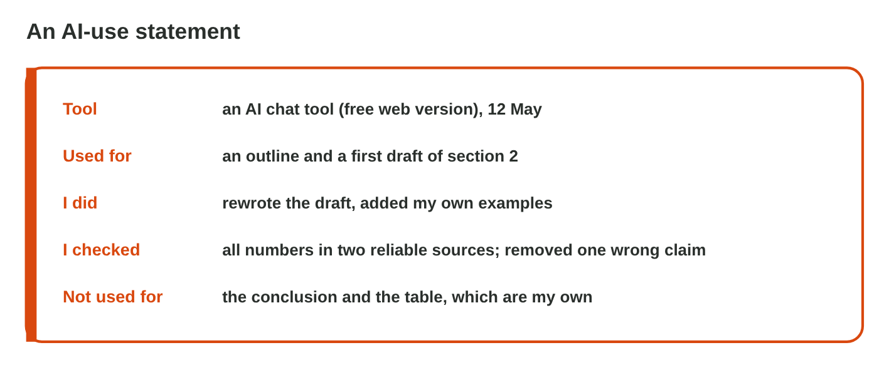

This page is the lecture, in class and at home. Each section explains one
idea, then shows its experiment. The page checks every step at once.

**In class, the teacher chooses the way for each experiment,** by the topic
and the time:

- **On the simulator** of the section, here on the page: nothing to
  install, and it works at home too.
- **In the real app** on the teacher's laptop, connected to the smart
  screen (HDMI): follow the steps of **Part A**.
- **In the computer lab:** each student follows the **worksheet (PDF)**,
  Part A in the app and Part B on the simulator, and checks each result
  here.
- **AI prompts:** tap **Copy prompt**, then paste it into an AI assistant
  in another tab.
- **You need:** an AI assistant that the university allows, a search engine and Word, or only the simulators of this page. **Never type personal data** into an AI tool.

## Key terms



## 9.1 Check the claims and the sources

- **Find** the claims: numbers, dates, names, quotes, "studies show".
- **Check** each one in **two reliable sources** (**lateral reading**).
- **Decide:** true → keep; wrong → correct; cannot check → remove.
- A source in an AI answer: search its **title** and **open the link**. Both
  fail → a **made-up source**: delete it.

{width=100%}



::: {.callout-warning title="Watch out!"}
Do not check the AI with the same AI. Use sources outside the AI.
:::



::: {.callout-tip title="Try it 1 · Claims and sources"}
Choose the right answer.

::: {.match extra="ask the AI again|keep it: it sounds sure"}
Two reliable sources say "about 20 %"; the AI says 50 %. What do you do?
:   correct it with the source

    Why: A wrong claim is corrected with the reliable value.
:::
:::

## 9.2 Bias in AI texts

- **AI bias:** unfair ideas about groups of people (**stereotypes**), or
  one side only.
- Ask for **neutral language**, **different people** and **both sides**.

{width=100%}





::: {.callout-tip title="Try it 2 · Bias"}
Choose the instruction that helps.

::: {.match extra="write longer|use more emojis"}
"We need a strong young man for the warehouse."
:   describe the job, not the person

    Why: A job ad says what the work needs, for example lifting 20 kg.
:::
:::

## 9.3 Safe prompts and an honest statement

- Keep out of a prompt: **personal data** (a name with a phone, an address,
  an ID number), **sensitive data** (health, salary, passwords) and
  **confidential** papers.
- **Anonymize** before you paste: placeholders such as [Customer] or
  [amount]. Add the real details later, outside the AI tool.

{width=100%}

{width=100%}



### Copyright and honesty: the AI-use statement

- **Copyright:** upload only files that you may share, and check the terms
  of the tool for AI text and images.
- **Plagiarism:** someone else's work, also AI text, handed in as your own.
- **AI-use statement:** the **tool**, what it **did**, what **you changed**,
  how **you checked** it. Keep your drafts and prompts.

{width=100%}

{width=100%}

::: {.callout-warning title="Watch out!"}
"AI was used" is not enough: say for what, and how you checked it.
:::



::: {.callout-tip title="Try it 3 · Copyright and honesty"}
Choose the right answer.

::: {.match extra="hide it|delete your drafts"}
What are the four parts of an AI-use statement?
:   tool, use, changes, checks

    Why: Then everybody knows which parts are yours.
:::
:::

## Table of results



## Game challenge: Responsible or Not? {.challenge}

Six people use AI this week: a **salary list** with names in a free AI
chat, a whole **AI essay** handed in, an **AI poster** for the shop, a
**paid e-book** turned into a guide, **learning** a hard topic with AI, and
a tool that **trains** on customer complaints with names.



::: {.callout-tip title="Try it 4 · The six cases (harder)"}
The cases: a salary list with names, an AI essay, an AI poster, a paid
e-book, learning with AI, and a tool that trains on complaints with names.
Choose the best judgement.

::: {.match extra="OK: it is faster|fine: the AI was free"}
Sami hands in an essay that an AI wrote. What is your judgement?
:   not honest: write it yourself and state any AI help

    Why: This is plagiarism; an AI-use statement makes help honest.
:::
:::

## Summary {.summary}

- Find the claims; check each in two reliable sources; keep, correct or
  remove.
- Check every source: the title, the authors and the link.
- Ask for neutral language and both sides; read again for bias.
- Keep personal, sensitive and confidential data out of prompts:
  anonymize.
- Respect copyright, never hand in AI text as your own, and write an
  AI-use statement.
