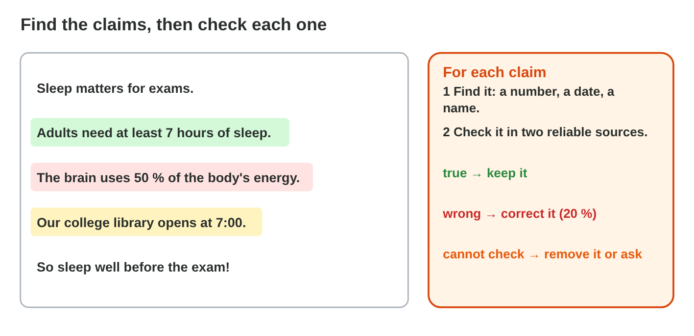
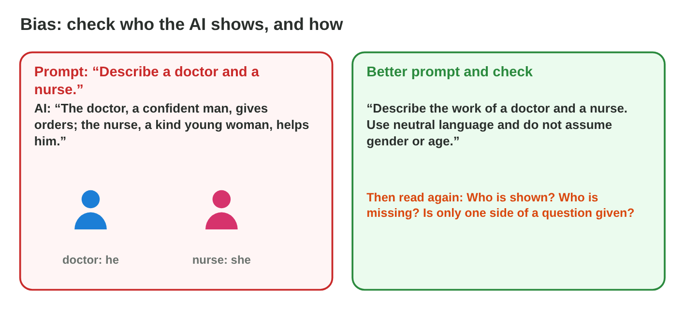
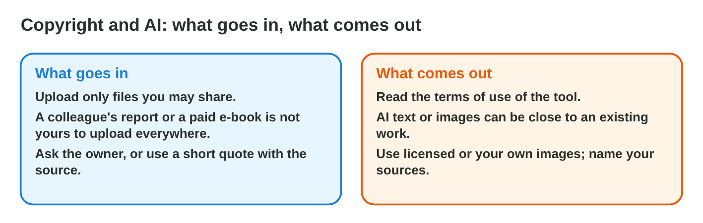
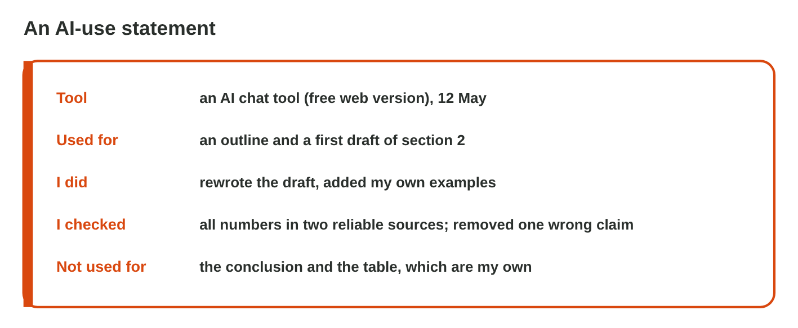

This page is the interactive version of the lesson notes (PDF). Each section
starts with a problem at study or at work. Then it explains one idea. It
ends with a **Lab task** and one set of questions. Every question on this
page has its answer: try first, then check.

## Key terms



## 9.1 Check the claims and the sources

- **Find** the claims: numbers, dates, names, quotes, "studies show".
- **Check** each one in **two reliable sources** (**lateral reading**).
- **Decide:** true → keep; wrong → correct; cannot check → remove.
- A source in an AI answer: search the **title**, the **authors** and the
  journal, and **open the link**. All fail → a **made-up source**: delete
  it.
- Sami's draft: "7 hours of sleep" → keep; "the brain uses 50 %" → correct
  to about 20 %; "Miller & Hart (2019)" → made up, remove.

{width=100%}



::: {.callout-warning title="Watch out!"}
Do not check the AI with the same AI. Use sources outside the AI.
:::

::: {.callout-note title="Lab task · Check the claims"}
In **Fact-Check Lab**, decide about all six claims. Then ask an AI tool for
three studies about sleep and exams, and check one with the three checks.

::: {.check}
Fact-Check Lab: keep "7 hours of sleep" and "a short nap of about 20
minutes"; correct the brain to about 20 % and the library to 8:00; remove
"Miller & Hart, 2019" and the Einstein quote (nothing reliable shows them).
The AI's studies: often the title search finds nothing, or the authors do
not exist: then the source is made up.
:::
:::

::: {.callout-tip title="Try it 1 · Claims and sources"}
Choose the right answer.

::: {.match extra="ask the AI again|keep it: it sounds sure"}
In how many reliable sources do you check a claim?
:   two

    Why: Two reliable sources that agree show that the claim is true.

Two reliable sources say "about 20 %"; the AI says 50 %. What do you do?
:   correct it with the source

    Why: A wrong claim is corrected with the reliable value.

"Einstein said: Sleep is the best study." Nothing reliable shows it. What do you do?
:   remove it

    Why: A claim that you cannot check does not stay in your text.

What is the first check of a source in an AI answer?
:   search its title

    Why: A made-up source has a title that no search can find.

The title, the authors and the link all fail. What is the source?
:   a made-up source

    Why: AI tools can invent sources that sound real.
:::
:::

## 9.2 Bias in AI texts

- **AI bias:** unfair ideas about groups of people (**stereotypes**), or
  one side only.
- Ask for **neutral language**, **different people** and **both sides**.
- Read again: who is shown, who is missing?
- Huda's prompt "a doctor and a nurse" gave "a confident man" and "a kind
  young woman". With "use neutral language", the answer describes the work.

{width=100%}



::: {.callout-warning title="Watch out!"}
An AI learned from people's texts: it is not automatically neutral.
:::

::: {.callout-note title="Lab task · A fair text"}
Fix the three requests in **Bias Lab**. Then ask an AI tool for a job ad for
a warehouse worker, and rewrite it so that it describes the job, not the
person.

::: {.check}
A fair job ad describes the work, not the person, for example: "We need a
warehouse worker. You lift boxes of up to 20 kg and use a computer for the
lists." No "young", no "strong man", no "he".

- ☐ No words about gender, age or origin.
- ☐ Every requirement is about the job.
:::
:::

::: {.callout-tip title="Try it 2 · Bias"}
Choose the instruction that helps.

::: {.match extra="write longer|use more emojis"}
"The doctor, a confident man; the nurse, a kind young woman."
:   use neutral language

    Why: The text should describe the work, not guess gender or age.

"The IT trainee is a young man who loves games."
:   show different people

    Why: A stereotype shows only one kind of person.

"Working from home is always better."
:   give both sides with reasons

    Why: A one-sided text is also a kind of bias.

"We need a strong young man for the warehouse."
:   describe the job, not the person

    Why: A job ad says what the work needs, for example lifting 20 kg.
:::
:::

## 9.3 Keep personal data out of prompts

- **Personal data:** a name with a phone number, an e-mail, an ID number,
  an address, a birthday.
- **Sensitive data:** health, salary, passwords, bank details.
- **Confidential information:** customer lists, contracts, exam questions.
- **Anonymize** before you paste: placeholders such as [Customer] or
  [amount]. Add the real details later, outside the AI tool.
- Check the **settings** (chat history, training on your chats), and use
  the university or work account.

{width=100%}

{width=100%}



::: {.callout-warning title="Watch out!"}
Anonymize **before** you paste; deleting the chat later is too late.
:::

::: {.callout-note title="Lab task · Clean three prompts"}
In **Prompt Cleaner**, clean the prompts of Huda, Rana and Sami. Then
rewrite one prompt of your own with placeholders.

::: {.check}
Prompt Cleaner: names, the e-mail, the birthday, the address, the student
number and the bank account become placeholders; the illness becomes [an
illness]; the password never goes into a prompt. The amount (340 JD), the
month, the day and "tea and cups" stay: the AI needs them, and they say
nothing about a person. Your own prompt: every name and detail is a
placeholder, and the task is still clear.
:::
:::

::: {.callout-tip title="Try it 3 · What is it?"}
Choose the right answer.

::: {.match extra="a placeholder|a font"}
A customer's name and address. What are they?
:   personal data

    Why: They tell who the person is and where the person lives.

A diagnosis in a sick note. What is it?
:   sensitive data

    Why: Health data can harm a person if others see it.

The company's customer list. What is it?
:   confidential information

    Why: It is a secret of the company, not yours to share.

"340 JD", once the name is replaced. Can it stay in the prompt?
:   yes, it can stay

    Why: Without the name, the amount says nothing about a person.
:::
:::

## 9.4 Copyright and honesty: the AI-use statement

- **Copyright in:** upload only files you may share; a paid e-book is not
  yours to upload.
- **Copyright out:** AI text and images can be close to an existing work;
  check the terms of the tool.
- **Plagiarism:** someone else's work, also AI text, handed in as your own.
- **AI-use statement:** the **tool**, what it **did**, what **you changed**,
  how **you checked** it. Keep your drafts and prompts.

{width=100%}

{width=100%}

::: {.callout-warning title="Watch out!"}
"AI was used" is not enough: say for what, and how you checked it.
:::

::: {.callout-note title="Lab task · Your statement"}
Write an AI-use statement of three or four sentences for your job ad of
Lab task 9.2: the tool, what it did, what you changed, how you checked it.

::: {.check}
A good statement: "I used Microsoft Copilot to write a first job ad for a
warehouse worker. I removed the words about gender and age and wrote the
tasks in my own words. I checked that every requirement is about the job."

- ☐ It names the tool and what it did.
- ☐ It says what you changed and how you checked it.
:::
:::

::: {.callout-tip title="Try it 4 · Copyright and honesty"}
Choose the right answer.

::: {.match extra="hide it|delete your drafts"}
AI text handed in as your own work. What is it?
:   plagiarism

    Why: You present work that is not yours as your own.

What are the four parts of an AI-use statement?
:   tool, use, changes, checks

    Why: Then everybody knows which parts are yours.

A colleague wants to rework a paid e-book with AI. Is it allowed?
:   not without permission

    Why: The book is protected by copyright; one copy gives no right to rework it.

What shows your own work, if somebody asks?
:   your drafts and prompts

    Why: They show what you did and what the AI did.
:::
:::

## Game challenge: Responsible or Not? {.challenge}

Work alone. Use every section of today.

Six people use AI this week: a **salary list** with names in a free AI
chat, a whole **AI essay** handed in, an **AI poster** for the shop, a
**paid e-book** turned into a guide, **learning** a hard topic with AI, and
a tool that **trains** on customer complaints with names.



::: {.callout-tip title="Try it 5 · The six cases (harder)"}
The cases: a salary list with names, an AI essay, an AI poster, a paid
e-book, learning with AI, and a tool that trains on complaints with names.
Choose the best judgement.

::: {.match extra="OK: it is faster|fine: the AI was free"}
Huda pastes the salary list with names into a free AI chat. What is your judgement?
:   not OK: remove the names or use an approved tool

    Why: Salaries with names are sensitive personal data.

Sami hands in an essay that an AI wrote. What is your judgement?
:   not honest: write it yourself and state any AI help

    Why: This is plagiarism; an AI-use statement makes help honest.

Rana makes a shop poster with an AI image tool. What is your judgement?
:   fine: check the tool's terms of use

    Why: The terms say what you may do with the output.

Sami asks an AI to explain a hard topic, then writes notes in Sami's own words. What is your judgement?
:   usually fine: learning with AI

    Why: Learning with AI is fine; the notes are Sami's own work.

The tool trains on chats, and Huda has complaints with names. What does she do?
:   switch off training and anonymize the complaints

    Why: Settings and placeholders keep the customers' data safe.
:::
:::

## Summary {.summary}

- Find the claims; check each in two reliable sources; keep, correct or
  remove.
- Check every source: the title, the authors and the link.
- Ask for neutral language and both sides; read again for bias.
- Keep personal, sensitive and confidential data out of prompts:
  anonymize.
- Respect copyright, never hand in AI text as your own, and write an
  AI-use statement.
