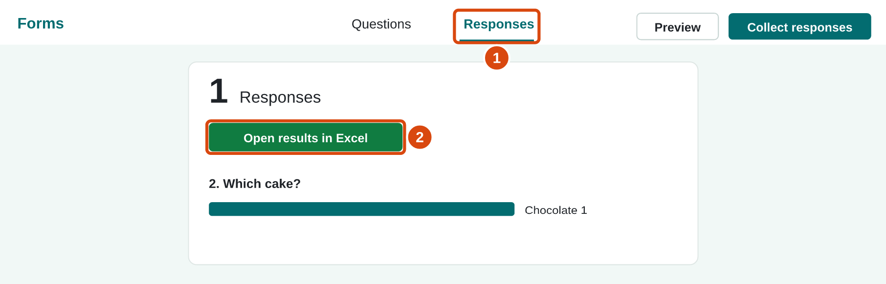

## Today in the lab

::: {.lab-plan}
1. **15 minutes, here:** the teacher shows each idea on a simulator, then
   in Microsoft Forms.
2. **35 minutes, in Microsoft Forms:** you follow the **worksheet**, step by
   step, on the lab computer. Nothing to download: you type the text
   yourself.
3. **At the end:** show your plan to your teacher. Then the **Extra**: an
   AI assistant adds a welcome sentence to your plan.
:::

{width=60%}

## Key terms



## 9.1 Kinds of digital services

### On the simulator

- A **digital service** does a job for people online: it informs, books, sells, pays or helps.
- Examples: a timetable page (information), a clinic booking (booking), an online shop (selling).

::: {.sim-part}

:::

::: {.callout-tip title="Try it 1 · Kinds"}
Choose the right answer.

::: {.match extra="information|payment"}
People choose a day and a time for a haircut online. Which kind?
:   booking

    Why: The customer books a time.
:::
:::

## 9.2 A plan: the customer, the need, the steps

### On the simulator

- Before you build a service, write a short **plan**: who is **the customer**, what is **the need**, which are **the steps**.
- Today: Mona makes cakes at home and takes orders online.

::: {.sim-part}

:::

### In Word: worksheet Task 1

:::: {.word-part}
::: {.screens}
![Type the plan. [1]{.step-n} Click in the first line. [2]{.step-n} **Title**.](images/lab-plan-1.png)

![Press **F12**. [1]{.step-n} **Desktop**. [2]{.step-n} **plan-** and your name. [3]{.step-n} **Save**.](images/lab-save-1.png)
:::
::::

## 9.3 An order form linked to a spreadsheet

### On the simulator

- **Microsoft Forms** (forms.office.com, with the university account): **New Form**, a title, then **+ Add new**.
- Question types: **Text**, **Choice** (options), **Date**, **Rating**. **Required**: the customer must answer.
- **Preview** shows the form; each order is a **response**; **Open results in Excel** puts them in a sheet.

::: {.sim-part}

:::

### In Microsoft Forms: worksheet Tasks 2 to 5

:::: {.word-part}
::: {.screens}
![[1]{.step-n} **New Form** (after you sign in).](images/lab-forms-1.png)

![[1]{.step-n} The title. [2]{.step-n} **+ Add new**. [3]{.step-n} The kind of question.](images/lab-forms-2.png)

![[1]{.step-n} **Required**. [2]{.step-n} The options. [3]{.step-n} A Date question.](images/lab-forms-3.png)

![[1]{.step-n} **Preview**. [2]{.step-n} A test order. [3]{.step-n} **Submit**.](images/lab-forms-4.png)

![[1]{.step-n} **Responses**. [2]{.step-n} **Open results in Excel**.](images/lab-result-1.png)
:::
::::

::: {.callout-tip title="Try it 2 · Questions"}
Choose the right answer.

::: {.match extra="Text|Date"}
The customer picks one cake from three. Which type of question?
:   Choice

    Why: Choice gives a list of options to tap.
:::
:::

## Extra: AI changes your plan

### On the simulator

- On **tutudocs.com** you open your own plan, with **no sign-in**.
- **AI Assistant**: ask for one change, for example: a welcome sentence for the customers.
- **File › Download**, the Word file (**.docx**).

::: {.sim-part}

:::

### On tutudocs.com: the Extra of the worksheet

:::: {.word-part}
::: {.screens}
![**tutudocs.com**: [1]{.step-n} click the box, then choose your plan.](images/lab-tutu-1.png)

![[1]{.step-n} **AI Assistant**. [2]{.step-n} Your request. [3]{.step-n} The AI adds the sentence.](images/lab-tutu-2.png)

![[1]{.step-n} **File**, [2]{.step-n} **Download**, [3]{.step-n} the **.docx** file.](images/lab-tutu-3.png)
:::
::::

## Now: your worksheet

::: {.lab-go}
Take your **worksheet** and do Tasks 1–5 in Microsoft Forms on the lab
computer, in order. Tick each step. Raise your hand when you are stuck,
and at the end. Finished? Do the **Extra**: on tutudocs.com an AI
assistant adds a welcome sentence to your plan.
:::

## Summary {.summary}

- A digital service does a job online: information, booking, selling, paying, help.
- A plan: the customer, the need, the steps.
- Microsoft Forms: New Form, a title, + Add new (Text, Choice, Date), Required.
- Preview and Submit a test order; Responses and Open results in Excel show the orders.
- On tutudocs.com (no sign-in) the AI Assistant changes your plan; File › Download gives the .docx.
