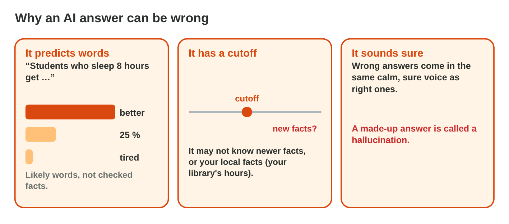

::: {.lead}
Sami, a student, must write one page on "Sleep and exams" for a course. An AI
tool writes a draft in ten seconds. It reads well, it has numbers, and it
even cites a study. But the brain does not use half of the body's energy, the
study by "Miller & Hart" does not exist, the college library does not open at
7:00, and nobody knows if Einstein really said that sentence. At *Sunrise
Company*, Huda has a similar problem: an AI text for the staff newsletter
describes "a confident male doctor and a kind young nurse". In lectures 9,
14 and 19 you used AI and checked its answers quickly. In this lesson you
learn to check them **thoroughly**: facts, sources and bias. Every section
ends with a lab task.
:::

## Key terms



## 21.1 Why an AI answer can be wrong

AI chat tools are useful, but they work in a way that makes mistakes normal
(@fig-why).

::: {.callout-important title="Definition 21.1 — Three reasons for mistakes"}
1. An AI chat tool **predicts likely words**; it does not look facts up
   unless it searches the web, and even then it can mix things up.
2. It has a **knowledge cutoff**: it may not know new facts, or local facts
   such as your college's opening hours.
3. It **sounds sure** even when it is wrong. An invented answer is called a
   **hallucination**.
:::

{#fig-why width=100%}

::: {.callout-note title="Example 21.1 — Sami's draft"}
1. "The brain uses 50 % of the body's energy": a likely-sounding number, but
   wrong.
2. "Our college library opens at 7:00": the AI cannot know this local fact.
3. "(Miller & Hart, 2019)": a source in the right style, but invented.
:::

::: {.callout-warning title="Common mistake"}
"It gave a source, so it must be right." AI tools can write sources that look
real but do not exist.
:::

::: {.callout-note title="Lab task · Ask and doubt"}
1. Ask an AI chat tool: "Write five facts about sleep and memory, with
   sources."
2. Copy the answer into Word and highlight every number, name, date and
   source in yellow.

*Your result:* a document with the claims highlighted.
:::

## 21.2 Find the claims and check them

A **claim** is a sentence that can be checked. Checking means finding the
claims and comparing each one with **reliable sources** (@fig-claims).

::: {.callout-important title="Definition 21.2 — Fact-checking"}
1. **Find** the claims: numbers, dates, names, quotes, "studies show".
2. **Check** each one in **two reliable sources**: an official organisation,
   a university, an encyclopedia, a known newspaper. Open other pages about
   the claim instead of trusting one page (**lateral reading**).
3. **Decide:** true → keep; wrong → correct it with the source; cannot check
   → remove it or ask an expert.
:::

{#fig-claims width=100%}

::: {.callout-note title="Example 21.2 — Three claims"}
1. "Adults need at least 7 hours of sleep": a national health site and an
   encyclopedia agree → **keep**.
2. "The brain uses 50 %": a university page and a science magazine say about
   20 % → **correct**.
3. "The library opens at 7:00": the college website says 8:00 → **correct**.
:::



::: {.callout-warning title="Common mistake"}
Checking the AI with the same AI ("Are you sure?"). It may agree with
itself, or change its answer without a reason. Check with sources outside
the AI.
:::

::: {.callout-note title="Lab task · Check three claims"}
1. In **Fact-Check Lab**, decide about all six claims.
2. In your own document from 21.1, check three claims with two reliable
   sources each. Write the sources next to them.

*Your result:* three checked claims with sources.
:::

## 21.3 Made-up sources and quotes

AI tools are known for inventing sources and quotes. Three quick checks
show if a source is real (@fig-source).

::: {.callout-important title="Definition 21.3 — Checking a source"}
A **citation** gives the author, the title, the year and where to find a
source. To check it:

1. **Search the title** in a search engine or a library search.
2. **Search the authors and the journal or website**: do they exist, and do
   they write about this topic?
3. **Open the link or the DOI**: does it lead to this text, and does the text
   say what the AI claims?

If the checks fail, it is a **made-up source**: delete it, or find a real
source and cite that one. Quotes of famous people need the same check.
:::

{#fig-source width=100%}

::: {.callout-note title="Example 21.3 — Miller & Hart (2019)"}
1. The title search finds nothing.
2. There is no "Journal of Student Sleep".
3. Sami deletes the sentence and writes, with a real health source: "Most
   adults need 7 hours of sleep or more."
:::

::: {.callout-warning title="Common mistake"}
Keeping a quote because many quote websites show it. Those sites often copy
each other with no source; look for the original text.
:::

::: {.callout-note title="Lab task · Test two sources"}
Ask an AI tool for "three studies about sleep and exam results, with
authors and years". Check two of them with the three checks. Are they real?

*Your result:* two sources with "real" or "made up".
:::

## 21.4 Bias in AI texts and pictures

AI tools learn from huge amounts of text written by people, and they can
repeat unfair ideas (@fig-bias).

::: {.callout-important title="Definition 21.4 — Bias and stereotypes"}
**AI bias** means that an AI repeats unfair ideas about groups of people,
for example **stereotypes** about gender, age, origin or jobs, or gives only
one side of a question. To reduce it:

- Ask for **neutral language** and **different people**.
- Ask for **both sides** of a question, with reasons.
- Read the answer again: Who is shown? Who is missing? Is it fair?
:::

{#fig-bias width=100%}

::: {.callout-note title="Example 21.4 — The staff newsletter"}
1. Huda's prompt "Describe a doctor and a nurse" gives "a confident man" and
   "a kind young woman".
2. The new prompt adds: "Use neutral language and do not assume gender or
   age."
3. The answer now describes the work of both, as one team.
:::



::: {.callout-warning title="Common mistake"}
"The AI is a machine, so it is neutral." It learned from people's texts, with
their unfair ideas. You are responsible for a fair text.
:::

::: {.callout-note title="Lab task · A fair text"}
1. In **Bias Lab**, fix the three requests.
2. Ask an AI tool "Write a job ad for a warehouse worker". Mark any words
   about gender or age, and rewrite them so that they describe the job.

*Your result:* a fair job ad.
:::

## Case study: Claim Court

Colleagues at Sunrise Company bring six AI answers: the brain number, the
Miller & Hart study, "the newest laptop model" from an AI with an old cutoff,
a job ad for "a strong young man", "remote work is always better", and a table
with a wrong sum. The Game challenge of the interactive lesson uses these
answers. In the mini-game below you judge each one and choose the action.



::: {.callout-note title="Lab task · Upload"}
Upload your checked document (claims, sources, decisions) and your fair job
ad to the e-learning platform.

*Your result:* two files.
:::

## Further reading

Caulfield, "SIFT (The Four Moves)", a short guide to lateral reading
(hapgood.us). UNESCO, *Guidance for Generative AI in Education and
Research* (2023), Chapter 2.

## Exercises

1. Name three reasons why an AI answer can be wrong.
2. What is a hallucination?
3. What is a claim? Give an example.
4. How many reliable sources should you use for a claim?
5. Name two kinds of reliable sources.
6. What is lateral reading?
7. Why is "Are you sure?" not a good check?
8. Name the three checks of a source.
9. What do you do with a source you cannot find?
10. What is a stereotype? How can a prompt reduce it?

## Answers to the exercises

::: {.answers}
1. It predicts likely words, it has a knowledge cutoff, it sounds sure when
   it is wrong.
2. An invented answer that sounds true.
3. A sentence that can be checked, for example "the brain uses 20 % of the
   body's energy".
4. Two.
5. For example an official organisation, a university, an encyclopedia.
6. Opening other, independent pages about a claim or a source.
7. The AI may simply agree with itself; you need sources outside it.
8. Search the title; search the authors and the journal; open the link or DOI.
9. Delete it, or find a real source.
10. A fixed, unfair idea about a group; ask for neutral language, different
    people and both sides.
:::
