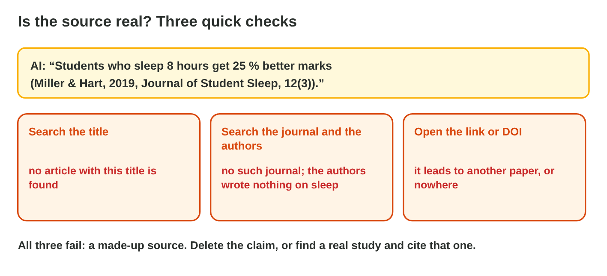
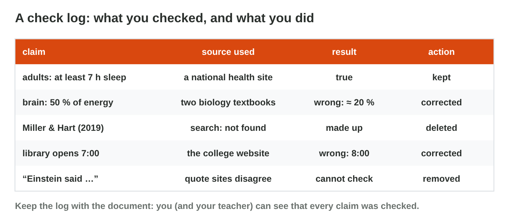

## Before you start {.study}

- **What you need:** Word (desktop, on the web at `office.com`, or the phone
  app) and a web browser with a search engine.
- **Time:** about 60 minutes. Work alone, at your own speed.
- **How it works:** watch the short video made for this course (1:10), then
  do Steps 1–3 on this page. Each step has a short text, a figure and a
  self-check; Steps 1 and 2 have a simulator. Then do the **Tasks to
  submit**.
- **What you submit:** one Word file with the corrected text and your check
  log, before lecture 10.
- **You need Lecture 9:** claims, reliable sources, made-up sources and
  bias.

## Key terms {.study}



## Step 1 · Find every claim {.study}

Watch the short video first: it shows the whole check, from the claims to
the check log (with captions; the words are also under it). Then do the
three steps.



- A **claim** can be checked: a number, a date, a name, a price, a quote,
  "a study shows", "experts say".
- Highlight every claim before you check anything.
- Opinions ("tea tastes better with mint") are not claims; leave them.

{width=100%}



::: {.callout-tip title="Try it 1 · Claim or opinion?"}
Choose the right answer.

::: {.match extra="a question|a title"}
"The college café opens at 7:30." What is it?
:   a claim

    Why: A time can be checked, for example on the café's notice.

"The café has the nicest cakes in Amman." What is it?
:   an opinion

    Why: "The nicest" is a matter of taste; nobody can check it.

"A 2021 survey of 500 students shows that most skip breakfast." What is it?
:   a claim

    Why: A survey, a year and a number can be checked.

"Doctors say that breakfast helps you focus." What is it?
:   a claim

    Why: "Doctors say" must be checked in reliable sources.
:::
:::

## Step 2 · Check facts and sources {.study}

- Check each claim in **two reliable sources**: official health
  organisations, universities, encyclopedias, known newspapers.
- Open other pages about the claim (**lateral reading**).
- For a source or a quote: search the title, the authors and the journal,
  and open the link.
- Decide: **keep**, **correct** (with the source), or **remove**.

{width=100%}



::: {.callout-tip title="Try it 2 · Decisions"}
Use Claim Court. Choose the action.

::: {.match extra="keep it because it sounds sure|ask the same AI"}
Two reliable sources say another number. What do you do?
:   correct it

    Why: The reliable sources win over the AI.

The study cannot be found. What do you do?
:   delete it

    Why: A study that no search finds is made up.

The AI's knowledge is two years old. What do you do with "the newest laptop"?
:   check a current source

    Why: The AI does not know what came after its knowledge cutoff.

The sum in an AI table is wrong. What do you do?
:   compute it yourself

    Why: AI can make mistakes in sums; a spreadsheet adds exactly.
:::
:::

## Step 3 · Fair words and a check log {.study}

- Look for **stereotypes** and one-sided parts; rewrite them with neutral
  words and both sides.
- Keep a **check log**: claim · source used · result · action.
- End the text with an **AI-use statement**: what the AI did, and that you
  checked it.

{width=100%}

::: {.callout-tip title="Try it 3 · Fair and documented"}
Choose the right answer.

::: {.match extra="remove all people|use capital letters"}
"Every office manager knows her team." What do you do?
:   use neutral language

    Why: "Her" guesses that every manager is a woman.

"Breaks are always a waste of time." What do you do?
:   give both sides with reasons

    Why: A one-sided sentence is a kind of bias.

What are the four columns of a check log?
:   claim, source, result, action

    Why: The log shows what you checked, where, and what you did.

What does the last sentence of the corrected text say?
:   what the AI did, and that you checked it

    Why: An AI-use statement makes the use of AI honest.
:::
:::

## Tasks to submit {.tasks}

Do the tasks alone. Your teacher marks them (6 marks). Huda asked an AI tool
for a short text for the staff newsletter of Sunrise Company. Copy this
**AI-written text** into a new Word file:

> **Drink water at work!** Water makes up about 60 % of an adult's body, so
> it matters for your work. The World Health Organization said in 2015 that
> every adult must drink exactly 8 glasses a day. A study by Laila
> Fares (Office Health Journal, 2018) showed that workers who drink more water
> make 40 % fewer mistakes. Coffee dehydrates you, so it does not count at
> all. The Dead Sea, the lowest place on land, is so salty that you cannot
> drink it. Every good secretary knows that her boss needs coffee, not
> water. Drinking water is always the best idea for everyone.

### Task 1 · Find and check (3 marks)

1. Highlight every claim in the text (there are at least six).
2. Check each claim with two reliable sources. Write a **check log** table
   with four columns: claim · sources (names and links) · result (true,
   wrong, cannot check, made up) · action.

### Task 2 · Correct the text (2 marks)

1. Write a corrected version of the newsletter text below the original:
   keep the true claims, correct the wrong ones with your sources, remove
   what you cannot check, and rewrite the biased and one-sided sentences.
2. End with an **AI-use statement** for the newsletter, for example "Draft
   written with AI help and checked by …".

### Task 3 · Reflect (1 mark)

a) Which claim was the hardest to check, and why?



## How to submit

Upload your Word file (the original text with highlights, the check log, and
the corrected text) to the university e-learning platform, **before
lecture 10**.
