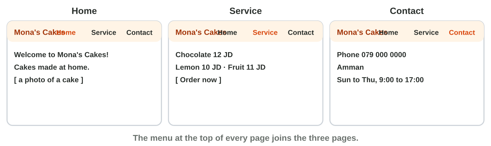
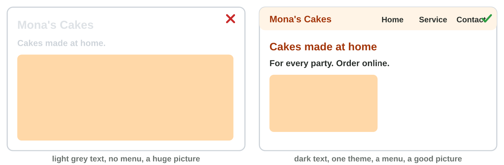
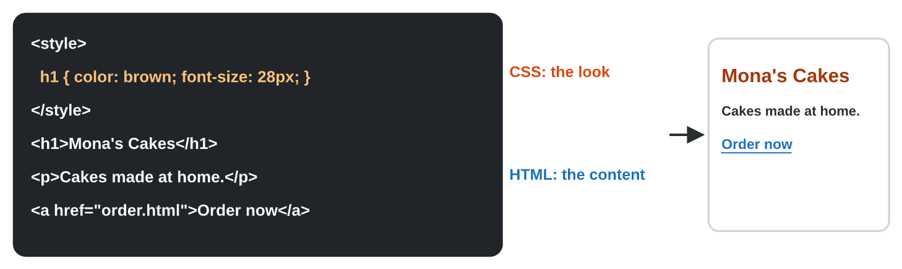

::: {.lead}
Mona's order form works (Lecture 8), but customers do not know about it.
They search the Internet for "cakes Amman" and find other shops with a
website. Mona needs a small **website**: who she is, her cakes and prices,
the order button, and how to reach her. In this lesson you plan the site,
build it with a free **website builder**, give it a clear design that
works on a phone, and look at the HTML and CSS behind a web page. These
notes are a short reference: in class you do each idea in the apps, as an
experiment of the **worksheet**.
:::

## Key terms



## 9.1 The plan and the pages

Plan the website before you build it (@fig-pages):

- **The purpose:** what the site is for (to take cake orders).
- **The audience:** who visits it (families in Amman, often on a phone).
- **The pages:** a small service needs three: **Home** (who you are and
  what you offer), **Service** (the cakes, the prices and the button
  *Order now*) and **Contact** (phone, address, opening times).

A **website builder** makes the pages without code. **Google Sites**
(`sites.google.com`, free with a Google account): **Blank site**, the site
name, then **Pages › +** for each page. The **menu** (navigation) at the
top joins the pages by itself.

{#fig-pages width=100%}

::: {.callout-important title="Definition 9.1 — Website"}
A **website** is a group of web pages with one name and one address,
joined by a menu.
:::

::: {.callout-note title="Example 9.1 — Mona's three pages"}
1. Home: "Welcome to Mona's Cakes!" and a photo of a cake.
2. Service: the three cakes and their prices, and the button *Order now*
   (the link to the form of Lecture 8).
3. Contact: the phone number, the address and the opening times.
:::



*In class: Experiment 1 of the worksheet, the three pages in Google
Sites.*

## 9.2 The design and the phone view

A good design is easy to read and the same on every page (@fig-design):

- **One theme** (Google Sites: **Themes**): the same colours and fonts on
  every page. One or two fonts, never five.
- **Strong contrast:** dark text on a light background (or light on dark).
- **Pictures** of a good size, with a few words of alt text.
- A clear **menu**: the visitor finds every page in one tap.

Most visitors open the site on a phone. Check the **mobile view** before
you publish: **Preview** (the eye), then the phone. On a phone the menu
becomes a button with three lines (≡).

{#fig-design width=100%}

::: {.callout-warning title="Common mistake"}
A huge photo at the top. On a phone the visitor scrolls a long time before
any text, and the page loads slowly. Choose a smaller picture.
:::



*In class: Experiment 2 of the worksheet, a theme, a picture and the phone
preview.*

## 9.3 A look at HTML and CSS

Behind every web page there is code (@fig-html). Google Sites writes it for
you, but it helps to read it:

- **HTML** is the content of the page, written with **tags**: `<h1>` a big
  heading, `
` a paragraph, `<a href="order.html">` a link, `` a
  picture.
- **CSS** is the look: `h1 { color: brown; font-size: 28px; }` makes the
  heading brown and big.

{#fig-html width=100%}

::: {.callout-note title="Example 9.2 — A green heading"}
1. Mona's page has `h1 { color: brown; }` in its CSS.
2. She changes `brown` to `green`, saves and refreshes the browser.
3. The heading is green; its text, *Mona's Cakes*, did not change: the
   text is in the HTML.
:::



*In class: Experiment 3 of the worksheet, `page-start.html` in Notepad and
in a browser.*

## Case study: the Web Desk at Sunrise Company

Huda's colleagues build websites. Omar asks which pages his shop needs.
Lina asks where the opening times go. Sami's text is light grey on white.
Mona wants to check her site on a phone. Somebody wants a green heading. In
the mini-game below, you answer eight such messages.



## Further reading

Duckett, *HTML and CSS: Design and Build Websites*, the first chapters
(structure, text, links). Google Sites Help (support.google.com/sites):
create a site, add pages, themes.

## Exercises

1. Which page has the phone number and the address: Home or Contact?
2. Which page has the order button: Service or Contact?
3. What joins the pages of a site: the menu or the theme?
4. Dark text on a light background: strong or weak contrast?
5. How many fonts are good on one site: one or two, or five?
6. Where do you check the phone view: Preview or Publish?
7. Which tag makes a link: `
` or `<a>`?
8. Which language sets the colour of a heading: HTML or CSS?

## Answers to the exercises

::: {.answers}
1. Contact.
2. Service.
3. The menu (navigation).
4. Strong contrast.
5. One or two.
6. Preview (then the phone).
7. `<a>`.
8. CSS.
:::
