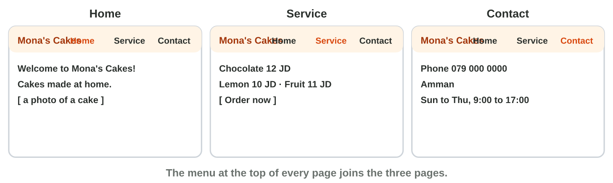
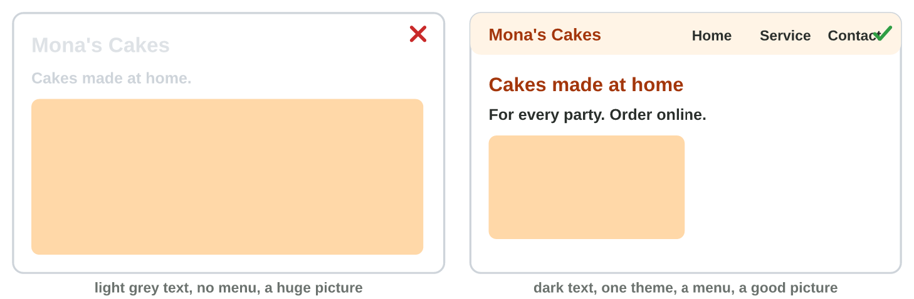
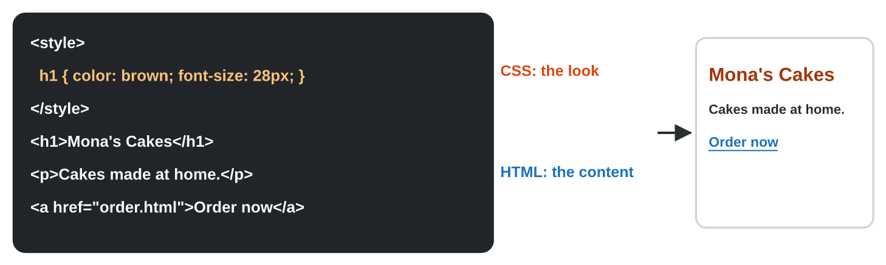

This page is the lecture, in class and at home. Each section explains one
idea, then shows its experiment. The page checks every step at once.

**In class, the teacher chooses the way for each experiment,** by the topic
and the time:

- **On the simulator** of the section, here on the page: nothing to
  install, and it works at home too.
- **In the real app** on the teacher's laptop, connected to the smart
  screen (HDMI): Google Sites and Notepad, with the steps of **Part A**.
- **In the computer lab:** each student follows the **worksheet (PDF)**,
  Part A in the apps and Part B on the simulator, and checks each result
  here.
- **You need:** a browser with a Google account (Google Sites at
  `sites.google.com`) and the start file, or only the simulators of this
  page.

## Key terms



## Before you start



## 9.1 The plan and the pages

- Plan first: the **purpose**, the **audience** and the **pages**.
- A small service: **Home**, **Service** (with the order button),
  **Contact**.
- A **website builder** (Google Sites) makes pages without code.
- The **menu** joins the pages.

{width=100%}





::: {.callout-tip title="Try it 1 · Pages"}
Choose the right page.

::: {.match extra="a new site|the menu"}
Fix It: the phone number and the address of the shop.
:   Contact

    Why: Contact says how to reach you.

Fix It: the button Book a repair.
:   Service

    Why: The customer books on the service page.
:::
:::

## 9.2 The design and the phone view

- One **theme**: the same colours and fonts on every page.
- **Strong contrast**: dark text on a light background.
- Pictures of a good size, and a clear menu.
- Check the **mobile view**: Preview › the phone.

{width=100%}





::: {.callout-tip title="Try it 2 · Design"}
Choose the right answer.

::: {.match extra="five fonts|a bigger picture"}
Light grey text on a white page. What is the problem?
:   weak contrast

    Why: Dark text on a light background is easy to read.

How do you check the site on a phone before you publish?
:   Preview, then the phone

    Why: The preview shows the narrow screen of a phone.
:::
:::

## 9.3 A look at HTML and CSS

- **HTML** is the content: `<h1>` a heading, `
` a paragraph, `<a>` a
  link, `` a picture.
- **CSS** is the look: `h1 { color: brown; }`.
- Google Sites writes them for you.

{width=100%}





::: {.callout-tip title="Try it 3 · HTML and CSS"}
Choose the right answer.

::: {.match extra="Excel|a PDF"}
`<a href="order.html">Order now</a>` is written in …
:   HTML

    Why: HTML says what is on the page: here a link.

`h1 { font-size: 36px; }` is written in …
:   CSS

    Why: CSS sets the look: here the size of the heading.
:::
:::

## Table of results



## Game challenge: the Web Desk at Sunrise Company {.challenge}

Huda's colleagues build websites for their services: pages, design, HTML.



::: {.callout-tip title="Try it 4 · Websites"}
Omar's shop site needs pages; Sami's text is light grey on white; Lina
wants a green heading. Choose the right answer.

::: {.match extra="twenty pages|HTML"}
Which pages does Omar's site need?
:   Home, Service and Contact

    Why: Who we are, what we offer, how to reach us.

What does Sami change?
:   dark text on the light background

    Why: Strong contrast is easy to read.

(Harder) Lina wants a green heading. Which language does it?
:   CSS

    Why: CSS sets colours; HTML says what is on the page.
:::
:::

## Summary {.summary}

- Plan the purpose, the audience and the pages: Home, Service, Contact.
- A website builder such as Google Sites makes the pages; the menu joins them.
- One theme, strong contrast, pictures of a good size.
- Check the site on a phone before you publish it.
- HTML is the content of a page; CSS is its look.
