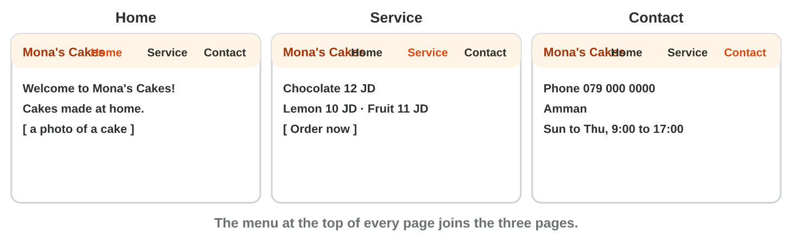
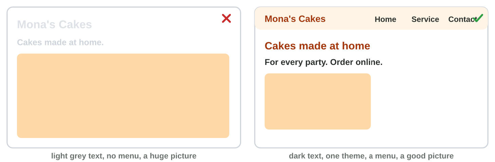
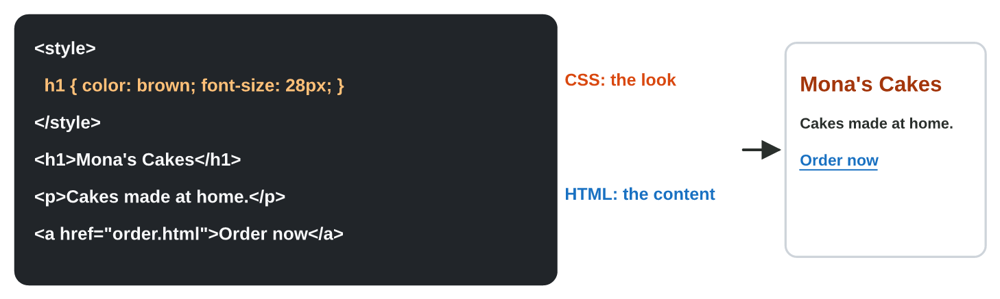

## Keywords



## The plan and the pages

:::: {.columns}
::: {.column width="50%"}
- You plan the purpose, the audience and the pages first.
- A small service needs Home, Service and Contact.
- A website builder such as Google Sites makes the pages without code.
- The menu joins the pages of the site.
:::
::: {.column width="50%"}

:::
::::

## Live demo · A site and its pages



## Try it 1 · Pages

a) On which page are the phone number and the address?
b) On which page is the button Book a repair?
c) What joins the pages of a site?

::: {.answer}
a) Contact
b) Service
c) the menu (navigation)
:::

## The design and the phone view

:::: {.columns}
::: {.column width="50%"}
- One theme gives every page the same colours and fonts.
- Dark text on a light background has strong contrast.
- Pictures have a good size, and the menu is clear.
- You check the phone view with Preview before you publish.
:::
::: {.column width="50%"}

:::
::::

## Live demo · The phone view



## Try it 2 · Design

a) Light grey text is on a white page. What is the problem?
b) How many fonts are good on one site?
c) Where do you check the site on a phone?

::: {.answer}
a) weak contrast
b) one or two
c) Preview, then the phone
:::

## A look at HTML and CSS

:::: {.columns}
::: {.column width="50%"}
- HTML is the content of a page, written with tags.
- The tag h1 is a heading, p is a paragraph, and a is a link.
- CSS is the look, such as colours, fonts and sizes.
- Google Sites writes the HTML and CSS for you.
:::
::: {.column width="50%"}

:::
::::

## Live demo · HTML Lab



## Try it 3 · HTML and CSS

a) Which tag makes the big heading of a page?
b) Which tag makes a link?
c) Which language sets the colour of the heading?

::: {.answer}
a) h1
b) a
c) CSS
:::

## Summary

- You plan the purpose, the audience and the pages: Home, Service and Contact.
- A website builder such as Google Sites makes the pages, and the menu joins them.
- One theme, strong contrast and pictures of a good size make a clear site.
- You check the site on a phone before you publish it.
- HTML is the content of a page, and CSS is its look.

## Your worksheet

:::: {.columns}
::: {.column width="50%"}
- In the computer lab, follow the worksheet alone, step by step, in Google Sites and Notepad.
- Four short tasks: a new site, two more pages, a theme and the phone view, a web page in Notepad.
- Nothing to download: you type the text yourself.
- Each step has a picture of the screen; tick each step when it is done.
- Then the Extra: on tutudocs.com an AI assistant adds a paragraph to your web page.
:::
::: {.column width="50%"}

:::
::::

## Results of the worksheet

What does your file show at the end?

::: {.reveal}
- Tasks 1–2: the site Mona's Cakes with Home, Cakes and Order in the menu.
- Task 3: a theme; on a phone the menu becomes ☰.
- Task 4: page-….html opens in the browser; the heading turns from brown to green.
:::

## Game challenge · The Web Desk



## Try it 4 · Websites (harder)

The facts: Omar's shop site needs pages. Sami's text is light grey on white. Lina wants a green heading.

a) Which pages does Omar's site need?
b) What does Sami change?
c) Which language makes Lina's heading green?

::: {.answer}
a) Home, Service and Contact
b) dark text on the light background
c) CSS
:::
