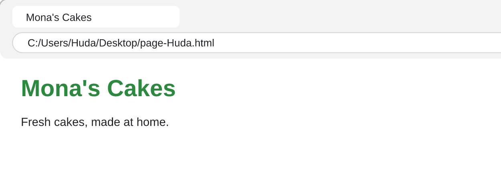
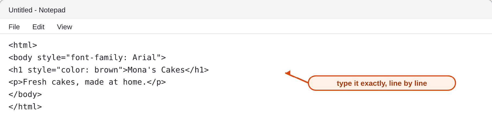
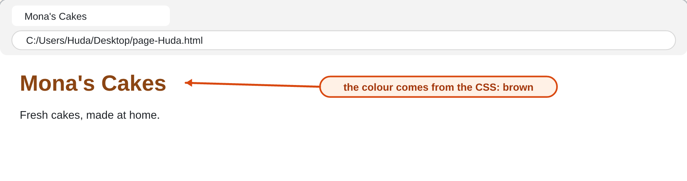

## Today in the lab

::: {.lab-plan}
1. **15 minutes, here:** the teacher shows each idea on a simulator, then
   in Google Sites.
2. **35 minutes, in Google Sites:** you follow the **worksheet**, step by
   step, on the lab computer. Nothing to download: you type the text
   yourself.
3. **At the end:** show your web page to your teacher. Then the **Extra**: an
   AI assistant adds a paragraph to your web page.
:::

{width=60%}

## Key terms



## 10.1 The plan and the pages

### On the simulator

- **Google Sites** (sites.google.com, with a Google account) builds a website with no code: **Blank site**.
- The **site name** (top left) and the **page title** (the big banner).
- **Pages › + New page**: every page gets a link in the **menu** at the top.

::: {.sim-part}

:::

### In Google Sites: worksheet Tasks 1 and 2

:::: {.word-part}
::: {.screens}
![[1]{.step-n} **Blank site** (after you sign in).](images/lab-sites-1.png)

![[1]{.step-n} The site name. [2]{.step-n} The page title.](images/lab-sites-2.png)

![[1]{.step-n} **Pages**. [2]{.step-n} **+ New page**. [3]{.step-n} The name. [4]{.step-n} **Done**. [5]{.step-n} The menu.](images/lab-sites-3.png)
:::
::::

::: {.callout-tip title="Try it 1 · Pages"}
Choose the right answer.

::: {.match extra="the theme|Publish"}
You add the page Order. Where does its link come?
:   in the menu at the top

    Why: Every new page gets a link in the menu of the site.
:::
:::

## 10.2 The design and the phone view

### On the simulator

- **Themes**: one click changes the colours and the fonts of **every page**.
- **Preview** (the eye) shows the site on a **phone**, a tablet and a large screen.
- On a phone the menu becomes **☰** and the text is one column.

::: {.sim-part}

:::

### In Google Sites: worksheet Task 3

:::: {.word-part}
::: {.screens}
![[1]{.step-n} **Themes**. [2]{.step-n} A theme. [3]{.step-n} **Preview**.](images/lab-sites-4.png)

![[1]{.step-n} **Phone**. [2]{.step-n} The menu ☰.](images/lab-sites-5.png)
:::
::::

## 10.3 A look at HTML and CSS

### On the simulator

- Every web page is **HTML**: **tags** such as **<h1>** (a big heading) and **
** (a paragraph).
- **CSS** says how it looks: **color: brown** makes the heading brown.
- Type it in **Notepad**, save it as **page.html**, and open it in the browser.

::: {.sim-part}

:::

### In Notepad: worksheet Task 4

:::: {.word-part}
::: {.screens}

![**File › Save as**. [1]{.step-n} **Desktop**. [2]{.step-n} **page-** and your name **.html**. [3]{.step-n} **Save**.](images/lab-save-1.png)

:::
::::

::: {.callout-tip title="Try it 2 · HTML"}
Choose the right answer.

::: {.match extra="
|<body>"}
Which tag makes the big heading?
:   <h1>

    Why: h1 is heading 1, the biggest heading; p is a paragraph.
:::
:::

## Extra: AI changes your web page

### On the simulator

- On **tutudocs.com** you open your own web page, with **no sign-in**.
- **AI Assistant**: ask for one change, for example: a short paragraph about the cakes.
- **File › Download › HTML**: open it in the browser.

::: {.sim-part}

:::

### On tutudocs.com: the Extra of the worksheet

:::: {.word-part}
::: {.screens}
![**tutudocs.com**: [1]{.step-n} click the box, then choose your web page.](images/lab-tutu-1.png)

![[1]{.step-n} **AI Assistant**. [2]{.step-n} Your request. [3]{.step-n} The AI adds the paragraph.](images/lab-tutu-2.png)

![[1]{.step-n} **File**, [2]{.step-n} **Download**, [3]{.step-n} **HTML**.](images/lab-tutu-3.png)
:::
::::

## Now: your worksheet

::: {.lab-go}
Take your **worksheet** and do Tasks 1–4 in Google Sites on the lab
computer, in order. Tick each step. Raise your hand when you are stuck,
and at the end. Finished? Do the **Extra**: on tutudocs.com an AI
assistant adds a paragraph to your web page.
:::

## Summary {.summary}

- Google Sites: Blank site, the site name, the page title.
- Pages › + New page: every page gets a link in the menu.
- Themes change every page; Preview shows the phone view (the menu becomes ☰).
- HTML is the content (<h1>, 
); CSS is the look (color: brown).
- On tutudocs.com (no sign-in) the AI Assistant changes your web page; File › Download › HTML.
