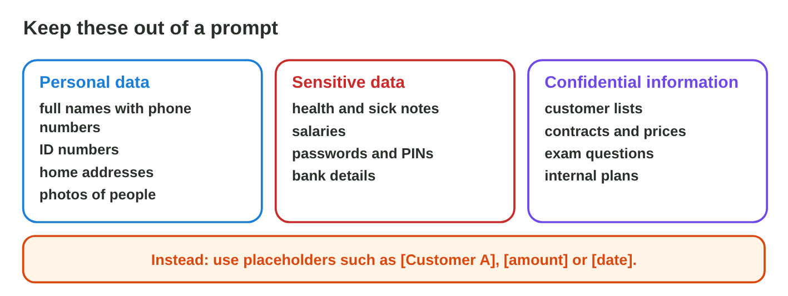
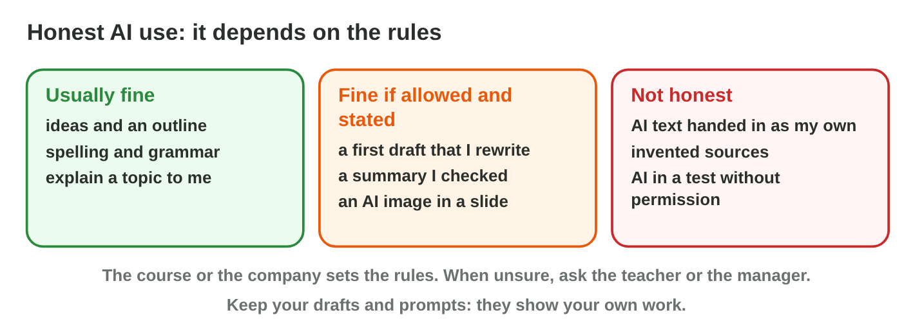

::: {.lead}
At *Sunrise Company*, Huda wants a chart of the staff salaries and pastes
the whole list, with names, into a free AI chat tool. Rana asks an AI for
gift ideas for a regular customer and types the customer's name, birthday
and address. Sami, a student, lets an AI write a report and wonders whether
to say so. Each of them saves time, and each of them takes a risk: for
other people's **personal data**, for someone's **copyright**, or for their
own **honesty**. In lecture 21 you checked AI answers for wrong facts and
bias. In this lesson you learn to use AI tools **responsibly**: what to keep
out of a prompt, which settings and rules to check, how to respect
copyright, and how to state honestly that you used AI. Every section ends
with a lab task.
:::

## Key terms



## 23.1 Personal data in prompts

Whatever you paste into a prompt leaves your computer: it goes to the
company that runs the tool (@fig-keepout).

::: {.callout-important title="Definition 23.1 — Keep it out of the prompt"}
- **Personal data:** anything about a person who can be identified: name
  with phone number, e-mail, ID number, address, birthday, photo.
- **Sensitive data:** data that can harm a person: health, salary,
  passwords and PINs, bank details.
- **Confidential information:** company or university secrets: customer
  lists, contracts, prices, exam questions.

**Anonymize** before you paste: replace names and details with
**placeholders** such as [Customer] or [amount], and add the real details
yourself later, outside the chat tool (@fig-anon).
:::

{#fig-keepout width=100%}

{#fig-anon width=100%}

::: {.callout-note title="Example 23.1 — Huda's reminder"}
1. Huda's first prompt contains the customer's name, e-mail address and the
   company's bank account.
2. Huda replaces them with [Customer], [e-mail] and [bank account]. The
   amount and the month can stay: without the name, they say nothing about
   a person, and the AI needs them.
3. The AI writes the reminder; Huda pastes it into Outlook and adds the real
   name and account there.
:::



::: {.callout-warning title="Common mistake"}
"I will delete the chat afterwards." The text may already be stored or used
by the provider. Anonymize **before** you paste.
:::

::: {.callout-note title="Lab task · Clean three prompts"}
1. In **Prompt Cleaner**, clean the three prompts.
2. Write one prompt from your own work or studies that would contain
   personal data, and rewrite it with placeholders.

*Your result:* one prompt before and after.
:::

## 23.2 Settings, rules and copyright

Before you use a tool, check its **settings** and the **rules**
(@fig-settings). Then think about **copyright** (@fig-copy).

::: {.callout-important title="Definition 23.2 — Settings, rules and copyright"}
- **Privacy settings:** Does the tool save the chat history? Does it use
  your chats to train the model? Can you switch this off?
- **Rules:** Does your company or course allow this tool? Use the work or
  university account if there is one. Read the **terms of use**: they say
  how the tool uses your data and what you may do with its output.
- **Copyright** of what goes in: upload only files you may share; a
  colleague's report or a paid e-book is not yours to upload everywhere.
- **Copyright** of what comes out: AI text or images can be close to an
  existing work; use licensed or your own images, and name your sources.
:::

{#fig-settings width=100%}

{#fig-copy width=100%}

::: {.callout-note title="Example 23.2 — The paid e-book"}
1. A colleague bought an e-book on customer service and wants an AI tool to
   turn it into a Sunrise Company guide.
2. Buying one copy does not give the right to copy or rework the book.
3. Huda's advice: write the guide in the team's own words, quote short
   parts with the source, or ask the publisher.
:::

::: {.callout-warning title="Common mistake"}
"AI output is always free to use." The terms of the tool and the law of
your country decide; an AI image can also look very close to an existing
picture or logo.
:::

::: {.callout-note title="Lab task · Check one tool"}
Open the settings of an AI tool you use. Write: Is the chat history saved?
Are your chats used for training? Which account do you use? Find one
sentence in the terms of use about the output.

*Your result:* four short answers.
:::

## 23.3 Honesty and the AI-use statement

At work and at university, people must be able to trust that your work is
yours (@fig-honest).

::: {.callout-important title="Definition 23.3 — Honest AI use"}
- **Academic integrity** means honest work: your own words, correct
  sources, and the rules of each course, including its rules for AI.
- **Plagiarism** is presenting someone else's work, including AI-written
  text, as your own.
- An **AI-use statement** says which tool you used, for what, what you
  changed and how you checked it (@fig-statement). Keep your drafts and
  prompts: they show your own work.
:::

{#fig-honest width=100%}

{#fig-statement width=100%}

::: {.callout-note title="Example 23.3 — Sami's report"}
1. The course allows AI for ideas and drafts if it is stated.
2. Sami used an AI chat tool for ideas, an outline and a first draft, then
   rewrote the text and checked every number in two reliable sources.
3. At the end of the report Sami writes: "I used an AI chat tool for ideas,
   an outline and a first draft. I rewrote it in my own words. I checked
   every fact in two reliable sources. The rest of the report is my own
   work."
:::



::: {.callout-warning title="Common mistake"}
A statement that only says "AI was used." It must say **for what** and
**how you checked it**; otherwise nobody knows which parts are yours.
:::

::: {.callout-note title="Lab task · Your statement"}
1. In **Statement Builder**, make all five checks green.
2. Write an AI-use statement for a piece of work you did with AI help this
   semester.

*Your result:* a statement of three to five sentences.
:::

## 23.4 A routine for responsible AI use

Five steps make responsible use a habit (@fig-steps).

::: {.callout-important title="Definition 23.4 — Five steps"}
1. **Remove personal data:** anonymize the prompt.
2. **Check the rules:** settings, terms of use, company or course rules.
3. **Respect copyright:** in what you upload and in what you use.
4. **Check the output:** facts, sources and bias (lecture 21).
5. **State the use:** an AI-use statement.
:::

{#fig-steps width=100%}

::: {.callout-note title="Example 23.4 — Rana's poster"}
1. Rana asks an image tool for "a calm tea shop at sunrise", with no
   customer names or photos.
2. Rana checks the terms: business use is allowed for this tool.
3. The picture does not copy a known logo or picture; Rana adds the shop's
   own logo.
4. Rana checks the text on the poster: the opening hours are right.
5. Small print: "Image made with an AI tool."
:::

::: {.callout-warning title="Common mistake"}
Using the steps only for big tasks. A short e-mail with a customer's name is
also personal data.
:::

::: {.callout-note title="Lab task · Five steps"}
Apply the five steps to one AI task from your work or studies. Write one
sentence per step.

*Your result:* five sentences.
:::

## Case study: Responsible or Not?

Six people use AI tools: Huda with the salary list, Sami with a whole essay
written by AI, Rana with an AI poster, a colleague with a paid e-book, Sami
learning a hard topic, and Huda with a tool that trains on customer
complaints. The Game challenge of the interactive lesson uses these cases.
In the mini-game below you judge each one and choose the action.



::: {.callout-note title="Lab task · Upload"}
Upload your cleaned prompt, your tool check and your AI-use statement to the
e-learning platform.

*Your result:* one file.
:::

## Further reading

UNESCO, *Guidance for Generative AI in Education and Research* (2023),
Chapters 3 and 4. The AI rules of your university and the privacy policy of
the AI tool you use.

## Exercises

1. Give three examples of personal data.
2. What is sensitive data? Give two examples.
3. What does "anonymize a prompt" mean?
4. Why is "I will delete the chat later" not enough?
5. Name two privacy settings to check in an AI tool.
6. May you upload a paid e-book to an AI tool and rework it? Explain.
7. What is plagiarism?
8. What does an AI-use statement contain?
9. Why should you keep your drafts and prompts?
10. List the five steps of responsible AI use.

## Answers to the exercises

::: {.answers}
1. For example a name with a phone number, an e-mail address, an ID number,
   an address, a birthday.
2. Data that can harm a person if shared; for example health, salary,
   passwords, bank details.
3. Replacing names and details with placeholders before pasting it.
4. The text may already be stored or used by the provider.
5. Saving the chat history; using chats for training.
6. No: buying one copy does not give the right to copy or rework it.
7. Presenting someone else's work, including AI text, as your own.
8. The tool, what it was used for, what you changed and how you checked it.
9. They show your own work.
10. Remove personal data; check the rules; respect copyright; check the
    output; state the use.
:::
