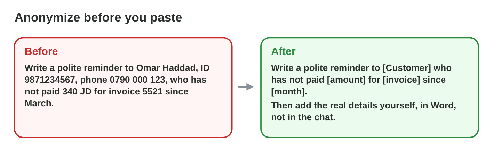
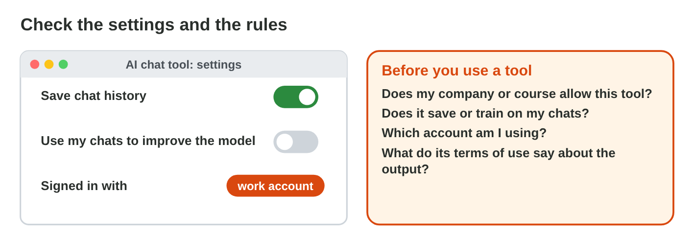
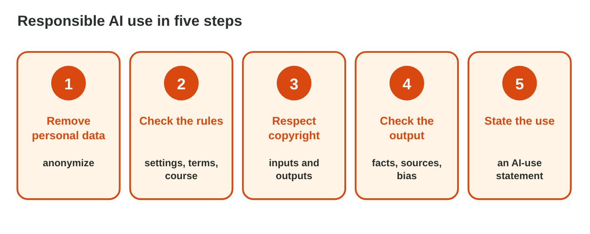

## Keywords



## 23.1 Personal data in prompts

:::: {.columns}
::: {.column width="50%"}
- A prompt leaves your computer and goes to the provider.
- Personal, sensitive and confidential data stay out.
- We use placeholders such as [Customer] and [amount].
- **Lab task:** Clean the three prompts in Prompt Cleaner. What may stay?
:::
::: {.column width="50%"}

:::
::::

## Live demo · Prompt Cleaner



## Example · Huda's reminder

Huda's prompt contains a customer's name, e-mail address and the bank account.
**How does Huda make it safe?**

::: {.reveal}
1. She replaces them with **[Customer]**, **[e-mail]** and **[bank account]**.
2. The **amount and the month** stay, because the AI needs them.
3. She adds the real details **in Outlook**, not in the chat.
:::

## Try it 1 · Personal data

a) Is a diagnosis in a sick note personal or sensitive data?
b) Why is deleting the chat later not enough?
c) What do we paste instead of a customer's name?

::: {.answer}
a) sensitive data
b) The provider may already store or use it.
c) a placeholder such as [Customer]
:::

## 23.2 Settings, rules and copyright

:::: {.columns}
::: {.column width="50%"}
- We check the chat history and the training setting.
- The company or course rules and the terms of use decide.
- We upload only files we may share, and use licensed images.
- **Lab task:** Check the settings of one AI tool. Is training switched on?
:::
::: {.column width="50%"}

:::
::::

## 23.3 Honesty and the AI-use statement

:::: {.columns}
::: {.column width="50%"}
- AI text handed in as our own is plagiarism.
- An AI-use statement names the tool, the use, the changes and the checks.
- Drafts and prompts show our own work.
- **Lab task:** Make all checks green in Statement Builder. What was missing?
:::
::: {.column width="50%"}

:::
::::

## Live demo · Statement Builder



## Example · Sami's report

The course allows AI for ideas and drafts if it is stated.
**What does Sami write at the end of the report?**

::: {.reveal}
1. "I used an AI chat tool for **ideas, an outline and a first draft**."
2. "I **rewrote** it in my own words and **checked every fact** in two sources."
3. "The rest of the report is **my own work**."
:::

## 23.4 Five steps

:::: {.columns}
::: {.column width="50%"}
- We remove personal data and check the rules.
- We respect copyright and check the output.
- We state the use in an AI-use statement.
- **Lab task:** Apply the five steps to one AI task of your own. Which step is new for you?
:::
::: {.column width="50%"}

:::
::::

## Game challenge · Responsible or Not?



## Try it 2 · Cases (harder)

a) May a colleague rework a paid e-book with AI into a company guide?
b) Is asking AI to explain a topic, then writing own notes, honest?
c) What does Huda do with a tool that trains on chats?

::: {.answer}
a) No, ask the owner or write your own.
b) Usually yes, if the course allows it.
c) switch off training and anonymize
:::

## Summary

- Personal, sensitive and confidential data stay out of prompts.
- We check the settings, the rules and the terms of use.
- We respect copyright in what goes in and what comes out.
- An AI-use statement makes our use honest.
- Five steps make responsible AI use a habit.
