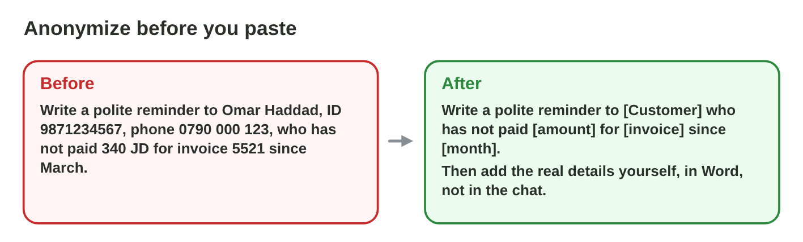
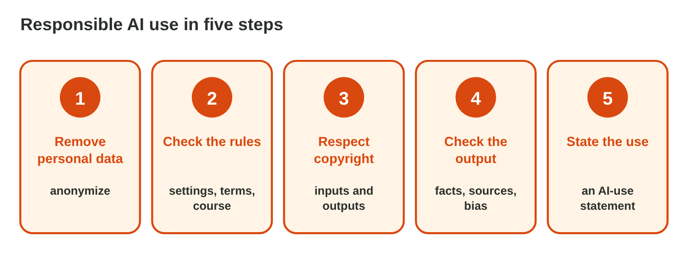

No new ideas today: two short problems on Lecture 9, on paper or on the lab
computer. Do each one alone. Tap, sort or type your answer at every step:
the page checks it at once and tells you why.

## Recall

- Personal data, sensitive data and confidential information stay out of a
  prompt. **Anonymize** with placeholders such as [Customer].
- Check the **settings** and the **rules** of a tool, and respect the
  **copyright** of what you upload and of what you use.
- Hand in your own work, with an **AI-use statement**: the tool, the use,
  your changes and your checks.

::: {.callout-tip title="Try it 1 · Recall"}
Choose the right answer.

::: {.match extra="a font|a theme"}
Which placeholder replaces a customer's name in a prompt?
:   [Customer]

    Why: The AI still knows the task, but not who the person is.

Sami hands in a report that an AI wrote, with no statement. What is it?
:   plagiarism

    Why: Sami presents work that is not Sami's own.

Which four parts does an AI-use statement have?
:   tool, use, changes, checks

    Why: Then everybody knows which parts are your own work.
:::
:::

## Activity 1 · Safe prompts at work

Three people want to paste these prompts into a free AI chat tool:

- **Huda:** *Write a birthday message for our colleague Lina Hasan, born
  2 March 1995, who lives at 5 Olive Street.*
- **Omar:** *Write a reply to Faris Nasser (faris.n@example.com, phone
  0795 111 222), who asks for a refund of 25 JD for a broken lamp.*
- **Sami:** *Here are the questions of tomorrow's quiz. Write the answers
  for me.*

{width=100%}

::: {.callout-note title="Activity 1 · Three prompts · 15 min"}
1. In each prompt, mark the personal, sensitive or confidential parts.
2. Write a safe version of Huda's and Omar's prompts with placeholders.
   Keep what the AI needs for the task.
3. For Sami's prompt, write in one sentence what Sami should do instead.

*Your product:* two safe prompts and one sentence for Sami.

::: {.sort}
Step 1: take it out, or keep it? Sort the parts of Huda's and Omar's
prompts.

Take it out
:   Lina Hasan

    Why: A name: a placeholder, [name], takes its place.

:   born 2 March 1995, of 5 Olive Street

    Why: The birthday and the address are not needed for the message.

:   faris.n@example.com, phone 0795 111 222

    Why: Personal data: the AI does not need it.

Keep: the AI needs it
:   a refund of 25 JD

    Why: The reply is about this amount.

:   a broken lamp

    Why: The reply says what is broken.
:::

::: {.choice}
Step 2: which safe version of Omar's prompt is good?

- [x] Write a reply to [Customer], who asks for a refund of 25 JD for a broken lamp.

  Why: The amount and the lamp stay: the AI needs them.

- [ ] Write a reply to Faris Nasser, who asks for a refund.

  Why: The name is personal data, and the AI needs the amount and the lamp.

- [ ] Write a reply to [Customer] about [something].

  Why: The AI needs the refund, 25 JD and the lamp to write the reply.
:::

::: {.choice}
Step 3: what should Sami do instead?

- [x] Ask the AI to explain the topic with one example, then answer the quiz alone.

  Why: The quiz questions are confidential, and the answers must be Sami's own.

- [ ] Paste only half of the questions.

  Why: Half of a confidential quiz is still confidential.

- [ ] Use another AI tool.

  Why: The problem is the quiz, not the tool.
:::
:::

::: {.callout-tip title="Try it 2 · The prompts"}
Choose the right answer.

::: {.match extra="paste them all|they are public"}
Does the birthday message need Lina's birthday and address?
:   no, leave them out

    Why: The AI needs the task, not the details of the person.

May "25 JD" and "a broken lamp" stay in Omar's prompt?
:   yes, they stay

    Why: Without the name, they say nothing about a person, and the AI needs them.

What kind of information are tomorrow's quiz questions?
:   confidential information

    Why: Exam questions are a secret of the college.
:::
:::

## Activity 2 · Five steps and a statement

Rana makes a poster for the new teas of the Sunrise shop with an AI tool.
Her plan: paste the supplier's catalogue page (its text and photo), paste
the price list of the regular customers with their names, ask for "a nice
text", and use the AI picture as it is.

{width=100%}

::: {.callout-note title="Activity 2 · Rana's poster · 15 min"}
1. Write one sentence for each of the five steps for Rana: remove personal
   data; check the rules; respect copyright; check the output; state the
   use.
2. Write Rana's AI-use statement in two or three sentences.

*Your product:* five sentences and a short statement.

::: {.sort}
Step 1: which step is each action of Rana? Sort them.

Remove personal data
:   no names of customers: the poster needs no list

    Why: The price list with names stays out of the AI tool.

Respect copyright
:   do not upload the supplier's text and photo

    Why: They belong to the supplier.

:   describe the teas in her own words

    Why: Her own text has no copyright problem.

Check the output
:   check every price and fact against the shop's list

    Why: The AI can change a price.

State the use
:   write a short AI-use statement on the poster file

    Why: Everybody knows which parts the AI made.
:::

::: {.choice}
Step 1: what does Rana check in the step "check the rules"?

- [x] an allowed tool, and its terms of use for images

  Why: The terms say what she may do with the pictures of the tool.

- [ ] the colours of the poster

  Why: The look is not a rule.

- [ ] the prices of the teas

  Why: That is "check the output".
:::

::: {.choice}
Step 2: which AI-use statement is good?

- [x] Text draft and picture made with an AI tool. Prices and facts checked by Rana.

  Why: It says what the AI made, and how Rana checked it.

- [ ] Made with AI.

  Why: It does not say what the AI made, or how it was checked.

- [ ] Rana made everything herself.

  Why: Not honest: the AI made the draft and the picture.
:::
:::

::: {.callout-tip title="Try it 3 · Rana's poster"}
Choose the step.

::: {.match extra="buy a faster PC|use capital letters"}
Rana wants to paste the supplier's catalogue page. Which step stops her?
:   respect copyright

    Why: The supplier's text and photo are not hers to upload.

The poster says "tea sets from 9 JD", but the price list says 12 JD. Which step finds it?
:   check the output

    Why: Every price and fact is checked against the shop's list.

"Picture made with an AI tool." Which step is it?
:   state the use

    Why: The note says honestly what the AI did.
:::
:::

## Wrap-up {.summary}

- You can rewrite a prompt so that no personal or confidential data goes
  into an AI tool.
- You can plan an AI task with the five steps of responsible use and write
  its AI-use statement.
