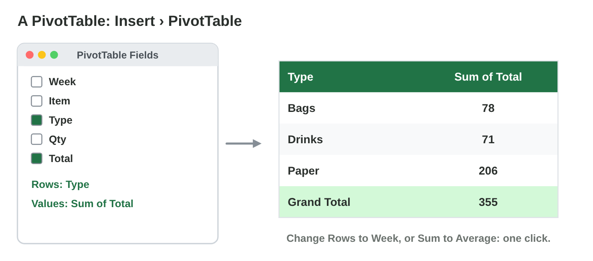
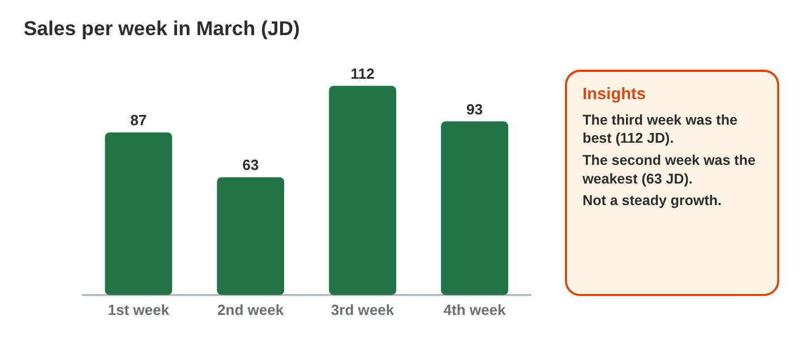
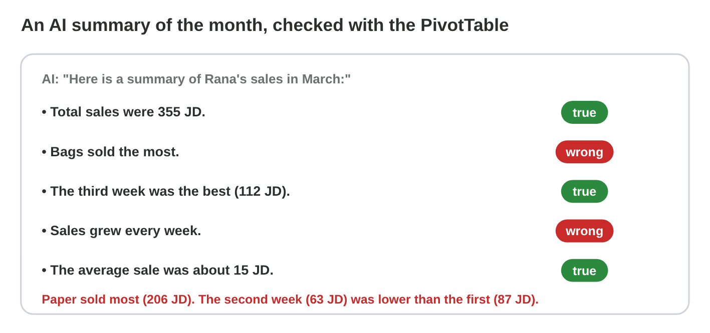

This page is the lecture, in class and at home. Each section explains one
idea, then shows its experiment: **Part A** in the app, **Part B** on a
simulator or on your phone. The page checks every step at once.

- **No computers in the room?** The teacher does each experiment here on
  the screen: Part A on the simulator of the section (or in the app on the
  teacher's laptop), and each prompt in an AI assistant in another tab (**Copy prompt**). Then the class checks the result with the step.
- **In the computer lab?** Follow the **worksheet (PDF)**: Part A in the
  app, Part B on the simulator. Write each result, then check it here.
- **You need:** Excel (the desktop app, or Excel on the web at `office.com`), the start file and an AI assistant that the university allows, or only the simulators of this page.

## Key terms



## Before you start



## 10.1 Totals by group: the PivotTable

- Rana has 24 sales of March. Huda asks: how much did each type sell?
- A **PivotTable** makes a **summary table** in a few clicks.
- Click one cell of the list › **Insert › PivotTable** › OK.
- Drag **Type** to **Rows** and **Total** to **Values**.
- March: Paper 206 JD, Drinks 71 JD, Bags 78 JD. Grand Total: 355 JD.

{width=100%}

::: {.callout-warning title="Watch out!"}
Do not type the totals again by hand. Typed numbers do not change when the
list changes.
:::





::: {.callout-tip title="Try it 1 · The PivotTable"}
Choose the right answer.

::: {.match extra="Insert › Picture|Quantity"}
You want one row for each type. Which field goes into Rows?
:   Type

    Why: the row field makes the groups.

The types are 206, 71 and 78 JD. What is the Grand Total?
:   355 JD

    Why: 206 + 71 + 78 = 355.
:::
:::

## 10.2 Ask another question: weeks, averages and a chart

- Change the **row field**: drag **Week** to Rows. March: 87, 63, 112 and
  93 JD.
- Change the calculation: **Value Field Settings › Average**.
- New rows in the list? **PivotTable Analyze › Refresh**.
- Click the PivotTable › **Insert › Chart**: a **line chart** shows the
  weeks.

{width=100%}

::: {.callout-warning title="Watch out!"}
A PivotTable does not change by itself. After new rows, click **Refresh**.
:::

Part B of this experiment uses **Pivot Lab** of section 10.1.



::: {.callout-tip title="Try it 2 · Other questions"}
The weeks of March were 87, 63, 112 and 93 JD. Choose the right answer.

::: {.match extra="Delete the PivotTable|a pie chart"}
You add new sales to the list. What must you do?
:   Refresh the PivotTable

    Why: the PivotTable does not change by itself.
:::
:::

## 10.3 An AI summary of the data: check every number

- Rana gives an AI tool the **summary table**, with no personal data.
- She asks: "Write three short sentences about these sales, each with a
  number."
- A **data insight** is a short, true sentence such as "Paper sold the
  most".
- Check every number with the PivotTable. Correct or delete wrong
  sentences.
- Add an **AI-use statement** under the text (Lecture 21).

{width=100%}



::: {.callout-warning title="Watch out!"}
A sentence can sound sure and still be wrong: an AI tool can invent a
number (a **hallucination**).
:::



::: {.callout-tip title="Try it 3 · The AI summary"}
The PivotTable of March: Paper 206 JD, Drinks 71 JD, Bags 78 JD; the weeks
87, 63, 112 and 93 JD. Choose the right answer.

::: {.match extra="Bags sold the most|the list with the names of customers"}
An AI sentence has a number that is not in the data. What is it?
:   a hallucination

    Why: the AI invented it.
:::
:::

## Table of results



## Game challenge: Huda's April meeting {.challenge}

Work alone. Use every section of today.

In April the Sunrise shop sold **400 JD**. Rana's PivotTable shows **Paper
180 JD**, **Drinks 95 JD** and **Bags 125 JD**, and the four weeks **90,
110, 85 and 115 JD**. An AI tool writes for the newsletter: "Drinks sold
the most. The best week was the fourth, with 115 JD. Sales fell in the
third week."

::: {.callout-tip title="Try it 4 · The April report (harder)"}
April: Paper 180 JD, Drinks 95 JD, Bags 125 JD; weeks 90, 110, 85 and 115
JD. Choose the right answer.

::: {.match extra="Drinks|the first week|a pie chart"}
Which type sold the most in April?
:   Paper, 180 JD

    Why: 180 is more than 125 and 95.

Is the AI sentence "Drinks sold the most" true?
:   no, it is wrong

    Why: Drinks sold 95 JD, the least of the three types.
:::
:::

## Summary {.summary}

- A PivotTable makes a summary table: a field in Rows, a field in Values.
- Change the row field or the calculation to ask another question.
- Refresh the PivotTable after new rows; a line chart shows the weeks.
- An AI summary can be wrong: check every number with the PivotTable.
- Add an AI-use statement under a text that AI helped to write.
