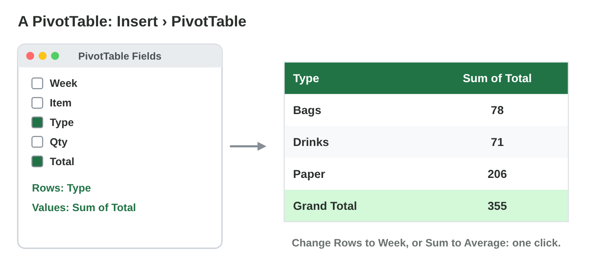
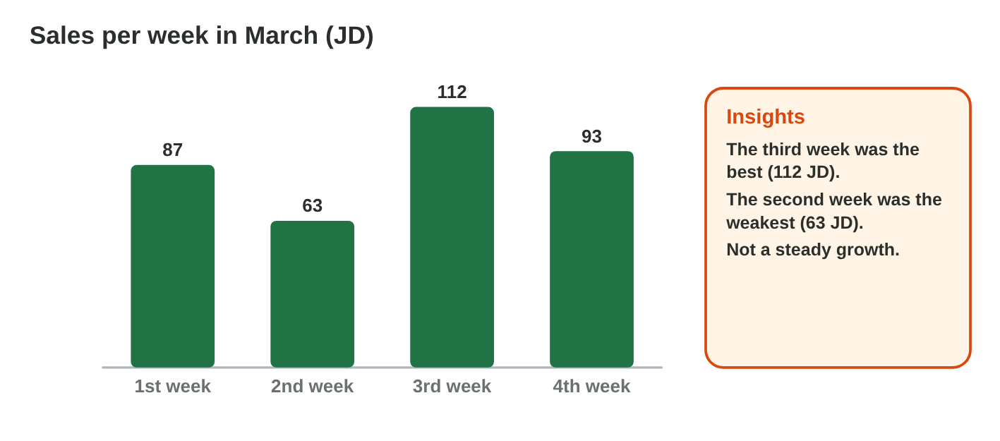
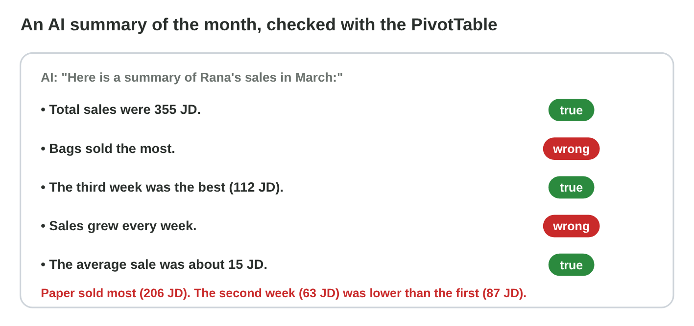

This page is the interactive version of the lesson notes (PDF). Each section
starts with a problem at work. Then it explains the idea. It ends with a
**Lab task** and one set of questions. Every question on this page has its
answer: try first, then check.

## Key terms



## 10.1 Totals by group: the PivotTable

- Rana has 24 sales of March. Huda asks: how much did each type sell?
- A **PivotTable** makes a **summary table** in a few clicks.
- Click one cell of the list › **Insert › PivotTable** › OK.
- Drag **Type** to **Rows** and **Total** to **Values**.
- March: Paper 206 JD, Drinks 71 JD, Bags 78 JD. Grand Total: 355 JD.

{width=100%}

::: {.callout-warning title="Watch out!"}
Do not type the totals again by hand. Typed numbers do not change when the
list changes.
:::



::: {.callout-note title="Lab task · Totals by type"}
In **Pivot Lab**, choose Rows **Type** and Values **Sum of Total**. Write
the total of each type and the Grand Total. Which type sold the most?

::: {.check}
Paper 206 JD, Drinks 71 JD, Bags 78 JD; Grand Total 355 JD. Paper sold the
most.
:::
:::

::: {.callout-tip title="Try it 1 · The PivotTable"}
Choose the right answer.

::: {.match extra="Insert › Picture|Quantity"}
What do you click first, before Insert › PivotTable?
:   one cell of the list

    Why: Excel then takes the whole list.

You want one row for each type. Which field goes into Rows?
:   Type

    Why: the row field makes the groups.

You want the money of each type. Which field goes into Values?
:   Total

    Why: Excel adds up the value field for each row.

The types are 206, 71 and 78 JD. What is the Grand Total?
:   355 JD

    Why: 206 + 71 + 78 = 355.

Why not type the totals into another table by hand?
:   they do not change when the list changes

    Why: the PivotTable can be refreshed; typed numbers cannot.
:::
:::

## 10.2 Ask another question: weeks, averages and a chart

- Change the **row field**: drag **Week** to Rows. March: 87, 63, 112 and
  93 JD.
- Change the calculation: **Value Field Settings › Average**.
- New rows in the list? **PivotTable Analyze › Refresh**.
- Click the PivotTable › **Insert › Chart**: a **line chart** shows the
  weeks.

{width=100%}

::: {.callout-warning title="Watch out!"}
A PivotTable does not change by itself. After new rows, click **Refresh**.
:::

::: {.callout-note title="Lab task · Weeks and averages"}
In **Pivot Lab**, choose Rows **Week**: which week was the best, and which
the weakest? Then choose Rows **Type** and Values **Average of Total**:
which type has the biggest average sale?

::: {.check}
The third week was the best (112 JD) and the second the weakest (63 JD).
Paper has the biggest average sale: about 20.6 JD.
:::
:::

::: {.callout-tip title="Try it 2 · Other questions"}
The weeks of March were 87, 63, 112 and 93 JD. Choose the right answer.

::: {.match extra="Delete the PivotTable|a pie chart"}
Which week was the best?
:   the third week, 112 JD

    Why: 112 is the biggest of the four totals.

Which week was the weakest?
:   the second week, 63 JD

    Why: 63 is the smallest of the four totals.

You add new sales to the list. What must you do?
:   Refresh the PivotTable

    Why: the PivotTable does not change by itself.

Which chart shows the four weeks?
:   a line chart

    Why: a line chart shows a change over time.

How do you get the average of each type?
:   Value Field Settings › Average

    Why: the value field can be added up, counted or averaged.
:::
:::

## 10.3 An AI summary of the data: check every number

- Rana gives an AI tool the **summary table**, with no personal data.
- She asks: "Write three short sentences about these sales, each with a
  number."
- A **data insight** is a short, true sentence such as "Paper sold the
  most".
- Check every number with the PivotTable. Correct or delete wrong
  sentences.
- Add an **AI-use statement** under the text (Lecture 9).

{width=100%}



::: {.callout-warning title="Watch out!"}
A sentence can sound sure and still be wrong: an AI tool can invent a
number (a **hallucination**).
:::

::: {.callout-note title="Lab task · Check the summary"}
In **Summary Check**, mark each of the six sentences true or wrong. Then
write a summary of three true sentences, each with a number.

::: {.check}
True: the total of 355 JD; the third week was the best (112 JD); the
average sale was about 15 JD. Wrong: "Bags sold the most" (Paper, 206 JD);
"sales grew every week" (the second week fell); "the biggest sale was a bag
for 48 JD" (notebooks, 60 JD). A good summary: "March sales were 355 JD.
Paper sold the most, 206 JD. The best week was the third, with 112 JD."
:::
:::

::: {.callout-tip title="Try it 3 · The AI summary"}
The PivotTable of March: Paper 206 JD, Drinks 71 JD, Bags 78 JD; the weeks
87, 63, 112 and 93 JD. Choose the right answer.

::: {.match extra="Bags sold the most|the list with the names of customers"}
The AI says "Bags sold the most". What is true?
:   Paper sold the most

    Why: Paper 206 JD is more than Bags 78 JD.

The AI says "Sales grew every week". Is it right?
:   no, the second week fell

    Why: 87 JD, then 63 JD: a fall.

What does Rana give the AI tool?
:   the summary table

    Why: it has the numbers and no personal data.

An AI sentence has a number that is not in the data. What is it?
:   a hallucination

    Why: the AI invented it.

What goes under a summary that an AI tool helped to write?
:   an AI-use statement

    Why: it says which tool you used and how you checked it.
:::
:::

## Game challenge: Huda's April meeting {.challenge}

Work alone. Use every section of today.

In April the Sunrise shop sold **400 JD**. Rana's PivotTable shows **Paper
180 JD**, **Drinks 95 JD** and **Bags 125 JD**, and the four weeks **90,
110, 85 and 115 JD**. An AI tool writes for the newsletter: "Drinks sold
the most. The best week was the fourth, with 115 JD. Sales fell in the
third week."

::: {.callout-tip title="Try it 4 · The April report (harder)"}
April: Paper 180 JD, Drinks 95 JD, Bags 125 JD; weeks 90, 110, 85 and 115
JD. Choose the right answer.

::: {.match extra="Drinks|the first week|a pie chart"}
Which type sold the most in April?
:   Paper, 180 JD

    Why: 180 is more than 125 and 95.

Is the AI sentence "Drinks sold the most" true?
:   no, it is wrong

    Why: Drinks sold 95 JD, the least of the three types.

Is "The best week was the fourth, with 115 JD" true?
:   yes, it is true

    Why: 115 is the biggest of the four weeks.

Is "Sales fell in the third week" true?
:   yes, from 110 to 85 JD

    Why: the second week had 110 JD and the third 85 JD.

Which chart shows the weeks of April for Huda?
:   a line chart

    Why: the weeks are a change over time.
:::
:::

## Summary {.summary}

- A PivotTable makes a summary table: a field in Rows, a field in Values.
- Change the row field or the calculation to ask another question.
- Refresh the PivotTable after new rows; a line chart shows the weeks.
- An AI summary can be wrong: check every number with the PivotTable.
- Add an AI-use statement under a text that AI helped to write.
