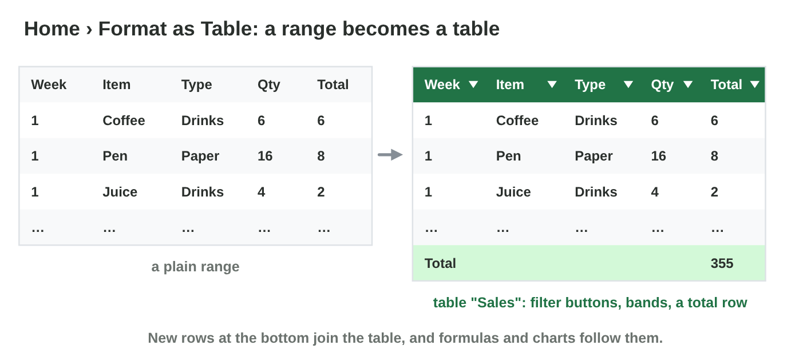
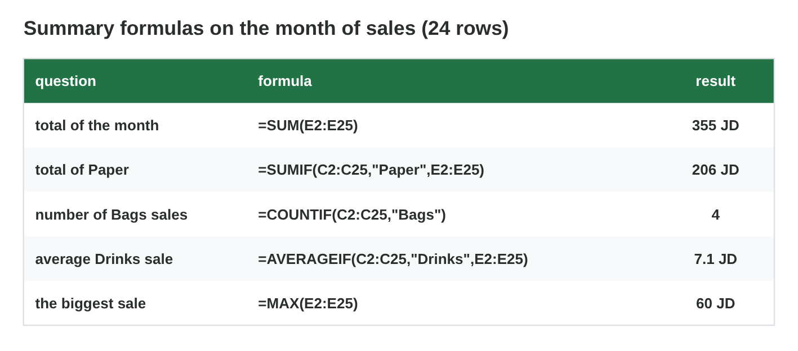

::: {.lead}
Rana's shop at *Sunrise Company* sold 24 times in March. Huda asks three
questions for the staff newsletter: "What sold the most? Which week was the
best? What was a normal sale?" Rana could add the numbers with a
calculator for an hour, or ask an AI tool and copy its answer. Neither is
a good idea. In lectures 11, 13 and 14 you used formulas, sorting, filters,
charts and AI help in Excel. In this lesson you learn to **summarize** a
list: as an Excel **table**, with **summary formulas**, with a
**PivotTable**, and with an **AI summary that you check**. Every section
ends with a lab task.
:::

## Key terms



## 25.1 Make the list a table

Rana's list has the columns Week, Item, Type, Qty and Total (JD). The first
step is to make it an **Excel table** (@fig-table).

::: {.callout-important title="Definition 25.1 — Excel table"}
Click one cell of the list, then **Home › Format as Table** (or
**Ctrl + T**), and confirm "My table has headers". The **Excel table**
gets:

- a **name** (Table Design › Table Name, for example `Sales`);
- **filter buttons** in the header and banded rows;
- a **total row** (Table Design › Total Row) with a sum, an average or a
  count for each column;
- new rows at the bottom join the table, so formulas and charts follow.
:::

{#fig-table width=100%}

::: {.callout-note title="Example 25.1 — Rana's table"}
1. Rana clicks A1, presses Ctrl + T and names the table `Sales`.
2. Rana switches on the total row; under Total (JD) it shows **355**.
3. In the total row of Qty, Rana chooses Average.
:::

::: {.callout-warning title="Common mistake"}
Empty rows or a second small table in the middle of the list. Excel stops
the table at the empty row. Keep one row per sale, with no gaps.
:::

::: {.callout-note title="Lab task · Make the table"}
1. Type or open the March sales (24 rows, see **Pivot Lab**) and save the
   file as `march.xlsx`.
2. Make it a table named `Sales`, and switch on the total row.

*Your result:* `march.xlsx` with a table and a total of 355.
:::

## 25.2 Summary formulas

Some answers need one number in one cell (@fig-formulas).

::: {.callout-important title="Definition 25.2 — Summary formulas"}
- `=SUMIF(range, condition, sum_range)` adds the rows that match.
- `=COUNTIF(range, condition)` counts the rows that match.
- `=AVERAGEIF(range, condition, average_range)` averages the rows that
  match.
- `=MAX(range)` and `=MIN(range)` give the biggest and the smallest value.

A small **summary table** puts these numbers next to the list, one row per
type.
:::

{#fig-formulas width=100%}

::: {.callout-note title="Example 25.2 — The answers in one cell each"}
1. `=SUMIF(C2:C25,"Paper",E2:E25)` gives **206 JD**.
2. `=COUNTIF(C2:C25,"Bags")` gives **4** sales.
3. `=AVERAGEIF(C2:C25,"Drinks",E2:E25)` gives **7.1 JD**.
4. `=MAX(E2:E25)` gives **60 JD**.
:::

::: {.callout-warning title="Common mistake"}
Typing the condition with a different spelling: "paper " with a space, or
"Papers", gives 0. Copy the text from the list, or point to a cell that
holds it.
:::

::: {.callout-note title="Lab task · A summary table"}
Next to the table, make a summary table with the rows Paper, Drinks and
Bags and the columns Total, Count and Average, with SUMIF, COUNTIF and
AVERAGEIF.

*Your result:* a summary table with nine numbers.
:::

## 25.3 PivotTables

A **PivotTable** builds a whole summary table in a few clicks
(@fig-pivot).

::: {.callout-important title="Definition 25.3 — PivotTable"}
Click in the table, then **Insert › PivotTable** › New Worksheet. In the
**PivotTable Fields** pane:

- drag a field to **Rows** (the **row field**, for example Type);
- drag a number field to **Values** (the **value field**, for example
  Total); it shows *Sum of Total*;
- change Sum to Count or Average with **Value Field Settings**.

When the data changes, press **Refresh** (PivotTable Analyze › Refresh).
:::

{#fig-pivot width=100%}

::: {.callout-note title="Example 25.3 — Three questions, three clicks"}
1. Rows Type, Values Sum of Total: Paper **206**, Bags 78, Drinks 71.
2. Rows Week: 87, 63, **112**, 93: the third week was the best.
3. Values Average: Paper 20.6, Bags 19.5, Drinks 7.1 JD per sale.
:::



::: {.callout-warning title="Common mistake"}
Forgetting Refresh. A PivotTable does not change by itself when you add
rows to the data.
:::

::: {.callout-note title="Lab task · Your PivotTable"}
1. In **Pivot Lab**, answer the four tasks.
2. In `march.xlsx`, make a PivotTable with Rows Week and Values Sum of
   Total, and check that the Grand Total is 355.

*Your result:* four answers and a PivotTable.
:::

## 25.4 AI help: summarize and check

An AI tool can write sentences about data quickly, but it can also invent
numbers and trends (@fig-ai).

::: {.callout-important title="Definition 25.4 — An AI summary you can trust"}
1. Paste only data you may share: no customer names or personal data
   (lecture 23). Or use the AI in Excel (for example Copilot in Excel with
   the university account) on the table.
2. Ask a clear question: "Summarize the sales by type and by week in three
   sentences, with numbers."
3. **Check** every number and every trend with your PivotTable or
   formulas.
4. Keep only the checked sentences: these are your **data insights**. Say
   that AI helped.
:::

{#fig-ai width=100%}

::: {.callout-note title="Example 25.4 — Two wrong sentences"}
1. The AI writes: "Bags sold the most." The PivotTable says Paper (206 JD)
   sold the most.
2. "Sales grew every week." The PivotTable shows 87, 63, 112, 93: no.
3. Rana keeps the true sentences, corrects the two wrong ones, and adds:
   "Summary drafted with AI help and checked with a PivotTable."
:::



::: {.callout-warning title="Common mistake"}
Believing a trend because it sounds normal. "Sales grew every week" sounds
likely, but the data says otherwise. Check trends with a chart or the
weekly totals.
:::

::: {.callout-note title="Lab task · Ask and check"}
1. In **Summary Check**, mark all six sentences.
2. Ask an AI tool for a three-sentence summary of your table (no personal
   data), and check each number with your PivotTable.

*Your result:* the AI summary with "true" or "wrong" after each sentence.
:::

## Case study: The Right Tool

Huda and Rana have six questions: the total of Paper, the biggest sale, the
number of Bags sales, the average Drinks sale, all weeks and all types at
once, and three sentences for the newsletter. The Game challenge of the
interactive lesson uses these questions. In the mini-game below you choose
the quickest right tool for each one.



::: {.callout-note title="Lab task · Upload"}
Upload `march.xlsx` with the table, the summary table, the PivotTable and
the checked AI summary to the e-learning platform.

*Your result:* one file.
:::

## Further reading

Microsoft Support, "Create a PivotTable to analyze worksheet data" and
"Overview of Excel tables" (support.microsoft.com). Microsoft Support,
"Get started with Copilot in Excel".

## Exercises

1. How do you make a list an Excel table?
2. Name three things an Excel table adds.
3. Write the formula for the total of Drinks in E2:E25 when the type is in
   C2:C25.
4. What does `=COUNTIF(C2:C25,"Paper")` give for Rana's month?
5. What is the difference between SUMIF and AVERAGEIF?
6. What are the row field and the value field of a PivotTable?
7. How do you change Sum of Total to Average of Total?
8. Why do you press Refresh?
9. Name two wrong things an AI summary can contain.
10. What must you do before you use an AI summary in a report?

## Answers to the exercises

::: {.answers}
1. Click one cell, then Home › Format as Table (or Ctrl + T).
2. For example a name, filter buttons, banded rows, a total row.
3. `=SUMIF(C2:C25,"Drinks",E2:E25)`.
4. 10.
5. SUMIF adds the matching rows; AVERAGEIF averages them.
6. The row field makes the rows (for example Type); the value field is
   summarized (for example Total).
7. Value Field Settings › Average.
8. The PivotTable does not change by itself when the data changes.
9. For example a wrong number, an invented trend.
10. Check every number with a PivotTable or formulas, and say AI helped.
:::
