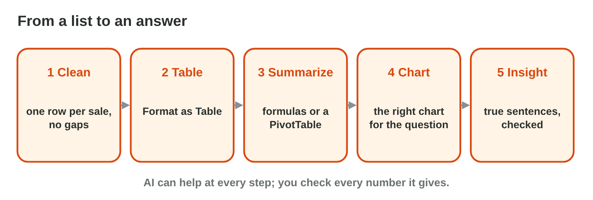

## Before you start {.study}

- **What you need:** Excel (desktop, on the web at `office.com`, or the
  phone app) and an AI tool your university allows.
- **Time:** about 60 minutes. Work alone, at your own speed.
- **How it works:** do Steps 1–3 on this page. Each step has a short text, a
  simulator and a self-check. Then do the **Tasks to submit**.
- **What you submit:** one Excel file with the clean table, the
  PivotTables, the chart and your insights, before lecture 27.
- **You need lecture 25:** Excel tables, summary formulas, PivotTables and
  checking an AI summary.

## Key terms {.study}



## Step 1 · Clean the data and make a table {.study}

- One row per record, one kind of value per column, no empty rows.
- Remove **duplicate rows** (Data › Remove Duplicates) and make spellings
  the same ("excel" → "Excel").
- Then **Format as Table** (Ctrl + T) and switch on the total row.

{width=100%}



::: {.callout-tip title="Try it 1 · Clean data"}
Choose the right answer.

::: {.match extra="a bigger font|a new sheet"}
the same row twice
:   remove the duplicate

"excel" and "Excel" in one column
:   make the spelling the same

an empty row in the middle
:   delete it

the step after cleaning
:   Format as Table
:::
:::

## Step 2 · Summarize with a PivotTable {.study}

- **Insert › PivotTable**; one field in **Rows**, the number field in
  **Values**.
- Change the rows to see the data from another side (by type, by month).
- Check: the Grand Total must equal the total row of the table.

{width=100%}



::: {.callout-tip title="Try it 2 · PivotTables"}
Use Pivot Lab. Choose the right answer.

::: {.match extra="Values: Item|Rows: Total"}
the total of each type
:   Rows Type, Values Sum of Total

the number of sales of each item
:   Rows Item, Values Count of sales

the Grand Total of Rana's month
:   355

after you add new rows
:   Refresh
:::
:::

## Step 3 · The right chart and checked insights {.study}

- Compare categories: a **column chart**; a change over time: a **line**
  or column chart in time order; parts of one whole: a **pie** (few parts).
- Give the chart a clear title and axis labels.
- An **insight** is a short, true sentence with a number. AI can draft
  insights; check each one with the PivotTable.

{width=100%}



::: {.callout-tip title="Try it 3 · Charts and insights"}
Choose the right answer.

::: {.match extra="a table of text|no chart at all"}
hours of three departments compared
:   a column chart

hours from January to April
:   a line or column chart in month order

the share of each course in all hours
:   a pie chart

an AI insight before you use it
:   check it with the PivotTable
:::
:::

## Tasks to submit {.tasks}

Do the tasks alone. Your teacher marks them (6 marks). Huda collected the
**training hours** of the staff of Sunrise Company from January to April.
Type this list into a new Excel workbook, starting in cell A1, and save it
as `training.xlsx`:

| Month | Department | Course | Hours |
|---|---|---|---|
| Jan | Sales | Excel | 6 |
| Jan | Office | Word | 4 |
| Jan | Shop | Safety | 2 |
| Feb | Sales | Word | 4 |
| Feb | Office | Excel | 6 |
| Feb | Office | Excel | 6 |
| Feb | Shop | Excel | 6 |
| Mar | Sales | Safety | 2 |
| Mar | Office | Safety | 2 |
| Mar | Shop | Word | 4 |
| Mar | Sales | excel | 6 |
| Apr | Office | Word | 4 |
| Apr | Shop | Safety | 2 |
| Apr | Sales | Excel | 6 |
| Apr | Shop | Excel | 6 |
| Apr | Office | Safety | 2 |

The row "Feb, Office, Excel, 6" was typed twice by mistake.

### Task 1 · Clean and table (2 marks)

1. Remove the duplicate row and make the spelling of the courses the same.
2. Make the list an Excel table named `Training` with a total row. Write
   the total number of hours in a cell next to the table.

### Task 2 · Summarize (2 marks)

1. Make a PivotTable with Rows Department and Values Sum of Hours.
2. Make a second PivotTable with Rows Course (or change the first one and
   copy the result). Which department and which course have the most
   hours?

### Task 3 · Chart and insights (2 marks)

1. Make the right chart for the hours of each month, in month order, with
   a title.
2. Ask an AI tool for three insights about the data (paste only the
   table). Check each number with your PivotTables, correct what is wrong,
   and write the three checked insights under the chart, with a one-line
   AI-use statement.

Which AI insight was wrong or unclear, and how did you find out?



## How to submit

Upload `training.xlsx` (the clean table, the PivotTables, the chart and the
insights) to the university e-learning platform, **before lecture 27**.
