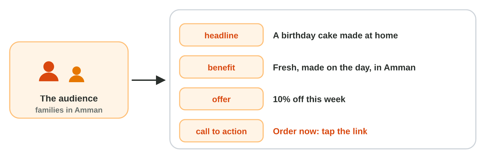
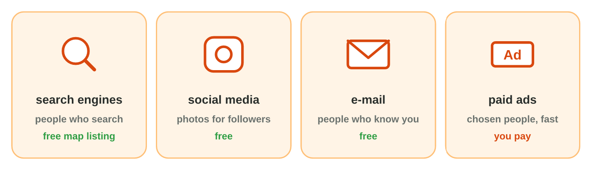
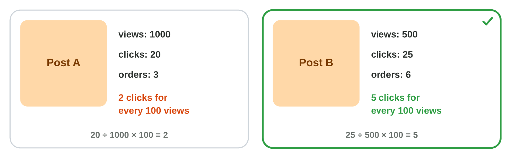

::: {.lead}
Mona's Cakes has an order form (Lecture 8) and a website (Lecture 9). But
a good service that nobody knows gets no orders. **E-marketing** tells the
right people about the service on the Internet: the right message, in the
right place, and then a look at the results. In this lesson you choose the
audience and the message, the channels, and you make a promotional post
and read its results. These notes are a short reference: in class you do
each idea in the apps, as an experiment of the **worksheet**.
:::

## Key terms



## 10.1 The audience and the message

Start with the **audience**: who is the message for? "Everybody" is too
wide: the message then speaks to nobody. Mona's audience: families in
Amman with a birthday soon.

Then write the **message** for them (@fig-message):

- a **headline** for the audience (*A birthday cake made at home*);
- the **benefit**: why it helps them (*fresh, made on the day*);
- the **offer**: a reason to act now (*10% off this week*);
- the **call to action**: what to do next (*Order now*, with the link).

{#fig-message width=100%}

::: {.callout-important title="Definition 10.1 — Call to action"}
A **call to action** is the words that tell the reader what to do next,
such as *Order now* with a link.
:::

::: {.callout-note title="Example 10.1 — Three posts from AI"}
1. Mona asks an AI assistant for three short posts (the prompt gives the
   audience, the offer and the words *Order now*).
2. Post 1 has no offer. Post 3 has big words and no call to action.
3. Post 2 has all the parts: *Birthday soon? Fresh cakes made at home in
   Amman. 10% off this week. Order now!* She uses it.
:::



*In class: Experiment 1 of the worksheet, three posts from an AI assistant,
checked.*

## 10.2 The channels

A **channel** is the way the message reaches people (@fig-channels):

| Channel | Good for | Cost |
|---|---|---|
| search engines (and the map) | people who search, ready to buy | free (the map listing) |
| social media | photos and posts for followers | free |
| e-mail | people who already know you | free |
| paid ads | the people that you choose, fast | you pay (for example 20 JD) |

: Four channels of e-marketing. {#tbl-channels}

{#fig-channels width=100%}

In a search engine, the paid ads have the word *Sponsored*. A shop can put
itself on the map for free, with its phone and hours (for example a Google
Business Profile).

::: {.callout-note title="Example 10.2 — Mona's channels"}
1. People who search "cakes Amman": a free map listing.
2. Photos of new cakes every week: Instagram.
3. The 200 old customers: one e-mail about the new lemon cake.
4. New families this week: a paid ad of 20 JD for families in Amman.
:::



*In class: Experiment 2 of the worksheet, the paid ads and the map in a
search.*

## 10.3 A post and its results

A **promotional post** is a picture with the message: a good photo, a few
words and the call to action. **Canva** (`canva.com`, free) has ready-made
designs (templates): change the text and the photo, then **Download** a
PNG.

**Pictures and copyright:** a picture belongs to the person who made it.
Use your own photos, or **free pictures** (Canva's free photos, Pixabay,
Unsplash), and write the source: *Photo: Canva*. Never take a picture from
Google Images or a company logo.

After a week, **measure** the results (@fig-results): **views** (how many
saw it), **clicks** (how many tapped the link) and **orders**. To compare
two posts, use **clicks for every 100 views** = clicks ÷ views × 100.

{#fig-results width=100%}

::: {.callout-note title="Example 10.3 — Post A or post B?"}
1. Post A: 1000 views, 20 clicks: 20 ÷ 1000 × 100 = 2 clicks for every
   100 views, and 3 orders.
2. Post B: 500 views, 25 clicks: 25 ÷ 500 × 100 = 5, and 6 orders.
3. Post B worked better, with fewer views. Next week Mona uses its style
   again.
:::

::: {.callout-warning title="Common mistake"}
Looking only at views. Many views and no clicks or orders is not a good
result. Count the clicks and the orders.
:::



*In class: Experiment 3 of the worksheet, a post in Canva with a free photo,
and the results of two posts.*

## Case study: the Market Desk at Sunrise Company

Huda's colleagues market their services. Omar asks who the audience of the
new school bags is. Lina's post has no call to action. Fix It wants people
who search to find it. Sami has 15 JD for new customers in Irbid. Two
posts must be compared. In the mini-game below, you answer eight such
messages.



## Further reading

Chaffey and Ellis-Chadwick, *Digital Marketing: Strategy, Implementation
and Practice*, the first chapter (what digital marketing is) and the
chapter on the channels. Canva Design School (canva.com/learn).

## Exercises

1. Which audience is clear: "everybody" or "students of the college who need prints"?
2. "Order now: tap the link" is … (the offer or the call to action)?
3. "10% off this week" is … (the offer or the benefit)?
4. People search "phone repair Amman". Which channel finds them?
5. Which channel reaches old customers for free?
6. A search result has the word *Sponsored*. Is it a paid ad: yes or no?
7. May you use a photo from Google Images in your post: yes or no?
8. A post: 400 views and 8 clicks. How many clicks for every 100 views?

## Answers to the exercises

::: {.answers}
1. Students of the college who need prints.
2. The call to action.
3. The offer.
4. A search engine (and its map).
5. E-mail.
6. Yes.
7. No: use your own photo or a free picture, with its source.
8. 2 (8 ÷ 400 × 100 = 2).
:::
