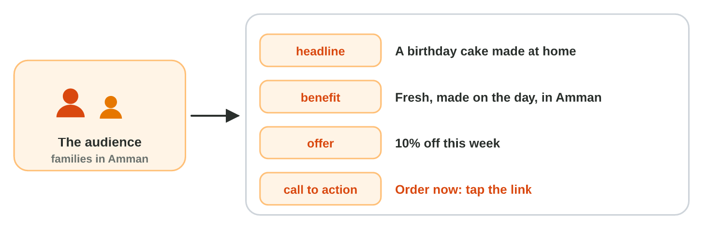
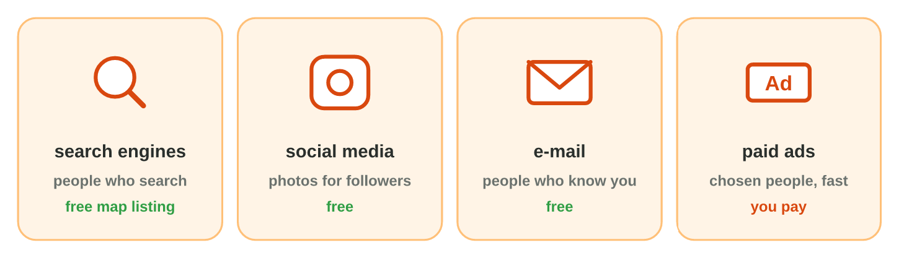
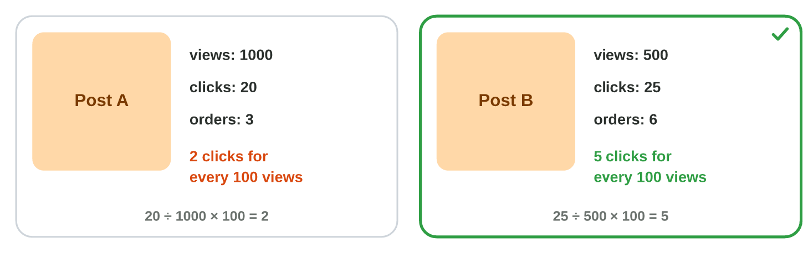

## Keywords



## The audience and the message

:::: {.columns}
::: {.column width="50%"}
- E-marketing tells people on the Internet about a service.
- First you choose the audience, the people that the message is for.
- The message has a headline, a benefit, an offer and a call to action.
- The call to action tells the reader what to do next, like Order now.
:::
::: {.column width="50%"}

:::
::::

## Live demo · Message Builder



## Try it 1 · The message

a) Which part of the message is "Book now: tap the link"?
b) Which part of the message is "Free delivery this week"?
c) Which audience is clear: "everybody" or "families in Amman with a birthday soon"?

::: {.answer}
a) the call to action
b) the offer
c) families in Amman with a birthday soon
:::

## The channels

:::: {.columns}
::: {.column width="50%"}
- Search engines bring people who search and are ready to buy.
- Social media shows photos and posts to followers.
- E-mail reaches people who already know you.
- Paid ads reach chosen people fast, and they cost money.
:::
::: {.column width="50%"}

:::
::::

## Live demo · Channel Mixer



## Try it 2 · Channels

a) Fix It wants people who search "phone repair Amman" to find it. Which channel is right?
b) Green Bites wants its old customers to know the new salad for free. Which channel is right?
c) What does the word Sponsored mean in a search result?

::: {.answer}
a) a search engine and its map
b) e-mail
c) It is a paid ad.
:::

## A post and its results

:::: {.columns}
::: {.column width="50%"}
- A promotional post has a good photo, a few words and the call to action.
- You use your own photo or a free picture, and you write its source.
- After a week you count the views, the clicks and the orders.
- Clicks for every 100 views are clicks divided by views, times 100.
:::
::: {.column width="50%"}

:::
::::

## Live demo · Results Reader



## Try it 3 · Results

a) A post has 200 views and 10 clicks. How many clicks for every 100 views does it have?
b) May Mona use a cake photo from Google Images?
c) What does Mona write under a free photo from Canva?

::: {.answer}
a) 5
b) No: it belongs to someone.
c) Photo: Canva
:::

## Summary

- E-marketing starts with the audience, the people that the message is for.
- A message has a benefit, an offer and a call to action.
- The channels are search engines, social media, e-mail and paid ads.
- A post uses your own photo or a free picture, with its source.
- You measure the results with clicks for every 100 views and with orders.

## Your worksheet

:::: {.columns}
::: {.column width="50%"}
- In the computer lab, do the three experiments of the worksheet alone.
- Part A is in an AI assistant, a search engine and Canva.
- Part B is on a simulator: scan its QR code, or click its link.
- Write your result after each step, and fill in the table at the end.
:::
::: {.column width="50%"}

:::
::::

## Results of the worksheet

Which results do you have in your table?

::: {.reveal}
- Experiment 1: The best post has a benefit, an offer and Order now, for families in Amman.
- Experiment 2: Paid results say Sponsored, the map shows the shops, and e-mail reaches old customers.
- Experiment 3: The post is a PNG with a free photo, and post B has 5 clicks for every 100 views.
:::

## Game challenge · The Market Desk



## Try it 4 · Marketing (harder)

The facts: Lina's post has no Order now. Sami has 15 JD for new customers in Irbid. Post A had 1000 views and 10 clicks, and post B had 400 views and 20 clicks.

a) What is missing in Lina's post?
b) Which channel does Sami use?
c) Which post worked better?

::: {.answer}
a) a call to action
b) a small paid ad for people in Irbid
c) post B (5 clicks for every 100 views; post A has 1)
:::
