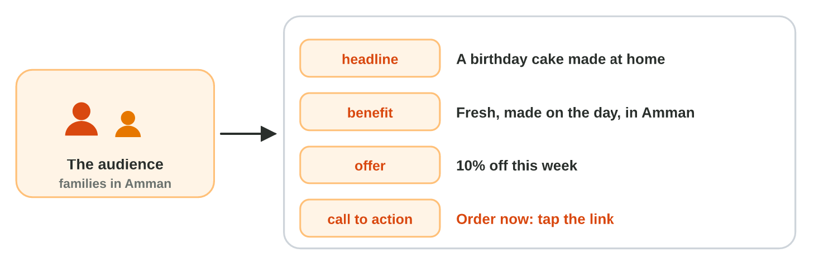
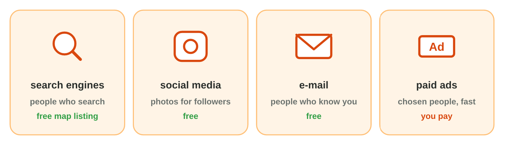
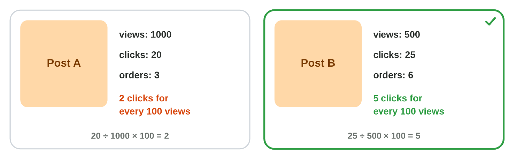

This page is the lecture, in class and at home. Each section explains one
idea, then shows its experiment. The page checks every step at once.

**In class, the teacher chooses the way for each experiment,** by the topic
and the time:

- **On the simulator** of the section, here on the page: nothing to
  install, and it works at home too.
- **In the real app** on the teacher's laptop, connected to the smart
  screen (HDMI): an AI assistant, a search engine and Canva, with the steps
  of **Part A**. The teacher runs the prompt (**Copy prompt**).
- **In the computer lab:** each student follows the **worksheet (PDF)**,
  Part A in the apps and Part B on the simulator, and checks each result
  here.
- **You need:** a browser, an AI assistant that the university allows and
  a free Canva account, or only the simulators of this page.

## Key terms



## 10.1 The audience and the message

- **E-marketing** tells people on the Internet about a service.
- First the **audience**: who the message is for.
- Then the **message**: a headline, the **benefit**, the **offer** and the
  **call to action** (*Order now*).

{width=100%}





::: {.callout-tip title="Try it 1 · The message"}
Choose the right part.

::: {.match extra="the audience|the price list"}
"Book now: tap the link."
:   the call to action

    Why: It tells the reader what to do next.

"Free delivery in Amman this week."
:   the offer

    Why: A reason to act now.
:::
:::

## 10.2 The channels

- **Search engines:** people who search; the map lists shops for free.
- **Social media:** photos for followers. **E-mail:** people who know you.
- **Paid ads:** you pay; *Sponsored* in a search.

{width=100%}





::: {.callout-tip title="Try it 2 · Channels"}
Choose the right channel.

::: {.match extra="a poster|nothing"}
Fix It wants people who search "phone repair Amman" to find it.
:   a search engine and its map

    Why: People who search are ready to buy.

Green Bites wants its 150 old customers to know the new salad, for free.
:   e-mail

    Why: E-mail reaches people who know you, for free.
:::
:::

## 10.3 A post and its results

- A **post**: a photo, a few words, the call to action (Canva).
- Your own photo or a **free picture**, with its source.
- **Measure:** clicks for every 100 views = clicks ÷ views × 100.

{width=100%}





::: {.callout-tip title="Try it 3 · Results"}
Choose the right answer.

::: {.match extra="20|post A"}
A post: 200 views, 10 clicks. How many clicks for every 100 views?
:   5

    Why: 10 ÷ 200 × 100 = 5.

May Mona use a cake photo from Google Images?
:   no: it belongs to someone

    Why: Use your own photo or a free picture, with its source.
:::
:::

## Table of results



## Game challenge: the Market Desk at Sunrise Company {.challenge}

Huda's colleagues market their services: the audience, the message, the
channel, the results.



::: {.callout-tip title="Try it 4 · Marketing"}
Lina's post has no "Order now"; Sami has 15 JD for new customers in Irbid;
post A had 1000 views and 10 clicks, post B 400 views and 20 clicks. Choose
the right answer.

::: {.match extra="more colours|post A"}
What is missing in Lina's post?
:   a call to action

    Why: The reader must know what to do next.

Which channel does Sami use?
:   a small paid ad for people in Irbid

    Why: A paid ad reaches chosen people fast.

(Harder) Which post worked better?
:   post B

    Why: Post A: 1 click for every 100 views; post B: 5.
:::
:::

## Summary {.summary}

- E-marketing starts with the audience: who the message is for.
- A message has a benefit, an offer and a call to action.
- Channels: search engines, social media, e-mail and paid ads.
- A post uses your own photo or a free picture, with its source.
- Measure the results: clicks for every 100 views, and orders.
