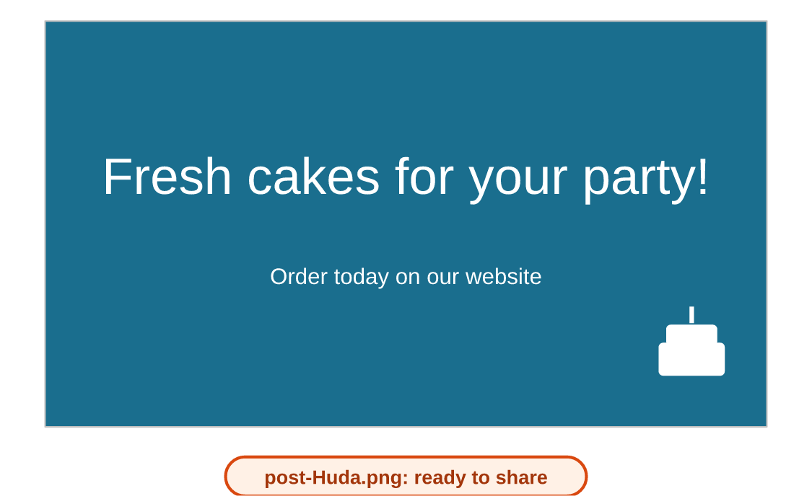

## Today in the lab

::: {.lab-plan}
1. **15 minutes, here:** the teacher shows each idea on a simulator, then
   in PowerPoint.
2. **35 minutes, in PowerPoint:** you follow the **worksheet**, step by
   step, on the lab computer. Nothing to download: you type the text
   yourself.
3. **At the end:** show your post to your teacher. Then the **Extra**: an
   AI assistant adds a slide of prices to your post.
:::

{width=55%}

## Key terms



## 11.1 The audience and the message

### On the simulator

- The **audience**: the people who need the service (students and families in Amman).
- The **message**: what they get, in a few words (Fresh cakes for your party!).
- The **call to action**: what to do now (Order today on our website).

::: {.sim-part}

:::

### In PowerPoint: worksheet Task 1

:::: {.word-part}
Open PowerPoint, then **Blank Presentation**. One slide is the post:

::: {.screens}
![[1]{.step-n} The title: the message. [2]{.step-n} The subtitle: the call to action.](images/lab-post-1.png)
:::
::::

::: {.callout-tip title="Try it 1 · The call to action"}
Choose the right answer.

::: {.match extra="Fresh cakes for your party!|Mona's Cakes"}
Which words are the call to action?
:   Order today on our website

    Why: A call to action says what to do now.
:::
:::

## 11.2 The channels

### On the simulator

- A **channel** is the way the message goes: social media, a website, search ads, a map, messages.
- Choose the channel where the audience already is: young people on social media, people near you on a map.

::: {.sim-part}

:::

::: {.callout-tip title="Try it 2 · Channels"}
Choose the right answer.

::: {.match extra="a printed letter|the radio"}
People search for a cake shop near them on their phones. Which channel helps most?
:   a map listing

    Why: A map shows the shop to people who are near it.
:::
:::

## 11.3 A post and its results

### On the simulator

- A **post**: one picture with the message, the call to action and a picture (a theme and an icon).
- Save it as a **PNG** picture to share it; keep the **.pptx** to change it later.
- The **results**: views and clicks; the **click rate** = clicks ÷ views (25 ÷ 500 = 5%).

::: {.sim-part}

:::

### In PowerPoint: worksheet Tasks 2 to 4

:::: {.word-part}
::: {.screens}
![[1]{.step-n} **Design**. [2]{.step-n} A theme.](images/lab-post-2.png)

![[1]{.step-n} **Insert**. [2]{.step-n} **Icons**. [3]{.step-n} **cake**. [4]{.step-n} An icon. [5]{.step-n} **Insert**.](images/lab-post-3.png)

![**F12**: [1]{.step-n} **Desktop**. [2]{.step-n} **post-** and your name. Save as type: **PNG**. [3]{.step-n} **Save**.](images/lab-save-2.png)
:::
::::

::: {.callout-tip title="Try it 3 · Results"}
Choose the right answer.

::: {.match extra="2%|50%"}
A post has 500 views and 25 clicks. What is its click rate?
:   5%

    Why: 25 ÷ 500 = 0.05 = 5%.
:::
:::

## Extra: AI changes your post

### On the simulator

- On **tutudocs.com** you open your own post, with **no sign-in**.
- **AI Assistant**: ask for one change, for example: a second slide with the prices.
- **File › Download**, the PowerPoint file (**.pptx**).

::: {.sim-part}

:::

### On tutudocs.com: the Extra of the worksheet

:::: {.word-part}
::: {.screens}
![**tutudocs.com**: [1]{.step-n} click the box, then choose your post.](images/lab-tutu-1.png)

![[1]{.step-n} **AI Assistant**. [2]{.step-n} Your request. [3]{.step-n} The AI adds the slide.](images/lab-tutu-2.png)

![[1]{.step-n} **File**, [2]{.step-n} **Download**, [3]{.step-n} the **.pptx** file.](images/lab-tutu-3.png)
:::
::::

## Now: your worksheet

::: {.lab-go}
Take your **worksheet** and do Tasks 1–4 in PowerPoint on the lab
computer, in order. Tick each step. Raise your hand when you are stuck,
and at the end. Finished? Do the **Extra**: on tutudocs.com an AI
assistant adds a slide of prices to your post.
:::

## Summary {.summary}

- The audience: who needs the service; the message: what they get; the call to action: what to do now.
- Choose the channel where the audience already is.
- A post in PowerPoint: the message, the call to action, a theme and an icon; saved as PNG to share.
- The click rate = clicks ÷ views.
- On tutudocs.com (no sign-in) the AI Assistant changes your post; File › Download gives the .pptx.
