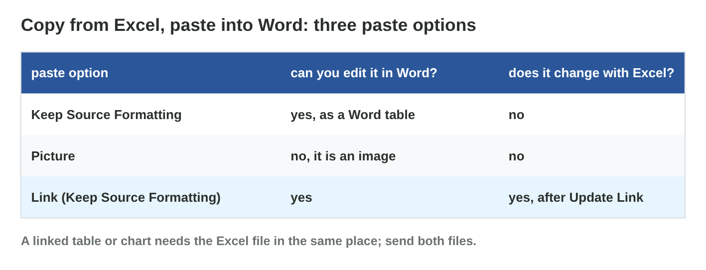
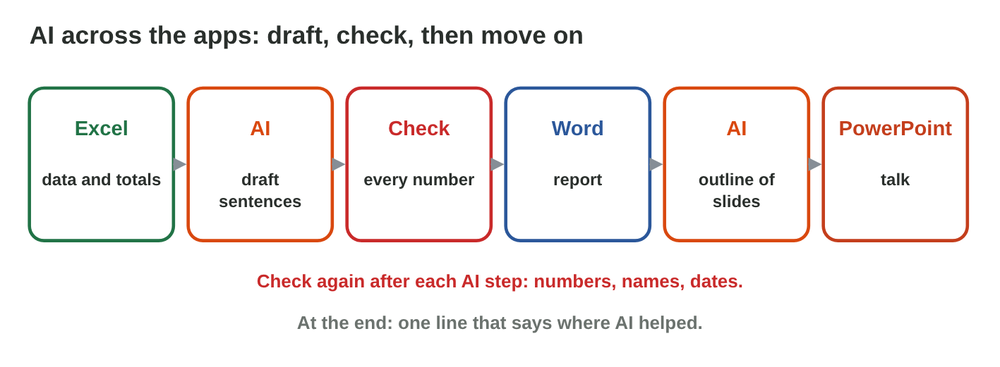

## Keywords



## 27.1 One job, three apps

:::: {.columns}
::: {.column width="50%"}
- Excel is for numbers, Word for words, PowerPoint for showing.
- We make the numbers once, in Excel.
- Then the numbers move to Word and PowerPoint.
- **Lab task:** Plan the three files of a monthly report. What goes into each file?
:::
::: {.column width="50%"}

:::
::::

## 27.2 From Excel to Word

:::: {.columns}
::: {.column width="50%"}
- Keep Source Formatting gives a Word table.
- Picture gives an image that we cannot edit.
- A link follows Excel after Update Link.
- **Lab task:** Paste your table into Word as a link. What happens after a change?
:::
::: {.column width="50%"}

:::
::::

## Live demo · Link Lab



## Try it 1 · Paste options

a) Which paste option follows the Excel file?
b) How do we show the new Excel numbers in Word?
c) Why can we not edit a pasted picture?

::: {.answer}
a) Link & Keep Source Formatting
b) Right-click the table, then Update Link.
c) The numbers are part of an image.
:::

## 27.3 From Word to PowerPoint

:::: {.columns}
::: {.column width="50%"}
- Heading 1 becomes a slide title.
- Heading 2 becomes a bullet.
- Slides from Outline reads the Word file.
- **Lab task:** Make slides from your report. How many slides do you get?
:::
::: {.column width="50%"}

:::
::::

## Live demo · Heading Slides



## Example · Huda's two slides

Huda has a report with two Heading 1 lines and three Heading 2 lines.
**What does Slides from Outline make?**

::: {.reveal}
1. It makes **two slides**: "March sales" and "The best week".
2. The three Heading 2 lines become **three bullets**.
3. The long paragraphs **stay in the report**.
:::

## 27.4 AI across the apps

:::: {.columns}
::: {.column width="50%"}
- AI can draft sentences and a slide outline.
- We check the output after every AI step.
- An AI-use statement ends the report.
- **Lab task:** Ask an AI tool for three sentences and check them. Which are true?
:::
::: {.column width="50%"}

:::
::::

## Example · A wrong AI sentence

The AI writes "Sales grew every week." The weekly totals are 87, 63, 112 and 93.
**What does Huda do?**

::: {.reveal}
1. Huda checks the sentence with the **weekly totals**.
2. The second week is lower than the first, so the sentence is **wrong**.
3. Huda deletes it and adds an **AI-use statement**.
:::

## Game challenge · Office Relay



## Try it 2 · Workflow (harder)

a) Which paste option suits a report for a manager without the Excel file?
b) Why should a heading not be only big bold text?
c) When do we check AI output in a workflow?

::: {.answer}
a) a normal table or a picture
b) Slides from Outline does not see it as a heading.
c) after every AI step
:::

## Summary

- Excel is for numbers, Word for words, PowerPoint for showing.
- A linked table follows Excel after Update Link.
- Word headings become slides with Slides from Outline.
- We check AI output after every step and say where AI helped.
