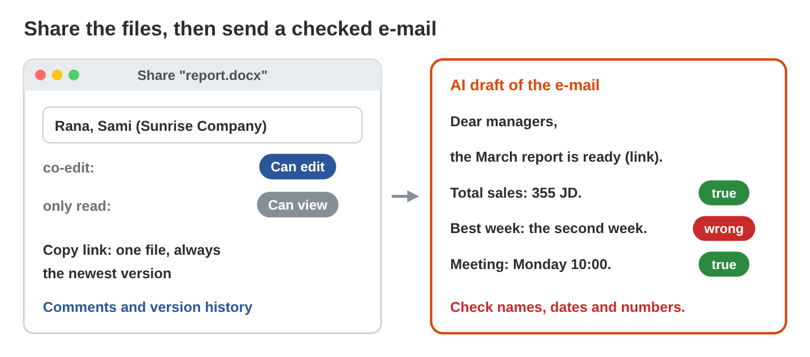

This page is the interactive version of the lesson notes (PDF). Each section
starts with a problem at work. Then it shows one skill. It ends with a
**Lab task** and one set of questions. The full explanations, examples and
exercises are in the notes.

## Key terms



## 27.1 One job, three apps

- **Excel** for numbers, **Word** for words, **PowerPoint** for showing.
- Make the numbers **once**, in Excel; then move them.

{width=100%}

::: {.callout-warning title="Watch out!"}
Do not type the numbers again in Word or on a slide.
:::

::: {.callout-note title="Lab task · Plan the three files"}
Write one line for each file: the Excel sheet, the Word report, three
slides.
:::

::: {.callout-tip title="Try it 1 · The right app"}
Choose the app.

::: {.match extra="Paint|the Calculator"}
24 sales and their total
:   Excel

a two-page monthly report
:   Word

three slides for a meeting
:   PowerPoint
:::
:::

## 27.2 From Excel to Word: paste options

- **Keep Source Formatting:** a Word table; it does not follow Excel.
- **Picture:** an image; you cannot edit it.
- **Link:** follows Excel after **Update Link**.

{width=100%}



::: {.callout-warning title="Watch out!"}
A link needs the Excel file. For an email, paste a normal table.
:::

::: {.callout-note title="Lab task · Paste the table"}
Paste your summary table and chart into `report.docx` as a link; change a
number in Excel and update the link.
:::

::: {.callout-tip title="Try it 2 · Paste options"}
Use Link Lab. Choose the paste option.

::: {.match extra="Paste Special › Text|Ctrl + Z"}
follows Excel after Update Link
:   Link

an image: you cannot edit the numbers
:   Picture

a Word table that does not follow Excel
:   Keep Source Formatting
:::
:::

## 27.3 From Word to PowerPoint

- **Heading 1:** a slide title. **Heading 2:** a bullet.
- **Home › New Slide › Slides from Outline**, then choose the Word file.

{width=100%}



::: {.callout-warning title="Watch out!"}
Big bold text is not a heading. Use the heading styles.
:::

::: {.callout-note title="Lab task · Slides from the report"}
Add headings to `report.docx` and make `talk.pptx` with Slides from
Outline.
:::

::: {.callout-tip title="Try it 3 · Outline"}
Use Heading Slides. Choose what each line becomes.

::: {.match extra="a picture|a new file"}
a Heading 1 line
:   a slide title

a Heading 2 line
:   a bullet

a Normal line
:   nothing on the slides
:::
:::

## 27.4 AI across the apps, sharing and e-mail

- AI drafts: sentences from the totals, an outline, an e-mail, meeting
  tasks.
- **Check after every AI step**: numbers, names, dates.
- **Share** one file: **Can edit** to co-edit, **Can view** to read.
- End with an **AI-use statement**.

{width=100%}

{width=100%}

::: {.callout-warning title="Watch out!"}
Five attachments make five copies. Share one file with a link.
:::

::: {.callout-note title="Lab task · AI help, checked and shared"}
Put three checked AI sentences and your AI-use statement in the report;
share it (Can view) and send a checked AI e-mail with the link.
:::

::: {.callout-tip title="Try it 4 · AI and sharing"}
Choose the right answer.

::: {.match extra="the AI tool|Can delete"}
where you check every AI number
:   in the Excel sheet

for a colleague who works on the file with you
:   Can edit

for managers who only read the report
:   Can view

what you check in an AI e-mail
:   names, dates and numbers

the last line of the report
:   the AI-use statement
:::
:::

## Game challenge: Office Relay {.challenge}

Work alone. Use every section of today.

Six jobs: the **total of the month**, a table that **follows Excel**,
**slides from the report**, an **AI number**, a report for a manager
**without the Excel file**, and an **AI-use statement**.



::: {.callout-tip title="Try it 5 · The relay"}
Choose the best way.

::: {.match extra="a phone calculator|a screenshot"}
the total of the month
:   a SUM formula in Excel

a table that follows Excel
:   paste as a link

slides from the report
:   Slides from Outline
:::
:::

## Summary {.summary}

- Excel for numbers, Word for words, PowerPoint for showing.
- A linked table follows Excel after Update Link.
- Heading 1 and Heading 2 give slides with Slides from Outline.
- Share one file; AI can help at each step, and you check after every
  step and say where AI helped.
