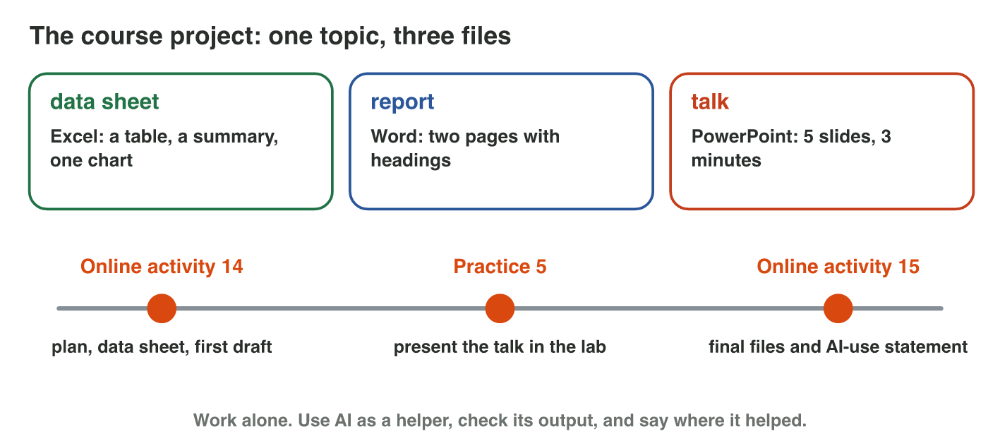
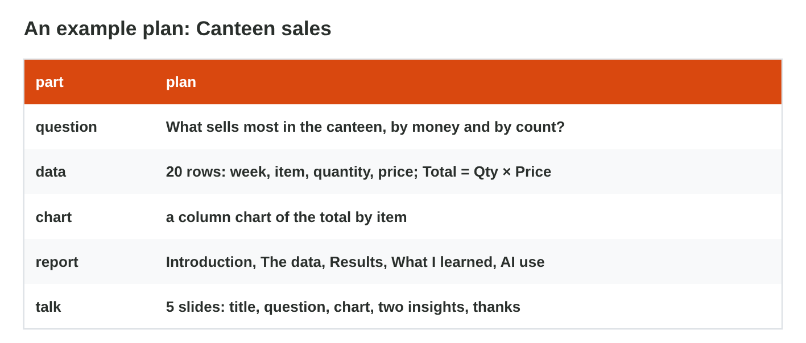
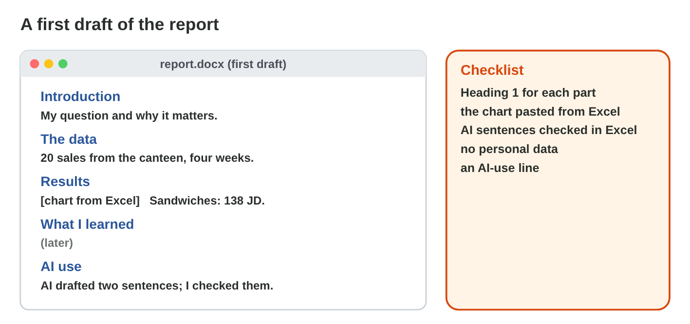

## Before you start {.study}

- **What you need:** Word and Excel (desktop, on the web at `office.com`,
  or the phone apps) and an AI tool your university allows.
- **Time:** about 60 minutes. Work alone, at your own speed.
- **How it works:** do Steps 1–3 on this page. Each step has a short text, a
  simulator and a self-check. Then do the **Tasks to submit**.
- **What you submit:** your plan, the data sheet `project.xlsx` and the
  first draft `report.docx`, before practice 5 (the project talks).
- **The course project:** one topic, three files: a data sheet (Excel), a
  report (Word) and a short talk (PowerPoint). In Practice 5 you present
  the talk; in Online activity 15 you hand in the final files.

{width=100%}

## Key terms {.study}



## Step 1 · Choose a topic and plan {.study}

- Choose **one topic**: *Canteen sales* (the data is below) or *My study
  week* (your own study minutes for two weeks).
- Write **one clear question** that your data can answer.
- **No personal data:** no names, phone numbers or marks of other people.
- Plan the five parts: the question, the data, the chart, the report
  headings and the slides.

{width=100%}



::: {.callout-tip title="Try it 1 · A good plan"}
Use Plan Checker. Choose the right answer.

::: {.match extra="Is the canteen good?|20 slides full of text"}
a clear project question
:   What sells most in the canteen, by money and by count?

    Why: It is clear, and the canteen data can answer it.

data you must never collect
:   names and phone numbers of buyers

    Why: Personal data of other people stays out of your project.

the chart for the total by item
:   a column chart

    Why: Columns compare the totals of the items.

the talk
:   5 slides: few words and one chart

    Why: A talk of about three minutes has five clear slides.
:::
:::

## Step 2 · Build the data sheet {.study}

- Type the data into Excel, one row per record, and make it a **table**
  (Ctrl + T) with a total row.
- Add a column with a **formula**, for example `Total = Qty × Price`.
- Summarize with a **PivotTable** (Lecture 10 and Online activity 13), and
  make **one chart** with a title.



::: {.callout-tip title="Try it 2 · The data sheet"}
Use Pivot Lab. Choose the right answer.

::: {.match extra="a pie with 20 slices|Ctrl + P"}
make a list a table
:   Ctrl + T

    Why: Ctrl + T makes the list an Excel table.

the total of each item in one table
:   a PivotTable with Rows Item

    Why: It gives one row per item, with the sum of its totals.

Total for 24 cups at 0.5 JD
:   12 JD

    Why: 24 × 0.5 = 12 JD.

compare the items
:   a column chart

    Why: Columns compare the items side by side.
:::
:::

## Step 3 · The first draft of the report {.study}

- In Word, write the **headings** first (Heading 1): Introduction, The
  data, Results, What I learned, AI use.
- Copy your chart in Excel and paste it into Word (Paste Options, Online
  activity 3).
- AI can draft sentences; **check every number** in your data sheet and
  write the text in your own words.

{width=100%}



::: {.callout-tip title="Try it 3 · The first draft"}
Choose the right answer.

::: {.match extra="one long paragraph|a screenshot"}
how a part of the report starts
:   a Heading 1

    Why: Each part of the report starts with a Heading 1.

how the chart goes into Word
:   copy it in Excel, paste it in Word

    Why: The chart comes from your data sheet, not from a drawing.

an AI sentence with a number
:   check it in the data sheet

    Why: An AI number can be wrong.

where AI helped
:   the AI-use statement

    Why: It says honestly where AI helped.
:::
:::

## Tasks to submit {.tasks}

Do the tasks alone. Your teacher marks them (6 marks). Choose **one**
topic.

**Topic A · Canteen sales.** The canteen of Sunrise Company sold these
items in four weeks. Type the list into a new Excel workbook, starting in
cell A1:

| Week | Item | Qty | Price (JD) |
|---|---|---|---|
| 1 | Tea | 40 | 0.5 |
| 1 | Coffee | 30 | 1 |
| 1 | Water | 20 | 0.25 |
| 1 | Sandwich | 24 | 1.5 |
| 1 | Cake | 10 | 1 |
| 2 | Tea | 36 | 0.5 |
| 2 | Coffee | 34 | 1 |
| 2 | Water | 28 | 0.25 |
| 2 | Sandwich | 20 | 1.5 |
| 2 | Cake | 12 | 1 |
| 3 | Tea | 44 | 0.5 |
| 3 | Coffee | 28 | 1 |
| 3 | Water | 32 | 0.25 |
| 3 | Sandwich | 26 | 1.5 |
| 3 | Cake | 8 | 1 |
| 4 | Tea | 30 | 0.5 |
| 4 | Coffee | 36 | 1 |
| 4 | Water | 40 | 0.25 |
| 4 | Sandwich | 22 | 1.5 |
| 4 | Cake | 14 | 1 |

**Topic B · My study week.** For two weeks, write down every day the
minutes you study for each subject (at least 14 rows: Day, Subject,
Minutes). Use only your own data.

### Task 1 · The plan (2 marks)

Write your plan in five lines: the question, the data, the chart, the
report headings and the five slides.



### Task 2 · The data sheet (2 marks)

1. Make your data an Excel table with a total row, and save it as
   `project.xlsx`. (Topic A: add a column Total with the formula
   `=C2*D2`.)
2. Make a summary (a PivotTable) and one chart with a title that answers
   your question.

### Task 3 · The first draft (2 marks)

1. Make `report.docx` with the five headings of Step 3, and paste your
   chart from Excel.
2. Ask an AI tool for two sentences about your summary (paste only the
   numbers). Check each number, write the true sentences in your own words
   under Results, and add a first AI-use line.

What did you check in the AI sentences, and was anything wrong?



## How to submit

Upload your plan (Task 1), `project.xlsx` and `report.docx` to the
university e-learning platform, **before practice 5**.
