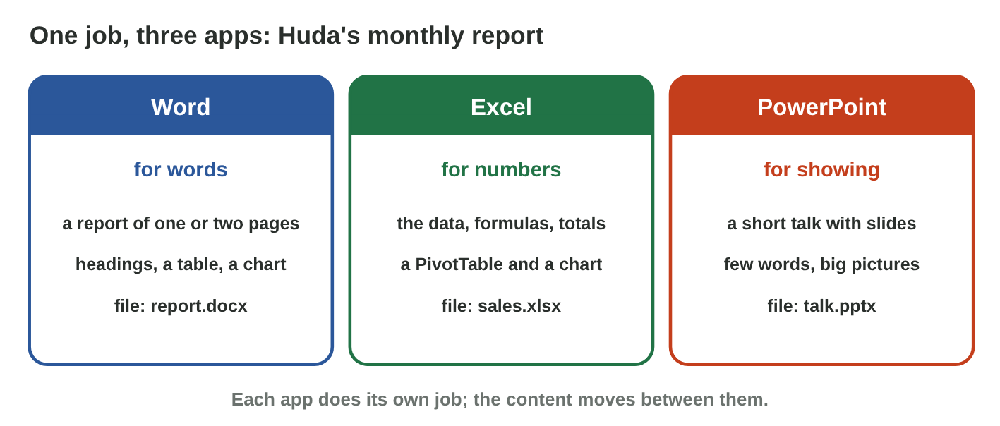
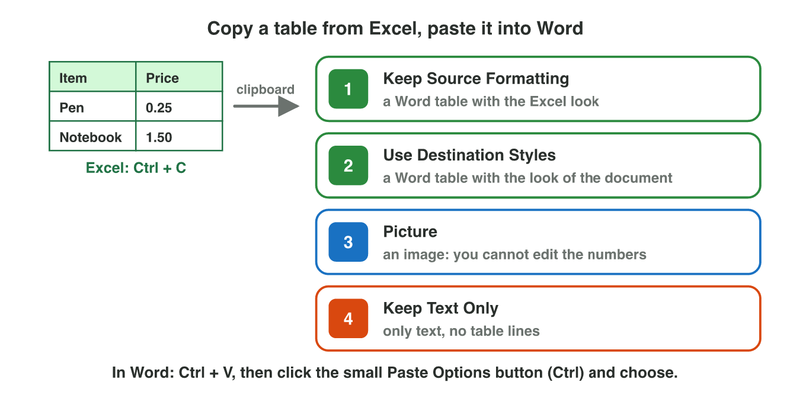
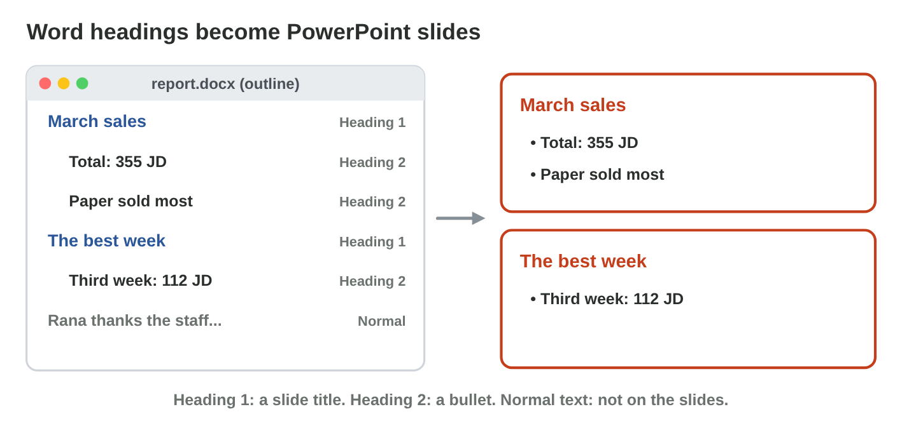

No new ideas today: two short problems on Lectures 4, 6 and 8, on the lab
computer. Do each one alone, then open "Check your result". Every question
on this page has its answer: try first, then check.

## Recall

- **Lecture 6:** Excel makes the numbers: a SUM formula, a summary table
  and a chart.
- **Lecture 4:** the styles Heading 1 and Heading 2 make the headings of a
  Word report.
- **Lecture 8:** a slide has one idea and 3–5 short points; the details go
  in the notes.

{width=100%}



::: {.callout-tip title="Try it 1 · Recall"}
Play **Office Relay**. Then choose the right answer.

::: {.match extra="with a phone calculator|20 points"}
Huda needs the total of 24 sales for the report. Where does she make it?
:   in Excel, with a SUM formula

    Why: Excel adds exactly, and the formula is easy to check.

Which style does a main heading of the report get?
:   Heading 1

    Why: Heading 1 is for the main headings; Heading 2 for smaller ones.

How many points should a slide have?
:   3 to 5 short points

    Why: One idea and a few short points; you say the rest.
:::
:::

## Activity 1 · From Excel to Word

Huda's summary of March is in Excel: Paper 206 JD, Drinks 71 JD, Bags 78
JD. She needs the table, its total and a chart in her Word report, in the
look of the report. The four Paste Options are in Online activity 3.

{width=100%}

::: {.callout-note title="Activity 1 · The report table · 15 min"}
1. In Excel, type the summary table (*Type*, *Total (JD)*) and the total
   with `=SUM(B2:B4)`. Make a column chart with a real title.
2. In `report.docx`, write the heading *Sales by type* with the style
   **Heading 1**. Paste the table under it with **Use Destination
   Styles**.
3. Copy the chart and paste it under the table.

*Your product:* `report.docx` with the table, its total and the chart.

::: {.check}
The Word table has the three types and the total 355 JD, in the look of
the report, and you can still edit it. The chart has a real title, for
example "Sales by type in March (JD)".

- ☐ The total comes from the SUM formula, not from typing.
- ☐ The heading *Sales by type* has the style Heading 1.
:::
:::

::: {.callout-tip title="Try it 2 · Paste Options"}
Choose the right answer.

::: {.match extra="Keep Text Only|Save As"}
Which paste option gives a Word table in the look of your report?
:   Use Destination Styles

    Why: It takes the styles of the Word document, and it stays a table.

Nobody may change the numbers by mistake. Which paste option do you use?
:   Picture

    Why: A picture is an image: nobody can edit the numbers in it.

Bags change from 78 to 98 JD in Excel. Does the pasted Word table change by itself?
:   no: paste it again or change it

    Why: A normal paste is a copy; it does not follow Excel.
:::
:::

## Activity 2 · From the report to slides, with AI help

Huda needs three slides for the Monday meeting from her report: March
sales, the best week, and thanks. PowerPoint can make the slides from the
report's headings: a **Heading 1** line becomes a slide title, a **Heading
2** line becomes a bullet, and Normal text stays out.

{width=100%}



::: {.callout-note title="Activity 2 · Three slides · 15 min"}
1. In **Heading Slides**, give each line of Huda's report the right style,
   until the slides are right.
2. In `report.docx`, give your slide titles Heading 1 and the points
   Heading 2, then close it. In PowerPoint: **Home › New Slide › Slides
   from Outline** › `report.docx`. Save it as `talk.pptx`.
3. Ask an AI tool for one sentence about the March totals (paste only the
   table). Check its numbers in Excel, and put the true sentence in the
   notes of slide 1.

*Your product:* `talk.pptx` with three slides and one checked AI sentence.

::: {.check}
Slide 1 *March sales* has the bullets "Total: 355 JD" and "Paper sold the
most"; slide 2 *The best week* has "Third week: 112 JD"; slide 3 is the
thanks, as a Heading 1 title. A line in the Normal style does not go to
the slides. A checked AI sentence: "In March we sold for 355 JD, and Paper
sold the most, 206 JD."
:::
:::

::: {.callout-tip title="Try it 3 · Slides from the report"}
Use Heading Slides. Choose the right answer.

::: {.match extra="a picture|a new file"}
What does a Heading 1 line become with Slides from Outline?
:   a slide title

    Why: Each Heading 1 starts a new slide.

What does a Normal line become?
:   nothing on the slides

    Why: Only the heading styles go to the slides.

The AI writes "The best week was the second week." The report says the third week, 112 JD. What do you do?
:   correct it before you use it

    Why: Every AI number is checked against the data.
:::
:::

## Wrap-up {.summary}

- You can move a table and a chart from Excel into a Word report in the
  report's look.
- You can make slides from the headings of a report, and check an AI
  sentence before it goes on a slide.
