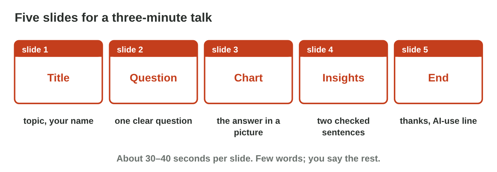
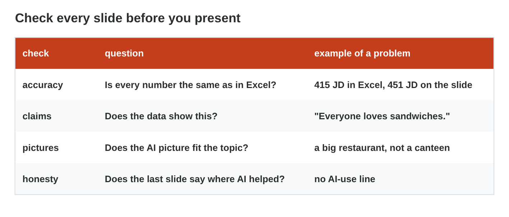
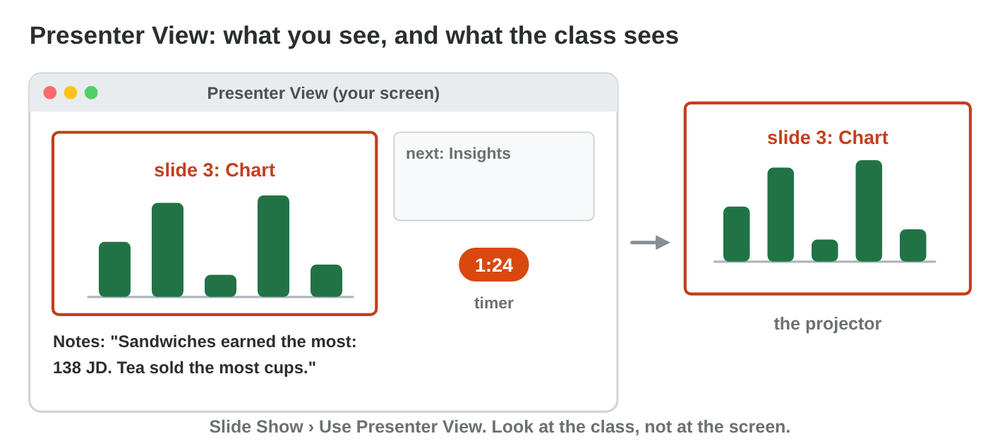

This page is the interactive version of the lesson notes (PDF). Each section
starts with a problem at study or at work. Then it explains one idea. It
ends with a **Lab task** and one set of questions. Every question on this
page has its answer: try first, then check.

## Key terms



## 10.1 From the report to five slides

- **Five slides:** title, question, chart, insights, end.
- **Fast from the report:** give the five titles **Heading 1** and use
  **Home › New Slide › Slides from Outline**, or ask an AI tool for an
  outline of five slides (Online activity 10).
- Copy the chart in Excel and paste it on slide 3. Few words on each slide.
- Sami's slide 4: "Sandwiches earned the most: 138 JD." "Tea sold the most
  cups: 150."

{width=100%}

::: {.callout-warning title="Watch out!"}
No paragraphs on slides: a few words, and you say the rest.
:::

::: {.callout-note title="Lab task · Your five slides"}
Make `talk.pptx` with five slides from your report. Paste your chart from
Excel on slide 3, and write two insights with numbers on slide 4.

::: {.check}
Five slides: the title with your name, your question, the chart with a
title, two insights with numbers, and the end. With the canteen data, for
example: "Sandwiches earned the most: 138 JD." and "Tea sold the most
cups: 150."

- ☐ Each slide has a few words, not a paragraph.
- ☐ The chart comes from your Excel file.
:::
:::

::: {.callout-tip title="Try it 1 · Five slides"}
Choose the right answer.

::: {.match extra="a slide of the whole report|a slide of every row"}
Which slide shows the topic and your name?
:   slide 1, the title

    Why: The title slide says what the talk is about and who you are.

Which slide shows the answer in a picture?
:   slide 3, the chart

    Why: The chart answers the project question at one look.

Where do your two checked sentences with numbers go?
:   slide 4, the insights

    Why: Two short insights say what the chart shows.

What does a Heading 1 line of the report become with Slides from Outline?
:   a slide title

    Why: Each Heading 1 line starts a new slide.

Which slide has the thanks and the AI-use line?
:   slide 5, the end

    Why: The talk ends honestly: it says where AI helped.
:::
:::

## 10.2 Check every slide

- **Accuracy:** every number is the same as in Excel.
- **Claims:** every sentence is shown by your data.
- **Pictures:** an AI picture fits the topic and is fair to people.
- **Honesty:** the last slide says where AI helped. No personal data on
  any slide.
- Sami's slide 3 says 451 JD, but Excel says 415 JD: Sami corrects it.

{width=100%}



::: {.callout-warning title="Watch out!"}
Check the text around the chart too: a wrong number in a sentence is as bad
as a wrong bar.
:::

::: {.callout-note title="Lab task · Check your slides"}
Mark Sami's five slides in **Deck Checker**. Then check your own five
slides with the four checks, and fix every problem.

::: {.check}
Deck Checker: slide 1 is OK; slide 2, the picture does not fit (a big
restaurant, not a small canteen); slide 3, a wrong number (451 JD, but
Excel says 415 JD); slide 4, a claim that the data does not show
("Everyone loves sandwiches"); slide 5, no AI-use line. Your slides: every
number as in Excel, every sentence shown by your data, pictures that fit,
and an AI-use line on slide 5.
:::
:::

::: {.callout-tip title="Try it 2 · Four checks"}
Use Deck Checker. Choose the check that fails.

::: {.match extra="the theme|the font"}
A slide says 451 JD, and Excel says 415 JD. Which check fails?
:   accuracy

    Why: Every number on a slide must be the same as in Excel.

A slide says "Everyone loves sandwiches." Which check fails?
:   claims

    Why: The data shows sales, not what everyone loves.

An AI picture shows a big, busy restaurant for a talk about a small canteen. Which check fails?
:   pictures

    Why: A picture must fit the topic of the talk.

An AI tool wrote the outline, and no slide says so. Which check fails?
:   honesty

    Why: The last slide says where AI helped.
:::
:::

## 10.3 Present in three minutes

- **Speaker notes:** short reminders under each slide, not a text to read.
- **Presenter View** (Lecture 8): you see your notes, the next slide and a
  timer; the class sees only the slide.
- About **30–40 seconds per slide**; one **rehearsal** with a timer
  before your turn.
- Look at the class, speak slowly, and end with your main insight. If you
  cannot answer a question, say so and say how you could find out.

{width=100%}



::: {.callout-warning title="Watch out!"}
Do not read the slides with your back to the class.
:::

::: {.callout-note title="Lab task · Rehearse and present"}
Rehearse Sami's talk once in **Rehearsal Lab**, with each slide close to
its plan. Then write short speaker notes for your five slides, rehearse
your talk alone with a timer, and write the time. Present it when the
teacher calls you.

::: {.check}
Rehearsal Lab: every slide says "about right", and the total is about
3:00 (the plan: 0:20, 0:45, 0:45, 0:45 and 0:25). Your talk: about three
minutes, 30–40 seconds per slide. Too long? Cut one sentence on each slide,
not the chart or the numbers.
:::
:::

::: {.callout-tip title="Try it 3 · Presenting"}
Use Rehearsal Lab. Choose the right answer.

::: {.match extra="10 minutes|the whole report"}
How long is each of five slides in a three-minute talk?
:   about 30–40 seconds

    Why: Five slides of about 35 seconds make about three minutes.

What do you see in Presenter View that the class does not see?
:   your notes, the next slide and a timer

    Why: The class sees only the slide on the projector.

What is one practice of the whole talk with a timer called?
:   a rehearsal

    Why: It shows if the talk fits in three minutes.

Someone asks a question that you cannot answer. What do you do?
:   say so and say how you could find out

    Why: An honest answer is better than a made-up one.
:::
:::

## Game challenge: Presentation Day {.challenge}

Work alone. Use every section of today.

Six situations on the day of the talks: a **long rehearsal**, a **claim
without data**, **time runs out**, a **hard question**, **reading every
word**, and the teacher's question about **AI help**.



::: {.callout-tip title="Try it 4 · The day (harder)"}
The situations: a rehearsal of 4 minutes, 2:40 with two slides left,
reading every word, and a question about AI help. Choose the best thing to
do.

::: {.match extra="present it anyway|speak very fast"}
The rehearsal takes 4 minutes, but the talk has 3. What do you do?
:   cut one sentence on each slide

    Why: Cut words, not the chart or the numbers.

The talk is at 2:40, and two slides are left. What do you do?
:   say the main insight and finish

    Why: End on time, with the most important sentence.

You notice that you read every word from the slides. What do you do?
:   look at the class and use the notes

    Why: The notes are reminders; you speak to the people.

The teacher asks: "Did AI write your insights?" An AI tool wrote the first draft. What do you say?
:   where AI helped and how you checked it

    Why: Honest AI use says what the AI did and what you checked.
:::
:::

## Summary {.summary}

- Five slides: title, question, chart, insights, end.
- Four checks: accuracy, claims, pictures, honesty.
- Speaker notes, Presenter View and one rehearsal for three minutes.
- Say honestly where AI helped, also when someone asks.
