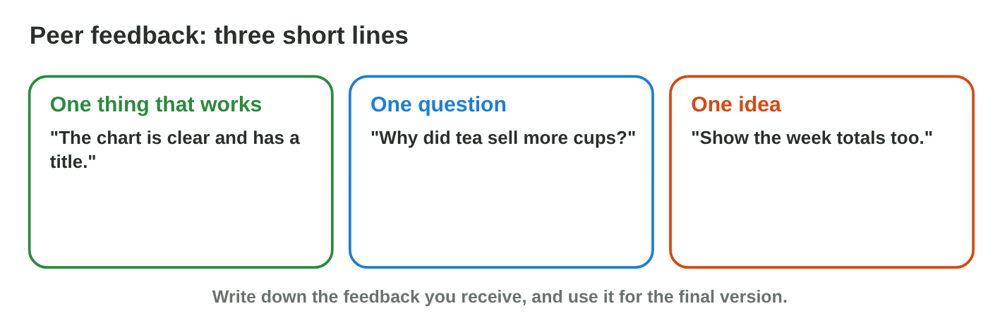

This page is the interactive version of the lesson notes (PDF). Each section
starts with a problem at work. Then it shows one skill. It ends with a
**Lab task** and one set of questions. The full explanations, examples and
exercises are in the notes.

## Key terms



## 29.1 From the report to five slides

- **Five slides:** title, question, chart, insights, end.
- Make them with **Slides from Outline** or an AI outline.
- Paste the chart as a link; few words on each slide.

{width=100%}

::: {.callout-warning title="Watch out!"}
No paragraphs on slides: a few words, and you say the rest.
:::

::: {.callout-note title="Lab task · Your five slides"}
Make `talk.pptx` with five slides from your report; paste your chart as a
link and write two insights.
:::

::: {.callout-tip title="Try it 1 · Five slides"}
Choose the slide.

::: {.match extra="a slide of the whole report|a slide of every row"}
the topic and your name
:   slide 1, the title

your project question
:   slide 2, the question

the answer in a picture
:   slide 3, the chart

thanks and your AI-use line
:   slide 5, the end
:::
:::

## 29.2 Check every slide

- **Accuracy:** numbers as in Excel. **Claims:** shown by the data.
- **Pictures:** fit the topic, fair to people. **Honesty:** an AI-use
  line.

{width=100%}



::: {.callout-warning title="Watch out!"}
Check the text around the chart too.
:::

::: {.callout-note title="Lab task · Check your slides"}
Mark Sami's slides in **Deck Checker**, then check and fix your own five
slides.
:::

::: {.callout-tip title="Try it 2 · Four checks"}
Use Deck Checker. Choose the check that fails.

::: {.match extra="the theme|the font"}
451 JD on the slide, 415 JD in Excel
:   accuracy

"Everyone loves sandwiches."
:   claims

an AI picture of a big restaurant
:   pictures

no line about AI help
:   honesty
:::
:::

## 29.3 Present in three minutes

- **Speaker notes:** short reminders. **Presenter View:** notes, next
  slide, timer.
- About 30–40 seconds per slide; one **rehearsal** with a timer.
- Look at the class; answer questions honestly.

{width=100%}



::: {.callout-warning title="Watch out!"}
Do not read the slides with your back to the class.
:::

::: {.callout-note title="Lab task · Rehearse and present"}
Plan a five-slide talk in **Talk Planner**; then write your speaker notes,
rehearse once with a timer, and present.
:::

::: {.callout-tip title="Try it 3 · Presenting"}
Use Talk Planner. Choose the right answer.

::: {.match extra="10 minutes|the whole report"}
time for each of five slides
:   about 30–40 seconds

what only you see in Presenter View
:   notes, next slide, timer

practice with a timer before the talk
:   a rehearsal

a question you cannot answer
:   say so and how to find out
:::
:::

## 29.4 Give and use peer feedback

- **Three lines:** one thing that works, one question, one idea.
- About the work, not the person. Write down what you receive.

{width=100%}

::: {.callout-warning title="Watch out!"}
"Nice!" gives nobody anything to do.
:::

::: {.callout-note title="Lab task · Feedback"}
Write three-line feedback on two other talks; choose one change for your
final version.
:::

::: {.callout-tip title="Try it 4 · Feedback"}
Choose the line of feedback.

::: {.match extra="Bad.|Nice!"}
"The chart is clear and has a title."
:   one thing that works

"Why did tea sell more cups?"
:   one question

"Show the week totals too."
:   one idea
:::
:::

## Game challenge: Presentation Day {.challenge}

Work alone. Use every section of today.

Six situations: an **old chart**, a **claim without data**, **time runs
out**, a **hard question**, **reading every word**, and **feedback**.



::: {.callout-tip title="Try it 5 · The day"}
Choose the best thing to do.

::: {.match extra="present it anyway|speak very fast"}
the linked chart shows old numbers
:   update the link and check

2:40 and two slides left
:   say the main insight and finish

feedback after the talk
:   write it down for the final version
:::
:::

## Summary {.summary}

- Five slides: title, question, chart, insights, end.
- Four checks: accuracy, claims, pictures, honesty.
- Notes, Presenter View and one rehearsal for three minutes.
- Peer feedback: one thing that works, one question, one idea.
