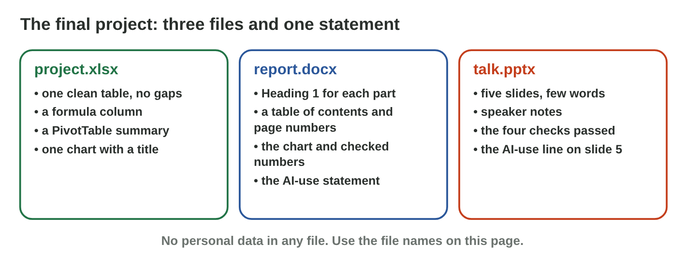

## Before you start {.study}

- **What you need:** your three project files (`project.xlsx`,
  `report.docx`, `talk.pptx`), Word, Excel and PowerPoint, and an AI tool
  your university allows.
- **Time:** about 60 minutes. Work alone, at your own speed.
- **How it works:** do Steps 1–3 on this page. Each step has a short text, a
  simulator and a self-check. Then do the **Tasks to submit**.
- **What you submit:** the final versions of the three files, with an
  AI-use statement for the whole project, by the date on the e-learning
  platform.
- **You need Online activity 14 and Lecture 10:** your first files, the
  five slides and the four checks.

{width=100%}

## Key terms {.study}



## Step 1 · The final data sheet {.study}

- One clean **table**: one row per record, no empty rows, the same
  spelling in each column.
- A **formula** column (for example Total = Qty × Price) and a total row.
- A **PivotTable** for the summary. After a change in the table,
  **Refresh** it.
- **One chart** that answers your question, with a title that says what it
  shows (Lecture 7: columns compare, a line shows a change over time).



::: {.callout-tip title="Try it 1 · The data sheet"}
Use Chart Lab. Choose the right answer.

::: {.match extra="Chart 1|a pie with 20 slices"}
Your question compares the money of five items. Which chart answers it?
:   a column chart

    Why: Columns compare the items side by side.

Your question asks how the sales changed in four weeks. Which chart answers it?
:   a line chart

    Why: A line shows how a value changes over time.

Which title is good for the chart of the canteen?
:   Total by item in four weeks (JD)

    Why: A good title says what the chart shows.

You corrected a number in the table. What do you do to the PivotTable?
:   Refresh it

    Why: A PivotTable does not change by itself.
:::
:::

## Step 2 · The final report {.study}

- Keep the five **headings** (Heading 1): Introduction, The data, Results,
  What I learned, AI use.
- Did a number change in Excel? Copy the chart again and paste it over the
  old one. Then check every number in the text against Excel.
- Check every AI sentence: is it **true**, **shown by the data**, and in
  **your own words**?
- Add a **table of contents** after the title (References › Table of
  Contents) and **page numbers** (Insert › Page Number), as in Online
  activity 4.
- Under "What I learned", write one thing that you changed after your
  rehearsal or your talk in Lecture 10.



::: {.callout-tip title="Try it 2 · The report"}
Use Contents Builder. Choose the right answer.

::: {.match extra="type the numbers again|paste a screenshot"}
Your report has five parts with the style Heading 1. What does the table of contents show?
:   the five headings with their page numbers

    Why: Word makes it from the heading styles and finds the pages.

You add a heading after you made the table of contents. What do you press?
:   Update Table

    Why: The table of contents does not change by itself.

An AI sentence says "Coffee earned the most." Excel says Sandwiches, 138 JD. What do you do?
:   correct it with the Excel number

    Why: Every AI sentence is checked against your data.

Where do you write what you changed after your talk?
:   under "What I learned"

    Why: This part shows what the project taught you.
:::
:::

## Step 3 · The final slides and the AI-use statement {.study}

- After your changes, use the **four checks** of Lecture 10 on every slide
  again: accuracy, claims, pictures, honesty.
- Keep **five slides** with speaker notes.
- Write one **AI-use statement** for the whole project: the tool, what it
  did, what you changed and how you checked it. Put it at the end of the
  report (under AI use), and a short AI-use line on slide 5.
- No personal data in any file or prompt.



::: {.callout-tip title="Try it 3 · Slides and AI use"}
Use Statement Builder. Choose the right answer.

::: {.match extra="nothing about AI|a password"}
You changed a total in Excel after the talk. Which check do you do again on the slides?
:   accuracy

    Why: Every number on a slide must be the same as in Excel.

A statement says only "AI was used." What is missing?
:   for what, what you changed and how you checked it

    Why: The four parts show which work is your own.

Where does the AI-use statement of the project go?
:   at the end of the report, and a short line on slide 5

    Why: Readers and listeners both see where AI helped.

What never goes into a file or a prompt of your project?
:   personal data of other people

    Why: Names, phone numbers and marks of others stay private.
:::
:::

## Tasks to submit {.tasks}

Do the tasks alone. Your teacher marks them (10 marks). Use your own
project from Online activity 14 and Lecture 10, and the file names below.

### Task 1 · The data sheet (3 marks)

Finish `project.xlsx`: one clean table with a formula column and a total
row, a PivotTable for the summary, and one chart with a title that answers
your question.

### Task 2 · The report (3 marks)

Finish `report.docx`: the five headings, a table of contents and page
numbers, the chart from your final data, and two or three checked insights
with numbers. Under "What I learned", write one change that you made after
your rehearsal or your talk.

What did you change after your rehearsal or your talk, and why?



### Task 3 · The slides (2 marks)

Finish `talk.pptx`: five slides with speaker notes that pass the four
checks (accuracy, claims, pictures, honesty).

### Task 4 · AI use (2 marks)

Write your AI-use statement for the whole project (three to five
sentences: the tool, what it did, what you changed, how you checked it).
Put it at the end of the report, and a short AI-use line on slide 5. Then
answer: which AI output did you change or delete, and why?



## How to submit

Upload `project.xlsx`, `report.docx` and `talk.pptx` to the university
e-learning platform, by the date given there.
