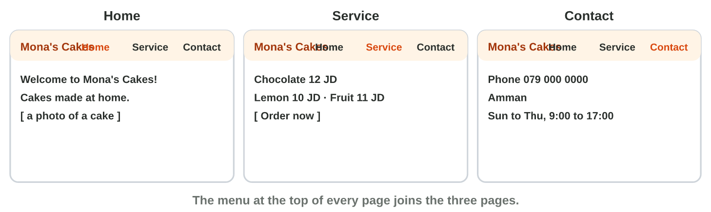
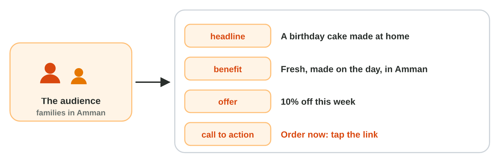

## Recall · The course project

a) Where are the responses of the form?
b) Which link goes into the button Book now?
c) What is written under a free picture from Canva?

::: {.answer}
a) in its sheet, one row for each response
b) the link of the form
c) Photo: Canva
:::

## Activity 1 · The project check · 15 min

:::: {.columns}
::: {.column width="50%"}
- Sami checks his project, Fix It, part by part.
- **Do it:** Send one test response with your form, open your site on your phone, and look at your post.
- Your product is a project in which every part works.
:::
::: {.column width="50%"}

:::
::::

## Check 1 · The project check

What does a project that works look like?

::: {.reveal}
1. A test response arrives in the sheet of the form.
2. The published site opens on a phone, with three pages and a menu.
3. The button Book now opens the form.
4. The post has the words of the service, a free photo and Photo: Canva.
:::

## Activity 2 · The talk · 15 min

:::: {.columns}
::: {.column width="50%"}
- The talk has three slides and lasts three minutes.
- **Do it:** Make slide 1 with the service, slide 2 with the website and the form, and slide 3 with the post and the goal. Say it once with a timer.
- Your product is project.pptx.
:::
::: {.column width="50%"}

:::
::::

## Check 2 · The talk

What does a good talk look like?

::: {.reveal}
1. Slide 1 shows the service, the customer and the need in three short points.
2. Slide 2 shows a screenshot of the site and the link of the form.
3. Slide 3 shows the post and a goal with a number, like 20 bookings this month.
4. The talk takes about three minutes, one minute for each slide.
:::

## Wrap-up

- You can check that every part of your digital service works.
- You can present your project in three slides and three minutes.
