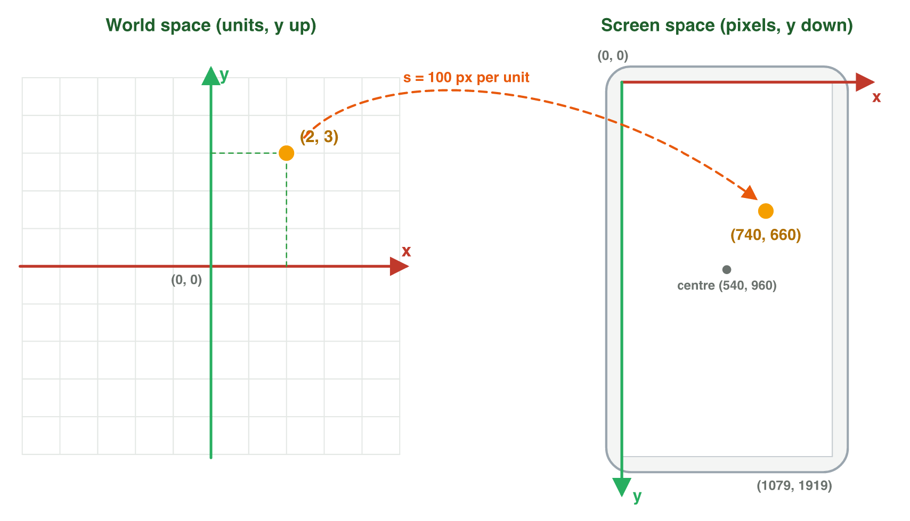
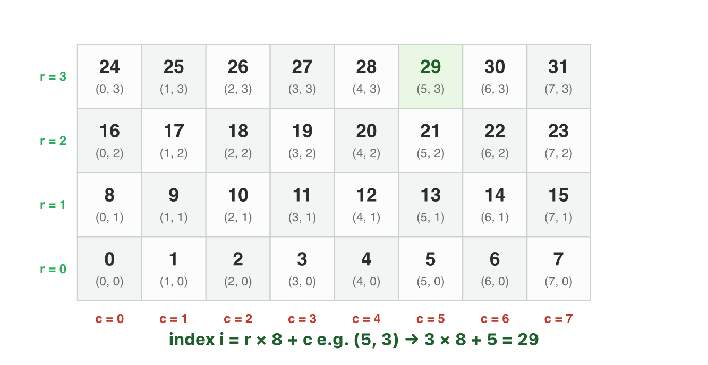
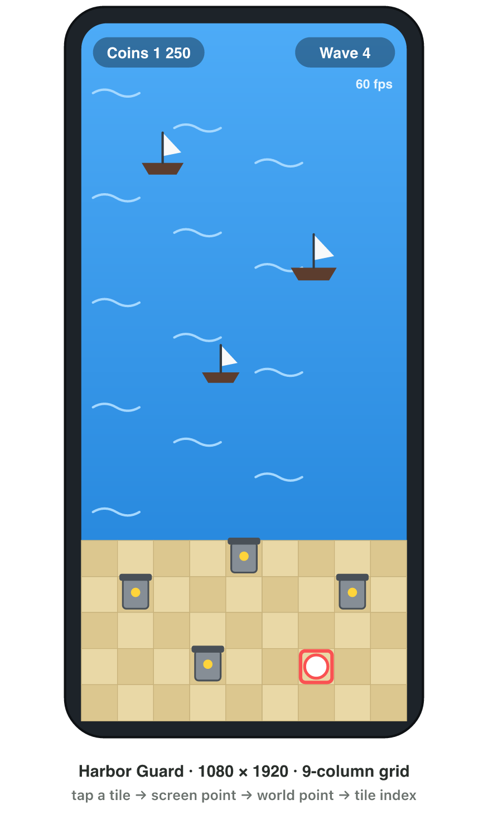

::: {.lead}
Every frame of a video game is the result of a calculation. Before a single
pixel is drawn, the program must know where each object is, where it is going
and what it can see. This chapter introduces the role of mathematics in game
development and builds the first tool that all later chapters rely on: the
coordinate system, which turns the question "where is it?" into numbers that a
computer can store and process.
:::

## Key terms



## 1.1 Mathematics in game development

A video game is an interactive simulation. Its *state* — the positions of the
characters, their health, the score, the time left in the level — is a
collection of numbers held in memory. The program repeatedly reads the
player's input, updates the state according to the rules of the game, and
renders an image of the new state on the screen. This repeated cycle is called
the **game loop**, and one pass through it produces one **frame**.

{#fig-game-loop width=78%}

::: {.callout-important title="Definition 1.1 — Frame rate and frame time"}
The **frame rate** $f$ is the number of frames a game produces per second
(frames per second, fps). The **frame time** $T$ is the time available for one
frame: $T = 1/f$ seconds, or $T = 1000/f$ milliseconds.
:::

The frame time is a strict budget. At 60 fps the program has
$1000/60 \approx 16.7$ ms to read input, update every object and draw the
scene. If the work takes longer, the frame is late and the player perceives a
stutter. Much of the mathematics in this course is therefore chosen not only
because it is correct, but because it is *cheap*: a few additions and
multiplications per object per frame.

::: {.callout-note title="Example 1.1 — Frame budget"}
A mobile racing game targets 60 fps. How much time does each frame have, and
how many times is the state updated during a 3-minute race?

1. Frame time: $T = 1000 / 60 \approx 16.7$ ms.
2. Duration of the race: $3 \times 60 = 180$ s.
3. Number of updates: $180 \times 60 = 10\,800$ frames.

If the same game drops to 30 fps on an older phone, each frame has
$1000/30 \approx 33.3$ ms, and the race has only $5\,400$ updates: motion
becomes visibly less smooth.
:::

The table below maps typical tasks of a game program to the areas of
mathematics studied in this course. Each task is executed many times in every
frame.

| Task in the game program | Mathematical tool | Weeks |
|---|---|---|
| Store where every object is; move it | coordinates, vectors | 1–3 |
| Aim a turret; make an object bob up and down | trigonometry | 4 |
| Move, rotate and resize models; place the camera | matrices, transformations | 5–7 |
| Decide whether a door opens or an enemy attacks | logic, Boolean algebra | 9–10 |
| Generate loot, critical hits and random levels | probability, random numbers | 11–13 |

: Mathematics behind common game tasks. {#tbl-map}

## 1.2 One-dimensional coordinates

The simplest coordinate system is the **number line**. A point called the
**origin** is chosen and labelled 0; a unit of length is chosen; one direction
is declared positive. Every point on the line is then described by a single
number, its **coordinate**: the signed distance from the origin, measured in
units. Points on the positive side have positive coordinates, points on the
negative side have negative coordinates.

{#fig-number-line width=88%}

Games use two kinds of number line. In a board game or a tile-based game, the
positions are **discrete**: only whole numbers (integers) are allowed, and a
piece is always on square 3 or square 4, never between them. In a physics-based
game, positions are **continuous**: any real number is allowed, and a
character can stand at $x = 3.27$. Game code stores discrete positions as
integers (`int`) and continuous positions as floating-point numbers (`float`).

A `float` does not store every real number exactly. It keeps about seven
significant digits, so the gap between two neighbouring values that it can
represent grows with the size of the number:

| Coordinate near | Smallest step a `float` can represent |
|---|---|
| 1 | about 0.000 000 1 |
| 1 000 | about 0.000 06 |
| 100 000 | about 0.008 |
| 10 000 000 | 1 |

: Precision of 32-bit floating-point coordinates. {#tbl-float}

Close to the origin the steps are far too small to see. Far from it they are
not: a character at $x = 100\,000$ can only move in steps of about 8 mm, and
small movements make it visibly *jitter*. For this reason large open-world
games keep the play area near the origin and, when the player travels far,
move the whole world back towards it — a technique called a **floating
origin**. The choice of the origin is therefore not only a matter of
convenience; it affects the accuracy of every calculation.

::: {.callout-important title="Definition 1.2 — Signed displacement and distance in one dimension"}
If an object moves from coordinate $a$ to coordinate $b$, its **signed
displacement** is $b - a$; the sign gives the direction of motion. The
**distance** between the two points is $|b - a|$, which is never negative.
:::

::: {.callout-note title="Example 1.2 — A checkpoint behind the player"}
In the runner game of @fig-number-line the player is at $x = 4$ and the last
checkpoint is at $x = -3$. The player falls and is sent back to the checkpoint.

1. Signed displacement: $b - a = -3 - 4 = -7$. The minus sign means that the
   player moves in the negative direction (to the left).
2. Distance: $|-7| = 7$ units.
:::

::: {.callout-warning title="Common mistake"}
Distance is not the same as displacement. A displacement of $-7$ and a
displacement of $+7$ have the same distance, 7 units. A negative *distance*
is always an error.
:::

## 1.3 The two-dimensional Cartesian coordinate system

A two-dimensional (2D) game world needs two numbers per point. The
**Cartesian coordinate system**, named after René Descartes, uses two number
lines that cross at right angles at their common origin. The horizontal line
is the **$x$-axis** and the vertical line is the **$y$-axis**. In the standard
orientation, $x$ increases to the right and $y$ increases upward.

::: {.callout-important title="Definition 1.3 — Ordered pair"}
A point in the plane is described by an **ordered pair** $(x, y)$. The first
number, the $x$-coordinate, is the signed distance from the $y$-axis; the
second, the $y$-coordinate, is the signed distance from the $x$-axis. The
order matters: $(3, 2)$ and $(2, 3)$ are different points.
:::

The two axes divide the plane into four **quadrants**, numbered I to IV
anticlockwise from the upper right (@fig-quadrants). The quadrant of a point
is decided only by the signs of its coordinates. A point with a zero
coordinate lies on an axis and belongs to no quadrant: $(5, 0)$ is on the
positive $x$-axis, $(0, -2)$ is on the negative $y$-axis, and $(0, 0)$ is the
origin itself.

{#fig-quadrants width=58%}

| Quadrant | Sign of $x$ | Sign of $y$ | Example point |
|---|---|---|---|
| I | $+$ | $+$ | $(4, 3)$ |
| II | $-$ | $+$ | $(-3, 2)$ |
| III | $-$ | $-$ | $(-4, -2.5)$ |
| IV | $+$ | $-$ | $(2, -3)$ |

: Sign patterns of the four quadrants. {#tbl-quadrants}

Level designers often place the origin at a meaningful point, for example at
the centre of an arena or at the spawn point of the player. Negative
coordinates are then normal: an enemy at $(-6, 1)$ is simply six units to the
left of the centre and one unit up.

::: {.callout-note title="Example 1.3 — Reading positions in a level"}
In @fig-quadrants, the coin is at $(4, 3)$, the key at $(-3, 2)$, the trap at
$(-4, -2.5)$ and the exit at $(2, -3)$.

1. The key has $x < 0$ and $y > 0$: it is in quadrant II.
2. The trap has both coordinates negative: quadrant III.
3. The horizontal distance between the key and the coin is
   $|4 - (-3)| = 7$ units; the vertical distance is $|3 - 2| = 1$ unit.
:::

To practise the coordinate plane as a game, scan the QR code below. The
mini-game asks for strikes at given coordinates in all four quadrants; its
second stage uses screen coordinates, the subject of the next section.



## 1.4 Screen space and world space

The coordinates of a game world are not the coordinates of the screen. A
display is a grid of **pixels**, and graphics systems number them from the
**top-left corner**: the screen $x$-coordinate grows to the right, but the
screen $y$-coordinate grows *downward*. This convention comes from the way a
display is refreshed, line by line from the top. A phone with a resolution of
$1080 \times 1920$ pixels in portrait orientation has screen coordinates from
$(0, 0)$ at the top-left to $(1079, 1919)$ at the bottom-right.

::: {.callout-important title="Definition 1.4 — World space and screen space"}
**World space** is the coordinate system of the game world, measured in world
units (often metres), with $y$ upward and an origin chosen by the designer.
**Screen space** is the coordinate system of the display, measured in pixels,
with the origin at the top-left and $y$ downward.
:::

{#fig-screen-world width=92%}

Suppose the camera is centred on the world origin, the screen is $W$ pixels
wide and $H$ pixels high, and one world unit is drawn as $s$ pixels (the
*scale*). The centre of the screen is at $(W/2, H/2)$. A world point
$(x_w, y_w)$ is drawn at the screen point

$$
x_s = \frac{W}{2} + s\,x_w, \qquad y_s = \frac{H}{2} - s\,y_w .
$$

The minus sign in the second formula reverses the direction of $y$. The
inverse formulas answer the opposite question, which every touch game must
answer: *the player touched pixel $(x_s, y_s)$ — which point of the world was
touched?*

$$
x_w = \frac{x_s - W/2}{s}, \qquad y_w = \frac{H/2 - y_s}{s} .
$$

::: {.callout-note title="Example 1.4 — From the world to the screen"}
A portrait phone has $W = 1080$, $H = 1920$ and a scale of $s = 100$ pixels
per unit. Where is the world point $(2, 3)$ drawn?

1. Centre of the screen: $(540, 960)$.
2. $x_s = 540 + 100 \times 2 = 740$.
3. $y_s = 960 - 100 \times 3 = 660$.
4. The point is drawn at pixel $(740, 660)$: right of the centre and *above*
   it, because $660 < 960$.
:::

::: {.callout-note title="Example 1.5 — From a touch to the world"}
On the same phone the player touches the pixel $(340, 1160)$.

1. $x_w = (340 - 540) / 100 = -2$.
2. $y_w = (960 - 1160) / 100 = -2$.
3. The player touched the world point $(-2, -2)$, in quadrant III.
:::

### Supporting different screens

Phones do not share one resolution or one shape. A game therefore does not
fix the scale $s$; it computes it from the part of the world that must always
be visible. If every player must see a play area $w$ units wide, the scale is
$s = W / w$, and the visible height follows from the screen: $H / s$ units.

::: {.callout-note title="Example 1.6 — One game, two phones"}
A portrait puzzle game must show a board 9 units wide. Phone A has
$1080 \times 1920$ pixels, phone B $1080 \times 2400$.

1. Both phones are 1080 pixels wide: $s = 1080 / 9 = 120$ pixels per unit.
2. Visible height on A: $1920 / 120 = 16$ units; on B: $2400 / 120 = 20$ units.
3. Both players see the whole board; the player with the taller phone simply
   sees 4 more units of background. Fixing the height instead
   ($s = H / 16$) would give phone B $s = 150$ and only $1080/150 = 7.2$ units
   of width: the edges of the board would be cut off.
:::

::: {.callout-warning title="Common mistake"}
Forgetting that screen $y$ grows downward. A program that uses
$y_s = H/2 + s\,y_w$ draws the whole world upside down: a character that jumps
appears to fall.
:::

## 1.5 Discrete coordinates: grids and tile maps

Many mobile games are built on a **grid**: puzzle boards, tile-based maps,
inventories, the cells of a strategy map. On a grid a position is a pair of
integers, the **column** $c$ and the **row** $r$, both counted from 0. The
cell $(c, r)$ is not a point but a small square region of the world.

Computer memory, however, is one-dimensional. A grid of `columns` $\times$
`rows` cells is therefore stored as a single list, row after row; this layout
is called **row-major order** (@fig-tile-index).

{#fig-tile-index width=80%}

::: {.callout-important title="Definition 1.5 — Index of a cell in row-major order"}
On a grid with $n$ columns, the cell in column $c$ and row $r$ has the index
$$
i = r\,n + c .
$$
Conversely, the cell with index $i$ is in column $c = i \bmod n$ (the
remainder of $i \div n$) and row $r = \lfloor i / n \rfloor$ (the whole-number
part of $i \div n$).
:::

::: {.callout-note title="Example 1.7 — A match-3 board"}
A match-3 board has $n = 8$ columns.

1. The gem in column 5, row 3 is stored at index $i = 3 \times 8 + 5 = 29$.
2. The gem at index 42: $42 \div 8 = 5$ remainder $2$, so it is in row 5,
   column 2.
3. Its neighbour to the right is in column 3 of the same row, index 43; its
   neighbour in the row above (row 6) is $42 + 8 = 50$. Moving one row changes
   the index by $n$.
:::

The centre of cell $(c, r)$ in world space follows from the size $t$ of one
tile: $x = (c + 0.5)\,t$ and $y = (r + 0.5)\,t$, if row 0 is the bottom row and
the grid starts at the world origin.

::: {.callout-caution title="In game code"}
A short C# example (C# is the language of many games, for example games made
with Unity). It converts an index into a column and a row. In C#, `/` between
two integers keeps only the whole-number part, and `%` gives the remainder.

```csharp
int columns = 8;
int index = 42;
int column = index % columns;   // 2
int row = index / columns;      // 5
```
:::

## 1.6 The three-dimensional Cartesian coordinate system

A three-dimensional (3D) world adds a third axis, the **$z$-axis**,
perpendicular to both the $x$- and the $y$-axis. A point is now an **ordered
triple** $(x, y, z)$. Each pair of axes spans a coordinate plane: the
$xy$-plane, the $xz$-plane and the $yz$-plane. In a world where $y$ points up,
the ground is the $xz$-plane, the $y$-coordinate is the height above the
ground, and every point with $y = 0$ lies on the ground. The three planes
divide space into eight regions called *octants*, one for each combination of
signs.

### Left-handed and right-handed systems

Once the $x$-axis (right) and the $y$-axis (up) are fixed, the $z$-axis can
point in two opposite directions: into the screen or out of it. The two
choices give two mirror-image coordinate systems that cannot be turned into
each other by any rotation. They are distinguished by the **hand rule**:
point the thumb of a hand along $+x$ and the index finger along $+y$; the
middle finger, bent at a right angle, points along $+z$. If this works with
the left hand, the system is **left-handed**; if it works with the right hand,
it is **right-handed** (@fig-handedness).

{#fig-handedness width=86%}

Different tools use different conventions, and a game developer moves data
between them every day:

| Software | Up axis | Handedness | $+z$ means |
|---|---|---|---|
| Unity | $y$ | left-handed | forward, into the screen |
| Godot, Maya | $y$ | right-handed | towards the viewer |
| Unreal Engine | $z$ | left-handed | up |
| Blender, 3ds Max | $z$ | right-handed | up |

: Coordinate conventions of common game and modelling software. {#tbl-conventions}

::: {.callout-important title="Rule 1.6 — Changing the handedness"}
Swapping two axes, or reversing one axis, turns a left-handed system into a
right-handed one and vice versa. In particular, swapping $y$ and $z$ converts
a right-handed $z$-up system (Blender) into a left-handed $y$-up system
(Unity): $(x, y, z) \mapsto (x, z, y)$.
:::

::: {.callout-note title="Example 1.8 — Exporting a model from Blender to Unity"}
A designer places a lamp at $(1, 4, 2)$ in Blender ($z$ up, right-handed).

1. In Blender the height of the lamp is its $z$-coordinate: 2 units.
2. Convert with $(x, y, z) \mapsto (x, z, y)$: the lamp is at $(1, 2, 4)$ in
   Unity.
3. Check: in Unity the height is the $y$-coordinate, which is 2, so the lamp
   is still 2 units above the ground. The 4 units that Blender measured along
   its $y$-axis are now measured along Unity's forward axis, $z$.
:::

::: {.callout-caution title="In game code"}
In C#, the type `Vector3` holds three `float` numbers — $x$, $y$ and $z$ — and
is used for 3D positions. The letter `f` marks a `float` value.

```csharp
Vector3 lamp = new Vector3(1f, 2f, 4f);   // x = 1, y = 2 (height), z = 4
float height = lamp.y;                     // 2
```
:::

::: {.callout-warning title="Common mistake"}
Assuming that "forward" is always $+z$. In Unity the camera looks along $+z$;
in a right-handed $y$-up system such as Godot or OpenGL the camera looks along
$-z$. Reading positions from another tool without checking its convention
mirrors or rotates the scene.
:::



## Case study: where the mathematics is in a mobile game

*Harbor Guard* is a portrait tower-defence game for phones
($1080 \times 1920$ pixels). The harbour is a grid of 9 columns of tiles of
size 1 unit; the camera shows the world with a scale of 120 pixels per unit,
centred on the world origin. Ships sail in from the top of the screen; the
player taps a tile to build a tower. The game runs at 60 fps. In its 3D update
the towers are models exported from Blender. Each of these sentences hides one
of the concepts of this chapter: frame time (§1.1), coordinates and quadrants
(§1.3), the conversion from a touch to the world (§1.4), the index of a tile
(§1.5) and the change of convention for 3D models (§1.6). The exercises below
and the Game challenge of the interactive lesson work through it.

{#fig-harbor width=46%}

## Further reading

Dunn and Parberry, *3D Math Primer for Graphics and Game Development*,
2nd ed., Chapter 1 ("Cartesian Coordinate Systems"): 1D mathematics, 2D and
3D Cartesian space, and left- and right-handed coordinate spaces.

## Exercises

1. A game runs at 90 fps on a high-end phone. Find the frame time in
   milliseconds, to one decimal place.
2. A physics update must finish in 4 ms of each frame at 60 fps. What fraction
   of the frame time is this, as a percentage?
3. On a number line, a platform moves from $x = -2.5$ to $x = 6$. Give its
   signed displacement and the distance it travels.
4. A racing game stores positions as `float`. The track is 150 000 units
   long and starts at the origin. Explain what the player may notice near the
   end of the track, and suggest a remedy.
5. State the quadrant, or the axis, of each point: $(-7, 3)$, $(0, -4)$,
   $(5.5, -0.5)$, $(-1, -1)$, $(8, 0)$.
6. A point has a negative $x$-coordinate and lies on the $x$-axis. Write a
   possible point and state its $y$-coordinate.
7. The player is at $(-3, 4)$ and an enemy at $(5, 4)$. Find the distance
   between them. Why is the vertical distance not needed?
8. A landscape tablet has $W = 2048$, $H = 1536$ and $s = 64$. Convert the
   world point $(-5, 2)$ to screen space.
9. On the same tablet the player taps the pixel $(1280, 1088)$. Which world
   point was touched? In which quadrant is it?
10. A program draws a world point with $y_w = 4$ at a pixel *below* the centre
   of the screen. Name the error in its formula.
11. A portrait game must show 9 units across. Find the scale and the visible
    height on a $1080 \times 2340$ phone.
12. An inventory has 6 columns. Find the index of the slot in column 4, row 2,
    and the column and row of index 23.
13. A tile map has tiles of size 2 units and row 0 at the bottom. Find the
    world position of the centre of tile $(3, 1)$.
14. In a $y$-up world, a drone is at $(4, 12, -3)$. How high is it above the
    ground? Which coordinate must change if it lands vertically?
15. A model is at $(2, -5, 3)$ in Blender. Give its position in Unity.
16. *Harbor Guard* (case study): the player taps the pixel $(780, 840)$.
    Which world point is it, and in which quadrant?

## Answers to the exercises

::: {.answers}
1. $1000/90 \approx 11.1$ ms.
2. $4 / 16.7 \approx 0.24$, about 24 %.
3. Displacement $6 - (-2.5) = 8.5$; distance 8.5 units.
4. Near $x = 150\,000$ a `float` can only step by about 0.008–0.016 units, so slow movement jitters; keep the play area near the origin (floating origin).
5. II; negative $y$-axis; IV; III; positive $x$-axis.
6. For example $(-4, 0)$; the $y$-coordinate is 0.
7. $|5 - (-3)| = 8$ units; both have $y = 4$, so the vertical distance is 0.
8. $x_s = 1024 + 64(-5) = 704$; $y_s = 768 - 64(2) = 640$: $(704, 640)$.
9. $x_w = (1280 - 1024)/64 = 4$; $y_w = (768 - 1088)/64 = -5$: $(4, -5)$, quadrant IV.
10. It adds $s\,y_w$ instead of subtracting it: screen $y$ grows downward.
11. $s = 1080/9 = 120$; visible height $2340/120 = 19.5$ units.
12. $i = 2 \times 6 + 4 = 16$; $23 = 3 \times 6 + 5$: column 5, row 3.
13. $x = 3.5 \times 2 = 7$, $y = 1.5 \times 2 = 3$: $(7, 3)$.
14. 12 units; only $y$ changes (to 0).
15. $(2, 3, -5)$.
16. $x_w = (780 - 540)/120 = 2$; $y_w = (960 - 840)/120 = 1$: $(2, 1)$, quadrant I.
:::
