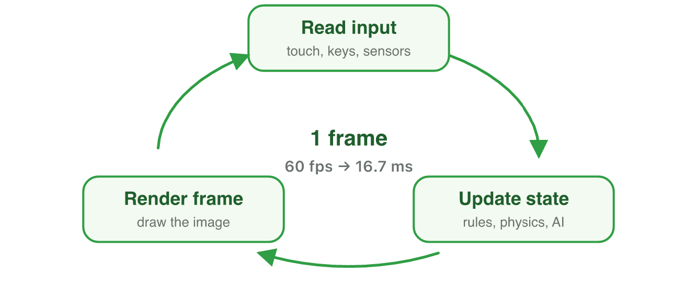
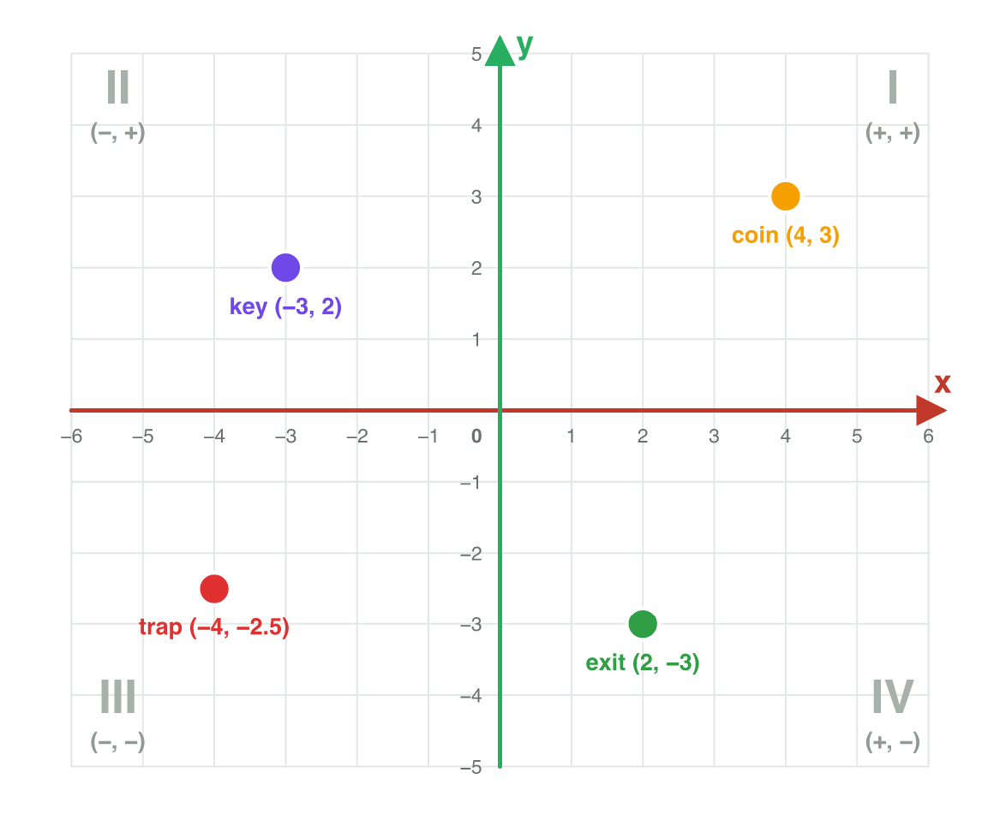
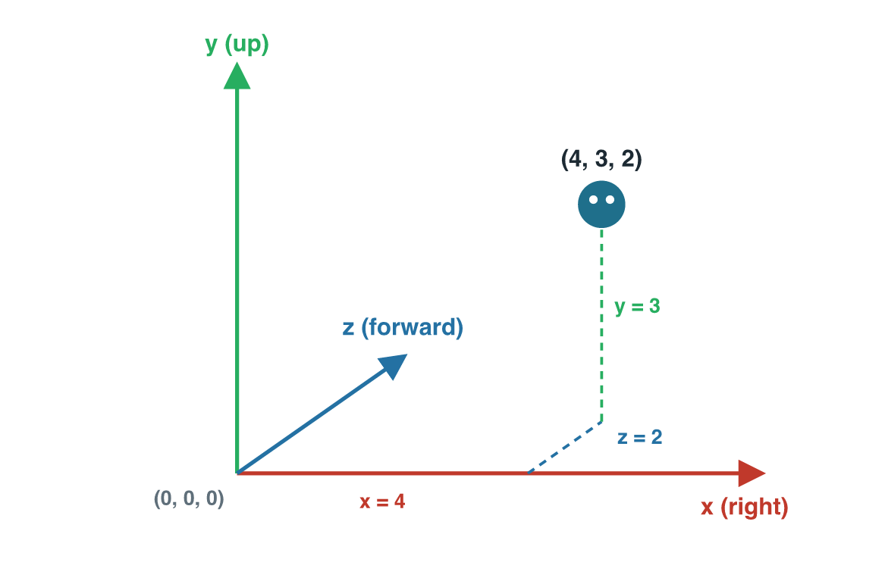
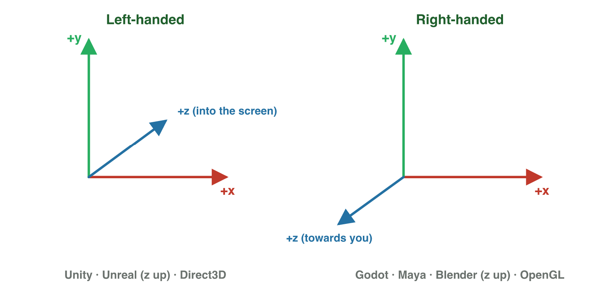

## Keywords



## 1.1 The game loop

:::: {.columns}
::: {.column width="50%"}
- For a computer, a game is numbers: positions, health, score.
- The game loop repeats: read the input, change the numbers, draw.
- One pass makes one **frame**; 60 fps means 60 passes every second.
- **Do it:** A racing game runs at 30 fps. How many updates does it make in 10 seconds?
:::
::: {.column width="50%"}

:::
::::

## Try it 1 · The game loop

a) The loop has read the player's tap. What does it do next?
b) A game runs at 60 fps. How many frames does it make in 10 seconds?
c) A ship drops a rare reward only sometimes. Which mathematics does this need?

::: {.answer}
a) It changes the numbers.
b) 600 frames (60 × 10)
c) probability
:::

## 1.2 Two dimensions: (x, y)

:::: {.columns}
::: {.column width="50%"}
- A point is an ordered pair (x, y): x to the right, y up.
- The signs of x and y decide the **quadrant** (I to IV).
- A point with a 0 lies on an axis, not in a quadrant.
- **Do it:** In GeoGebra, draw an enemy at (−5, −2). In which quadrant is it?
:::
::: {.column width="50%"}

:::
::::

## Example · Reading a level

The coin is at (4, 3), the key at (−3, 2) and the exit at (2, −3).
**In which quadrant is each object?**

::: {.reveal}
1. Coin (4, 3): plus and plus, so **quadrant I**.
2. Key (−3, 2): minus and plus, so **quadrant II**.
3. Exit (2, −3): plus and minus, so **quadrant IV**.
:::

## Try it 2 · Where is the point?

a) Both numbers of a point are negative. In which quadrant is it?
b) A tree stands at (−5, 0). Where is it?
c) A player at (2, 1) moves 3 right and 4 up. What is the new position?

::: {.answer}
a) quadrant III
b) on the x-axis, in no quadrant
c) (5, 5)
:::

## 1.3 Three dimensions: (x, y, z)

:::: {.columns}
::: {.column width="50%"}
- A 3D point has three numbers: (x, y, z).
- In most engines y points up, so y is the height.
- Every point on the ground has y = 0.
- **Do it:** In the 3D viewer, move the player to (1, 2, 4). Which slider changes the height?
:::
::: {.column width="50%"}

:::
::::

## Live demo · Place an object in 3D



## Try it 3 · Positions in 3D

a) A drone is at (4, 12, −3) and y is up. How high is it?
b) A depot stands on the ground at x = 4 and z = −3. What is its position?
c) The drone lands straight down. Which number changes?

::: {.answer}
a) 12 units (the middle number)
b) (4, 0, −3)
c) only y
:::

## 1.4 Left-handed or right-handed?

:::: {.columns}
::: {.column width="50%"}
- With x right and y up, z can point into the screen or out of it.
- Point your fingers along +x and bend them to +y: the thumb shows +z.
- Unity is left-handed: +z goes into the screen.
- **Do it:** Try the rule with each hand. Where does each thumb point?
:::
::: {.column width="50%"}

:::
::::

## Try it 4 · Which hand?

a) Your left hand has the fingers to the right, bent up. Where does the thumb point?
b) Is Unity left-handed or right-handed?
c) A tool's +z comes out of the screen. Which handedness does it have?

::: {.answer}
a) into the screen
b) left-handed
c) right-handed
:::

## 1.5 Vectors and components

:::: {.columns}
::: {.column width="50%"}
- A scalar is one number; a vector has a size and a direction.
- A vector is an arrow, and it has no position.
- The game stores its components: head minus tail.
- **Do it:** In GeoGebra, compare the arrows from (1, 4) to (5, 1) and from (−2, 2) to (2, −1).
:::
::: {.column width="50%"}

:::
::::

## Example · Components of an arrow

An arrow starts at (1, 4) and ends at (5, 1).
**What are its components?**

::: {.reveal}
1. Along x: 5 − 1 = 4, so four units to the right.
2. Along y: 1 − 4 = −3, so three units down.
3. The vector is **(4, −3)**.
:::

## Try it 5 · Scalars and components

a) Is the score 12 400 a scalar or a vector?
b) An arrow goes from (−2, 3) to (4, −1). What are its components?
c) Where does the vector (0, 5) point?

::: {.answer}
a) a scalar
b) (6, −4)
c) straight up
:::

## 1.6 From one point to another

:::: {.columns}
::: {.column width="50%"}
- The movement from A to B is the vector B − A.
- A − B is the opposite vector: same size, other way.
- An enemy that uses E − P walks away from the player.
- **Do it:** In GeoGebra, type E = (−2, 1) and P = (3, 4). What is P − E?
:::
::: {.column width="50%"}

:::
::::

## Example · Enemy and player

The enemy is at E = (2, 7) and the player at P = (6, 4).
**Which vector takes the enemy to the player?**

::: {.reveal}
1. From E to P is P − E.
2. P − E = (6 − 2, 4 − 7) = **(4, −3)**.
3. The way back is E − P = (−4, 3), the opposite vector.
:::

## Try it 6 · Enemy and treasure

a) The player is at (−3, 2) and the treasure at (5, −4). What is the arrow to the treasure?
b) The player stands on the goal. What is goal − player?

::: {.answer}
a) (8, −6)
b) the zero vector (0, 0)
:::

## 1.7 Moving every frame

:::: {.columns}
::: {.column width="50%"}
- Every frame the game adds the velocity to the position.
- After n frames the object has moved n times the velocity.
- To find a velocity, divide the total displacement by the frames.
- **Do it:** Play three levels of Vector Dash and check one velocity.
:::
::: {.column width="50%"}

:::
::::

## Example · Which velocity?

A missile at (10, 7) must reach (4, 1) in exactly 3 frames.
**Which velocity does it need?**

::: {.reveal}
1. The total displacement is (4, 1) − (10, 7) = (−6, −6).
2. Each frame is one third of it: **(−2, −2)**.
3. Check: (10, 7) + 3 × (−2, −2) = (4, 1).
:::

## Live demo · Vector Dash



## Try it 7 · Frame by frame

a) A ball at (0, 2) has the velocity (3, 1). Where is it after 3 frames?
b) What does the game add to the position in every frame?
c) What does an object with the velocity (0, 0) do?

::: {.answer}
a) (9, 5)
b) the velocity
c) It stands still.
:::

## Game challenge · Comet Courier



## Try it 8 · Alpha to Beta (harder)

The facts: Alpha is at (1, 2), Beta at (9, 6), and the comet at (5, 4).

a) What is the displacement from Alpha to Beta?
b) A ship leaves Alpha with (2, 1). After how many frames does it hit the comet?
c) Which velocity reaches Beta from Alpha in only 2 frames?

::: {.answer}
a) (8, 4)
b) after 2 frames, at (5, 4)
c) (4, 2)
:::

## Summary

- The game loop reads, changes the numbers and draws, once per frame.
- The signs of (x, y) decide the quadrant, and with y up, y is the height.
- Unity is left-handed, so its +z goes into the screen.
- A vector has a size and a direction, and its components are head minus tail.
- The move from A to B is B − A, and every frame adds the velocity.
