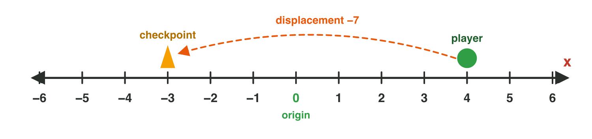

## Keywords



## 1.1 The game loop

:::: {.columns}
::: {.column width="50%"}
- For a computer, a game is numbers: positions, health, score.
- The game loop repeats: read the input, change the numbers, draw.
- One pass makes one **frame**; 60 fps means 60 passes every second.
- **Do it:** Write four things that a game you play computes with numbers.
:::
::: {.column width="50%"}

:::
::::

## Example · One tap, one pass

The player taps to build a tower that costs 50 coins.
**What does the game do in one pass of the loop?**

::: {.reveal}
1. Read: the game reads where the finger touched.
2. Change: it adds a tower, and the coins go from 200 to 150.
3. Draw: the next frame shows the tower and the new coins.
:::

## Try it 1 · The game loop

a) The loop has read the player's tap. What does it do next?
b) A game runs at 60 fps. How many frames does it make in 10 seconds?
c) A ship drops a rare reward only sometimes. Which mathematics does this need?

::: {.answer}
a) It changes the numbers.
b) 600 frames (60 × 10)
c) probability
:::

## 1.2 One dimension: the number line

:::: {.columns}
::: {.column width="50%"}
- Displacement = end − start. A minus sign means left (or down).
- Distance is the displacement without the sign.
- A board game uses whole numbers; a runner can use decimals.
- **Do it:** Draw a line from −5 to 10. What is the displacement from 0 to 6?
:::
::: {.column width="50%"}

:::
::::

## Example · Back to the checkpoint

The player is at 4. The checkpoint is at −3.
**What are the displacement and the distance back to the checkpoint?**

::: {.reveal}
1. Displacement = end − start = −3 − 4 = **−7**.
2. The minus sign means the player moves to the left.
3. The distance has no sign: **7 units**.
:::

## Try it 2 · Moving along a line

a) The player runs from 0 to a coin at 6. What is the displacement?
b) One move has a displacement of −5, another of +5. What are their distances?
c) A board game piece can stand only on squares 1, 2, 3. What kind of numbers are these?

::: {.answer}
a) +6
b) 5 units each
c) whole numbers
:::

## 1.3 Two dimensions: (x, y)

:::: {.columns}
::: {.column width="50%"}
- A point is an ordered pair (x, y): x to the right, y up.
- The signs of x and y decide the **quadrant** (I to IV).
- A point with a 0 lies on an axis, not in a quadrant.
- **Do it:** In GeoGebra, draw the key at (−3, 2). In which quadrant is it?
:::
::: {.column width="50%"}

:::
::::

## Example · Reading a level

The coin is at (4, 3), the key at (−3, 2) and the exit at (2, −3).
**In which quadrant is each object?**

::: {.reveal}
1. Coin (4, 3): plus and plus, so **quadrant I**.
2. Key (−3, 2): minus and plus, so **quadrant II**.
3. Exit (2, −3): plus and minus, so **quadrant IV**.
:::

## Live demo · Grid Strike



## Try it 3 · Where is the point?

a) Both numbers of a point are negative. In which quadrant is it?
b) A tree stands at (−5, 0). Where is it?
c) A point is 3 units right of the centre and 2 units down. What are its coordinates?

::: {.answer}
a) quadrant III
b) on the x-axis
c) (3, −2)
:::

## 1.4 Three dimensions: (x, y, z)

:::: {.columns}
::: {.column width="50%"}
- A point in 3D is an ordered triple (x, y, z).
- In most engines, y is up, so y is the height.
- On the ground, y = 0.
- **Do it:** In the 3D viewer, move the player to (1, 2, 4). Which slider changes the height?
:::
::: {.column width="50%"}

:::
::::

## Example · A drone over the harbour

A drone flies at (4, 12, −3), and y is up.
**How high is it, and where is the point below it on the ground?**

::: {.reveal}
1. The height is the middle number: **12 units**.
2. The point below it has y = 0: **(4, 0, −3)**.
3. When the drone lands straight down, only y changes.
:::

## Live demo · 3D position



## Try it 4 · Positions in 3D

In these questions, y is up.

a) A box is at (5, 0, 5). Where is it?
b) Point A is at (1, 4, 2) and point C at (3, 7, −1). Which point is higher?
c) A tower stands on the ground at x = 4 and z = −3. What is its position?

::: {.answer}
a) on the ground
b) C
c) (4, 0, −3)
:::

## 1.5 Left-handed or right-handed?

:::: {.columns}
::: {.column width="50%"}
- Hand rule: point the fingers along +x and bend them towards +y. The thumb shows +z.
- Left hand: +z points into the screen (**left-handed**).
- Right hand: +z points towards you (**right-handed**).
- **Do it:** Try the rule with your left hand. Where does your thumb point?
:::
::: {.column width="50%"}

:::
::::

## Unity and Blender use different axes

| Software | Up axis | Handedness |
|---|---|---|
| Unity | y | left-handed |
| Blender | z | right-handed |

## Try it 5 · Which hand?

a) Is Blender left-handed or right-handed?
b) Which axis is up in Blender?
c) Left hand: the fingers point right and bend up. Where does the thumb (+z) point?

::: {.answer}
a) right-handed
b) z
c) into the screen
:::

## Game challenge · Harbor Guard



## Try it 6 · The harbour (harder)

The facts: Harbor Guard runs at 60 fps. The dock is at (0, −6). A ship enters at (5, 8) and sails to the dock.

a) How many frames does the game make in 5 seconds?
b) The dock is at (0, −6). Where is it?
c) The ship sails from y = 8 down to y = −6. What is its displacement in y?

::: {.answer}
a) 300 frames
b) on the y-axis
c) −14
:::

## Summary

- The game loop reads, changes and draws, once per frame.
- On a line, displacement = end − start; distance has no sign.
- In 2D, the signs of x and y decide the quadrant.
- In 3D with y up, y is the height, and the ground is y = 0.
- Unity is left-handed with y up; Blender is right-handed with z up.
