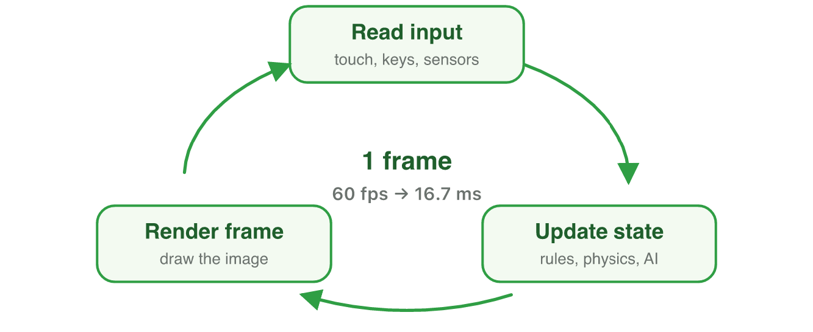
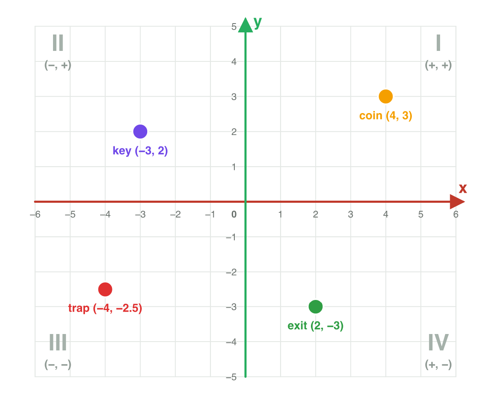
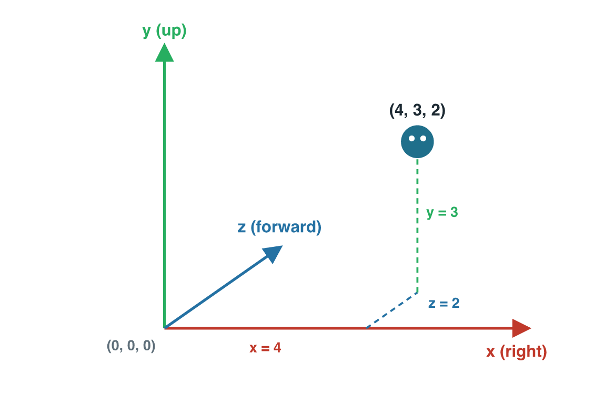
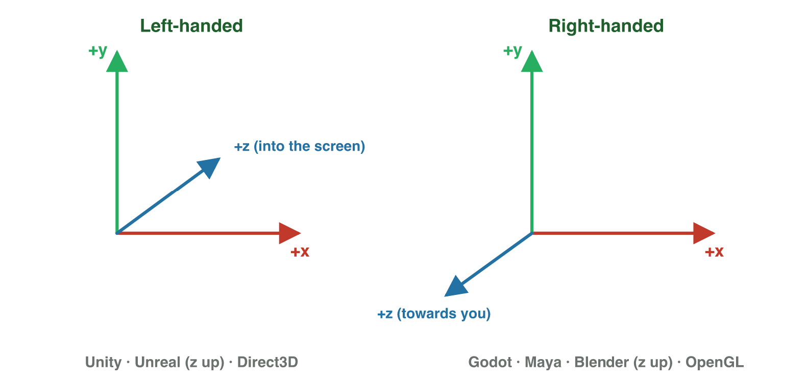
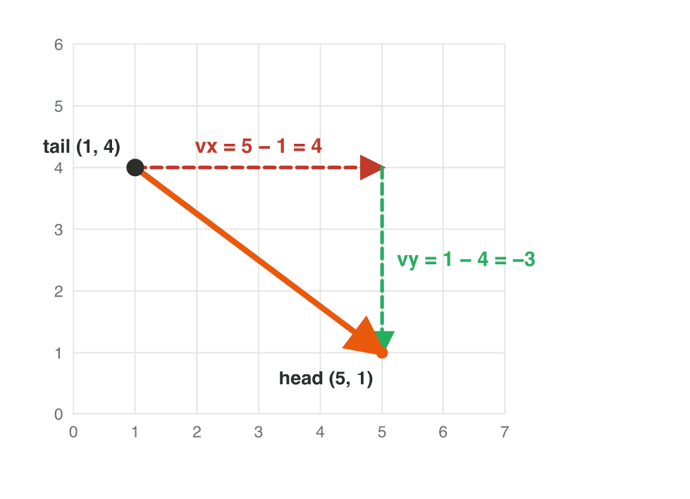
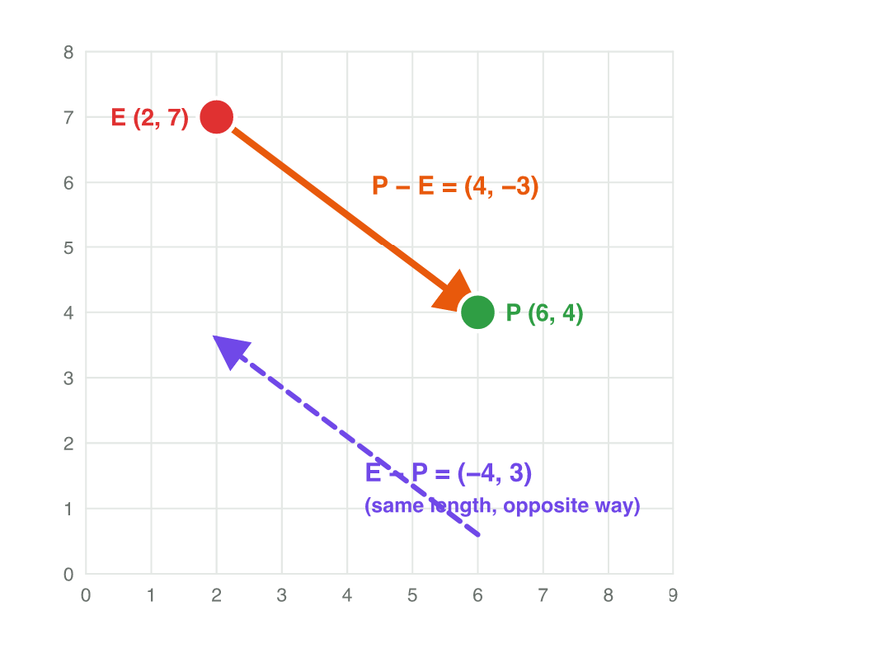
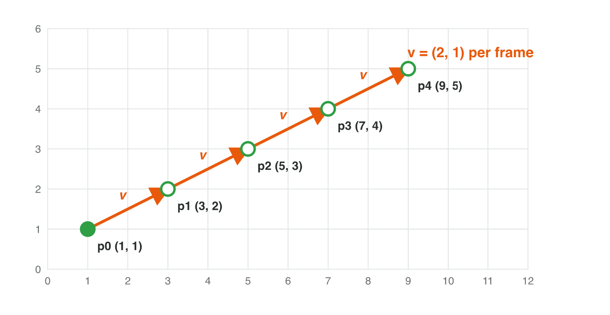

This page is the interactive version of the lesson notes (PDF). Each section
starts with a problem in a game. Then it explains the idea behind it. It ends
with a **Do it** task and one set of questions. Tap, sort or type your answer:
the page checks it at once and tells you why.

## Key terms



## 1.1 Why a game needs numbers: the game loop

- For a computer, a game is numbers in memory: positions, health, score.
- The **game loop** repeats: read the input → change the numbers → draw.
- One pass makes one **frame**.
- **Frame rate**: frames per second (fps). Phone games: 30 or 60 fps.
- The mathematics of this course in a game:

| What the game does | Mathematics |
|---|---|
| know where every object is; move it | coordinates, vectors |
| aim a turret; make an object bob up and down | trigonometry |
| move, turn and resize models | matrices |
| decide if a door opens or an enemy attacks | logic |
| loot, critical hits, random levels | probability |

{width=66%}

::: {.callout-note title="Do it · How often does the loop run?"}
A racing game runs at 30 fps. The same game can also run at 60 fps. How
many times does it update each car's position in 10 seconds?

::: {.fill answer="300" hint="Multiply the frames per second by the seconds."}
At 30 fps, how many updates are there in 10 seconds?

Why: 30 frames each second × 10 seconds = 300 updates.
:::

::: {.choice}
At 60 fps the game makes 600 updates in 10 seconds. Which version moves the
cars more smoothly?

- [x] the 60 fps version

  Why: Twice as many updates, so every step of a car is smaller.

- [ ] the 30 fps version

  Why: Fewer updates mean bigger jumps between two pictures.

- [ ] both look the same

  Why: The frame rate decides how many small steps a car makes in a second.
:::
:::

::: {.callout-tip title="Try it 1 · The game loop"}
Choose the right answer.

::: {.match extra="draw first|vectors|60 frames"}
The loop has read the player's tap. What does it do next?
:   change the numbers

    Why: the order is read → change the numbers → draw.

A game runs at 60 fps. How many frames in 10 seconds?
:   600 frames

    Why: 60 frames each second × 10 seconds = 600.

What does one pass of the game loop make?
:   one frame

    Why: each pass ends by drawing one picture: one frame.

A turret must turn to aim at a ship. Which mathematics?
:   trigonometry

    Why: turning to an angle is trigonometry (the table above).

A ship drops a rare reward only sometimes. Which mathematics?
:   probability

    Why: "only sometimes" is chance: probability.
:::
:::

## 1.2 Where is it on a level? 2D coordinates

- Two axes cross at the **origin**: the **x-axis** (right) and the **y-axis** (up).
- A point is an **ordered pair** (x, y). Read x first. The order matters.
- Four **quadrants**: I (+, +), II (−, +), III (−, −), IV (+, −).
- A point with a 0 is on an axis, not in a quadrant.
- Moving right or left changes x; moving up or down changes y.

{width=58%}

::: {.callout-note title="Do it · Build the level in GeoGebra"}
The level has a coin at (4, 3), a key at (−3, 2) and an exit at (2, −3).
Add an enemy at (−5, −2) and a door at (0, 4). You can also type them at
geogebra.org/calculator: `Coin = (4, 3)`, `Enemy = (-5, -2)` …

::: {.sort}
Where is each point? Sort the points of the level.

Quadrant I
:   the coin at (4, 3)

    Why: x and y are both plus: right and up.

Quadrant III
:   the enemy at (−5, −2)

    Why: x and y are both minus: left and down.

On an axis
:   the door at (0, 4)

    Why: x = 0, so the door is on the y-axis, in no quadrant.

:   the start of the level at (0, 0)

    Why: The origin is on both axes, in no quadrant.
:::
:::

::: {.callout-tip title="Try it 2 · Where is the point?"}
Choose the right answer. You can use an answer more than once.

::: {.match extra="quadrant I|quadrant IV|on the y-axis"}
The key at (−3, 2).
:   quadrant II

    Why: x is minus and y is plus: left and up.

Both numbers of a point are negative. Which quadrant?
:   quadrant III

    Why: (−, −) is quadrant III, bottom left.

A tree at (−5, 0).
:   on the x-axis

    Why: y = 0, so the tree is on the x-axis, in no quadrant.

A player at (2, 1) moves 3 right and 4 up. New position?
:   (5, 5)

    Why: right changes x: 2 + 3 = 5; up changes y: 1 + 4 = 5.

The point 3 units right of the centre and 2 units down.
:   (3, −2)

    Why: right is +3 for x, down is −2 for y.
:::
:::

## 1.3 Adding height: 3D coordinates

- A third axis, **z**, at a right angle to x and y.
- A point is an **ordered triple** (x, y, z).
- In most engines y is up: y is the **height**.
- On the ground, y = 0. x and z say where the point is on the ground.

{width=56%}

::: {.callout-warning title="Watch out!"}
With y up, the height is the **middle** number, not the last one.
:::



::: {.callout-note title="Do it · Move a player in 3D"}
In the 3D viewer, move the player to (1, 2, 4). Then move it straight down
to the ground.

::: {.choice}
Which slider changes the height of the player?

- [x] the y slider

  Why: In this world y is up, so y is the height.

- [ ] the z slider

  Why: z moves the player forward or back on the ground.

- [ ] the x slider

  Why: x moves the player left or right.
:::

::: {.fill answer="(1, 0, 4)" hint="On the ground the height is 0; x and z stay."}
The player goes straight down to the ground. Where is it now? Type (x, y, z).

Why: Straight down changes only the height: y becomes 0, so (1, 0, 4).
:::
:::

::: {.callout-tip title="Try it 3 · Positions in 3D"}
In these questions, y is up. Choose the right answer.

::: {.match extra="−3 units|(4, 12, 0)"}
A drone at (4, 12, −3). How high is it?
:   12 units

    Why: with y up, the height is the middle number.

A box at (5, 0, 5). Where is it?
:   on the ground

    Why: y = 0 means no height: on the ground.

A depot on the ground at x = 4, z = −3. Its position?
:   (4, 0, −3)

    Why: on the ground y = 0; x and z keep their values.

The drone lands straight down. Which number changes?
:   only y

    Why: straight down changes only the height; x and z stay.

A at (1, 4, 2), C at (3, 7, −1). Which is higher?
:   C

    Why: compare the middle numbers: 7 is more than 4.
:::
:::

## 1.4 Which way does z point? Left- and right-handed systems

- With x right and y up, z can point **into** or **out of** the screen.
- Hand rule: point the fingers along +x and bend them towards +y. The thumb
  shows +z.
- Works with the left hand: **left-handed** (+z into the screen).
- Works with the right hand: **right-handed** (+z towards you).
- Unity is left-handed with y up. Some modelling tools are right-handed:
  check the axes of a tool before you read a position.

{width=82%}

::: {.callout-note title="Do it · The hand rule"}
Hold your left hand palm up, with the fingers to the right. Bend the fingers
up: your thumb shows +z. Do the same with your right hand.

::: {.choice}
In Unity, x goes right, y goes up and +z goes into the screen. Which hand
fits Unity?

- [x] the left hand

  Why: With the left hand, the thumb points into the screen: Unity is left-handed.

- [ ] the right hand

  Why: With the right hand, the thumb points towards you, out of the screen.

- [ ] both hands

  Why: The two thumbs point in opposite directions, so only one hand fits.
:::
:::

::: {.callout-tip title="Try it 4 · Which hand?"}
Choose the right answer.

::: {.match extra="down|y"}
Left hand: fingers to the right, bent up. Where does the thumb (+z) point?
:   into the screen

    Why: that is the left-hand rule: +z goes into the screen.

Right hand: fingers to the right, bent up. Where does the thumb point?
:   towards you

    Why: the right hand is the mirror image: +z comes out of the screen.

The handedness of Unity.
:   left-handed

    Why: in Unity, with x right and y up, +z goes into the screen.

A tool's +z comes out of the screen (x right, y up). Its handedness?
:   right-handed

    Why: +z towards you is the right-hand rule.
:::
:::

## 1.5 How far, and which way? Vectors and components

- A **scalar** has only a size: one number (health 75, time 42 s).
- A **vector** has a size (**magnitude**) and a **direction**.
- A vector is drawn as an **arrow**. It has **no position**: equal arrows
  anywhere are the same vector.
- The game stores the **components**: v = (v~x~, v~y~) = **head − tail**.
- (0, 5) points straight up, (−2, 0) straight left; (0, 0) is the **zero
  vector**: no movement.

{width=58%}

::: {.callout-warning title="Watch out!"}
Two enemies in different places that both move "2 left per frame" have the
**same** velocity vector, (−2, 0).
:::

::: {.callout-note title="Do it · Arrows in GeoGebra"}
Arrow u goes from (1, 4) to (5, 1). Arrow w goes from (−2, 2) to (2, −1).
You can also draw them at geogebra.org/calculator:
`u = Vector((1, 4), (5, 1))` and `w = Vector((-2, 2), (2, -1))`.

::: {.fill answer="(4, −3)" hint="Head − tail: subtract the x-parts, then the y-parts."}
What are the components of w? Type (x, y).

Why: Head − tail: (2 − (−2), −1 − 2) = (4, −3).
:::

::: {.choice}
u has the components (4, −3) too. Are u and w the same vector?

- [x] Yes: they have the same components.

  Why: A vector has a size and a direction, but no position.

- [ ] No: they start at different points.

  Why: Equal arrows anywhere are the same vector; only the start is different.

- [ ] No: w is longer than u.

  Why: Both have the components (4, −3), so they have the same length.
:::
:::

::: {.callout-tip title="Try it 5 · Scalars, arrows and components"}
Choose the right answer. You can use an answer more than once.

::: {.match extra="(−4, 3)|straight down"}
The score of a game, 12 400.
:   scalar

    Why: one number, no direction.

"The hit pushes the player 4 units away from the enemy."
:   vector

    Why: it has a size (4 units) and a direction (away from the enemy).

An arrow from (1, 4) to (5, 1). Components?
:   (4, −3)

    Why: head − tail: (5 − 1, 1 − 4) = (4, −3).

An arrow from (−2, 3) to (4, −1). Components?
:   (6, −4)

    Why: (4 − (−2), −1 − 3) = (6, −4).

Where does the vector (0, 5) point?
:   straight up

    Why: no change in x, plus 5 in y.

The player lets go of the joystick. Which vector?
:   (0, 0)

    Why: no push in any direction: the zero vector.
:::
:::

## 1.6 From one point to another: displacement vectors

- A **point** is a place (where?). A **vector** is a change (how far, which way?).
- From A to B: **B − A** (end minus start).
- A − B is the **opposite vector**: same size, other direction.
- An arrow to the goal uses goal − player.

{width=62%}

::: {.callout-warning title="Watch out!"}
"From A to B" is always B − A. An enemy that uses E − P walks **away** from
the player.
:::

::: {.callout-note title="Do it · Chase the player"}
The enemy is at E = (−2, 1) and the player at P = (3, 4). In GeoGebra you
can type `Vector(E, P)` and `Vector(P, E)` to see both arrows.

::: {.choice}
Which vector does the enemy need to walk to the player?

- [x] (5, 3)

  Why: From the enemy to the player is P − E = (3 − (−2), 4 − 1) = (5, 3).

- [ ] (−5, −3)

  Why: That is E − P: it points from the player back to the enemy.

- [ ] (1, 5)

  Why: That is P + E; adding two points has no meaning.
:::
:::

::: {.callout-tip title="Try it 6 · Enemy, player, treasure"}
Choose the right answer.

::: {.match extra="(−8, 6)|it walks faster"}
Enemy E = (2, 7), player P = (6, 4). The vector from the enemy to the player?
:   (4, −3)

    Why: end − start: P − E = (6 − 2, 4 − 7) = (4, −3).

The same enemy E = (2, 7) and player P = (6, 4). The vector from the player back to the enemy?
:   (−4, 3)

    Why: E − P is the opposite vector: both signs change.

Player (−3, 2), treasure (5, −4). The arrow to the treasure?
:   (8, −6)

    Why: treasure − player = (5 − (−3), −4 − 2) = (8, −6).

An enemy uses E − P instead of P − E. What happens?
:   it walks away from the player

    Why: E − P points from the player to the enemy, the wrong way.

The player stands on the goal. Goal − player?
:   the zero vector

    Why: a point minus itself is (0, 0).
:::
:::

## 1.7 Moving every frame: a point plus a vector

- point − point = vector; point + vector = point; point + point = no meaning.
- **Velocity**: the displacement in one frame.
- Every frame: new position = old position + velocity.
- After n frames: the object has moved n × the velocity.
- Reverse question: velocity = total displacement ÷ number of frames.

{width=80%}



::: {.callout-note title="Do it · Vector Dash"}
Play three levels of **Vector Dash**. Then check one level by hand: the
start is (1, 1), the target is (9, 5) and you have 4 frames.

::: {.order}
Put the three lines of the check in order.

1. Total displacement: target − start = (9, 5) − (1, 1) = (8, 4).
2. Velocity: (8, 4) ÷ 4 frames = (2, 1).
3. Test: (1, 1) + 4 × (2, 1) = (9, 5), the target.

Why: First the whole way, then the part for one frame, then a test that it ends on the target.
:::

::: {.choice}
A friend chose the velocity (8, 4) for this level. What happens?

- [x] The ship flies past the target.

  Why: (8, 4) is the whole way in one frame; after 4 frames the ship is at (33, 17).

- [ ] The ship reaches the target after 4 frames.

  Why: Only (2, 1) reaches it: 4 × (2, 1) = (8, 4).

- [ ] The ship stands still.

  Why: Only the zero vector (0, 0) keeps a ship still.
:::
:::

::: {.callout-tip title="Try it 7 · Frame by frame"}
Choose the right answer.

::: {.match extra="(6, 3)|a vector"}
A ball at (0, 2) with velocity (3, 1). Where after 3 frames?
:   (9, 5)

    Why: (0 + 3 × 3, 2 + 3 × 1) = (9, 5).

A missile at (10, 7) must reach (4, 1) in 3 frames. Velocity?
:   (−2, −2)

    Why: (4, 1) − (10, 7) = (−6, −6); ÷ 3 = (−2, −2).

What does the game add to the position in every frame?
:   the velocity

    Why: new position = old position + velocity.

What is point + point?
:   no meaning

    Why: places cannot be added; only point + vector gives a point.

An object has the velocity (0, 0). What does it do?
:   it stands still

    Why: adding (0, 0) does not change the position.
:::
:::

## Game challenge: Comet Courier {.challenge}

Work alone. Use every section of today.

**Comet Courier** is a delivery game in space. Depot Alpha is at (1, 2),
depot Beta at (9, 6), and a comet passes through (5, 4). The player chooses
one velocity before the ship starts; the game adds it once per frame. If the
ship passes through the comet's point, it is hit.



::: {.callout-tip title="Try it 8 · Alpha to Beta (harder)"}
Comet Courier: Alpha (1, 2), Beta (9, 6), comet (5, 4); one velocity per
frame. Choose the right answer.

::: {.match extra="(4, 4)|after 3 frames|quadrant II"}
The displacement from Alpha to Beta.
:   (8, 4)

    Why: Beta − Alpha = (9 − 1, 6 − 2) = (8, 4).

A ship leaves Alpha with (2, 1). After how many frames is it at Beta?
:   4 frames

    Why: 4 × (2, 1) = (8, 4), the whole way from Alpha to Beta.

Is that ship hit by the comet? When?
:   yes, after 2 frames

    Why: (1, 2) + 2 × (2, 1) = (5, 4), the comet's point.

The velocity to reach Beta from Alpha in only 2 frames.
:   (4, 2)

    Why: (8, 4) ÷ 2 = (4, 2).

The way back, from Beta to Alpha.
:   (−8, −4)

    Why: the opposite of Alpha → Beta: both signs change.

In which quadrant are all three points of the map?
:   quadrant I

    Why: every x and every y on the map is plus.
:::
:::

::: {.callout-note .ai-task title="Task with AI · Draw every frame of a delivery"}
An extra for the curious: let an AI assistant draw it. Copy the prompt
into an AI assistant that the university allows (for example Microsoft
Copilot with your university account), and look at the picture.

::: {.prompt}
Draw a 2D grid with x and y from 0 to 10, with numbered axes. A spaceship
starts at (1, 2). In every frame it adds the velocity (2, 1) to its
position. Draw its position for frames 0, 1, 2, 3 and 4 as blue dots, and
write the frame number next to each dot. Draw a red star for a comet at
(5, 4). Show the result as a picture.
:::

::: {.choice}
What should the picture show? The AI can be wrong: compare.

- [x] Five dots on one straight line, from (1, 2) to (9, 6). Dot 2 is on the star.

  Why: (1, 2) + 2 × (2, 1) = (5, 4), the comet's point.

- [ ] Five dots straight up from (1, 2), one above the other.

  Why: The velocity (2, 1) also moves the ship 2 to the right in every frame.

- [ ] Five dots on a line, and no dot on the star.

  Why: After 2 frames the ship is at (5, 4), exactly on the comet.
:::

::: {.try-change}
**Change:** make the velocity (4, 2) and ask again.

::: {.choice}
What changes in the picture?

- [x] The dots are twice as far apart, and dot 1 is on the star.

  Why: (1, 2) + (4, 2) = (5, 4) after only 1 frame; dots 3 and 4 leave the grid.

- [ ] The line turns and gets steeper.

  Why: (4, 2) is 2 × (2, 1): the same direction, so the same line.
:::
:::

::: {.try-change}
**Change:** make the velocity (2, 2) and ask again.

::: {.choice}
What changes in the picture?

- [x] The line is steeper, and no dot is on the star.

  Why: After 2 frames the ship is at (5, 6), 2 units above the comet.

- [ ] The ship is hit after 2 frames again.

  Why: (1, 2) + 2 × (2, 2) = (5, 6), not the comet's point (5, 4).
:::
:::

**Your own idea:** change one more number or word, and look again. The AI
can be wrong: compare its result with the answers.
:::

## Summary {.summary}

- The game loop: read → change → draw, once per frame.
- (x, y): four quadrants, decided by the signs; (x, y, z): with y up, y is the height.
- Hand rule: Unity is left-handed (+z into the screen).
- A vector has a size and a direction; components = head − tail.
- From A to B: B − A; every frame: position + velocity.
