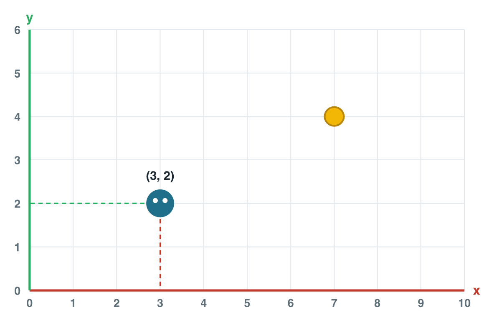

## New words



## 1. Math is inside every game

Open any mobile game. You see things move, turn, and appear.
Behind every one of these, there is math.

| In the game… | The math | We learn it in… |
|---|---|---|
| The player walks to a coin. | position and vectors | weeks 1–3 |
| A cannon turns to aim. | angles (trigonometry) | week 4 |
| A character grows or spins. | transformations (matrices) | weeks 5–7 |
| "If health is 0, game over." | logic | weeks 9–10 |
| A chest gives a random prize. | probability | weeks 11–13 |

Today we start with the first question in every game:
**where is everything?**

::: {.callout-tip title="Try it 1"}
Match each game moment with its math: *position*, *angle*, *probability*, *logic*.

a) An enemy drops a rare sword only 1 time in 20.
b) The car is 5 steps to the right of the start.
c) The door opens only if you have the key.
d) The tower turns to face the enemy.
:::

::: {.callout-note title="Check your answers" collapse="true"}
a) probability  b) position  c) logic  d) angle
:::

## 2. Every object has a position

The computer does not see the screen like you.
It only knows numbers.

So each object has a **position**.
In a flat (**2D**) game, a position is two numbers.

{width=85%}

- The red line is the **x-axis**. x grows to the **right**.
- The green line is the **y-axis**. y grows **up**.
- The corner where they meet is the **origin**. There, x = 0 and y = 0.

::: {.callout-tip title="Try it 2"}
Look at the picture.

a) What number is at the right end of the x-axis?
b) What number is at the top of the y-axis?
:::

::: {.callout-note title="Check your answers" collapse="true"}
a) 10  b) 6
:::

## 3. Write a position: (x, y)

We write a 2D position like this: **(x, y)**.
Each number is a **coordinate**.

- First number: **x**. Count to the right.
- Second number: **y**. Count up.

The player is at **(3, 2)**: 3 steps right, 2 steps up.

Order is important! (3, 2) and (2, 3) are **different** places.

Now try it. Move the player. Then press **Challenge** and catch the coin.



::: {.callout-tip title="Try it 3"}
a) Where is the coin in the picture? Write (x, y).
b) Move the player to (0, 0). What is this point called?
c) The player is at (3, 2). It moves 4 steps right. What is the new position?
:::

::: {.callout-note title="Check your answers" collapse="true"}
a) (7, 4)  b) the origin  c) (7, 2). Only x changes.
:::

## 4. From 2D to 3D: add z

Many mobile games are **3D**. The world has depth.
So we need a third number: **z**.

{width=75%}

A 3D position is **(x, y, z)**:

- x → right
- y → up
- z → forward (into the screen)

To reach (4, 3, 2): walk 4 right, walk 2 forward, then go 3 up.

Now try it in 3D. Turn the world with your finger. Move the player.
Then press **Challenge** and catch the coin in the air.



::: {.callout-tip title="Try it 4"}
A 3D player is at (4, 3, 2).

a) The player jumps up 1. Which number changes? Write the new position.
b) The player walks forward 5. Which number changes? Write the new position.
:::

::: {.callout-note title="Check your answers" collapse="true"}
a) y changes: (4, 4, 2)  b) z changes: (4, 3, 7)
:::

## 5. Position in a game engine

A **game engine** like Unity shows the position of every object.
In Unity, each object has a **Transform** with three numbers:

| Position | X | Y | Z |
|---|---|---|---|
| Player | 4 | 3 | 2 |

In code, it looks like this. **Just read it today.**
You will write code like this in *Programming Fundamentals (1)*.

```csharp
// put the player at x = 4, y = 3, z = 2
transform.position = new Vector3(4, 3, 2);
```

In a 2D game in Unity, z is usually 0.

::: {.callout-tip title="Try it 5"}
Read the code: `transform.position = new Vector3(0, 5, 0);`
Where is the object? Describe it in words.
:::

::: {.callout-note title="Check your answers" collapse="true"}
At x = 0, y = 5, z = 0: 5 steps up, straight above the origin.
:::

## Class activity {.activity}

Work in pairs. Open one mobile game on your phone.
Find **three places** where the game uses math.
Use the table in part 1 to help you. Tell the class one example.

## Summary {.summary}

- Every game uses math. It starts with **position**.
- 2D position: **(x, y)**. 3D position: **(x, y, z)**.
- x → right. y ↑ up. z → forward.
- The **origin** is (0, 0) in 2D and (0, 0, 0) in 3D.
- In Unity, every object has a position in its Transform.
