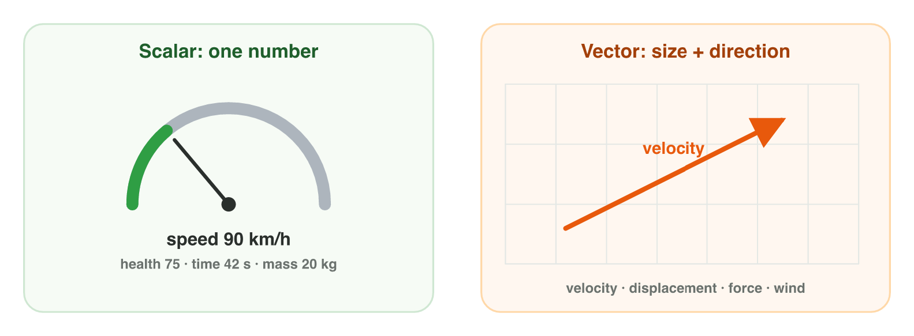
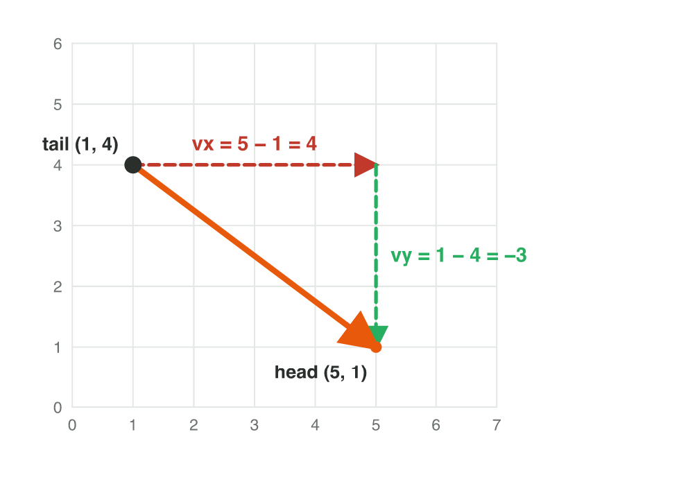
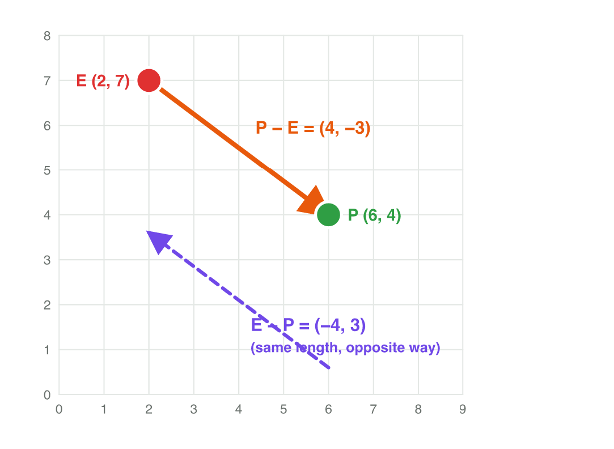
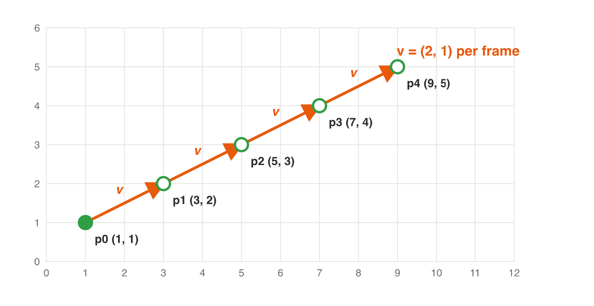
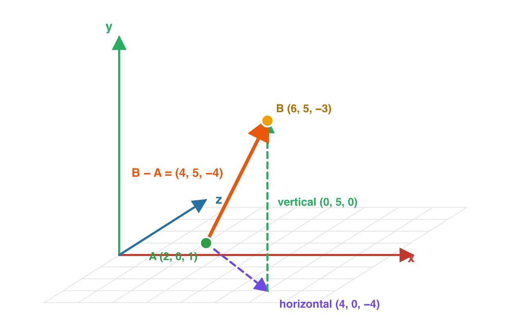

## Keywords



## Think · Is "5 m/s" enough?

The game says: **the wind blows at 5 m/s**.
**Can the program move the leaves?**

::: {.answer}
No. It also needs the **direction**: 5 m/s *to the east*.
:::

## 2.1 Scalars and vectors

:::: {.columns}
::: {.column width="38%"}
- scalar: one number
- vector: size + direction
- speed → **velocity**
- distance → **displacement**
- **Do it together:** scalars and vectors in a game
:::
::: {.column width="62%"}

:::
::::

## Example · A platform game

Scalar or vector?

::: {.reveal}
1. score 12 400 → **scalar**
2. 3 units right per frame → **vector**
3. 4 units away from the enemy → **vector**
4. waiting time 2.5 s → **scalar**
:::

## Try it 1 · Scalar or vector?

a) the waiting time of a skill?
b) "4 units away from the enemy"?
c) to move a car: speed or velocity?

::: {.answer}
a) scalar
b) vector
c) the velocity
:::

## 2.2 Arrows and components

:::: {.columns}
::: {.column width="38%"}
- arrow: tail → head
- **no position**
- **v** = (v~x~, v~y~)
- components = **head − tail**
- **Do it together:** arrows in GeoGebra
:::
::: {.column width="62%"}

:::
::::

## Example · Components from a drawing

Tail (1, 4), head (5, 1).

::: {.reveal}
1. v~x~ = 5 − 1 = **4** (right)
2. v~y~ = 1 − 4 = **−3** (down)
3. **v = (4, −3)**
:::

## Try it 2 · Arrows and components

a) arrow from (−2, 3) to (4, −1)?
b) the joystick is let go?
c) where does (0, 5) point?

::: {.answer}
a) (6, −4)
b) (0, 0)
c) straight up
:::

## 2.3 Points and displacement

:::: {.columns}
::: {.column width="38%"}
- from A to B: **B − A**
- A − B: the **opposite vector**
- on the goal: **(0, 0)**
- wrong order → walks away
- **Do it together:** chase the player in GeoGebra
:::
::: {.column width="62%"}

:::
::::

## Example · Enemy and player

E = (2, 7), P = (6, 4).

::: {.reveal}
1. P − E = (4, −3): enemy → player
2. E − P = (−4, 3): player → enemy
3. a hit pushes the player along **P − E**
:::

## Try it 3 · Enemy, player, treasure

a) from the player back to the enemy (above)?
b) enemy uses E − P: what happens?
c) player on the goal: goal − player?

::: {.answer}
a) (−4, 3)
b) it walks away
c) the zero vector
:::

## 2.4 Moving a point with a vector

:::: {.columns}
::: {.column width="38%"}
- point + vector = point
- every frame: position + **velocity**
- after n frames: n × each component
- velocity = displacement ÷ frames
:::
::: {.column width="62%"}

:::
::::

## Example · Which velocity?

Missile (10, 7) → target (4, 1) in 3 frames.

::: {.reveal}
1. total: (4, 1) − (10, 7) = (−6, −6)
2. 3 equal steps: **v = (−2, −2)**
3. check: (10, 7) + 3 × (−2, −2) = (4, 1)
:::

## Live demo · Vector Dash



## Try it 4 · Frame by frame

a) (1, 1) with (2, 1): after 4 frames?
b) added to the position every frame?
c) point + point?

::: {.answer}
a) (9, 5)
b) the velocity
c) no meaning
:::

## 2.5 Vectors in 3D

:::: {.columns}
::: {.column width="38%"}
- (v~x~, v~y~, v~z~)
- vertical (0, v~y~, 0): height
- horizontal (v~x~, 0, v~z~): ground
- walk: v~y~ = 0 · jump: only v~y~
- **Do it together:** a 3D move in the viewer
:::
::: {.column width="62%"}

:::
::::

## Example · Delivery drone

A = (2, 0, 1), B = (6, 5, −3).

::: {.reveal}
1. B − A = **(4, 5, −4)**
2. vertical (0, 5, 0): climbs 5
3. horizontal (4, 0, −4)
:::

## Live demo · 3D position



## Try it 5 · A drone in 3D

A = (2, 0, 1) → B = (6, 5, −3).

a) horizontal part?
b) the way back?
c) walking on flat ground: v~y~?

::: {.answer}
a) (4, 0, −4)
b) (−4, −5, 4)
c) 0
:::

## Game challenge · Comet Courier



## Try it 6 · Alpha to Beta (harder)

Alpha (1, 2) · Beta (9, 6) · comet (5, 4) · one velocity, chosen at the start · 3D: Gamma (2, 1, 3) · Delta (6, 4, 3)

a) Alpha → Beta?
b) leaves Alpha with (2, 1): hit by the comet?
c) Gamma → Delta: vertical part?

::: {.answer}
a) (8, 4)
b) yes, after 2 frames
c) (0, 3, 0)
:::

## Summary

- scalar: one number · vector: size + direction
- components = head − tail · no position
- from A to B: B − A · opposite: A − B
- every frame: position + velocity
- 3D: vertical + horizontal parts
