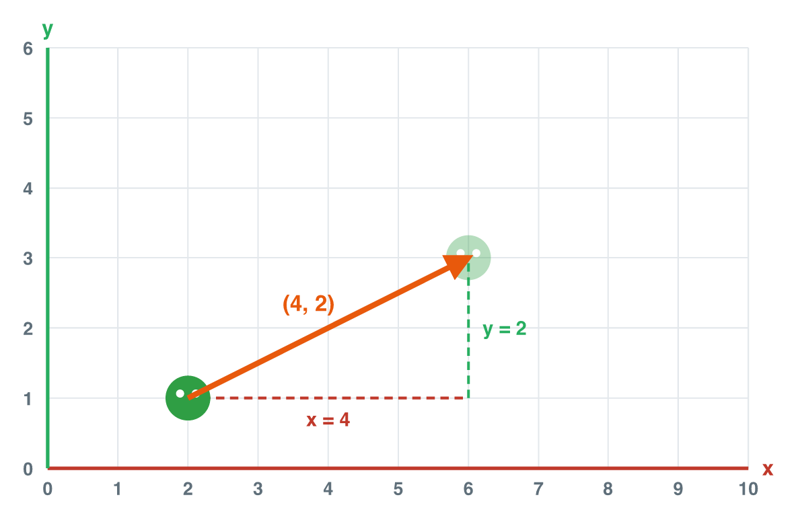

## New words



## Warm-up: remember lesson 1

In lesson 1, we learned **position**.

- 2D: **(x, y)**. 3D: **(x, y, z)**.
- x → right, y ↑ up, z → forward. Left, down and back are negative (−).

::: {.callout-tip title="Try it 1"}
Remember lesson 1.

::: {.match extra="(1, 3)|5"}
A coin is 3 steps right and 1 step up from the origin. Where is it?
:   (3, 1)

The player is at (4, 2). It moves 2 steps left. Where is it now?
:   (2, 2)

In the 3D position (1, 5, 8), what is z?
:   8
:::
:::

## 1. A place or a move?

Now look at this game moment.
The player is at (2, 1). You push the joystick.
The player goes **4 steps right** and **2 steps up**.

"4 right, 2 up" is not a place. It is a **move**.
In math, a move is a **vector**.

| | It answers… | Example |
|---|---|---|
| **Position** | Where is it? | The coin is **at** (7, 4). |
| **Vector** | Which way? How far? | The player **moves** 4 right and 2 up. |

Games use vectors all the time: a jump, a bullet, the wind, a car on the road.

::: {.callout-tip title="Try it 2"}
Position or vector? You can use an answer more than once.

::: {.match}
The coin is at (7, 4).
:   position

The car goes 3 steps right.
:   vector

The enemy goes 2 steps down.
:   vector

The door is at (0, 5).
:   position

The wind pushes the ball 1 step left.
:   vector
:::
:::

## 2. A vector is an arrow

We draw a vector as an **arrow**.

{width=85%}

An arrow tells us two things:

- its **direction**: where it points.
- its **magnitude** (length): how far it goes.

A vector is only a move. It does not have a place.
"4 right, 2 up" is the same move from any start point.

::: {.callout-note title="Example: the same vector in two places"}
Player A is at (0, 0). Player B is at (5, 3).
Both players move 2 steps right.

- A goes from (0, 0) to (2, 0).
- B goes from (5, 3) to (7, 3).

Two different places, but the **same vector**: 2 right.
:::

::: {.callout-tip title="Try it 3"}
::: {.match extra="Arrow B"}
Two arrows point the same way. They have the same length. Are they the same vector?
:   Yes: same direction, same length

Arrow A is long. Arrow B is short. They point the same way. Which one has the bigger magnitude?
:   Arrow A

Two arrows have the same length. One points right, one points left. Are they the same vector?
:   No: the direction is different
:::
:::

## 3. Components: the numbers of a vector

Look at the picture again.
The red dashed line shows the steps **right**. The green dashed line shows the steps **up**.
These two numbers are the **components** of the vector.

We write a vector with its components: **(x, y)**.

- **x**: steps right (+) or left (−).
- **y**: steps up (+) or down (−).

A minus sign changes the direction.

| Vector | In words |
|---|---|
| (4, 2) | 4 right, 2 up |
| (−3, 0) | 3 left |
| (0, −2) | 2 down |
| (−1, 5) | 1 left, 5 up |

::: {.callout-note title="Example: read the arrow in the picture"}
1. Count the steps right along the red dashed line: **4**. So x = 4.
2. Count the steps up along the green dashed line: **2**. So y = 2.
3. The vector is **(4, 2)**.
:::

::: {.callout-note title="Watch out!"}
A vector and a position look the same: two numbers in brackets.
Read the words. "**at** (4, 2)" is a place. "**moves** (4, 2)" is a vector.
:::

::: {.callout-tip title="Try it 4"}
Match each move with its vector.

::: {.match extra="(0, 5)|(−2, 0)|(3, −1)"}
5 steps right
:   (5, 0)

2 steps down
:   (0, −2)

3 steps left and 1 step up
:   (−3, 1)

6 steps up
:   (0, 6)

2 steps left and 2 steps down
:   (−2, −2)
:::
:::

::: {.callout-tip title="Try it 5"}
Now the other way: say the vector in words.

::: {.match extra="4 up|5 right"}
(0, −4)
:   4 down

(−5, 0)
:   5 left

(2, −3)
:   2 right, 3 down

(−1, −1)
:   1 left, 1 down
:::
:::

## 4. Move with a vector: position + vector

To move an object, we **add** the vector to its position.
Add x to x. Add y to y.

> new position = position + vector

::: {.callout-note title="Example: move the player"}
The player is at (2, 1). The vector is (4, 2).

1. Add the x numbers: 2 + 4 = 6.
2. Add the y numbers: 1 + 2 = 3.
3. The new position is **(6, 3)**.

In short: (2, 1) + (4, 2) = (2 + 4, 1 + 2) = (6, 3).
:::

A minus in the vector moves left or down:
(5, 4) + (−2, −3) = (5 − 2, 4 − 3) = **(3, 1)**.

Now try it. Change the vector with the sliders. Press **Move**.
Then press **Challenge**: reach the coin with **one** vector.



::: {.callout-tip title="Try it 6"}
Find the new position.

::: {.match extra="(7, 7)|(6, 0)"}
The player is at (1, 1). The vector is (3, 2).
:   (4, 3)

The player is at (5, 4). The vector is (−2, −3).
:   (3, 1)

The player is at (6, 3). The vector is (0, 3).
:   (6, 6)

The player is at (2, 3). The vector is (−2, 0).
:   (0, 3)
:::
:::

## 5. The vector from A to B: B − A

An enemy wants to walk to the player. Which vector does it need?

To find the vector **from A to B**, take **end − start**:

> vector from A to B = B − A

::: {.callout-note title="Example: from the player to the coin"}
The player is at A = (2, 1). The coin is at B = (7, 4).

1. x: end − start = 7 − 2 = 5.
2. y: end − start = 4 − 1 = 3.
3. The vector is **(5, 3)**.

Check it: (2, 1) + (5, 3) = (7, 4). Yes, the player reaches the coin.
:::

::: {.callout-note title="Watch out!"}
Order is important!
B − A goes from A **to** B. A − B goes the other way, **back** from B to A.
Always take **end − start**.
:::

In the simulator, tap the coin on the grid.
The simulator finds the vector for you: coin − player.

::: {.callout-tip title="Try it 7"}
Find the vector. Use end − start.

::: {.match extra="(4, 0)|(5, −3)"}
From (1, 2) to (4, 6)
:   (3, 4)

From (6, 5) to (2, 5)
:   (−4, 0)

From the enemy at (8, 1) to the player at (3, 4)
:   (−5, 3)

From (3, 3) to (3, 0)
:   (0, −3)
:::
:::

## 6. Go back: the opposite vector

The player moves (3, 2): 3 right, 2 up.
How does it come **back** to the start?

It needs the same move, but the other way: **(−3, −2)**.
This is the **opposite vector**. Change the sign of every component.

| Vector | Opposite vector |
|---|---|
| (3, 2) | (−3, −2) |
| (−4, 1) | (4, −1) |
| (0, −5) | (0, 5) |

A vector + its opposite = **(0, 0)**.
(3, 2) + (−3, −2) = (0, 0).

The vector (0, 0) is the **zero vector**. It means "do not move".
A player who stands still has velocity (0, 0).

::: {.callout-tip title="Try it 8"}
Opposite and zero.

::: {.match extra="(4, −1)|(0, −5)"}
What is the opposite of (4, 1)?
:   (−4, −1)

What is the opposite of (0, −5)?
:   (0, 5)

(2, 3) + (−2, −3) = ?
:   (0, 0)

The player goes (−6, 2). Which vector brings it back?
:   (6, −2)
:::
:::

## 7. Vectors in 3D and in game code

In a 3D game, a vector has three components: **(x, y, z)**.
z is the steps forward (+) or back (−).
For example, (0, 0, 3) is 3 steps forward. (0, −2, 0) is 2 steps down.

A game draws many pictures every second. Each picture is a **frame**.
Many mobile games draw 30 or 60 frames every second.

In each frame, the game moves the player a little:

> new position = position + velocity

The **velocity** is the vector of the move in one frame.

::: {.callout-note title="Example: frame by frame"}
The player is at (0, 0, 0). The velocity is (1, 0, 2).

- After frame 1: (0, 0, 0) + (1, 0, 2) = (1, 0, 2)
- After frame 2: (1, 0, 2) + (1, 0, 2) = (2, 0, 4)
- After frame 3: (2, 0, 4) + (1, 0, 2) = (3, 0, 6)

Each frame adds the same velocity again.
:::

Here is game code in C#, the language of many games
(for example, games made with Unity). **Just read it.**

```csharp
// the move in one frame: 2 right, 0 up, 1 forward
Vector3 velocity = new Vector3(2, 0, 1);

// in every frame: the new position is the old position + velocity
position = position + velocity;
```

- `Vector3` means "three numbers together": x, y, z.
  A 2D game uses `Vector2`: two numbers, x and y.
- `velocity` and `position` are names. We choose the names.
- Read `=` as "becomes". The position **becomes** position + velocity.

::: {.callout-tip title="Try it 9"}
3D vectors and frames.

::: {.match extra="3 up|(12, 0, 3)"}
The 3D vector (0, 0, 3) in words?
:   3 forward

The 3D vector (0, −2, 0) in words?
:   2 down

The player is at (10, 0, 0). The velocity is (2, 0, 1). Where is it after 1 frame?
:   (12, 0, 1)

Same player, same velocity. Where is it after 3 frames?
:   (16, 0, 3)
:::
:::

## Practice round

Use everything from today. These are a little harder.

::: {.callout-tip title="Try it 10 (harder)"}
An enemy is at (9, 5). The player is at (3, 2).

::: {.match extra="(6, −3)|(5, 2)|2 frames"}
Find the vector from the enemy to the player.
:   (−6, −3)

Find the vector from the player back to the enemy.
:   (6, 3)

A ball is at (4, 4). Its velocity is (1, −2) in each frame. Where is it after 2 frames?
:   (6, 0)

Another enemy is at (8, 1). It moves (−1, 1) in each frame. After how many frames is it at (5, 4)?
:   3 frames
:::
:::

## Class activity {.activity}

**Treasure hunt with vectors** (pairs, about 18 minutes).

1. **Draw** (3 min). Each student draws a grid on paper: x from 0 to 10, y from 0 to 6.
2. **Hide** (2 min). Put the player at (1, 1). Hide **3 treasures** on your grid.
   Do not show your partner.
3. **Give vectors** (5 min). Tell your partner only **vectors**, one for each treasure.
   Start every vector from the player: "From the player, go (4, 2)."
   Your partner draws each arrow and writes the treasure position.
4. **Check and swap** (5 min). Check together. Then change roles.
5. **Bonus** (3 min). Write the vector from treasure 1 to treasure 2 (end − start).
   Then write its opposite vector: the way back from treasure 2 to treasure 1.

## Summary {.summary}

- A **position** is a place. A **vector** is a move.
- A vector is an arrow: it has a **direction** and a **magnitude** (length).
- **Components**: (x, y). + is right or up. − is left or down.
- Move an object: **new position = position + vector**.
- The vector from A to B: **B − A** (end − start).
- **Opposite vector**: change every sign. It goes back. **Zero vector** (0, 0): no move.
- In game code: `Vector2` (x, y), `Vector3` (x, y, z). Each frame: position + velocity.
