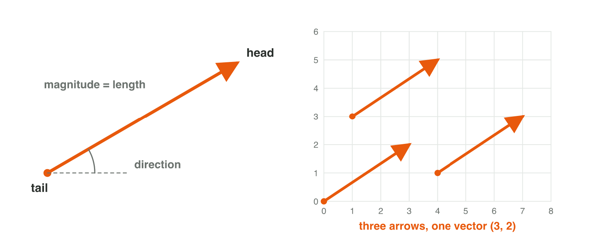
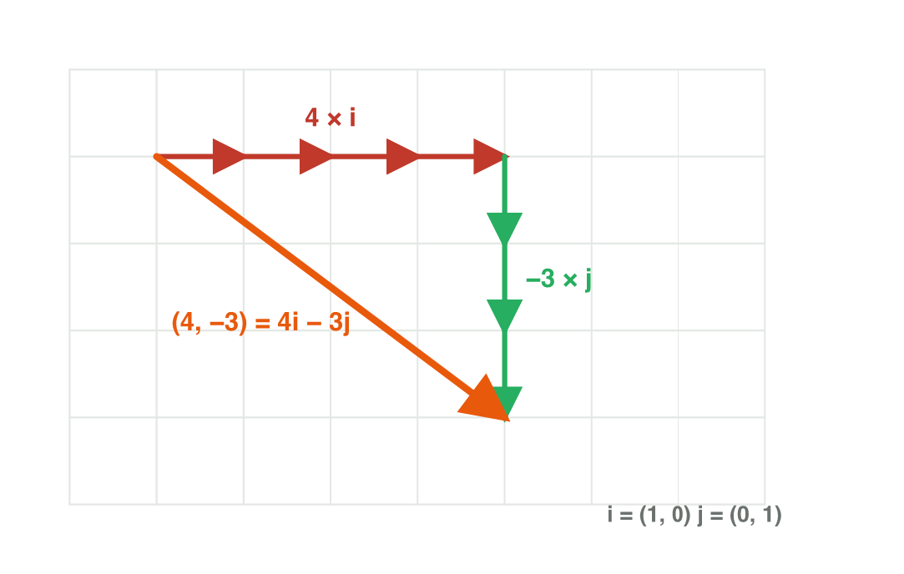
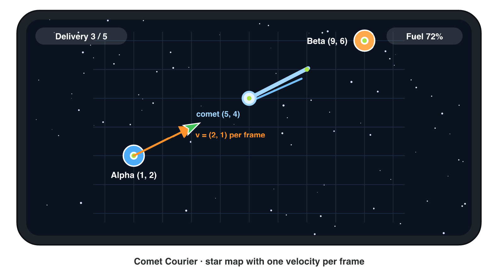

This page is the interactive version of the lesson notes (PDF). Each section
summarises one concept and ends with one set of questions. The full
explanations, all worked examples and the exercises are in the notes.

## Key terms



## 2.1 Scalars and vectors

A **scalar** is a single number: health, time, mass, speed. A **vector** has a
**magnitude** *and* a **direction**: "5 m/s towards the east". The pairs to
remember: distance (scalar) and **displacement** (vector); speed (scalar) and
**velocity** (vector). Gravity, a knockback and the wind are vectors.

{width=86%}

::: {.callout-tip title="Try it 1 · Scalar or vector?"}
You can use an answer more than once.

::: {.match}
A wind of 6 m/s towards the west.
:   vector

The number of coins, 350.
:   scalar

The gravity of the game world.
:   vector

The speed shown on a car's dashboard.
:   scalar

The velocity of a bullet.
:   vector

The quantity "how far and which way".
:   displacement

The quantity "how far" only.
:   distance
:::
:::

## 2.2 The geometric view: arrows

A vector is drawn as an **arrow** from its **tail** to its **head**. The
length is the magnitude; the arrow points in the direction. A vector has **no
position**: arrows with the same length and direction are **equal vectors**,
wherever they are drawn.

{width=88%}

::: {.callout-tip title="Try it 2 · Reading arrows"}
Choose the right term.

::: {.match extra="different vectors|direction"}
The pointed end of an arrow.
:   head

The starting point of an arrow.
:   tail

What the length of the arrow shows.
:   magnitude

Two arrows "3 right, 2 up" drawn in different places of the level.
:   equal vectors

Something that a vector does not have.
:   a position
:::
:::

## 2.3 Components and notation

A program stores a vector as its **components**: the signed change along each
axis, **v** = (*v*~x~, *v*~y~) or (*v*~x~, *v*~y~, *v*~z~). From a drawing:
**head minus tail**. A negative component points in the negative direction of
its axis (left or down). In code: `Vector2`, `Vector3`, read with `.x`, `.y`, `.z`.

Algebraically, a vector is just an **ordered list of numbers**; its length is
the **dimension**. A colour (*r*, *g*, *b*) and the input of a virtual joystick
(*x*, *y*), read every frame, are vectors too. The **basis vectors**
**i** = (1, 0, 0), **j** = (0, 1, 0), **k** = (0, 0, 1) point along the axes,
and every vector is built from them: (4, −3) = 4**i** − 3**j**.

{width=52%}

{width=60%}

::: {.callout-tip title="Try it 3 · Components"}
Find the components or the point.

::: {.match extra="(5, −5)|up"}
The components of the arrow from (2, −1) to (−3, 4).
:   (−5, 5)

The head of the arrow (3, −2) when its tail is at (1, 1).
:   (4, −1)

The vector that points straight left with magnitude 6.
:   (−6, 0)

What a negative *y*-component means in a *y*-up world.
:   down

The value of `.y` in `new Vector2(4f, -3f)`.
:   −3

The vector (−2, 5) written with the basis vectors.
:   −2**i** + 5**j**

The joystick input when the player lets go of the stick.
:   (0, 0)
:::
:::

## 2.4 Points and displacement vectors

A **point** is a location (*where?*); a **vector** is a change (*how far, which
way?*). The **displacement** from *A* to *B* is **B − A** — end minus start.
Reversing the order gives the **negative** vector, with the same magnitude and
the opposite direction. The displacement from a point to itself is the **zero
vector** (0, 0).

{width=66%}

::: {.callout-note title="Watch out!"}
"From *A* to *B*" is always *B* − *A*. An enemy that uses *E* − *P* instead of
*P* − *E* walks away from the player.
:::

::: {.callout-tip title="Try it 4 · Enemy and player"}
The enemy is at *E* = (8, 1) and the player at *P* = (3, 4).

::: {.match extra="(5, 3)"}
The displacement from the enemy to the player.
:   (−5, 3)

The displacement from the player to the enemy.
:   (5, −3)

The displacement from a point to itself.
:   the zero vector

The result of point − point.
:   a vector

The result of point + vector.
:   a point

The result of point + point.
:   meaningless
:::
:::

## 2.5 Moving a point with a vector

A point plus a vector is a moved point. A **velocity** is the displacement per
unit of time — here, per frame. The game loop adds it once per frame:
**p**~k+1~ = **p**~k~ + **v**. After *n* frames each component has changed by
*n* times the velocity component: **p**~n~ = (*p*~0x~ + *n·v*~x~, *p*~0y~ + *n·v*~y~).
The reverse question — which velocity reaches a target in *n* frames? — divides
the total displacement into *n* equal steps.

{width=86%}



::: {.callout-tip title="Try it 5 · Frame by frame"}
A ship starts at (2, 1) with velocity (3, 2) per frame, unless the question
says otherwise.

::: {.match extra="(11, 9)"}
The ship's position after 1 frame.
:   (5, 3)

The ship's position after 4 frames.
:   (14, 9)

The velocity that goes from (0, 0) to (12, −8) in 4 frames.
:   (3, −2)

A ball at (9, 3) with velocity (−3, 0): the frames until *x* = 0.
:   3

0.5 units per frame at 60 fps, in units per second.
:   30
:::
:::

## 2.6 Vectors in three dimensions

A 3D vector has three components; the displacement is again end minus start.
In a *y*-up world a vector splits into a **vertical** part (0, *v*~y~, 0),
which changes the height, and a **horizontal** part (*v*~x~, 0, *v*~z~), which
moves along the ground. Walking on flat ground: *v*~y~ = 0. A jump changes
only *v*~y~.

{width=70%}

::: {.callout-tip title="Try it 6 · A drone in 3D"}
A drone flies from *A* = (1, 2, 0) to *B* = (5, 6, −6). The world has *y* up.

::: {.match extra="(4, 4, 0)|z"}
The displacement from *A* to *B*.
:   (4, 4, −6)

The vertical part of the displacement.
:   (0, 4, 0)

The horizontal part of the displacement.
:   (4, 0, −6)

The displacement of the return trip.
:   (−4, −4, 6)

The only component that a vertical jump changes.
:   y
:::
:::

## Game challenge: Comet Courier {.challenge}

Work alone. Use every section of today.

**Comet Courier** is a mobile delivery game in space. The courier ship flies
between depots on a 2D star map with one velocity per frame. Depot Alpha is at
(1, 2), depot Beta at (9, 6), and a comet crosses the map at (5, 4). In the 3D
mode, space stations float at different heights.

{width=88%}

::: {.callout-tip title="Try it 7 · Alpha to Beta"}
Use the 2D star map.

::: {.match extra="(8, −4)|(3, 3)"}
The displacement from Alpha to Beta.
:   (8, 4)

The displacement from Beta to Alpha.
:   (−8, −4)

The velocity that flies from Alpha to Beta in exactly 4 frames.
:   (2, 1)

The ship's position after 2 of those frames.
:   (5, 4)

What the ship meets at that position.
:   the comet
:::
:::

::: {.callout-tip title="Try it 8 · Stations in 3D (harder)"}
Station Gamma is at (2, 3, 4) and station Delta at (6, 9, −2); *y* is up.

::: {.match extra="(4, 6, 6)|(0, 9, 0)"}
The displacement from Gamma to Delta.
:   (4, 6, −6)

Its vertical part.
:   (0, 6, 0)

The velocity that makes the trip in 2 frames.
:   (2, 3, −3)

A hit pushes the ship back by the negative of that velocity. The push.
:   (−2, −3, 3)
:::
:::

## Summary {.summary}

- Scalar: one number. Vector: magnitude and direction.
- An arrow has a tail and a head, but no position: equal arrows, equal vectors.
- Components = head − tail; the sign gives the direction on each axis; **v** = *v*~x~**i** + *v*~y~**j**.
- Displacement from *A* to *B* = *B* − *A*; *A* − *B* is its negative.
- Point + vector = point; per frame **p**~k+1~ = **p**~k~ + **v**.
- 3D: three components; vertical part (0, *v*~y~, 0), horizontal part (*v*~x~, 0, *v*~z~).
