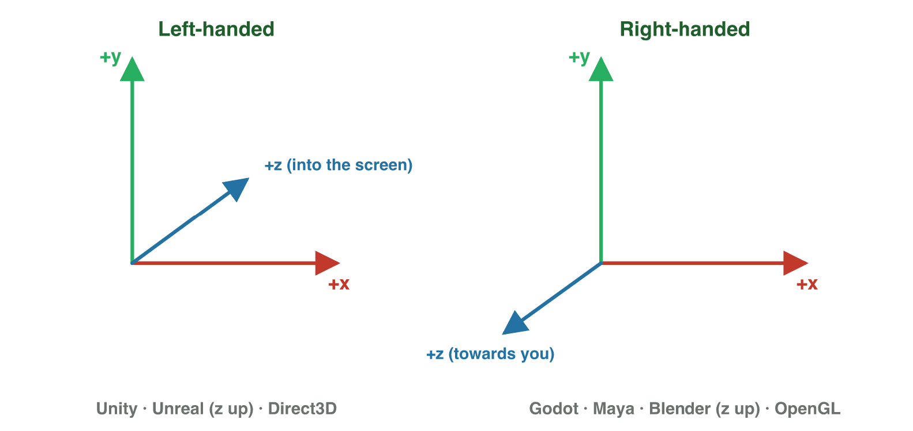

No new ideas today: three short problems on Lecture 1. Do each one alone.
Tap, sort or type your answer at every step: the page checks it at once and
tells you why.

## Recall

- A game repeats the **game loop**: read the input, change the numbers,
  draw. One pass makes one frame.
- A 2D point is (x, y); the signs decide the quadrant. With y up, a 3D point
  (x, y, z) has its height in the middle.
- From A to B: **B − A**. Every frame: position + velocity.

::: {.callout-tip title="Try it 1 · Recall"}
Choose the right answer.

::: {.match extra="quadrant I|(3, 2)"}
In which quadrant is (−2, −6)?
:   quadrant III

    Why: Both signs are minus.

What is the vector from A = (1, 1) to B = (4, 3)?
:   (3, 2)

    Why: B − A = (4 − 1, 3 − 1) = (3, 2).

With y up, which number of (7, 2, 9) is the height?
:   2

    Why: The height is the middle number.
:::
:::

## Activity 1 · Find the mathematics in a game

Every moving thing in a game is computed with numbers, and each needs a
kind of mathematics.

| What the game does | Mathematics |
|---|---|
| know where every object is; move it | coordinates, vectors |
| aim a turret; make an object bob up and down | trigonometry |
| move, turn and resize models | matrices |
| decide if a door opens or an enemy attacks | logic |
| loot, critical hits, random levels | probability |

::: {.callout-note title="Activity 1 · Four things · 12 min"}
1. Play a game on your phone for two minutes.
2. Write four things it must compute with numbers, and the mathematics of
   each one from the table.

*Your product:* a table with four rows: game thing, mathematics.

Lina played the racing game *Road Rush* and wrote six things that it
computes.

::: {.sort}
Which mathematics does each thing of Road Rush need? Sort them.

Coordinates and vectors
:   where my car is on the road

    Why: A place on the level is a pair of coordinates.

:   the car moves forward 2 units in every frame

    Why: A move with a size and a direction is a vector.

Logic
:   the gate opens only when I have the key

    Why: "Only when …" is a rule that is true or false: logic.

:   an enemy car attacks only when I am near

    Why: A decision from a condition is logic.

Probability
:   a box gives a random prize

    Why: A random prize is chance: probability.

:   a gold car appears 1 time in 50 races

    Why: "1 time in 50" is a chance.
:::
:::

::: {.callout-tip title="Try it 2 · Which mathematics?"}
Choose the right answer.

::: {.match extra="matrices"}
A boss attacks only when its health is below 50 and the player is near.
:   logic

    Why: "Only when … and …" is a rule: logic.

A coin floats up and down above a platform.
:   trigonometry

    Why: Bobbing up and down is a wave: trigonometry.

A chest gives a rare sword 1 time in 20.
:   probability

    Why: "1 time in 20" is a chance.
:::
:::

## Activity 2 · A level from a description

A designer describes a farm level in words. The origin is the well in the
centre; x goes right and y goes up.

- the barn is 4 units left of the well and 1 unit up;
- the gate is 6 units right of the well, on the ground line (y = 0);
- the tractor is 2 units right and 3 units down;
- the scarecrow is 5 units left and 2 units down.



::: {.callout-note title="Activity 2 · A level in numbers · 15 min"}
1. Write the coordinates and the quadrant (or the axis) of the well, the
   barn, the gate, the tractor and the scarecrow.
2. Play stage 1 of **Grid Strike**.

*Your product:* a table with five rows (object, coordinates, quadrant) and
your Grid Strike score.

::: {.fill answer="(−4, 1)" hint="Left is minus for x; up is plus for y."}
Step 1: what are the coordinates of the barn? Type (x, y).

Why: 4 units left gives x = −4, and 1 unit up gives y = 1.
:::

::: {.sort}
Step 1: is each object on an axis, or in a quadrant? Sort them.

On an axis
:   the well at (0, 0)

    Why: The origin is on both axes, in no quadrant.

:   the gate at (6, 0)

    Why: y = 0 puts the gate on the x-axis.

In a quadrant
:   the barn at (−4, 1)

    Why: Left and up: (−, +) is quadrant II.

:   the tractor at (2, −3)

    Why: Right and down: (+, −) is quadrant IV.

:   the scarecrow at (−5, −2)

    Why: Left and down: (−, −) is quadrant III.
:::
:::

::: {.callout-tip title="Try it 3 · The farm level"}
The well is the origin; barn (−4, 1), gate (6, 0), tractor (2, −3). Choose
the right answer.

::: {.match extra="quadrant I|(−1, 4)"}
The tractor drives 3 units up. Where is it now?
:   (2, 0)

    Why: Up changes y: −3 + 3 = 0.

Where is the tractor after that move?
:   on the x-axis

    Why: y = 0 puts it on the x-axis.

A pond is 1 unit right of the barn and 3 units up. What is its position?
:   (−3, 4)

    Why: (−4 + 1, 1 + 3) = (−3, 4).
:::
:::

## Activity 3 · A guard in 2D and a drone in 3D

A guard in a museum level is at G = (−4, 3), and the player at
P = (2, −1). A delivery drone in a 3D world with y up flies from the ground
at A = (1, 0, 2) to a roof at B = (5, 6, −1).

{width=72%}

::: {.callout-note title="Activity 3 · Two moves · 18 min"}
1. Find the vector that takes the guard to the player.
2. The guard gets there in 2 frames. Find its velocity per frame.
3. Find the displacement of the drone from A to B. How many units does it
   climb?

*Your product:* three vectors and one height.

::: {.choice}
Step 1: which vector takes the guard G = (−4, 3) to the player P = (2, −1)?

- [x] (6, −4)

  Why: P − G = (2 − (−4), −1 − 3) = (6, −4).

- [ ] (−6, 4)

  Why: That is G − P: from the player back to the guard.

- [ ] (−2, 2)

  Why: That is P + G; adding two points has no meaning.
:::

::: {.fill answer="(3, −2)" hint="Divide each part of (6, −4) by 2."}
Step 2: the guard gets there in 2 frames. What is its velocity per frame?
Type (x, y).

Why: (6, −4) ÷ 2 = (3, −2); two frames of (3, −2) give (6, −4).
:::

::: {.choice}
Step 3: the drone flies from A = (1, 0, 2) to B = (5, 6, −1), with y up. How
many units does it climb?

- [x] 6 units

  Why: B − A = (4, 6, −3); with y up, the middle number 6 is the climb.

- [ ] 4 units

  Why: 4 is the change in x, a move to the side.

- [ ] 3 units

  Why: z changes by −3, a move forward or back, not up.
:::
:::

::: {.callout-tip title="Try it 4 · Moves and axes"}
Guard G = (−4, 3), player P = (2, −1); drone A = (1, 0, 2), B = (5, 6, −1),
y up. Choose the right answer.

::: {.match extra="(6, −4)|towards you"}
Which vector takes the player back to the guard?
:   (−6, 4)

    Why: G − P is the opposite of P − G: the same size, the other way.

What is the way back of the drone, from B to A?
:   (−4, −6, 3)

    Why: A − B is the opposite: all three signs change.

A character walks on flat ground. What is its v~y~?
:   0

    Why: Flat ground means no change in height.

Unity is left-handed with y up. Where does +z point?
:   into the screen

    Why: The left-hand rule: fingers along +x, bent to +y, the thumb into the screen.
:::
:::

## At home · Task with AI

::: {.callout-note .ai-task title="Task with AI · Draw a level from its description"}
An extra for the curious: let an AI assistant draw it. Copy the prompt
into an AI assistant that the university allows (for example Microsoft
Copilot with your university account), and look at the picture.

::: {.prompt}
The origin (0, 0) is the centre of a 2D game level; x goes right and y goes
up. Draw a grid from −8 to 8 on both axes. Draw each object as a labelled
dot: a castle 5 units left of the centre and 2 up; a tree 3 right and 4 up;
a lake 4 left and 3 down; a gate 6 right and 1 down. Then make a table with
each object, its coordinates and its quadrant.
:::

::: {.choice}
Which table should the AI make? The AI can be wrong: compare.

- [x] Castle (−5, 2) II · tree (3, 4) I · lake (−4, −3) III · gate (6, −1) IV

  Why: Left and down give minus signs; the signs decide the quadrant.

- [ ] Castle (5, 2) I · tree (3, 4) I · lake (4, 3) I · gate (6, 1) I

  Why: This table forgot the minus signs of "left" and "down".
:::

::: {.try-change}
**Change:** put the tree 4 left and 4 up, and ask again.

::: {.choice}
What changes?

- [x] The tree moves to (−4, 4), into quadrant II.

  Why: Only the sign of x changes: the tree crosses the y-axis.

- [ ] The tree moves to (4, −4), into quadrant IV.

  Why: "Up" keeps y plus; only x becomes minus.
:::
:::

::: {.try-change}
**Change:** add an enemy that starts at the castle and moves 2 right and 1 down
every frame. Ask for its dots after frames 1, 2 and 3.

::: {.choice}
Where is the enemy after 2 frames?

- [x] at (−1, 0), on the x-axis

  Why: (−5, 2) + 2 × (2, −1) = (−1, 0), and y = 0 is on the x-axis.

- [ ] at (−1, 0), in quadrant II

  Why: y = 0 puts the point on an axis, in no quadrant.

- [ ] at (1, −1), in quadrant IV

  Why: (1, −1) is the enemy after 3 frames, not 2.
:::
:::

**Your own idea:** change one more number or word, and look again. The AI
can be wrong: compare its result with the answers.
:::

## Wrap-up {.summary}

- You can find where coordinates, vectors and other mathematics work in a
  game.
- You can turn a level description into coordinates and quadrants.
- You can find the vector from one object to another, its velocity per
  frame, and a move in 3D.
