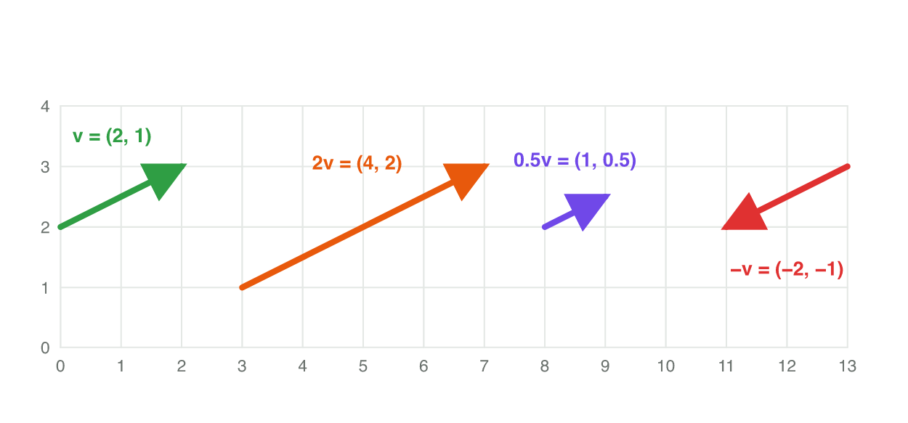
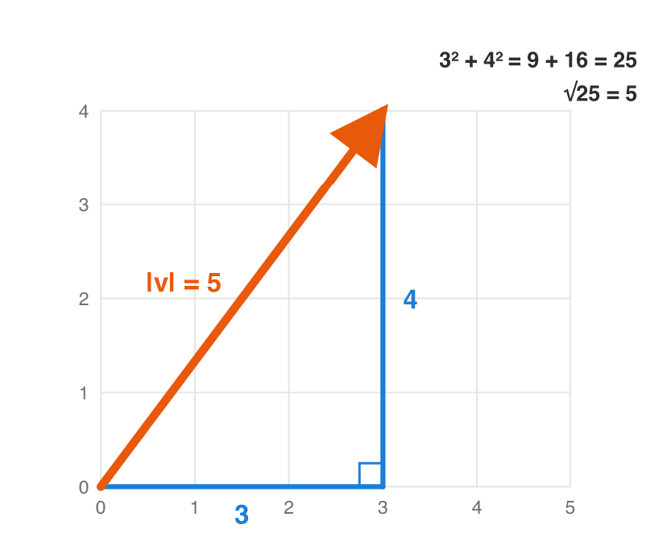
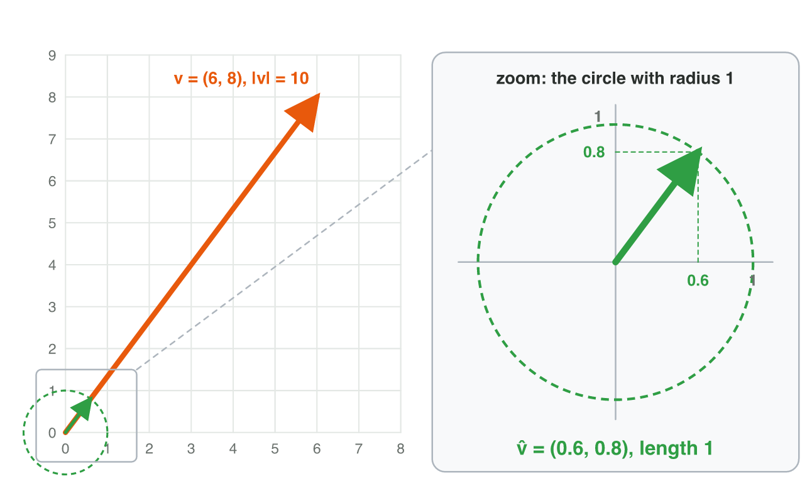

::: {.lead}
*Raft Rush* is a mobile game about a small raft on a fast river, and
*Shadow Cat* is a stealth game in a garden with a guard dog. Both games ask
vector questions in every frame. Where does the raft really go when the river
pushes it? How far away is the cat, and can the dog see it? In Lecture 1 you
learned what a vector is. In this lesson you learn to *work* with vectors: add
two moves, make a move longer or shorter, find the length of a move and keep
only its direction. Then you learn the **dot product**, one number from two
vectors, which tells if a target is in front or behind and how big the angle
is. Every section ends with a short task: in GeoGebra, in a simulator or on
paper. Seminar 2 practises all of it in game problems.
:::

## Key terms



## 2.1 Two moves at once: adding vectors

A player walks on a moving belt in a factory level. The player walks
3 units to the right in each frame, and the belt carries everything 1 unit
up in each frame. Where does the player really go? The game must combine
the two moves into one.

Draw the first move as an arrow. Then start the second arrow at the head of
the first one. This is called **head to tail**. The arrow from the start of
the first arrow to the end of the second arrow is the total move. It is the
**sum** of the two vectors, also called the **resultant** (@fig-add).

{#fig-add width=80%}

The picture shows a simple rule. The x-parts add up, and the y-parts add up.

::: {.callout-important title="Definition 2.1 — Vector addition"}
To add two vectors, add their components one by one:
$$\mathbf{a} + \mathbf{b} = (a_x + b_x,\ a_y + b_y).$$
The sum is one move that has the same result as the two moves one after the
other. The order does not matter: $\mathbf{a} + \mathbf{b} = \mathbf{b} + \mathbf{a}$.
:::

::: {.callout-note title="Example 2.1 — The raft and the river"}
The player paddles the raft with $\mathbf{p} = (0, 3)$ per frame: straight
across the river. The river pushes the raft with the current
$\mathbf{c} = (2, 0)$ per frame.

1. Real velocity: $\mathbf{p} + \mathbf{c} = (0 + 2,\ 3 + 0) = (2, 3)$ per frame.
2. The raft does not go straight across. In each frame it also drifts 2 units
   down the river.
3. After 2 frames it has moved $(4, 6)$.
:::

Games often add more than two vectors: in one frame a character can have a
walking velocity, a push from the wind and a jump. The game adds them all,
component by component.

The **reverse question** is common in games: *which* move must I add to
get a wanted result? Subtract the move you already have from the move you
want. Subtracting a vector is the same as adding its opposite:
$\mathbf{a} - \mathbf{b} = \mathbf{a} + (-\mathbf{b})$.

::: {.callout-note title="Example 2.2 — Paddling straight across"}
The current is $\mathbf{c} = (2, 0)$. The player wants the raft to move
straight across: $(0, 3)$ per frame. How must the player paddle?

1. Wanted move minus the current: $(0, 3) - (2, 0) = (-2, 3)$.
2. The player must paddle a little *against* the current: 2 units to the
   left and 3 units across.
3. Check: $(-2, 3) + (2, 0) = (0, 3)$. Correct.
:::

::: {.callout-warning title="Common mistake"}
Adding all the numbers into one number. $(2, 0) + (0, 3)$ is not 5. The sum
of two vectors is a vector: $(2, 3)$. Add the x-parts together and the
y-parts together, never an x-part to a y-part.
:::

::: {.callout-caution title="In game code"}
Game code adds vectors with `+`. It adds the components for you.

```csharp
Vector2 walk = new Vector2(3f, 0f);
Vector2 belt = new Vector2(0f, 1f);
Vector2 move = walk + belt;       // (3, 1)
```
:::

::: {.callout-note title="Do it · Head to tail in GeoGebra"}
Open geogebra.org/calculator.

1. Type `u = Vector((3, 1))` and `v = Vector((1, 2))`.
2. Type `w = Vector((3, 1), (4, 3))`. This is $\mathbf{v}$, drawn from the
   head of $\mathbf{u}$.
3. Type `u + v`. Check that it ends where $\mathbf{w}$ ends.

*Your result:* the components of $\mathbf{u} + \mathbf{v}$, and one sentence
that explains head to tail.

::: {.check}
$\mathbf{u} + \mathbf{v} = (3 + 1,\ 1 + 2) = (4, 3)$. It ends at $(4, 3)$,
where $\mathbf{w}$ ends: drawing $\mathbf{v}$ from the head of $\mathbf{u}$
gives the same end point as the sum.
:::
:::

## 2.2 Faster, slower, backwards: scaling a vector

A player picks up a dash power-up. For two seconds the character moves twice
as fast, in the same direction. Later a slow-motion spell makes every enemy
move at half speed. The game does not need new directions for this. It
multiplies the velocity by a number.

::: {.callout-important title="Definition 2.2 — Scaling (multiplying by a scalar)"}
To multiply a vector by a number $k$, multiply each component by $k$:
$$k\,\mathbf{v} = (k\,v_x,\ k\,v_y).$$
The arrow becomes $k$ times as long. A negative $k$ also reverses the
direction.
:::

{#fig-scale width=84%}

@tbl-scale shows what each kind of number does (@fig-scale).

| Number $k$ | What happens to the arrow | Game example |
|---|---|---|
| $k > 1$ | longer, same direction | dash power-up, $\times 2$ |
| $0 < k < 1$ | shorter, same direction | slow motion, $\times 0.5$ |
| $k = 0$ | the zero vector | the game is paused |
| $k = -1$ | same length, opposite direction | a ball bounces straight back |

: What scaling by k does. {#tbl-scale}

::: {.callout-note title="Example 2.3 — Dash and slow motion"}
A character runs with the velocity $\mathbf{v} = (3, 1)$ per frame.

1. Dash, $\times 2$: $2\mathbf{v} = (6, 2)$. The same direction, twice as far
   in each frame.
2. Slow motion, $\times 0.5$: $0.5\,\mathbf{v} = (1.5, 0.5)$.
3. A wall throws it straight back, $\times(-1)$: $-\mathbf{v} = (-3, -1)$.
:::

You already used scaling in Lecture 1: after $n$ frames, an object has moved
$n \times \mathbf{v}$. That is the velocity scaled by the number of frames.

::: {.callout-warning title="Common mistake"}
Scaling only one component. $2 \times (3, 1)$ is $(6, 2)$, not $(6, 1)$. If
only one part changes, the direction changes too, and the character goes
somewhere else.
:::



::: {.callout-note title="Do it · Scale it in Vector Lab"}
Open the **Vector Lab** simulator above (or scan its QR code).

1. Drag the head of the arrow to $\mathbf{v} = (2, 1)$.
2. Set the slider $k$ to 3, then to 0.5, then to −2. Each time, write down
   $k\,\mathbf{v}$.

*Your result:* three vectors, and one sentence: which values of $k$ reverse
the arrow?

::: {.check}
$3\mathbf{v} = (6, 3)$, $0.5\,\mathbf{v} = (1, 0.5)$, $-2\mathbf{v} = (-4, -2)$.
Only a negative $k$ reverses the arrow.
:::
:::

## 2.3 How far away is it? The magnitude

An enemy guard attacks only when the player is at most 5 units away. The game
knows the vector from the guard to the player, for example $(3, 4)$. But is
that close enough? The game needs the **length** of the vector, its
**magnitude**.

The two components and the arrow make a triangle with a right angle
(@fig-length). The **Pythagorean theorem** gives the length of the longest
side: square the two short sides, add them, and take the square root.

{#fig-length width=62%}

::: {.callout-important title="Definition 2.3 — Magnitude"}
The **magnitude** of $\mathbf{v} = (v_x, v_y)$ is the length of its arrow:
$$|\mathbf{v}| = \sqrt{v_x^2 + v_y^2}.$$
In 3D: $|\mathbf{v}| = \sqrt{v_x^2 + v_y^2 + v_z^2}$. A magnitude is never
negative.
:::

::: {.callout-note title="Example 2.4 — Is the player in range?"}
The guard is at $G = (1, 1)$ and the player at $P = (4, 5)$. The guard attacks
at a distance of 5 units or less.

1. Vector from the guard to the player: $P - G = (3, 4)$.
2. Magnitude: $\sqrt{3^2 + 4^2} = \sqrt{9 + 16} = \sqrt{25} = 5$.
3. $5 \le 5$: the player is just in range. The guard attacks.
:::

A negative component gives a positive square: $(-3)^2 = 9$. So $(-3, 4)$,
$(3, -4)$ and $(3, 4)$ all have the magnitude 5. The magnitude says *how far*,
not *which way*.

::: {.callout-note title="Example 2.5 — A drone in 3D"}
A drone flies $\mathbf{d} = (2, 3, 6)$ in one move. How far does it fly?

1. Squares: $2^2 = 4$, $3^2 = 9$, $6^2 = 36$.
2. Sum: $4 + 9 + 36 = 49$.
3. $|\mathbf{d}| = \sqrt{49} = 7$ units.
:::

::: {.callout-warning title="Common mistake"}
Adding the components: $|(3, 4)| = 3 + 4 = 7$. This is wrong. The arrow is the
short way, straight across the triangle. It is 5 units long, not 7.
:::

::: {.callout-caution title="In game code"}
```csharp
Vector2 toPlayer = player - guard;
float distance = toPlayer.magnitude;     // 5
bool inRange = distance <= 5f;           // true
```
:::

::: {.callout-note title="Do it · Measure an arrow on paper"}
On squared paper, let 1 cm be 1 unit.

1. Draw the vector $(6, 8)$ from a corner of the grid.
2. Measure the arrow with a ruler.
3. Calculate $\sqrt{6^2 + 8^2}$ and compare.

*Your result:* your measured length, your calculated length, and one sentence:
why is the arrow shorter than $6 + 8$?

::: {.check}
$\sqrt{36 + 64} = \sqrt{100} = 10$: the ruler shows about 10 cm. The arrow
is the short way, straight across the triangle; $6 + 8 = 14$ is the long way
along the two sides.
:::
:::

## 2.4 Only the direction: unit vectors

A small arrow at the edge of the screen points to the next goal. It must
always have the same size, near or far. So the game needs only the
*direction* of the vector to the goal, not its length.

A vector of length 1 shows only a direction. It is called a **unit vector**.
We get it when we divide a vector by its own magnitude. This is called
**normalizing** the vector.

::: {.callout-important title="Definition 2.4 — Unit vector and normalization"}
A **unit vector** has the magnitude 1. To **normalize** a vector
$\mathbf{v}$ (not the zero vector), divide each component by $|\mathbf{v}|$:
$$\hat{\mathbf{v}} = \frac{\mathbf{v}}{|\mathbf{v}|} = \left(\frac{v_x}{|\mathbf{v}|},\ \frac{v_y}{|\mathbf{v}|}\right).$$
$\hat{\mathbf{v}}$ ("v hat") has the same direction as $\mathbf{v}$.
:::

{#fig-unit width=70%}

::: {.callout-note title="Example 2.6 — The arrow to the goal"}
The player is at $(2, 1)$ and the goal at $(8, 9)$ (@fig-unit).

1. Vector to the goal: $(8, 9) - (2, 1) = (6, 8)$.
2. Magnitude: $\sqrt{36 + 64} = \sqrt{100} = 10$.
3. Unit vector: $(6 \div 10,\ 8 \div 10) = (0.6, 0.8)$.
4. Check: $0.6^2 + 0.8^2 = 0.36 + 0.64 = 1$. The arrow on the screen uses
   this direction.
:::

Some unit vectors are easy to see. $(1, 0)$ points right, $(0, 1)$ points
up and $(0, -1)$ points down. Normalizing $(0, -7)$ gives $(0, -1)$.

The zero vector has no direction, so it cannot be normalized: the division
would be by 0. When the player stands on the goal, the vector to the goal is
$(0, 0)$, and the game must hide the arrow.

::: {.callout-warning title="Common mistake"}
Normalizing changes the length, not the direction. After normalizing, the
vector has length 1. To get it back to its old length, scale it by the old
magnitude: $10 \times (0.6, 0.8) = (6, 8)$.
:::

Unit vectors give games a fair speed. A game often knows the *direction* of a
move and the *speed* it wants. It normalizes the direction and then scales it
by the speed. Then the speed is the same in every direction.

::: {.callout-important title="Definition 2.5 — Velocity from a direction and a speed"}
The **speed** is the magnitude of the velocity: a scalar. To move at speed
$s$ in the direction of $\mathbf{d}$:
$$\mathbf{v} = s \times \hat{\mathbf{d}}.$$
:::

::: {.callout-note title="Example 2.7 — A homing missile"}
A missile at $M = (2, 1)$ flies to a target at $T = (8, 9)$ with the speed
5 units per frame. Which velocity does it need?

1. Direction: $T - M = (6, 8)$, magnitude 10, unit vector $(0.6, 0.8)$.
2. Velocity: $5 \times (0.6, 0.8) = (3, 4)$.
3. Check: $|(3, 4)| = 5$. After 2 frames the missile is at
   $(2, 1) + 2 \times (3, 4) = (8, 9)$: on the target.
:::

::: {.callout-note title="Do it · Normalize in Vector Lab"}
In **Vector Lab**, switch on **Show unit vector**.

1. Drag the arrow to $(6, 8)$, then $(0, -5)$, then $(5, 12)$.
2. Each time, write the magnitude and the unit vector.

*Your result:* a table with three rows, and one check: $x^2 + y^2$ of one unit
vector is (about) 1.

::: {.check}
$(6, 8)$: magnitude 10, unit vector $(0.6, 0.8)$. $(0, -5)$: magnitude 5,
unit vector $(0, -1)$. $(5, 12)$: magnitude 13, unit vector about
$(0.38, 0.92)$. Check: $0.6^2 + 0.8^2 = 0.36 + 0.64 = 1$.
:::
:::

## 2.5 One number from two vectors: the dot product

A sailing boat moves in the direction $\mathbf{m} = (1, 0)$. The wind blows
with $\mathbf{w} = (3, 1)$. Does the wind help the boat, or does it slow the
boat down? The game needs one number that says how much the two vectors go
the same way.

::: {.callout-important title="Definition 2.6 — Dot product"}
The **dot product** of two vectors is a number (a scalar). Multiply the
matching components and add the results:
$$\mathbf{a} \cdot \mathbf{b} = a_x b_x + a_y b_y.$$
In 3D: $\mathbf{a} \cdot \mathbf{b} = a_x b_x + a_y b_y + a_z b_z$.
:::

{#fig-dotsteps width=84%}

::: {.callout-note title="Example 2.8 — Does the wind help?"}
The boat moves in the direction $\mathbf{m} = (1, 0)$, and the wind is
$\mathbf{w} = (3, 1)$ (@fig-dotsteps).

1. x-parts: $1 \times 3 = 3$.
2. y-parts: $0 \times 1 = 0$.
3. $\mathbf{m} \cdot \mathbf{w} = 3 + 0 = 3$. The result is positive: the
   wind pushes the boat forward.
:::

::: {.callout-warning title="Common mistake"}
Writing the result as a vector, such as $(3, 0)$. The products of the
components are only a middle step. The dot product adds them into **one
number**: 3.
:::

::: {.callout-caution title="In game code"}
```csharp
Vector2 move = new Vector2(1f, 0f);
Vector2 wind = new Vector2(3f, 1f);
float help = Vector2.Dot(move, wind);   // 3
```
:::

::: {.callout-note title="Do it · The dot product in GeoGebra"}
Open geogebra.org/calculator.

1. Type `u = Vector((2, 3))` and `v = Vector((4, -1))`.
2. Type `u * v`. For two vectors, GeoGebra gives the dot product.
3. Calculate $(2, 3) \cdot (4, -1)$ by hand and compare.

*Your result:* GeoGebra's number, your calculation, and the dot product of
two vectors of your choice.

::: {.check}
$(2, 3) \cdot (4, -1) = 2 \times 4 + 3 \times (-1) = 8 - 3 = 5$: GeoGebra also
shows 5. For your own vectors: multiply the x-parts, multiply the y-parts,
add; GeoGebra must give the same number.
:::
:::

## 2.6 In front or behind? The sign of the dot product

A guard dog faces right. Its **forward vector** is $\mathbf{f} = (1, 0)$: the
direction it is looking. A cat is somewhere in the garden. Is the cat in
front of the dog or behind it?

Take the vector from the dog to the cat, $\mathbf{d} = C - D$. Then look at
the sign of $\mathbf{f} \cdot \mathbf{d}$ (@fig-sign):

| $\mathbf{f} \cdot \mathbf{d}$ | Angle between the arrows | Meaning for the guard |
|---|---|---|
| positive (> 0) | less than 90° | the cat is in front |
| zero (= 0) | exactly 90° | the cat is exactly to the side |
| negative (< 0) | more than 90° | the cat is behind |

: What the sign of the dot product tells. {#tbl-sign}

{#fig-sign width=88%}

::: {.callout-note title="Example 2.9 — In front or behind?"}
The dog is at $D = (2, 2)$ and faces $\mathbf{f} = (1, 0)$.

1. Cat at $(5, 3)$: $\mathbf{d} = (3, 1)$, and $\mathbf{f} \cdot \mathbf{d} = 3$.
   Positive: **in front**.
2. Cat at $(0, 4)$: $\mathbf{d} = (-2, 2)$, and $\mathbf{f} \cdot \mathbf{d} = -2$.
   Negative: **behind**.
3. Cat at $(2, 6)$: $\mathbf{d} = (0, 4)$, and $\mathbf{f} \cdot \mathbf{d} = 0$.
   **Exactly to the side**.
:::

The same test works for movement. If the velocity of a player and the vector
to the goal give a positive dot product, the player is moving *towards* the
goal. If it is negative, the player is moving *away* from it.

::: {.callout-note title="Example 2.10 — Warmer or colder?"}
A treasure-hunt game says "warmer" when the player moves towards the
treasure. The player is at $(1, 1)$, the treasure at $(4, 5)$, and the player
moves with $\mathbf{v} = (-1, 2)$.

1. Vector to the treasure: $(4, 5) - (1, 1) = (3, 4)$.
2. $\mathbf{v} \cdot (3, 4) = -3 + 8 = 5$. Positive.
3. The game says "warmer", even though the player also moves a little to
   the left.
:::

::: {.callout-warning title="Common mistake"}
Using the wrong vector. The test needs the vector *from the guard to the
cat*, $C - D$, not the position of the cat. The cat at $(5, 3)$ is in front
of a dog at $(2, 2)$, but behind a dog at $(8, 3)$ that also faces right.
:::



::: {.callout-note title="Do it · Dot Lab"}
Open the **Dot Lab** simulator above (or scan its QR code). The green arrow
is the guard's forward vector, and the orange arrow points to the cat.

1. Drag the orange arrow until the dot product is positive, then zero, then
   negative.
2. Each time, write the two vectors and the dot product.

*Your result:* three rows, and one sentence: where is the orange arrow when
the dot product is zero?

::: {.check}
Positive: the orange arrow points somewhere in front of the green one (less
than 90°). Zero: it is exactly at a right angle, to the side. Negative: it
points behind (more than 90°). Check each row: $a_x b_x + a_y b_y$ must give
the number that Dot Lab shows.
:::
:::

A dot product of exactly 0 means a right angle: the two vectors are
**perpendicular**. For example $(3, 4) \cdot (-4, 3) = -12 + 12 = 0$, so a
character that faces $(3, 4)$ side-steps along $(-4, 3)$.

## 2.7 How big is the angle?

The sign says "in front" or "behind". But a guard does not see everything in
front of it. It sees only a little to each side. So the game needs the size
of the **angle between two vectors**.

The dot product grows with the lengths of the vectors. So first make both
vectors unit vectors (section 2.4). Then the dot product is always a number
from −1 to 1, and it depends only on the angle.

::: {.callout-important title="Definition 2.7 — The angle from the dot product"}
For two unit vectors, $\hat{\mathbf{a}} \cdot \hat{\mathbf{b}}$ is a number
from −1 to 1 that depends only on the angle between them. For any two
vectors, divide by the two magnitudes:
$$\frac{\mathbf{a} \cdot \mathbf{b}}{|\mathbf{a}|\,|\mathbf{b}|}.$$
@tbl-angles gives the angle for common values.
:::

| $\hat{\mathbf{a}} \cdot \hat{\mathbf{b}}$ | 1 | 0.87 | 0.71 | 0.5 | 0 | −0.5 | −0.71 | −1 |
|---|---|---|---|---|---|---|---|---|
| angle | 0° | 30° | 45° | 60° | 90° | 120° | 135° | 180° |

: The dot product of two unit vectors and the angle between them. {#tbl-angles}

This number is called the **cosine** of the angle. You will meet it again in
Lecture 4. For now, the table is enough (@fig-angles).

{#fig-angles width=86%}

::: {.callout-note title="Example 2.11 — Between two values"}
A guard faces $\mathbf{f} = (1, 0)$. The cat is in the direction
$\mathbf{d} = (3, 4)$.

1. $\hat{\mathbf{d}} = (3, 4) \div 5 = (0.6, 0.8)$.
2. $\hat{\mathbf{f}} \cdot \hat{\mathbf{d}} = 0.6$.
3. 0.6 is between 0.5 (60°) and 0.71 (45°). So the angle is between 45° and
   60°. That is enough for most game decisions.
:::

::: {.callout-warning title="Common mistake"}
Reading the table with vectors that are not unit vectors.
$(3, 0) \cdot (2, 0) = 6$, but the angle is 0°, not "6". Divide by the
magnitudes first: $6 \div (3 \times 2) = 1$, so 0°.
:::

::: {.callout-note title="Do it · Find the angle in Dot Lab"}
In **Dot Lab**, switch on **Unit vectors**.

1. Make the angle 0°, 60°, 90° and 180°.
2. Each time, write the value of $\hat{\mathbf{a}} \cdot \hat{\mathbf{b}}$.

*Your result:* a table with four rows. Compare it with @tbl-angles.

::: {.check}
0° → 1; 60° → 0.5; 90° → 0; 180° → −1. These are the values of @tbl-angles:
the closer the two directions, the bigger the number.
:::
:::

## Case study: Shadow Cat

*Shadow Cat* is a made-up stealth game. A cat must sneak through a garden
past a guard dog. The dog is at $D = (6, 4)$ and looks right: its forward
vector is $\mathbf{f} = (1, 0)$. It sees a point when the point is at most
60° to the side ($\hat{\mathbf{f}} \cdot \hat{\mathbf{d}} \ge 0.5$) and at
most 5 units away. There are three bushes: A at $(10, 7)$, B at $(9, 8)$ and
C at $(6, 9)$. The fish that the cat wants is at $(2, 1)$. The cat can hide
only in a bush that the dog cannot see. Later the dog turns and looks up:
$\mathbf{f} = (0, 1)$. The Game challenge of the interactive lesson uses
these numbers. In the mini-game below you choose the safe bush in each round.



## Further reading

Dunn and Parberry, *3D Math Primer for Graphics and Game Development*,
2nd ed., Chapter 2 ("Vectors"): multiplying a vector by a scalar, vector
addition and subtraction, vector magnitude (length), unit vectors, the dot
product and its geometric interpretation, and the angle between two vectors.

## Exercises

1. Add: (a) $(4, 1) + (2, 5)$; (b) $(-3, 2) + (3, -2)$; (c) $(1, 0, 2) + (0, 4, -1)$.
2. The current is $(-1, 0)$. Which paddle vector gives the real move $(0, 4)$?
3. Scale $\mathbf{v} = (4, -2)$ by 3, by 0.5 and by −1.
4. A power-up makes a car $1.5$ times as fast. Its velocity was $(2, 4)$. What is the new velocity?
5. Find the magnitude of $(6, 8)$, of $(-5, 12)$ and of $(0, -9)$.
6. A trap goes off when the player is at most 10 units away. The trap is at $(2, 3)$, the player at $(8, 11)$. Does it go off?
7. Find the magnitude of the 3D vector $(1, 2, 2)$.
8. Normalize $(0, 4)$ and $(-6, 8)$.
9. An enemy at $(0, 0)$ chases the player at $(9, 12)$ with the speed 5 units per frame. Find its velocity.
10. Compute: (a) $(3, 2) \cdot (1, 4)$; (b) $(-2, 5) \cdot (3, 1)$; (c) $(2, 0, 1) \cdot (1, 3, -2)$.
11. A boat moves in the direction $(0, 1)$. The wind is $(2, -3)$. Does the wind help the boat? Why?
12. A guard at $(3, 3)$ faces $(0, 1)$. Is a player at $(5, 7)$ in front of it or behind it? And a player at $(1, 1)$?
13. Are $(4, 6)$ and $(-3, 2)$ perpendicular?
14. Two unit vectors have the dot product 0.5. What is the angle between them? And for −1?
15. *Shadow Cat*: the dog at $(6, 4)$ looks right. Which bushes can it see: A $(10, 7)$, B $(9, 8)$, C $(6, 9)$?
16. *Shadow Cat*: the dog turns and looks up, $\mathbf{f} = (0, 1)$. Is the fish at $(2, 1)$ seen? Is bush C seen?

## Answers to the exercises

::: {.answers}
1. (a) (6, 6); (b) (0, 0); (c) (1, 4, 1).
2. (0, 4) − (−1, 0) = (1, 4).
3. (12, −6); (2, −1); (−4, 2).
4. 1.5 × (2, 4) = (3, 6).
5. 10; 13; 9.
6. P − T = (6, 8), magnitude 10. 10 ≤ 10: yes, it goes off.
7. √(1 + 4 + 4) = √9 = 3.
8. (0, 1); (−0.6, 0.8).
9. Direction (9, 12), magnitude 15, unit vector (0.6, 0.8); velocity 5 × (0.6, 0.8) = (3, 4).
10. (a) 3 + 8 = 11; (b) −6 + 5 = −1; (c) 2 + 0 − 2 = 0.
11. (0, 1) · (2, −3) = −3. Negative: the wind blows against the boat and slows it down.
12. (5, 7): d = (2, 4), f · d = 4 > 0, in front. (1, 1): d = (−2, −2), f · d = −2 < 0, behind.
13. (4, 6) · (−3, 2) = −12 + 12 = 0. Yes.
14. 60°; 180°.
15. A: d = (4, 3), 0.8, seen. B: d = (3, 4), 0.6, seen. C: d = (0, 5), 0, not seen. Only C is safe.
16. Fish: d = (−4, −3), f̂ · d̂ = −0.6, behind: not seen. C: d̂ = (0, 1), f̂ · d̂ = 1, distance 5: seen.
:::
