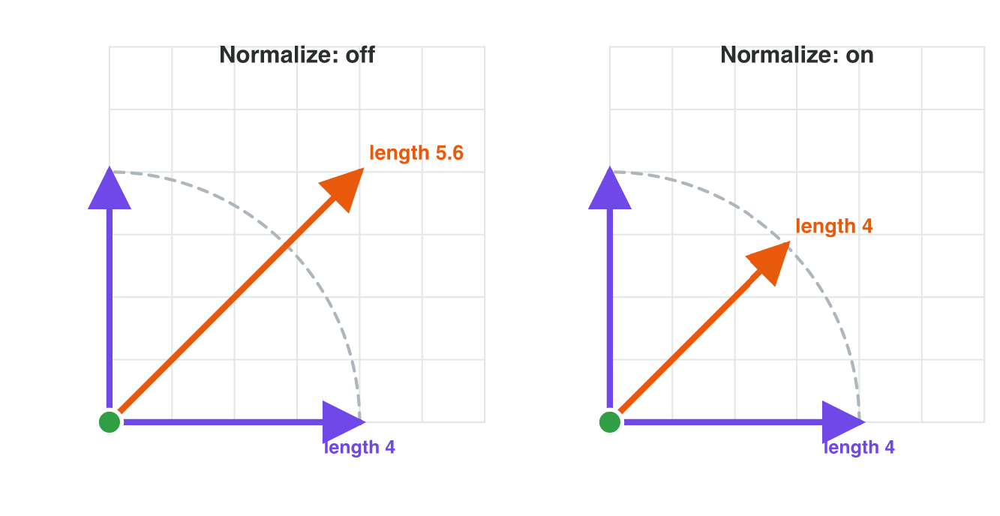

::: {.lead}
*Raft Rush* is a mobile game about a small raft on a fast river. The player
paddles, but the river also pushes the raft. So in every frame the raft makes
two moves at once. A game developer must answer some questions about it.
Where does the raft really go? How fast is it? Which way must the player
paddle to reach the dock? In lecture 2 you learned what a vector is. In this
lesson you learn to *work* with vectors: add two moves, make a move longer or
shorter, find the length of a move, and keep only its direction. Every
section ends with a short task: in GeoGebra, in a simulator, in a mini-game
or on paper.
:::

## Key terms



## 3.1 Two moves at once: adding vectors

A player walks on a moving belt in a factory level. The player walks
3 units to the right in each frame, and the belt carries everything 1 unit
up in each frame. Where does the player really go? The game must combine
the two moves into one.

Draw the first move as an arrow. Then start the second arrow at the head of
the first one. This is called **head to tail**. The arrow from the start of
the first arrow to the end of the second arrow is the total move. It is the
**sum** of the two vectors, also called the **resultant** (@fig-add).

{#fig-add width=80%}

The picture shows a simple rule. The x-parts add up, and the y-parts add up.

::: {.callout-important title="Definition 3.1 — Vector addition"}
To add two vectors, add their components one by one:
$$\mathbf{a} + \mathbf{b} = (a_x + b_x,\ a_y + b_y).$$
The sum is one move that has the same result as the two moves one after the
other. The order does not matter: $\mathbf{a} + \mathbf{b} = \mathbf{b} + \mathbf{a}$.
:::

::: {.callout-note title="Example 3.1 — The raft and the river"}
The player paddles the raft with $\mathbf{p} = (0, 3)$ per frame: straight
across the river. The river pushes the raft with the current
$\mathbf{c} = (2, 0)$ per frame.

1. Real velocity: $\mathbf{p} + \mathbf{c} = (0 + 2,\ 3 + 0) = (2, 3)$ per frame.
2. The raft does not go straight across. In each frame it also drifts 2 units
   down the river.
3. After 2 frames it has moved $(4, 6)$.
:::

Games often add more than two vectors. In each frame, a character can have
a walking velocity, a push from the wind and a jump. The game adds them all.

::: {.callout-note title="Example 3.2 — Walk, wind and jump"}
In one frame, a character walks $(3, 0)$, the wind pushes it $(-1, 0)$ and a
jump lifts it $(0, 4)$.

1. Add the x-parts: $3 + (-1) + 0 = 2$.
2. Add the y-parts: $0 + 0 + 4 = 4$.
3. Total move in this frame: $(2, 4)$.
:::

The **reverse question** is common in games: *which* move must I add to
get a wanted result? Subtract the move you already have from the move you
want. Subtracting a vector is the same as adding its opposite:
$\mathbf{a} - \mathbf{b} = \mathbf{a} + (-\mathbf{b})$.

::: {.callout-note title="Example 3.3 — Paddling straight across"}
The current is $\mathbf{c} = (2, 0)$. The player wants the raft to move
straight across: $(0, 3)$ per frame. How must the player paddle?

1. Wanted move minus the current: $(0, 3) - (2, 0) = (-2, 3)$.
2. The player must paddle a little *against* the current: 2 units to the
   left and 3 units across.
3. Check: $(-2, 3) + (2, 0) = (0, 3)$. Correct.
:::

::: {.callout-warning title="Common mistake"}
Adding all the numbers into one number. $(2, 0) + (0, 3)$ is not 5. The sum
of two vectors is a vector: $(2, 3)$. Add the x-parts together and the
y-parts together, never an x-part to a y-part.
:::

::: {.callout-caution title="In game code"}
Game code adds vectors with `+`. It adds the components for you.

```csharp
Vector2 walk = new Vector2(3f, 0f);
Vector2 belt = new Vector2(0f, 1f);
Vector2 move = walk + belt;       // (3, 1)
```
:::

::: {.callout-note title="Do it · Head to tail in GeoGebra"}
Open geogebra.org/calculator.

1. Type `u = Vector((3, 1))` and `v = Vector((1, 2))`.
2. Type `w = Vector((3, 1), (4, 3))`. This is $\mathbf{v}$, drawn from the
   head of $\mathbf{u}$.
3. Type `u + v`. Check that it ends where $\mathbf{w}$ ends.

*Your result:* the components of $\mathbf{u} + \mathbf{v}$, and one sentence
that explains head to tail.
:::

## 3.2 Faster, slower, backwards: scaling a vector

A player picks up a dash power-up. For two seconds the character moves twice
as fast, in the same direction. Later a slow-motion spell makes every enemy
move at half speed. The game does not need new directions for this. It
multiplies the velocity by a number.

::: {.callout-important title="Definition 3.2 — Scaling (multiplying by a scalar)"}
To multiply a vector by a number $k$, multiply each component by $k$:
$$k\,\mathbf{v} = (k\,v_x,\ k\,v_y).$$
The arrow becomes $k$ times as long. A negative $k$ also reverses the
direction.
:::

{#fig-scale width=84%}

@tbl-scale shows what each kind of number does (@fig-scale).

| Number $k$ | What happens to the arrow | Game example |
|---|---|---|
| $k > 1$ | longer, same direction | dash power-up, $\times 2$ |
| $0 < k < 1$ | shorter, same direction | slow motion, $\times 0.5$ |
| $k = 0$ | the zero vector | the game is paused |
| $k = -1$ | same length, opposite direction | a ball bounces straight back |

: What scaling by k does. {#tbl-scale}

::: {.callout-note title="Example 3.4 — Dash and slow motion"}
A character runs with the velocity $\mathbf{v} = (3, 1)$ per frame.

1. Dash, $\times 2$: $2\mathbf{v} = (6, 2)$. The same direction, twice as far
   in each frame.
2. Slow motion, $\times 0.5$: $0.5\,\mathbf{v} = (1.5, 0.5)$.
3. A wall throws it straight back, $\times(-1)$: $-\mathbf{v} = (-3, -1)$.
:::

You already used scaling in lecture 2: after $n$ frames, an object has moved
$n \times \mathbf{v}$. That is the velocity scaled by the number of frames.

::: {.callout-warning title="Common mistake"}
Scaling only one component. $2 \times (3, 1)$ is $(6, 2)$, not $(6, 1)$. If
only one part changes, the direction changes too, and the character goes
somewhere else.
:::



::: {.callout-note title="Do it · Scale it in Vector Lab"}
Open the **Vector Lab** simulator above (or scan its QR code).

1. Drag the head of the arrow to $\mathbf{v} = (2, 1)$.
2. Set the slider $k$ to 3, then to 0.5, then to −2. Each time, write down
   $k\,\mathbf{v}$.

*Your result:* three vectors, and one sentence: which values of $k$ reverse
the arrow?
:::

## 3.3 How far away is it? The magnitude

An enemy guard attacks only when the player is at most 5 units away. The game
knows the vector from the guard to the player, for example $(3, 4)$. But is
that close enough? The game needs the **length** of the vector, its
**magnitude**.

The two components and the arrow make a triangle with a right angle
(@fig-length). The **Pythagorean theorem** gives the length of the longest
side: square the two short sides, add them, and take the square root.

{#fig-length width=62%}

::: {.callout-important title="Definition 3.3 — Magnitude"}
The **magnitude** of $\mathbf{v} = (v_x, v_y)$ is the length of its arrow:
$$|\mathbf{v}| = \sqrt{v_x^2 + v_y^2}.$$
In 3D: $|\mathbf{v}| = \sqrt{v_x^2 + v_y^2 + v_z^2}$. A magnitude is never
negative.
:::

::: {.callout-note title="Example 3.5 — Is the player in range?"}
The guard is at $G = (1, 1)$ and the player at $P = (4, 5)$. The guard attacks
at a distance of 5 units or less.

1. Vector from the guard to the player: $P - G = (3, 4)$.
2. Magnitude: $\sqrt{3^2 + 4^2} = \sqrt{9 + 16} = \sqrt{25} = 5$.
3. $5 \le 5$: the player is just in range. The guard attacks.
:::

A negative component gives a positive square: $(-3)^2 = 9$. So $(-3, 4)$,
$(3, -4)$ and $(3, 4)$ all have the magnitude 5. The magnitude says *how far*,
not *which way*.

::: {.callout-note title="Example 3.6 — A drone in 3D"}
A drone flies $\mathbf{d} = (2, 3, 6)$ in one move. How far does it fly?

1. Squares: $2^2 = 4$, $3^2 = 9$, $6^2 = 36$.
2. Sum: $4 + 9 + 36 = 49$.
3. $|\mathbf{d}| = \sqrt{49} = 7$ units.
:::

Games check distances many times in every frame, and a square root is slow
to compute. So many games compare the *squares*: the player is in range if
$v_x^2 + v_y^2 \le 5^2$. In Example 3.5: $25 \le 25$. The answer is the same,
without a square root.

::: {.callout-warning title="Common mistake"}
Adding the components: $|(3, 4)| = 3 + 4 = 7$. This is wrong. The arrow is the
short way, straight across the triangle. It is 5 units long, not 7.
:::

::: {.callout-caution title="In game code"}
```csharp
Vector2 toPlayer = player - guard;
float distance = toPlayer.magnitude;     // 5
bool inRange = distance <= 5f;           // true
```
`toPlayer.sqrMagnitude` gives $v_x^2 + v_y^2$ (25), without the square root.
:::

::: {.callout-note title="Do it · Measure an arrow on paper"}
On squared paper, let 1 cm be 1 unit.

1. Draw the vector $(6, 8)$ from a corner of the grid.
2. Measure the arrow with a ruler.
3. Calculate $\sqrt{6^2 + 8^2}$ and compare.

*Your result:* your measured length, your calculated length, and one sentence:
why is the arrow shorter than $6 + 8$?
:::

## 3.4 Only the direction: unit vectors

A small arrow at the edge of the screen points to the next goal. It must
always have the same size, near or far. So the game needs only the
*direction* of the vector to the goal, not its length.

A vector of length 1 shows only a direction. It is called a **unit vector**.
We get it when we divide a vector by its own magnitude. This is called
**normalizing** the vector.

::: {.callout-important title="Definition 3.4 — Unit vector and normalization"}
A **unit vector** has the magnitude 1. To **normalize** a vector
$\mathbf{v}$ (not the zero vector), divide each component by $|\mathbf{v}|$:
$$\hat{\mathbf{v}} = \frac{\mathbf{v}}{|\mathbf{v}|} = \left(\frac{v_x}{|\mathbf{v}|},\ \frac{v_y}{|\mathbf{v}|}\right).$$
$\hat{\mathbf{v}}$ ("v hat") has the same direction as $\mathbf{v}$.
:::

{#fig-unit width=70%}

::: {.callout-note title="Example 3.7 — The arrow to the goal"}
The player is at $(2, 1)$ and the goal at $(8, 9)$ (@fig-unit).

1. Vector to the goal: $(8, 9) - (2, 1) = (6, 8)$.
2. Magnitude: $\sqrt{36 + 64} = \sqrt{100} = 10$.
3. Unit vector: $(6 \div 10,\ 8 \div 10) = (0.6, 0.8)$.
4. Check: $0.6^2 + 0.8^2 = 0.36 + 0.64 = 1$. The arrow on the screen uses
   this direction.
:::

Some unit vectors are easy to see. $(1, 0)$ points right, $(0, 1)$ points
up and $(0, -1)$ points down. Normalizing $(0, -7)$ gives $(0, -1)$.

The zero vector has no direction, so it cannot be normalized: the division
would be by 0. When the player stands on the goal, the vector to the goal is
$(0, 0)$, and the game must hide the arrow.

::: {.callout-warning title="Common mistake"}
Normalizing changes the length, not the direction. After normalizing, the
vector has length 1. To get it back to its old length, scale it by the old
magnitude: $10 \times (0.6, 0.8) = (6, 8)$.
:::

::: {.callout-note title="Do it · Normalize in Vector Lab"}
In **Vector Lab**, switch on **Show unit vector**.

1. Drag the arrow to $(6, 8)$, then $(0, -5)$, then $(5, 12)$.
2. Each time, write the magnitude and the unit vector.

*Your result:* a table with three rows, and one check: $x^2 + y^2$ of one unit
vector is (about) 1.
:::

## 3.5 Same speed in every direction: direction times speed

A top-down game reads the arrow keys or a joystick. *Right* gives the input
$(1, 0)$, and *up* gives $(0, 1)$. *Right and up together* gives $(1, 1)$. The
game multiplies the input by the speed, 4 units per frame. The players soon
find a trick: they always move diagonally. Why?

The magnitude of $(1, 1)$ is $\sqrt{1 + 1} = \sqrt{2} \approx 1.41$, not 1.
So the diagonal move is about 41 % faster (@fig-diagonal). The fix uses the
two ideas of this lesson: first normalize the direction, then scale it by
the speed.

::: {.callout-important title="Definition 3.5 — Velocity from a direction and a speed"}
The **speed** is the magnitude of the velocity: a scalar. To move at speed
$s$ in the direction of $\mathbf{d}$:
$$\mathbf{v} = s \times \hat{\mathbf{d}}.$$
:::

{#fig-diagonal width=92%}

::: {.callout-note title="Example 3.8 — The diagonal bug"}
The speed is 4 units per frame. The player holds right and up: input $(1, 1)$.
Use $\sqrt{2} \approx 1.41$ and $1 \div \sqrt{2} \approx 0.71$.

1. Without the fix: $4 \times (1, 1) = (4, 4)$. Its magnitude is
   $4 \times 1.41 \approx 5.6$ units per frame: too fast.
2. Normalize the input: $(1, 1) \div 1.41 \approx (0.71, 0.71)$.
3. With the fix: $4 \times (0.71, 0.71) \approx (2.8, 2.8)$. Its magnitude is
   4: the same speed as a straight move.
:::

::: {.callout-note title="Example 3.9 — A homing missile"}
A missile at $M = (2, 1)$ flies to a target at $T = (8, 9)$ with the speed
5 units per frame. Which velocity does it need?

1. Direction: $T - M = (6, 8)$, magnitude 10, unit vector $(0.6, 0.8)$.
2. Velocity: $5 \times (0.6, 0.8) = (3, 4)$.
3. Check: $|(3, 4)| = 5$. After 2 frames the missile is at
   $(2, 1) + 2 \times (3, 4) = (8, 9)$: on the target.
:::

::: {.callout-warning title="Common mistake"}
Multiplying the speed by the vector to the target without normalizing:
$5 \times (6, 8) = (30, 40)$. That is a speed of 50, and the missile flies
far past the target.
:::

::: {.callout-caution title="In game code"}
```csharp
Vector2 input = new Vector2(1f, 1f);          // right + up
Vector2 velocity = input.normalized * 4f;     // speed 4 in any direction
```
:::



::: {.callout-note title="Do it · Fair Speed"}
Open the **Fair Speed** mini-game above (or scan its QR code).

1. With **Normalize: off**, race the right runner and the diagonal runner.
   Write down how far each one gets.
2. Switch **Normalize: on** and race again.

*Your result:* the four distances, and one sentence that explains the
difference.
:::

## Case study: Raft Rush

*Raft Rush* is a made-up mobile game. A raft must cross a river that is
8 units wide, from a jetty on one bank to a dock on the other bank. The river
pushes the raft with the current $\mathbf{c} = (3, 0)$ per frame: 3 units
down the river. The player chooses one paddle vector before the raft starts.
The player can paddle with a magnitude of **at most 5** units per frame. In
each frame the raft moves by paddle + current. In round 1, the jetty is at
$(4, 0)$ and the dock straight across at $(4, 8)$, and the raft must arrive in
2 frames. The Game challenge of the interactive lesson uses these numbers.
In the mini-game below you plan each crossing yourself.



## Further reading

Dunn and Parberry, *3D Math Primer for Graphics and Game Development*,
2nd ed., Chapter 2 ("Vectors"): multiplying a vector by a scalar, vector
addition and subtraction, vector magnitude (length), and unit vectors.

## Exercises

1. Add: (a) $(4, 1) + (2, 5)$; (b) $(-3, 2) + (3, -2)$; (c) $(1, 0, 2) + (0, 4, -1)$.
2. A boat moves $(0, 2)$ per frame, and the wind pushes it $(1, 0)$ per frame.
   What is its real velocity? Where is it after 3 frames, from $(0, 0)$?
3. The current is $(-1, 0)$. Which paddle vector gives the real move
   $(0, 4)$?
4. Scale $\mathbf{v} = (4, -2)$ by 3, by 0.5 and by −1.
5. A power-up makes a car $1.5$ times as fast. Its velocity was $(2, 4)$. What
   is the new velocity?
6. Find the magnitude of $(6, 8)$, of $(-5, 12)$ and of $(0, -9)$.
7. A trap goes off when the player is at most 10 units away. The trap is at
   $(2, 3)$, the player at $(8, 11)$. Does it go off?
8. Find the magnitude of the 3D vector $(1, 2, 2)$.
9. Normalize $(0, 4)$ and $(-6, 8)$.
10. Why can the game not normalize the vector to the goal when the player
    stands on the goal?
11. An enemy at $(0, 0)$ chases the player at $(9, 12)$ with the speed 5 units
    per frame. Find its velocity.
12. In a top-down game the speed is 3. A player moves with the input $(1, 1)$
    without normalizing. About how fast is the player? (Use
    $\sqrt{2} \approx 1.41$.)
13. *Raft Rush*: the paddle is $(0, 4)$ and the current $(3, 0)$. Find the real
    velocity and the real speed.
14. *Raft Rush*: the current is $(3, 0)$. Which paddle vector takes the raft
    from $(4, 0)$ straight across to $(4, 8)$ in 2 frames? Is it allowed?

## Answers to the exercises

::: {.answers}
1. (a) (6, 6); (b) (0, 0); (c) (1, 4, 1).
2. (1, 2) per frame; after 3 frames at (3, 6).
3. (0, 4) − (−1, 0) = (1, 4).
4. (12, −6); (2, −1); (−4, 2).
5. 1.5 × (2, 4) = (3, 6).
6. 10; 13; 9.
7. P − T = (6, 8), magnitude 10. 10 ≤ 10: yes, it goes off.
8. √(1 + 4 + 4) = √9 = 3.
9. (0, 1); (−0.6, 0.8).
10. The vector is the zero vector (0, 0). Its magnitude is 0, and the game cannot divide by 0. The zero vector has no direction.
11. Direction (9, 12), magnitude 15, unit vector (0.6, 0.8); velocity 5 × (0.6, 0.8) = (3, 4).
12. 3 × 1.41 ≈ 4.2 units per frame instead of 3.
13. (3, 4); speed 5.
14. The real move must be (0, 4) per frame; paddle = (0, 4) − (3, 0) = (−3, 4). Its magnitude is 5, so it is allowed.
:::
